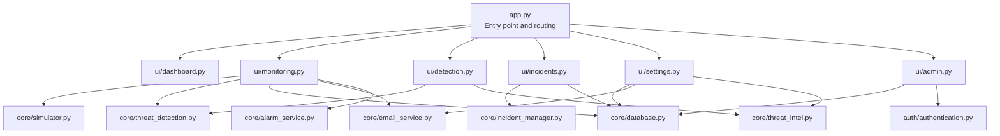
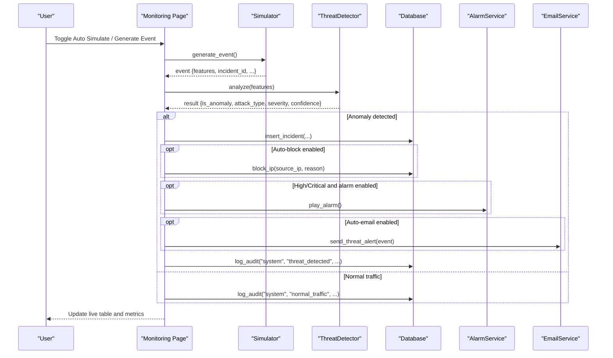
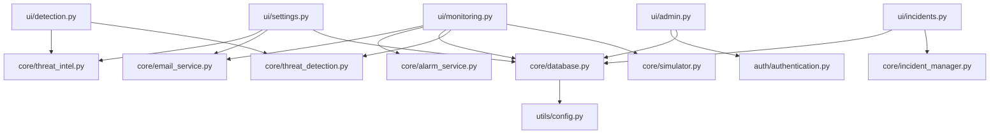
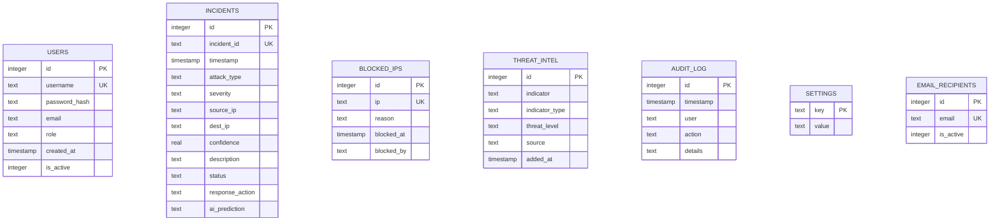

# API Reference

<cite>
**Referenced Files in This Document**
- [app.py](file://app.py)
- [authentication.py](file://auth/authentication.py)
- [database.py](file://core/database.py)
- [threat_detection.py](file://core/threat_detection.py)
- [incident_manager.py](file://core/incident_manager.py)
- [email_service.py](file://core/email_service.py)
- [alarm_service.py](file://core/alarm_service.py)
- [threat_intel.py](file://core/threat_intel.py)
- [simulator.py](file://core/simulator.py)
- [config.py](file://utils/config.py)
- [detection.py](file://ui/detection.py)
- [monitoring.py](file://ui/monitoring.py)
- [incidents.py](file://ui/incidents.py)
- [settings.py](file://ui/settings.py)
- [admin.py](file://ui/admin.py)
</cite>

## Table of Contents
1. Introduction
2. Project Structure
3. Core Components
4. Architecture Overview
5. Detailed Component Analysis
6. Dependency Analysis
7. Performance Considerations
8. Troubleshooting Guide
9. Conclusion
10. Appendices

## Introduction
This document provides comprehensive API documentation for the Autonomous AI Cyber Defense Platform. It covers:
- Database API methods for CRUD operations on incidents, blocked IPs, threat intelligence, and settings
- Threat Detection API with ML model inference endpoints
- Incident Management API for case operations (search, update status, export)
- Email Service API for notifications
- Alarm System API for audio alerts
- Authentication and session management
- Data models, validation rules, error handling strategies, and integration patterns

The application is a Streamlit-based platform that exposes functionality through UI pages which call core modules. While not a traditional REST API, this reference documents all public interfaces and their usage patterns as invoked by the UI and internal flows.

## Project Structure
The project is organized into core modules (business logic), authentication, UI pages, and utilities. The main entry point initializes the database, seeds default admin, and routes user interactions to feature-specific UI pages.

**Diagram sources**
- [app.py:102-200](file://app.py#L102-L200)
- [monitoring.py:1-133](file://ui/monitoring.py#L1-L133)
- [detection.py:1-96](file://ui/detection.py#L1-L96)
- [incidents.py:1-118](file://ui/incidents.py#L1-L118)
- [settings.py:1-99](file://ui/settings.py#L1-L99)
- [admin.py:1-109](file://ui/admin.py#L1-L109)

**Section sources**
- [app.py:1-200](file://app.py#L1-L200)

## Core Components
- Authentication module: user registration, login, password reset, user listing, deactivation, and audit logging
- Database module: SQLite schema initialization, helper functions for settings, IP blocking/unblocking, incident insertion/retrieval, threat intel, and audit logs
- Threat detection module: Isolation Forest anomaly detection and Random Forest classification with severity scoring
- Incident manager: search/filter incidents, update status, export CSV, compute stats
- Email service: SMTP configuration retrieval, recipient management, sending threat alerts
- Alarm service: plays Windows beep alarm for high/critical threats
- Threat intelligence: lookup indicators (IP/domain), add entries, list all
- Simulator: generates realistic events with features for AI analysis
- Configuration: paths, constants, severity levels, attack types, app metadata

**Section sources**
- [authentication.py:1-99](file://auth/authentication.py#L1-L99)
- [database.py:1-248](file://core/database.py#L1-L248)
- [threat_detection.py:1-147](file://core/threat_detection.py#L1-L147)
- [incident_manager.py:1-57](file://core/incident_manager.py#L1-L57)
- [email_service.py:1-92](file://core/email_service.py#L1-L92)
- [alarm_service.py:1-23](file://core/alarm_service.py#L1-L23)
- [threat_intel.py:1-31](file://core/threat_intel.py#L1-L31)
- [simulator.py:1-76](file://core/simulator.py#L1-L76)
- [config.py:1-36](file://utils/config.py#L1-L36)

## Architecture Overview
The system integrates simulation, AI detection, persistence, alerting, and UI-driven workflows. Monitoring page orchestrates event generation, AI analysis, persistence, optional auto-blocking, alarms, and email notifications.

**Diagram sources**
- [monitoring.py:91-133](file://ui/monitoring.py#L91-L133)
- [simulator.py:45-76](file://core/simulator.py#L45-L76)
- [threat_detection.py:92-127](file://core/threat_detection.py#L92-L127)
- [database.py:209-221](file://core/database.py#L209-L221)
- [database.py:167-183](file://core/database.py#L167-L183)
- [alarm_service.py:8-23](file://core/alarm_service.py#L8-L23)
- [email_service.py:37-92](file://core/email_service.py#L37-L92)

## Detailed Component Analysis

### Authentication API
Public methods:
- register_user(username, password, email, role="analyst") -> (bool, str)
- authenticate(username, password) -> dict | None
- get_all_users() -> list[dict]
- delete_user(user_id: int) -> void
- reset_user_password(username, new_password) -> void
- user_exists(username) -> bool
- get_user_email(username) -> str | None
- seed_default_admin() -> void

Parameters and return values:
- register_user: returns success flag and message; logs audit on success or failure
- authenticate: returns user row if credentials valid and active; logs successful/failed attempts
- get_all_users: returns list of users with id, username, email, role, created_at, is_active
- delete_user: soft-deletes user by setting is_active=0
- reset_user_password: updates hashed password and logs action
- user_exists: checks existence by username
- get_user_email: retrieves email for username

Error handling:
- Registration duplicates handled via exception; returns failure message
- Authentication failures logged appropriately

Usage example:
- Admin panel uses register_user to add users and reset passwords
- Login flow calls authenticate and sets session state

**Section sources**
- [authentication.py:17-99](file://auth/authentication.py#L17-L99)
- [admin.py:24-70](file://ui/admin.py#L24-L70)
- [app.py:109-121](file://app.py#L109-L121)

### Database API
Core methods:
- init_db() -> void
- get_connection() -> sqlite3.Connection
- log_audit(user, action, details="") -> void
- get_setting(key, default="") -> str
- set_setting(key, value) -> void
- block_ip(ip, reason="automated", blocked_by="system") -> void
- unblock_ip(ip) -> void
- is_ip_blocked(ip) -> bool
- get_blocked_ips_df(limit=None) -> pd.DataFrame
- get_incidents_df(limit=500) -> pd.DataFrame
- insert_incident(incident_id, attack_type, severity, source_ip, dest_ip, confidence, description, response_action, ai_prediction) -> void
- get_threat_intel_df() -> pd.DataFrame
- add_threat_intel(indicator, indicator_type, threat_level, source) -> void
- get_audit_df(limit=200) -> pd.DataFrame

Data models:
- users: id, username (unique), password_hash, email, role, created_at, is_active
- incidents: id, incident_id (unique), timestamp, attack_type, severity, source_ip, dest_ip, confidence, description, status, response_action, ai_prediction
- blocked_ips: id, ip (unique), reason, blocked_at, blocked_by
- threat_intel: id, indicator, indicator_type, threat_level, source, added_at
- audit_log: id, timestamp, user, action, details
- settings: key (PK), value

Validation rules:
- Unique constraints enforced at DB level (username, incident_id, ip)
- Defaults seeded for settings and threat intel

Error handling:
- Connection opened/closed per operation; exceptions are not propagated beyond helpers
- Duplicate inserts handled via INSERT OR IGNORE where applicable

Usage examples:
- Monitoring inserts incidents and blocks IPs
- Settings page reads/writes configuration keys
- Admin panel lists blocked IPs and audit logs

**Section sources**
- [database.py:16-136](file://core/database.py#L16-L136)
- [database.py:141-248](file://core/database.py#L141-L248)

### Threat Detection API
Class: ThreatDetector
- __init__() -> loads or trains models from data/models
- analyze(features: dict) -> dict

Input features:
- packets_per_sec: number
- failed_logins: number
- payload_size: number
- unique_ports: number
- entropy: float

Return values:
- is_anomaly: bool
- attack_type: string (from ATTACK_TYPES or "Normal")
- severity: string ("Low", "Medium", "High", "Critical")
- confidence: float rounded to 3 decimals
- anomaly_score: float rounded to 4 decimals

Model behavior:
- IsolationForest detects anomalies based on feature vector
- RandomForestClassifier predicts attack type when anomaly detected
- Severity scored using confidence and feature thresholds

Usage examples:
- Manual analysis in detection page
- Live monitoring pipeline processes simulated events

**Section sources**
- [threat_detection.py:15-147](file://core/threat_detection.py#L15-L147)
- [detection.py:15-96](file://ui/detection.py#L15-L96)
- [monitoring.py:91-133](file://ui/monitoring.py#L91-L133)

### Incident Management API
Methods:
- search_incidents(query="", severity="All", status="All", limit=500) -> pd.DataFrame
- update_incident_status(incident_id, new_status) -> void
- export_csv(df) -> str
- get_stats() -> dict

Parameters:
- query: substring match across incident_id, attack_type, source_ip, description
- severity: filter by "Low", "Medium", "High", "Critical", or "All"
- status: filter by "open", "resolved", "investigating", or "All"
- limit: max rows returned

Return values:
- search_incidents: filtered DataFrame
- get_stats: counts total, critical, high, medium, low, open, resolved

Usage examples:
- Incident Center displays filtered results and actions
- Export CSV/PDF generated from filtered data

**Section sources**
- [incident_manager.py:10-57](file://core/incident_manager.py#L10-L57)
- [incidents.py:15-118](file://ui/incidents.py#L15-L118)

### Email Service API
Methods:
- get_recipients() -> list[str]
- add_recipient(email: str) -> void
- remove_recipient(email: str) -> void
- send_threat_alert(threat_info: dict) -> bool

Parameters:
- threat_info: dict containing incident_id, attack_type, severity, source_ip, dest_ip, timestamp, confidence

Behavior:
- Retrieves SMTP settings from DB settings
- Requires configured sender email and password
- Sends formatted alert to active recipients
- Returns True on success, False on failure (missing config, no recipients, SMTP errors)

Usage examples:
- Auto-email triggered on High/Critical threats if enabled

**Section sources**
- [email_service.py:10-92](file://core/email_service.py#L10-L92)
- [monitoring.py:117-122](file://ui/monitoring.py#L117-L122)
- [settings.py:19-54](file://ui/settings.py#L19-L54)

### Alarm System API
Method:
- play_alarm(duration_ms=3000, freq=1000) -> void

Behavior:
- Plays beep sound on Windows only
- Runs in background thread
- Silently ignores unsupported platforms or errors

Usage examples:
- Triggered for High/Critical threats when alarm_enabled is true

**Section sources**
- [alarm_service.py:8-23](file://core/alarm_service.py#L8-L23)
- [monitoring.py:117-120](file://ui/monitoring.py#L117-L120)

### Threat Intelligence API
Methods:
- check_ip(ip: str) -> dict | None
- check_domain(domain: str) -> dict | None
- get_all_intel() -> pd.DataFrame
- add_intel(indicator: str, indicator_type: str, threat_level: str, source: str) -> void

Behavior:
- Queries threat_intel table by indicator and type
- Adds new indicators with metadata
- Lists all indicators ordered by added_at

Usage examples:
- Detection page shows warning if source IP matches known bad indicators
- Settings page allows adding indicators manually

**Section sources**
- [threat_intel.py:7-31](file://core/threat_intel.py#L7-L31)
- [detection.py:86-92](file://ui/detection.py#L86-L92)
- [settings.py:80-99](file://ui/settings.py#L80-L99)

### Simulation API
Methods:
- generate_event() -> dict
- generate_batch(n=10) -> list[dict]

Event structure:
- timestamp: ISO-like string
- event_type: string from EVENT_TYPES
- source_ip: external IP
- dest_ip: internal IP
- username: random username
- attack_type: string from ATTACK_TYPES
- description: human-readable description
- features: dict with packets_per_sec, failed_logins, payload_size, unique_ports, entropy
- incident_id: unique ID

Usage examples:
- Monitoring page generates single or batch events for live display

**Section sources**
- [simulator.py:45-76](file://core/simulator.py#L45-L76)
- [monitoring.py:91-98](file://ui/monitoring.py#L91-L98)

### Configuration API
Constants and defaults:
- BASE_DIR, DATA_DIR, DB_PATH, LOG_PATH
- SMTP_SERVER, SMTP_PORT, DEFAULT_ADMIN_EMAIL
- SEVERITY_LEVELS, ATTACK_TYPES
- APP_TITLE, APP_ICON, APP_VERSION

Usage:
- Used across modules for consistent configuration and labels

**Section sources**
- [config.py:1-36](file://utils/config.py#L1-L36)

## Dependency Analysis
Key dependencies and relationships:
- UI pages depend on core modules for business logic
- Core modules depend on database helpers and configuration
- Threat detection depends on ML libraries and model persistence
- Email service depends on SMTP settings stored in DB
- Alarm service is platform-specific (Windows)

**Diagram sources**
- [detection.py:1-96](file://ui/detection.py#L1-L96)
- [monitoring.py:1-133](file://ui/monitoring.py#L1-L133)
- [incidents.py:1-118](file://ui/incidents.py#L1-L118)
- [settings.py:1-99](file://ui/settings.py#L1-L99)
- [admin.py:1-109](file://ui/admin.py#L1-L109)
- [database.py:1-248](file://core/database.py#L1-L248)
- [config.py:1-36](file://utils/config.py#L1-L36)

**Section sources**
- [app.py:173-200](file://app.py#L173-L200)

## Performance Considerations
- Model loading: ThreatDetector caches models in memory via Streamlit cache_resource to avoid retraining/loading on each rerun
- Database access: Each helper opens/closes connections; consider connection pooling for high-throughput scenarios
- Event processing: Live monitoring keeps last 500 events in session state; adjust limits to balance memory and responsiveness
- Export operations: CSV/PDF generation should be limited to filtered subsets to reduce payload size
- Email sending: SMTP operations can be slow; ensure retries and timeouts are considered in production deployments

[No sources needed since this section provides general guidance]

## Troubleshooting Guide
Common issues and resolutions:
- Email not sending:
  - Ensure smtp_email and smtp_password are configured in settings
  - Verify recipients are active and exist
  - Check SMTP server/port and network connectivity
- Alarms not playing:
  - Alarm is Windows-only; verify platform
  - Ensure alarm_enabled setting is true
- Incidents not appearing:
  - Check insert_incident calls and duplicate incident_id handling
  - Validate filters in search_incidents
- Models not loaded:
  - Ensure data/models directory exists and contains trained artifacts
  - Re-run training by deleting existing model files

**Section sources**
- [email_service.py:42-92](file://core/email_service.py#L42-L92)
- [alarm_service.py:8-23](file://core/alarm_service.py#L8-L23)
- [incident_manager.py:10-57](file://core/incident_manager.py#L10-L57)
- [threat_detection.py:27-38](file://core/threat_detection.py#L27-L38)

## Conclusion
This API reference documents all public interfaces exposed by the platform’s core modules and UI integrations. The design emphasizes modularity, clear separation of concerns, and robust error handling. Integration patterns include UI-driven workflows invoking core services, with persistence and alerting mechanisms ensuring operational visibility and response automation.

[No sources needed since this section summarizes without analyzing specific files]

## Appendices

### Data Models Diagram

**Diagram sources**
- [database.py:20-100](file://core/database.py#L20-L100)

### Error Handling Strategies
- Validation: Input parameters validated before DB operations; unique constraints enforced at schema level
- Exceptions: Database operations wrapped in try/finally to ensure connection closure; exceptions logged or converted to user-friendly messages
- Graceful degradation: Email sending returns boolean status; alarms silently fail on unsupported platforms

**Section sources**
- [authentication.py:17-31](file://auth/authentication.py#L17-L31)
- [email_service.py:83-92](file://core/email_service.py#L83-L92)
- [alarm_service.py:13-22](file://core/alarm_service.py#L13-L22)

### Usage Examples
- Manual threat analysis:
  - Enter features in detection page; view AI result including anomaly status, attack type, severity, confidence
- Live monitoring:
  - Toggle auto-simulation; observe real-time events, alarms, and emails based on severity and settings
- Incident management:
  - Search/filter incidents; mark as resolved or investigating; export CSV/PDF
- Settings management:
  - Configure SMTP, recipients, alarm, simulation speed, and threat intel indicators

**Section sources**
- [detection.py:24-96](file://ui/detection.py#L24-L96)
- [monitoring.py:20-88](file://ui/monitoring.py#L20-L88)
- [incidents.py:34-82](file://ui/incidents.py#L34-L82)
- [settings.py:19-99](file://ui/settings.py#L19-L99)