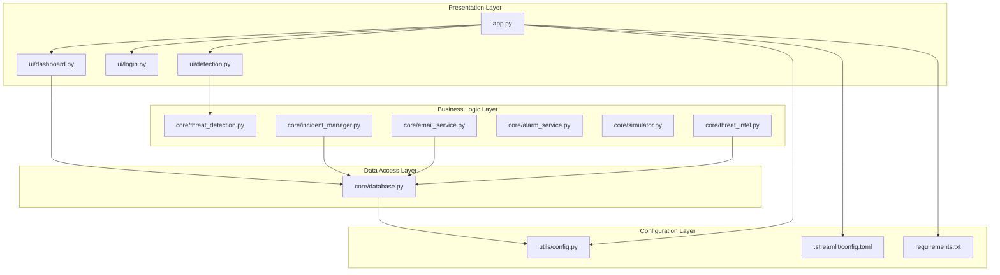
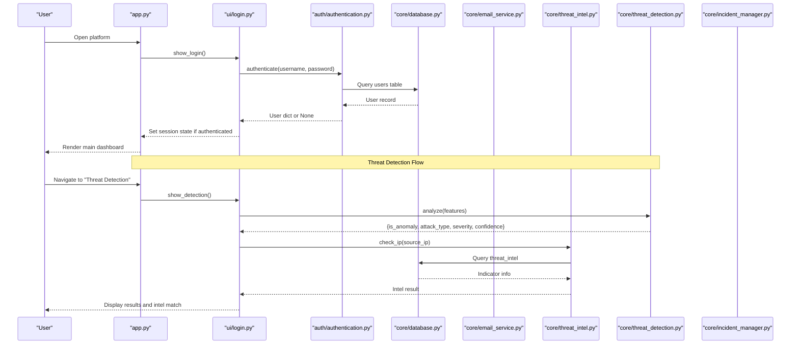
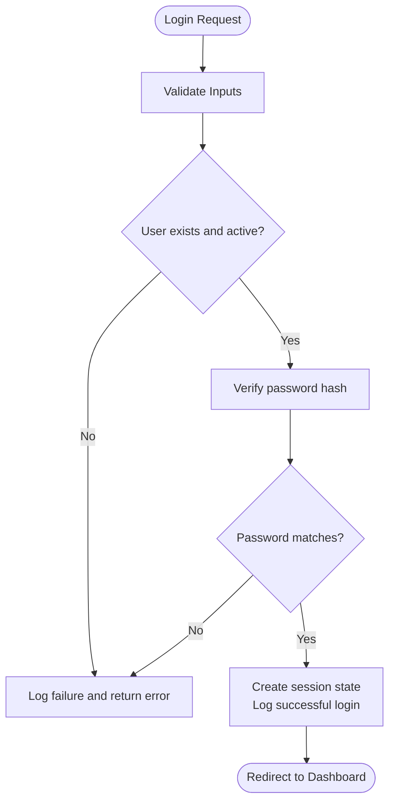
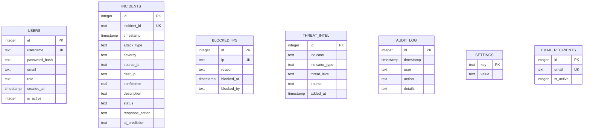
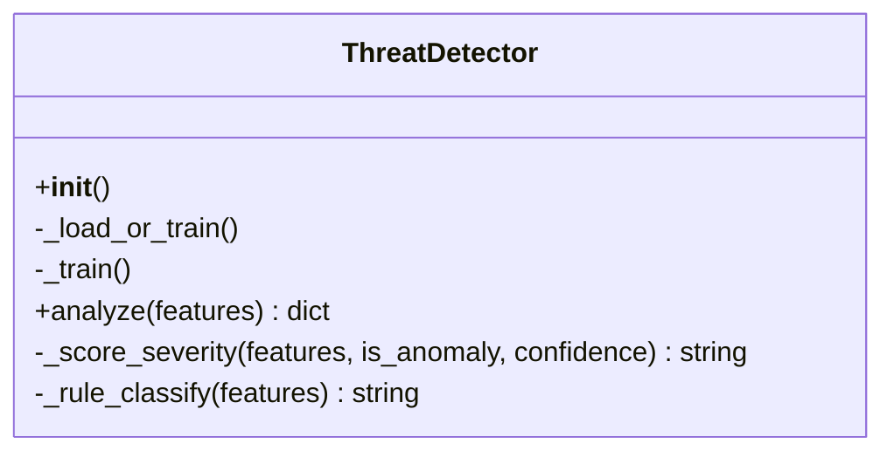
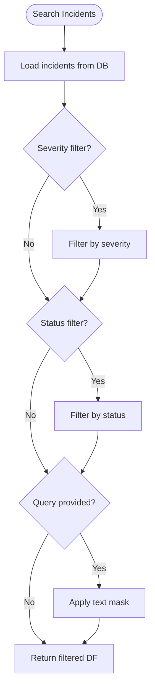
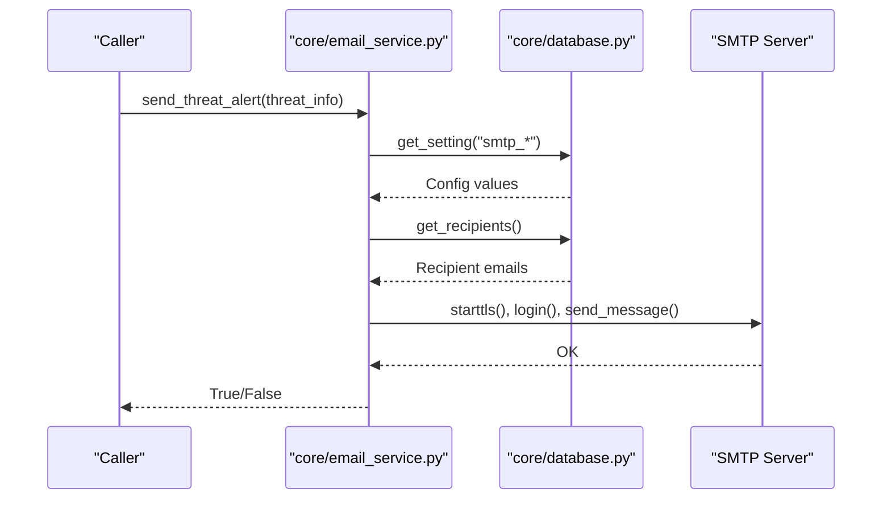
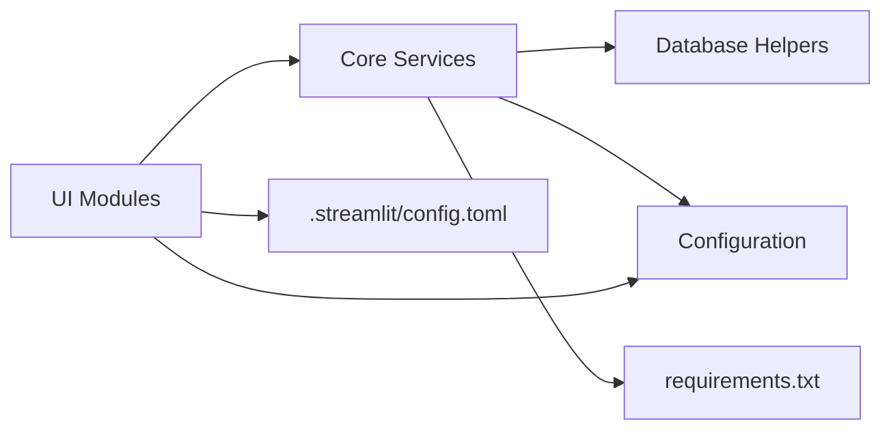

# Architecture Overview

<cite>
**Referenced Files in This Document**
- [app.py](file://app.py)
- [.streamlit/config.toml](file://.streamlit/config.toml)
- [requirements.txt](file://requirements.txt)
- [utils/config.py](file://utils/config.py)
- [core/database.py](file://core/database.py)
- [auth/authentication.py](file://auth/authentication.py)
- [core/threat_detection.py](file://core/threat_detection.py)
- [core/incident_manager.py](file://core/incident_manager.py)
- [core/email_service.py](file://core/email_service.py)
- [core/alarm_service.py](file://core/alarm_service.py)
- [core/simulator.py](file://core/simulator.py)
- [core/threat_intel.py](file://core/threat_intel.py)
- [ui/dashboard.py](file://ui/dashboard.py)
- [ui/login.py](file://ui/login.py)
- [ui/detection.py](file://ui/detection.py)
</cite>

## Table of Contents
1. Introduction
2. Project Structure
3. Core Components
4. Architecture Overview
5. Detailed Component Analysis
6. Dependency Analysis
7. Performance Considerations
8. Troubleshooting Guide
9. Conclusion

## Introduction
This document describes the architecture of the Cyber Defense Platform, a modular monolith built with Streamlit for rapid prototyping and SQLite for simplicity. The system separates concerns into:
- Presentation layer (Streamlit UI pages)
- Business logic layer (threat detection, incident management, threat intelligence, email alerts, alarms, simulation)
- Data access layer (SQLite schema and helpers)
- Configuration layer (paths, defaults, constants)

The platform ingests simulated or manual traffic features, applies ML-based anomaly detection and classification, persists incidents, and provides operational dashboards and alerting. It is designed to be easy to run locally while remaining extensible for future scaling.

## Project Structure
The repository follows a clear module layout:
- app.py: Application entry point, global theme, session state, login gate, and page router
- .streamlit/config.toml: Streamlit server and theme configuration
- requirements.txt: Python dependencies
- utils/config.py: Centralized configuration (paths, SMTP defaults, severity levels, attack types)
- core/: Business logic modules (database, threat detection, incident manager, email service, alarm service, simulator, threat intel)
- ui/: Streamlit pages (dashboard, monitoring, detection, analytics, incidents, reports, chatbot, settings, admin, login)
- auth/: Authentication utilities and user management
- data/: Runtime data directory created at startup (DB, logs, models)

**Diagram sources**
- [app.py:102-200](file://app.py#L102-L200)
- [ui/dashboard.py:1-119](file://ui/dashboard.py#L1-L119)
- [ui/login.py:1-102](file://ui/login.py#L1-L102)
- [ui/detection.py:1-96](file://ui/detection.py#L1-L96)
- [core/threat_detection.py:1-147](file://core/threat_detection.py#L1-L147)
- [core/incident_manager.py:1-57](file://core/incident_manager.py#L1-L57)
- [core/email_service.py:1-92](file://core/email_service.py#L1-L92)
- [core/alarm_service.py:1-23](file://core/alarm_service.py#L1-L23)
- [core/simulator.py:1-76](file://core/simulator.py#L1-L76)
- [core/threat_intel.py:1-31](file://core/threat_intel.py#L1-L31)
- [core/database.py:1-248](file://core/database.py#L1-L248)
- [utils/config.py:1-36](file://utils/config.py#L1-L36)
- [.streamlit/config.toml:1-14](file://.streamlit/config.toml#L1-L14)
- [requirements.txt:1-10](file://requirements.txt#L1-L10)

**Section sources**
- [app.py:1-200](file://app.py#L1-L200)
- [.streamlit/config.toml:1-14](file://.streamlit/config.toml#L1-L14)
- [requirements.txt:1-10](file://requirements.txt#L1-L10)
- [utils/config.py:1-36](file://utils/config.py#L1-L36)

## Core Components
- Presentation Layer (Streamlit UI):
  - app.py orchestrates authentication gating, sidebar navigation, and routing to feature pages.
  - ui/login.py handles login, registration, and password reset flows.
  - ui/dashboard.py displays KPIs, charts, and system resources.
  - ui/detection.py provides manual analysis via AI model inputs and threat intel lookups.

- Business Logic Layer:
  - core/threat_detection.py implements IsolationForest anomaly detection and RandomForest classification with rule-based fallbacks; persists models under data/models.
  - core/incident_manager.py provides search, status updates, CSV export, and stats aggregation over incidents.
  - core/email_service.py sends SMTP-based threat alerts using configured credentials and recipients.
  - core/alarm_service.py plays an audible alarm on Windows for high/critical threats.
  - core/simulator.py generates realistic synthetic events with feature vectors for testing and demos.
  - core/threat_intel.py queries known-bad indicators from the database.

- Data Access Layer:
  - core/database.py defines SQLite schema (users, incidents, blocked_ips, threat_intel, audit_log, settings, email_recipients), seeds defaults, and exposes helper functions for CRUD and reporting.

- Configuration Layer:
  - utils/config.py centralizes paths (DB, logs), SMTP defaults, severity levels, attack types, and app metadata.
  - .streamlit/config.toml configures Streamlit theme and server settings.
  - requirements.txt lists runtime dependencies.

**Section sources**
- [app.py:102-200](file://app.py#L102-L200)
- [ui/login.py:1-102](file://ui/login.py#L1-L102)
- [ui/dashboard.py:1-119](file://ui/dashboard.py#L1-L119)
- [ui/detection.py:1-96](file://ui/detection.py#L1-L96)
- [core/threat_detection.py:1-147](file://core/threat_detection.py#L1-L147)
- [core/incident_manager.py:1-57](file://core/incident_manager.py#L1-L57)
- [core/email_service.py:1-92](file://core/email_service.py#L1-L92)
- [core/alarm_service.py:1-23](file://core/alarm_service.py#L1-L23)
- [core/simulator.py:1-76](file://core/simulator.py#L1-L76)
- [core/threat_intel.py:1-31](file://core/threat_intel.py#L1-L31)
- [core/database.py:1-248](file://core/database.py#L1-L248)
- [utils/config.py:1-36](file://utils/config.py#L1-L36)
- [.streamlit/config.toml:1-14](file://.streamlit/config.toml#L1-L14)
- [requirements.txt:1-10](file://requirements.txt#L1-L10)

## Architecture Overview
The platform is a modular monolith where Streamlit serves as both presentation and lightweight orchestration. Requests flow through app.py to specific UI modules, which call business logic modules that interact with SQLite via core/database.py. Configuration is centralized and environment-driven where applicable.

**Diagram sources**
- [app.py:117-199](file://app.py#L117-L199)
- [ui/login.py:1-102](file://ui/login.py#L1-L102)
- [auth/authentication.py:1-99](file://auth/authentication.py#L1-L99)
- [core/database.py:1-248](file://core/database.py#L1-L248)
- [core/email_service.py:1-92](file://core/email_service.py#L1-L92)
- [core/threat_intel.py:1-31](file://core/threat_intel.py#L1-L31)
- [core/threat_detection.py:1-147](file://core/threat_detection.py#L1-L147)
- [core/incident_manager.py:1-57](file://core/incident_manager.py#L1-L57)

## Detailed Component Analysis

### Authentication and Session Management
- Password hashing and verification use bcrypt.
- Registration inserts hashed passwords and records audit entries.
- Login validates active users and logs success/failure.
- Default admin seeding ensures initial access.

**Diagram sources**
- [auth/authentication.py:33-44](file://auth/authentication.py#L33-L44)
- [auth/authentication.py:17-31](file://auth/authentication.py#L17-L31)
- [core/database.py:141-148](file://core/database.py#L141-L148)

**Section sources**
- [auth/authentication.py:1-99](file://auth/authentication.py#L1-L99)
- [core/database.py:141-148](file://core/database.py#L141-L148)

### Database Schema and Data Access
- SQLite schema includes users, incidents, blocked_ips, threat_intel, audit_log, settings, email_recipients.
- Initialization seeds default settings and threat intel indicators.
- Helper functions provide safe CRUD operations and DataFrame exports for UI consumption.

**Diagram sources**
- [core/database.py:20-100](file://core/database.py#L20-L100)

**Section sources**
- [core/database.py:1-248](file://core/database.py#L1-L248)

### Threat Detection Engine
- Uses IsolationForest for anomaly scoring and RandomForest for attack classification.
- Synthetic training data bootstraps models on first run; persisted under data/models.
- Severity scoring combines confidence and feature thresholds.

**Diagram sources**
- [core/threat_detection.py:15-147](file://core/threat_detection.py#L15-L147)

**Section sources**
- [core/threat_detection.py:1-147](file://core/threat_detection.py#L1-L147)

### Incident Management
- Search supports filtering by severity, status, and free-text query across multiple fields.
- Status updates persist changes to incidents.
- Export functionality returns CSV content for download.
- Stats aggregation computes totals and breakdowns.

**Diagram sources**
- [core/incident_manager.py:10-26](file://core/incident_manager.py#L10-L26)

**Section sources**
- [core/incident_manager.py:1-57](file://core/incident_manager.py#L1-L57)

### Email Alert Service
- Retrieves SMTP configuration from settings and recipient list from database.
- Composes structured alert body and sends via SMTP with TLS.
- Returns success/failure and logs errors.

**Diagram sources**
- [core/email_service.py:37-92](file://core/email_service.py#L37-L92)
- [core/database.py:151-164](file://core/database.py#L151-L164)

**Section sources**
- [core/email_service.py:1-92](file://core/email_service.py#L1-L92)

### Alarm Service
- Plays a beep sound on Windows for high/critical threats using a background thread.
- Non-Windows platforms are gracefully ignored.

**Section sources**
- [core/alarm_service.py:1-23](file://core/alarm_service.py#L1-L23)

### Attack Simulator
- Generates realistic events with random IPs, usernames, event types, and feature vectors.
- Provides single-event and batch generation utilities.

**Section sources**
- [core/simulator.py:1-76](file://core/simulator.py#L1-L76)

### Threat Intelligence Lookup
- Queries threat_intel table by IP or domain.
- Supports retrieving all indicators and adding new ones.

**Section sources**
- [core/threat_intel.py:1-31](file://core/threat_intel.py#L1-L31)

### UI Pages and Routing
- app.py sets global theme, initializes DB and admin seed, manages session state, and routes to feature pages based on sidebar selection.
- ui/dashboard.py renders KPI cards, severity distribution chart, and system resource gauges.
- ui/detection.py integrates ThreatDetector and threat intel checks.

**Section sources**
- [app.py:1-200](file://app.py#L1-L200)
- [ui/dashboard.py:1-119](file://ui/dashboard.py#L1-L119)
- [ui/detection.py:1-96](file://ui/detection.py#L1-L96)

## Dependency Analysis
High-level dependencies between layers:
- UI depends on core services for data and processing.
- Core services depend on database helpers and configuration.
- Configuration centralizes constants and paths used across components.

**Diagram sources**
- [app.py:102-200](file://app.py#L102-L200)
- [core/database.py:1-248](file://core/database.py#L1-L248)
- [utils/config.py:1-36](file://utils/config.py#L1-L36)
- [.streamlit/config.toml:1-14](file://.streamlit/config.toml#L1-L14)
- [requirements.txt:1-10](file://requirements.txt#L1-L10)

**Section sources**
- [app.py:102-200](file://app.py#L102-L200)
- [core/database.py:1-248](file://core/database.py#L1-L248)
- [utils/config.py:1-36](file://utils/config.py#L1-L36)
- [.streamlit/config.toml:1-14](file://.streamlit/config.toml#L1-L14)
- [requirements.txt:1-10](file://requirements.txt#L1-L10)

## Performance Considerations
- SQLite is simple and sufficient for local development and small-scale deployments but may become a bottleneck under high concurrency. Consider connection pooling or migrating to a client-server RDBMS for scale.
- Streamlit re-executes scripts per interaction; caching with @st.cache_resource reduces repeated initialization costs for heavy objects like ML models.
- Model persistence avoids retraining on every run; ensure data/models directory is writable.
- Use pagination or limit clauses when querying large datasets to avoid memory pressure.
- Background threads for alarms should not block UI rendering; keep them lightweight.

[No sources needed since this section provides general guidance]

## Troubleshooting Guide
- Authentication failures:
  - Ensure users table has active accounts and passwords are correctly hashed.
  - Audit log captures login attempts and failures for diagnostics.

- Email alerts not sent:
  - Verify smtp_email and smtp_password are set in settings.
  - Confirm recipients exist and are active in email_recipients.
  - Check network connectivity and SMTP server availability.

- Models not loading:
  - Ensure data/models/anomaly_model.pkl and classifier.pkl exist.
  - If missing, the detector will train on synthetic data on first run.

- Database issues:
  - Run init_db() to create tables and seed defaults.
  - Inspect DB_PATH and DATA_DIR permissions.

- UI performance:
  - Avoid heavy computations inside render loops; cache expensive results.
  - Limit returned rows for large tables.

**Section sources**
- [auth/authentication.py:33-44](file://auth/authentication.py#L33-L44)
- [core/database.py:141-148](file://core/database.py#L141-L148)
- [core/email_service.py:37-92](file://core/email_service.py#L37-L92)
- [core/threat_detection.py:27-37](file://core/threat_detection.py#L27-L37)
- [core/database.py:16-136](file://core/database.py#L16-L136)

## Conclusion
The Cyber Defense Platform demonstrates a clean separation of concerns within a modular monolith. Streamlit enables rapid iteration of the UI, SQLite simplifies deployment, and scikit-learn provides practical ML capabilities. With centralized configuration, robust authentication, and comprehensive data access helpers, the system balances ease of use with extensibility. For production scaling, consider moving to a managed database, introducing asynchronous processing, and enhancing security controls such as token-based sessions and rate limiting.

[No sources needed since this section summarizes without analyzing specific files]