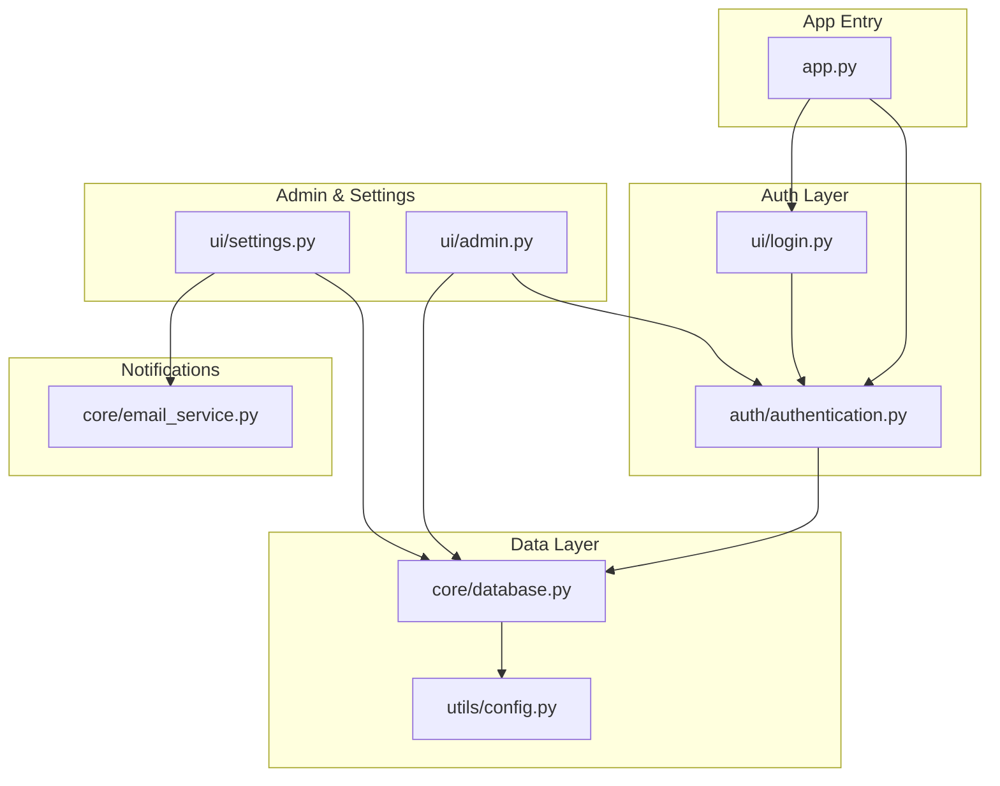
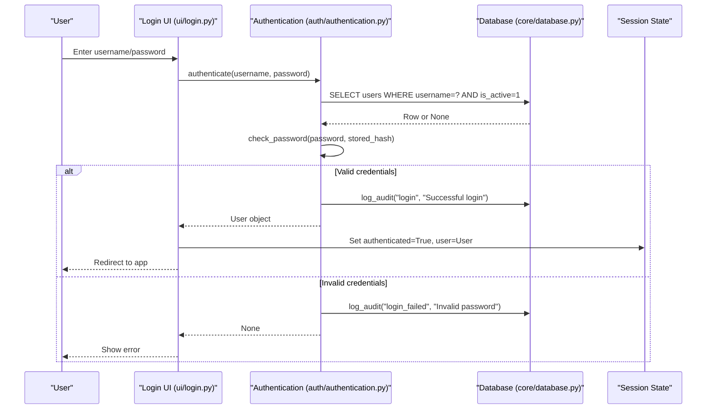
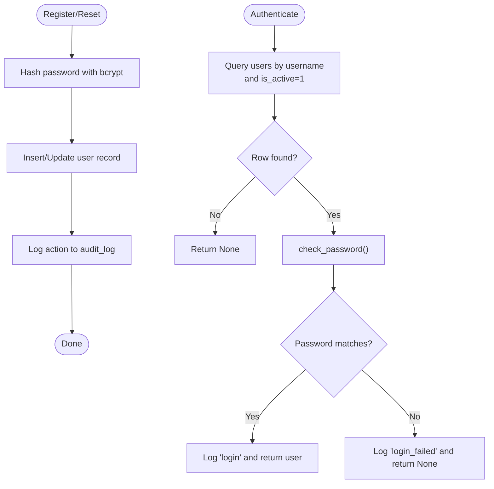
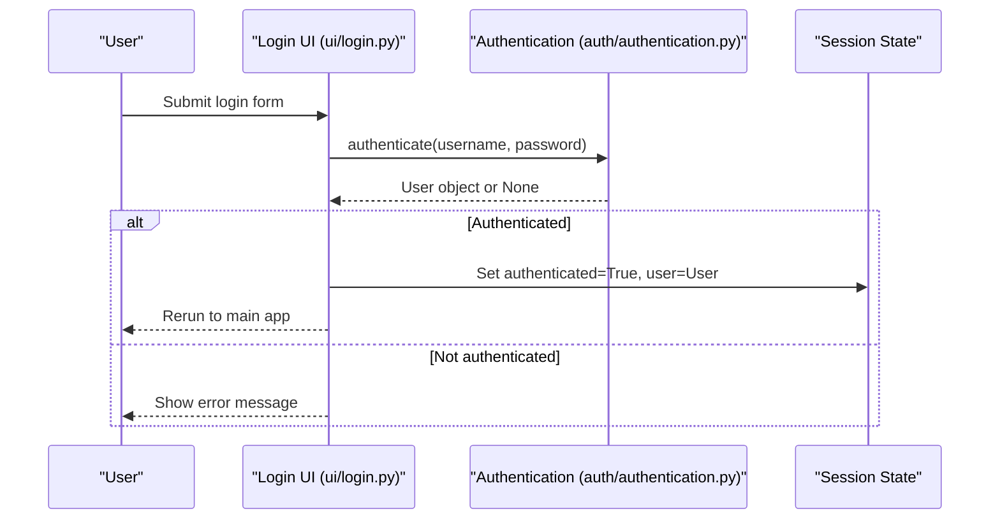
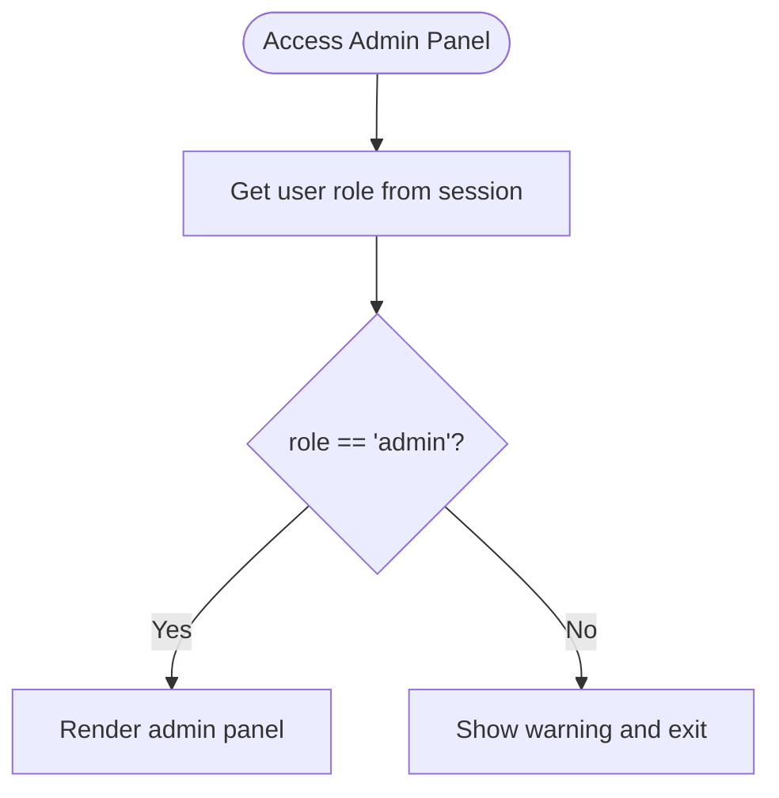
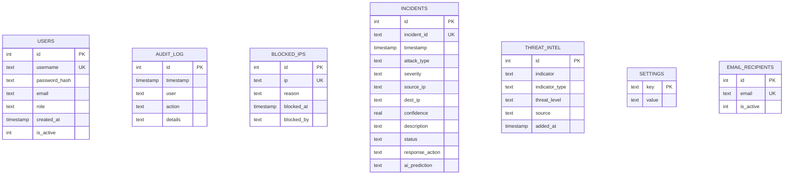
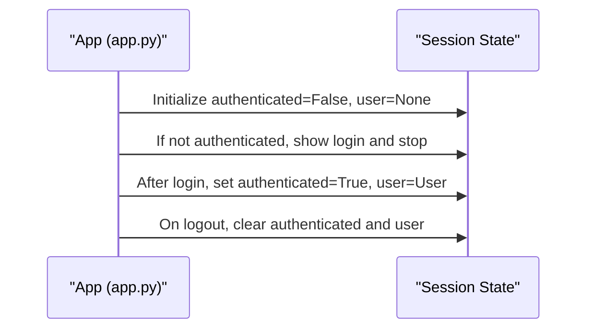
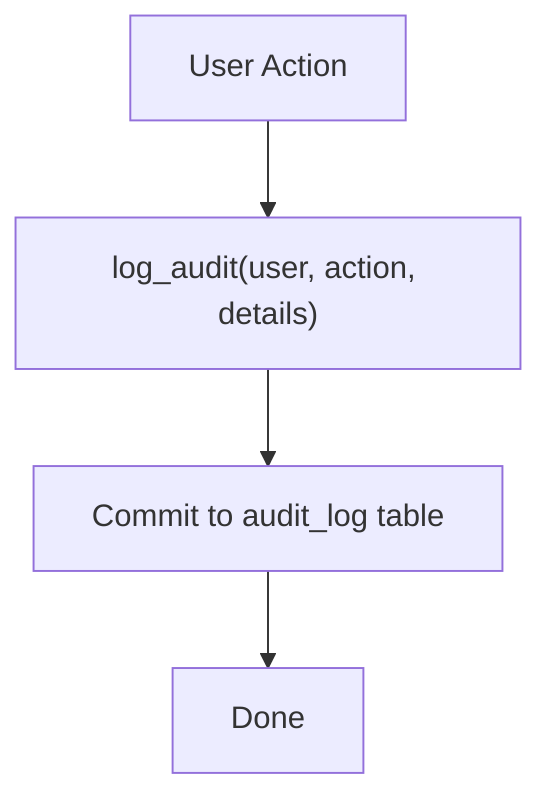
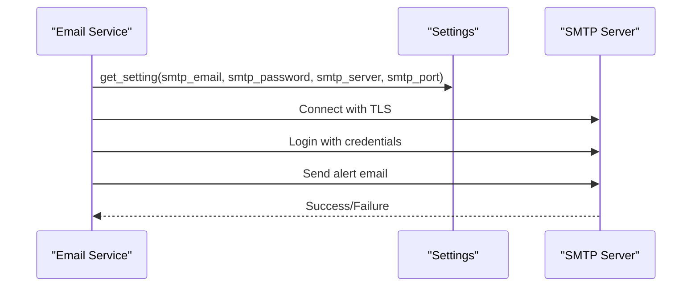
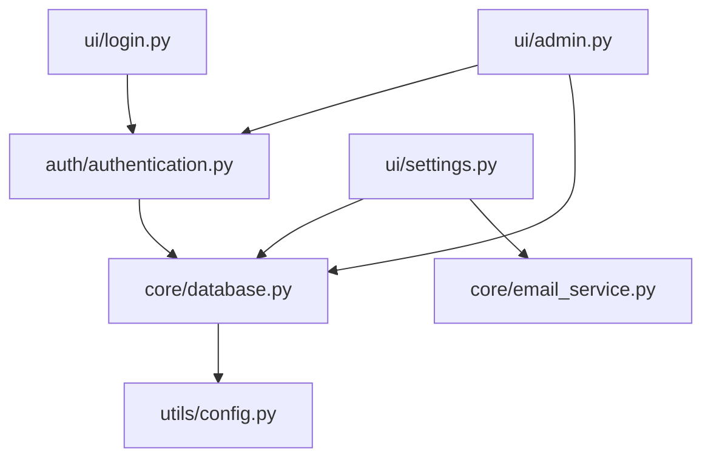

# Authentication & Security

<cite>
**Referenced Files in This Document**
- [app.py](file://app.py)
- [authentication.py](file://auth/authentication.py)
- [login.py](file://ui/login.py)
- [database.py](file://core/database.py)
- [email_service.py](file://core/email_service.py)
- [config.py](file://utils/config.py)
- [admin.py](file://ui/admin.py)
- [settings.py](file://ui/settings.py)
</cite>

## Table of Contents
1. [Introduction](#introduction)
2. [Project Structure](#project-structure)
3. [Core Components](#core-components)
4. [Architecture Overview](#architecture-overview)
5. [Detailed Component Analysis](#detailed-component-analysis)
6. [Dependency Analysis](#dependency-analysis)
7. [Performance Considerations](#performance-considerations)
8. [Troubleshooting Guide](#troubleshooting-guide)
9. [Conclusion](#conclusion)
10. [Appendices](#appendices)

## Introduction
This document provides comprehensive security documentation for the application’s authentication system and related security implementations. It covers user registration and login, role-based access control (RBAC), password hashing with bcrypt, session management, audit logging, input validation, SQL injection prevention, secure communication patterns, configuration options for security parameters, user management procedures, and security monitoring capabilities. It also outlines common security considerations and mitigation strategies.

## Project Structure
The authentication and security logic is implemented across a small set of focused modules:
- Authentication module handles password hashing, user registration, login, and basic user operations.
- Database module defines schema, parameterized queries, and audit logging helpers.
- UI login page orchestrates user-facing flows for login, registration, and password reset.
- Admin panel enforces RBAC and manages users, IP blocking, and audit logs.
- Settings page configures email, alarms, simulation controls, and threat intelligence.
- Email service sends alerts via SMTP using TLS.
- Configuration module centralizes paths and defaults.
- Application entrypoint initializes database, seeds default admin, and gates access behind session-based authentication.

**Diagram sources**
- [app.py:101-120](file://app.py#L101-L120)
- [authentication.py:1-99](file://auth/authentication.py#L1-L99)
- [login.py:1-102](file://ui/login.py#L1-L102)
- [database.py:1-248](file://core/database.py#L1-L248)
- [config.py:1-36](file://utils/config.py#L1-L36)
- [admin.py:1-109](file://ui/admin.py#L1-L109)
- [settings.py:1-99](file://ui/settings.py#L1-L99)
- [email_service.py:1-92](file://core/email_service.py#L1-L92)

**Section sources**
- [app.py:101-120](file://app.py#L101-L120)
- [authentication.py:1-99](file://auth/authentication.py#L1-L99)
- [login.py:1-102](file://ui/login.py#L1-L102)
- [database.py:1-248](file://core/database.py#L1-L248)
- [config.py:1-36](file://utils/config.py#L1-L36)
- [admin.py:1-109](file://ui/admin.py#L1-L109)
- [settings.py:1-99](file://ui/settings.py#L1-L99)
- [email_service.py:1-92](file://core/email_service.py#L1-L92)

## Core Components
- Password hashing and verification: Uses bcrypt to hash and verify passwords securely.
- User registration: Inserts hashed passwords into the users table and logs the event.
- Login flow: Validates credentials against stored hashes and records successful/failed attempts.
- Session management: Streamlit session state tracks authenticated status and current user.
- Role-based access control: Enforced at UI boundaries (e.g., admin-only features).
- Audit logging: Centralized logging of key actions (register, login, logout, password reset, IP block/unblock).
- Secure communications: SMTP over TLS for alert emails.
- Input validation: Client-side checks in UI; parameterized SQL prevents injection.
- Configuration: Centralized settings for SMTP, alarms, auto-block, and simulation speed.

**Section sources**
- [authentication.py:9-14](file://auth/authentication.py#L9-L14)
- [authentication.py:17-30](file://auth/authentication.py#L17-L30)
- [authentication.py:33-44](file://auth/authentication.py#L33-L44)
- [app.py:108-120](file://app.py#L108-L120)
- [admin.py:12-16](file://ui/admin.py#L12-L16)
- [database.py:141-148](file://core/database.py#L141-L148)
- [email_service.py:37-91](file://core/email_service.py#L37-L91)
- [login.py:66-78](file://ui/login.py#L66-L78)
- [settings.py:20-34](file://ui/settings.py#L20-L34)

## Architecture Overview
The authentication architecture follows a layered approach:
- Presentation layer (Streamlit UI) collects inputs and renders pages.
- Authentication layer validates credentials and manages sessions.
- Data layer persists users, incidents, blocked IPs, threat intel, and audit logs.
- Notification layer sends alerts via SMTP with TLS.

**Diagram sources**
- [login.py:45-54](file://ui/login.py#L45-L54)
- [authentication.py:33-44](file://auth/authentication.py#L33-L44)
- [database.py:141-148](file://core/database.py#L141-L148)
- [app.py:116-120](file://app.py#L116-L120)

## Detailed Component Analysis

### Authentication Module
- Password hashing uses bcrypt with salt generation and constant-time comparison.
- Registration inserts a new user with hashed password and logs the action.
- Authentication queries active users by username, verifies password, and logs success/failure.
- Utility functions manage user existence, email retrieval, deactivation, and password resets.
- Default admin seeding ensures an initial admin account exists if none is present.

**Diagram sources**
- [authentication.py:9-14](file://auth/authentication.py#L9-L14)
- [authentication.py:17-30](file://auth/authentication.py#L17-L30)
- [authentication.py:33-44](file://auth/authentication.py#L33-L44)
- [authentication.py:63-71](file://auth/authentication.py#L63-L71)
- [authentication.py:89-99](file://auth/authentication.py#L89-L99)

**Section sources**
- [authentication.py:9-14](file://auth/authentication.py#L9-L14)
- [authentication.py:17-30](file://auth/authentication.py#L17-L30)
- [authentication.py:33-44](file://auth/authentication.py#L33-L44)
- [authentication.py:47-78](file://auth/authentication.py#L47-L78)
- [authentication.py:89-99](file://auth/authentication.py#L89-L99)

### Login UI Flow
- The login tab authenticates users and sets session state upon success.
- The register tab validates inputs (required fields, password match, minimum length) before calling registration.
- The forgot password tab allows resetting passwords for existing usernames.

**Diagram sources**
- [login.py:38-54](file://ui/login.py#L38-L54)
- [authentication.py:33-44](file://auth/authentication.py#L33-L44)
- [app.py:116-120](file://app.py#L116-L120)

**Section sources**
- [login.py:38-54](file://ui/login.py#L38-L54)
- [login.py:57-78](file://ui/login.py#L57-L78)
- [login.py:81-92](file://ui/login.py#L81-L92)

### Role-Based Access Control (RBAC)
- Admin-only features are guarded by checking the user’s role from session state.
- Non-admin users attempting to access admin features receive a warning and are denied.

**Diagram sources**
- [admin.py:12-16](file://ui/admin.py#L12-L16)

**Section sources**
- [admin.py:12-16](file://ui/admin.py#L12-L16)

### Database Schema and SQL Injection Prevention
- All database interactions use parameterized queries with placeholders to prevent SQL injection.
- Schema includes tables for users, incidents, blocked_ips, threat_intel, audit_log, settings, and email_recipients.
- Audit logging captures user, action, and details for compliance and monitoring.

**Diagram sources**
- [database.py:20-100](file://core/database.py#L20-L100)

**Section sources**
- [database.py:10-13](file://core/database.py#L10-L13)
- [database.py:141-148](file://core/database.py#L141-L148)
- [database.py:167-190](file://core/database.py#L167-L190)
- [database.py:200-248](file://core/database.py#L200-L248)

### Session Management
- Streamlit session state stores authentication flags and user data.
- On successful login, session variables are set and the app reruns to render authenticated UI.
- Logout clears session variables and logs the action.

**Diagram sources**
- [app.py:108-120](file://app.py#L108-L120)
- [app.py:165-170](file://app.py#L165-L170)

**Section sources**
- [app.py:108-120](file://app.py#L108-L120)
- [app.py:165-170](file://app.py#L165-L170)

### Audit Logging
- Key events logged include registration, login, failed login, logout, password reset, and IP block/unblock.
- Audit entries capture timestamp, user, action, and details.

**Diagram sources**
- [database.py:141-148](file://core/database.py#L141-L148)
- [authentication.py:25](file://auth/authentication.py#L25)
- [authentication.py:40](file://auth/authentication.py#L40)
- [authentication.py:43](file://auth/authentication.py#L43)
- [authentication.py:71](file://auth/authentication.py#L71)
- [admin.py:58](file://ui/admin.py#L58)
- [admin.py:81](file://ui/admin.py#L81)
- [admin.py:95](file://ui/admin.py#L95)
- [app.py:167](file://app.py#L167)

**Section sources**
- [database.py:141-148](file://core/database.py#L141-L148)
- [authentication.py:25](file://auth/authentication.py#L25)
- [authentication.py:40](file://auth/authentication.py#L40)
- [authentication.py:43](file://auth/authentication.py#L43)
- [authentication.py:71](file://auth/authentication.py#L71)
- [admin.py:58](file://ui/admin.py#L58)
- [admin.py:81](file://ui/admin.py#L81)
- [admin.py:95](file://ui/admin.py#L95)
- [app.py:167](file://app.py#L167)

### Secure Communication Patterns
- Email alerts are sent via SMTP with TLS encryption.
- Credentials are read from settings and used to authenticate to the SMTP server.

**Diagram sources**
- [email_service.py:37-91](file://core/email_service.py#L37-L91)

**Section sources**
- [email_service.py:37-91](file://core/email_service.py#L37-L91)

### Configuration Options for Security Parameters
- SMTP settings: server, port, sender email, app password, auto-email toggle.
- Alarm settings: enable/disable alarms for High/Critical threats.
- Simulation settings: auto-block malicious IPs and simulation speed.
- Threat intelligence: add indicators with type, level, and source.

**Section sources**
- [settings.py:20-34](file://ui/settings.py#L20-L34)
- [settings.py:57-77](file://ui/settings.py#L57-L77)
- [settings.py:80-99](file://ui/settings.py#L80-L99)
- [config.py:18-21](file://utils/config.py#L18-L21)

### User Management Procedures
- Add users via admin panel with username, email, password, and role selection.
- Deactivate users by setting is_active flag.
- Reset user passwords through admin panel or forgot password flow.
- View all users and their metadata.

**Section sources**
- [admin.py:24-41](file://ui/admin.py#L24-L41)
- [admin.py:43-70](file://ui/admin.py#L43-L70)
- [authentication.py:47-71](file://auth/authentication.py#L47-L71)
- [login.py:81-92](file://ui/login.py#L81-L92)

## Dependency Analysis
The authentication and security components have clear dependencies:
- UI layers depend on authentication and database modules.
- Authentication depends on database for persistence and audit logging.
- Settings and admin panels interact with database and email services.
- Configuration module centralizes paths and defaults.

**Diagram sources**
- [login.py:5-8](file://ui/login.py#L5-L8)
- [admin.py:6-9](file://ui/admin.py#L6-L9)
- [settings.py:4-7](file://ui/settings.py#L4-L7)
- [authentication.py:5-6](file://auth/authentication.py#L5-L6)
- [database.py:7](file://core/database.py#L7)

**Section sources**
- [login.py:5-8](file://ui/login.py#L5-L8)
- [admin.py:6-9](file://ui/admin.py#L6-L9)
- [settings.py:4-7](file://ui/settings.py#L4-L7)
- [authentication.py:5-6](file://auth/authentication.py#L5-L6)
- [database.py:7](file://core/database.py#L7)

## Performance Considerations
- Password hashing with bcrypt is intentionally slow to resist brute-force attacks; ensure adequate resource allocation during high-volume registrations.
- Parameterized queries avoid overhead from string concatenation and reduce risk of injection-related errors.
- Audit logging writes incrementally; consider batching or asynchronous logging for high-throughput environments.
- SMTP email sending can be slow; implement retries and timeouts to avoid blocking UI operations.

[No sources needed since this section provides general guidance]

## Troubleshooting Guide
- Login failures: Check audit logs for “login_failed” entries and verify user is active.
- Registration errors: Ensure unique usernames and valid email formats; review exceptions in registration flow.
- Password reset issues: Confirm username exists and new password meets requirements.
- Email alerts: Validate SMTP settings and credentials; check network connectivity and TLS configuration.
- Admin access: Ensure user role is “admin”; non-admin users will see warnings.

**Section sources**
- [authentication.py:33-44](file://auth/authentication.py#L33-L44)
- [authentication.py:17-30](file://auth/authentication.py#L17-L30)
- [authentication.py:63-71](file://auth/authentication.py#L63-L71)
- [email_service.py:37-91](file://core/email_service.py#L37-L91)
- [admin.py:12-16](file://ui/admin.py#L12-L16)

## Conclusion
The application implements a robust authentication and security framework using bcrypt for password hashing, parameterized SQL queries to prevent injection, session-based access control, and comprehensive audit logging. Role-based restrictions protect sensitive administrative functions, while secure SMTP communication ensures reliable alerting. Configuration options allow operators to tailor security behaviors such as auto-blocking and alarm thresholds. Continuous monitoring via audit logs supports incident response and compliance.

[No sources needed since this section summarizes without analyzing specific files]

## Appendices

### Security Best Practices Implemented
- Password hashing with bcrypt and salt generation.
- Parameterized SQL queries to prevent injection.
- Session-based authentication with explicit login gate.
- Role-based access control enforced at UI boundaries.
- Audit logging for critical actions.
- TLS-enabled SMTP for secure email delivery.
- Input validation in UI forms.

**Section sources**
- [authentication.py:9-14](file://auth/authentication.py#L9-L14)
- [database.py:141-148](file://core/database.py#L141-L148)
- [app.py:116-120](file://app.py#L116-L120)
- [admin.py:12-16](file://ui/admin.py#L12-L16)
- [email_service.py:84-87](file://core/email_service.py#L84-L87)
- [login.py:66-78](file://ui/login.py#L66-L78)

### Common Security Considerations and Mitigations
- Brute force attacks: Implement account lockout after repeated failures and CAPTCHA challenges.
- Credential stuffing: Enforce strong password policies and consider multi-factor authentication.
- Session hijacking: Use secure cookies and short-lived sessions; invalidate on logout.
- XSS and CSRF: Sanitize outputs and enforce Content Security Policy headers.
- Data exposure: Encrypt sensitive data at rest and in transit; limit access to audit logs.

[No sources needed since this section provides general guidance]