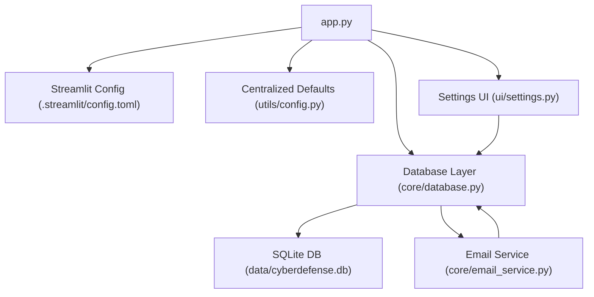
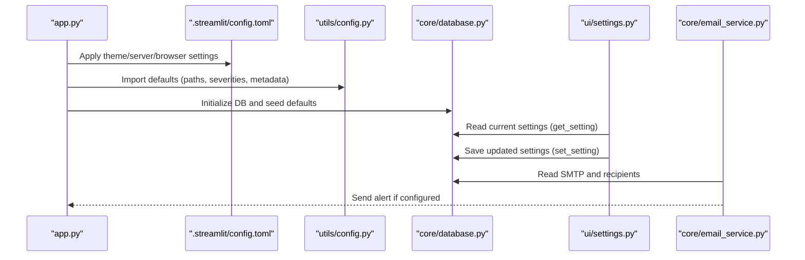
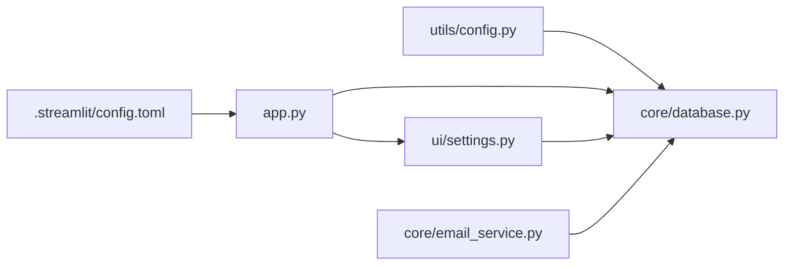

# Configuration & Settings

<cite>
**Referenced Files in This Document**
- [utils/config.py](file://utils/config.py)
- [.streamlit/config.toml](file://.streamlit/config.toml)
- [ui/settings.py](file://ui/settings.py)
- [core/database.py](file://core/database.py)
- [core/email_service.py](file://core/email_service.py)
- [app.py](file://app.py)
- [requirements.txt](file://requirements.txt)
</cite>

## Table of Contents
1. [Introduction](#introduction)
2. [Project Structure](#project-structure)
3. [Core Components](#core-components)
4. [Architecture Overview](#architecture-overview)
5. [Detailed Component Analysis](#detailed-component-analysis)
6. [Dependency Analysis](#dependency-analysis)
7. [Performance Considerations](#performance-considerations)
8. [Troubleshooting Guide](#troubleshooting-guide)
9. [Conclusion](#conclusion)
10. [Appendices](#appendices)

## Introduction
This document explains the configuration and settings system for the application. It covers:
- Centralized configuration constants and defaults in utils/config.py
- Streamlit-specific runtime settings in .streamlit/config.toml
- Runtime settings management through the UI (Settings page)
- Environment variables usage
- Database connection parameters
- Email service configuration
- Security-related parameters
- Common configuration scenarios, environment-specific setups, and troubleshooting steps
- Programmatic configuration methods via the database layer

The goal is to help you configure, customize, and troubleshoot the platform effectively across development, testing, and production environments.

## Project Structure
Configuration spans multiple layers:
- Static defaults and paths are defined in utils/config.py
- Streamlit server and theme options are defined in .streamlit/config.toml
- Runtime user-configurable settings are stored in a SQLite database and managed via the Settings UI
- Email alerts use SMTP credentials and recipients configured at runtime

**Diagram sources**
- [app.py:1-200](file://app.py#L1-L200)
- [.streamlit/config.toml:1-14](file://.streamlit/config.toml#L1-L14)
- [utils/config.py:1-36](file://utils/config.py#L1-L36)
- [core/database.py:1-248](file://core/database.py#L1-L248)
- [core/email_service.py:1-92](file://core/email_service.py#L1-L92)
- [ui/settings.py:1-99](file://ui/settings.py#L1-L99)

**Section sources**
- [app.py:1-200](file://app.py#L1-L200)
- [.streamlit/config.toml:1-14](file://.streamlit/config.toml#L1-L14)
- [utils/config.py:1-36](file://utils/config.py#L1-L36)
- [core/database.py:1-248](file://core/database.py#L1-L248)
- [core/email_service.py:1-92](file://core/email_service.py#L1-L92)
- [ui/settings.py:1-99](file://ui/settings.py#L1-L99)

## Core Components
- Centralized configuration (utils/config.py): Defines base paths, default email server/port, admin email from environment, severity levels, attack types, and app metadata.
- Streamlit configuration (.streamlit/config.toml): Controls theme colors, server headless mode, port, and browser telemetry.
- Settings UI (ui/settings.py): Provides tabs for Email, Alarm, Simulation, and Threat Intel; persists values to the database.
- Database layer (core/database.py): Initializes schema, seeds default settings, and exposes get_setting/set_setting for runtime configuration.
- Email service (core/email_service.py): Reads SMTP settings and recipients from the database to send threat alerts.

Key responsibilities:
- Static defaults and paths: utils/config.py
- Streamlit runtime behavior: .streamlit/config.toml
- User-driven configuration persistence: core/database.py
- UI for editing settings: ui/settings.py
- Alert delivery using SMTP: core/email_service.py

**Section sources**
- [utils/config.py:1-36](file://utils/config.py#L1-L36)
- [.streamlit/config.toml:1-14](file://.streamlit/config.toml#L1-L14)
- [ui/settings.py:1-99](file://ui/settings.py#L1-L99)
- [core/database.py:1-248](file://core/database.py#L1-L248)
- [core/email_service.py:1-92](file://core/email_service.py#L1-L92)

## Architecture Overview
The configuration architecture combines static defaults, Streamlit runtime config, and persistent runtime settings:

**Diagram sources**
- [app.py:1-200](file://app.py#L1-L200)
- [.streamlit/config.toml:1-14](file://.streamlit/config.toml#L1-L14)
- [utils/config.py:1-36](file://utils/config.py#L1-L36)
- [core/database.py:1-248](file://core/database.py#L1-L248)
- [ui/settings.py:1-99](file://ui/settings.py#L1-L99)
- [core/email_service.py:1-92](file://core/email_service.py#L1-L92)

## Detailed Component Analysis

### Centralized Configuration (utils/config.py)
Purpose:
- Define base directories and data file locations
- Provide default SMTP server and port
- Load default admin email from an environment variable
- Enumerate severity levels and attack types
- Store app metadata used by the UI

Key elements:
- Base directory and data directory creation
- Database path and log CSV path
- Default SMTP server and port
- Admin email sourced from environment variable
- Severity levels and attack type lists
- Application title, icon, and version

Common customization:
- Change data directory location by modifying BASE_DIR
- Override SMTP defaults if needed elsewhere in code
- Set ADMIN_EMAIL environment variable to control default admin email

Environment variables:
- ADMIN_EMAIL: Used to set the default administrator email address

Notes:
- The module does not read .env files directly; it uses os.environ.get for ADMIN_EMAIL
- Other dependencies can import this module to access centralized constants

**Section sources**
- [utils/config.py:1-36](file://utils/config.py#L1-L36)

### Streamlit Configuration (.streamlit/config.toml)
Purpose:
- Configure Streamlit’s theme colors and fonts
- Control server behavior (headless mode, port)
- Disable browser usage statistics

Key settings:
- Theme colors and font
- Server headless and port
- Browser telemetry flag

Environment-specific setup:
- Development: Set port to 8501 or another local port
- Production: Keep headless true and bind to appropriate ports via deployment configuration

Notes:
- Changes require restarting the Streamlit process to take effect
- These settings do not affect application logic beyond UI appearance and server behavior

**Section sources**
- [.streamlit/config.toml:1-14](file://.streamlit/config.toml#L1-L14)

### Runtime Settings Management (ui/settings.py)
Purpose:
- Provide a tabbed interface to manage email, alarm, simulation, and threat intelligence settings
- Persist changes to the database via get_setting/set_setting
- Manage email recipients list

Tabs and controls:
- Email: SMTP server, port, sender email, app password, auto-send toggle
- Alarm: Enable/disable alarms for High/Critical threats
- Simulation: Auto-block malicious IPs, simulation speed slider
- Threat Intel: View and add indicators (IP/domain/country), with threat level and source

Data flow:
- On load, fields are populated from database defaults
- On save, values are written back to the database
- Recipients can be added/removed and reflected immediately

Security considerations:
- Passwords are entered via a secure input field
- Values are stored in the database; ensure database protection in production

**Section sources**
- [ui/settings.py:1-99](file://ui/settings.py#L1-L99)

### Database Layer (core/database.py)
Purpose:
- Initialize SQLite schema including users, incidents, blocked_ips, threat_intel, audit_log, settings, and email_recipients
- Seed default settings and threat intel entries
- Provide helper functions to read/write settings and manage entities

Key tables:
- settings: key-value pairs for runtime configuration
- email_recipients: active recipient emails for alerts
- Others: users, incidents, blocked_ips, threat_intel, audit_log

Default settings seeded:
- smtp_server, smtp_port, smtp_email, smtp_password
- alarm_enabled, auto_block, auto_email, simulation_speed

Programmatic configuration:
- get_setting(key, default="") returns value or default
- set_setting(key, value) updates or inserts a setting

Data persistence:
- SQLite database located at data/cyberdefense.db (from utils/config.py)

Operational notes:
- init_db() must run before any settings are accessed
- All connections are closed after operations

**Section sources**
- [core/database.py:1-248](file://core/database.py#L1-L248)

### Email Service (core/email_service.py)
Purpose:
- Send threat alerts via SMTP using settings stored in the database
- Manage recipients list

Behavior:
- Reads smtp_email, smtp_password, smtp_server, smtp_port from settings
- Requires at least one active recipient
- Constructs alert body with incident details
- Connects via SMTP, starts TLS, authenticates, and sends message
- Returns success/failure status

Error handling:
- If credentials missing or no recipients, returns False
- Exceptions during SMTP send are caught and logged

Integration points:
- Uses get_setting to retrieve SMTP configuration
- Uses get_connection to fetch recipients

**Section sources**
- [core/email_service.py:1-92](file://core/email_service.py#L1-L92)

### Application Entry Point (app.py)
Purpose:
- Configure Streamlit page layout and global CSS
- Initialize database and seed default admin
- Gate unauthenticated access
- Route navigation to different UI modules including Settings

Initialization sequence:
- Page config and CSS applied
- Database initialized and admin seeded
- Session state defaults set
- Login gate enforced
- Sidebar navigation renders pages

Settings integration:
- When navigating to Settings, show_settings is invoked

**Section sources**
- [app.py:1-200](file://app.py#L1-L200)

## Dependency Analysis
Configuration dependencies and relationships:

- utils/config.py provides paths and defaults consumed by other modules
- .streamlit/config.toml affects Streamlit runtime behavior loaded by app.py
- app.py initializes DB and routes to UI modules
- ui/settings.py reads/writes settings via core/database.py
- core/email_service.py reads SMTP settings and recipients from core/database.py

**Diagram sources**
- [utils/config.py:1-36](file://utils/config.py#L1-L36)
- [.streamlit/config.toml:1-14](file://.streamlit/config.toml#L1-L14)
- [app.py:1-200](file://app.py#L1-L200)
- [core/database.py:1-248](file://core/database.py#L1-L248)
- [ui/settings.py:1-99](file://ui/settings.py#L1-L99)
- [core/email_service.py:1-92](file://core/email_service.py#L1-L92)

**Section sources**
- [utils/config.py:1-36](file://utils/config.py#L1-L36)
- [.streamlit/config.toml:1-14](file://.streamlit/config.toml#L1-L14)
- [app.py:1-200](file://app.py#L1-L200)
- [core/database.py:1-248](file://core/database.py#L1-L248)
- [ui/settings.py:1-99](file://ui/settings.py#L1-L99)
- [core/email_service.py:1-92](file://core/email_service.py#L1-L92)

## Performance Considerations
- SQLite is lightweight and suitable for single-instance deployments; avoid concurrent writes without proper locking strategies
- Frequent calls to get_setting/set_setting open/close connections; consider caching frequently used settings in memory if performance becomes critical
- Streamlit config.toml changes require restart; batch configuration changes together
- Email sending is synchronous; offload to background tasks if high volume of alerts is expected

[No sources needed since this section provides general guidance]

## Troubleshooting Guide

Common issues and resolutions:
- Email alerts not sent:
  - Ensure smtp_email and smtp_password are configured in Settings
  - Verify recipients are added and active
  - Confirm SMTP server and port are correct
  - Check network connectivity and firewall rules
- Settings not persisting:
  - Ensure init_db() has been called before accessing settings
  - Validate database file exists and is writable
  - Re-run initialization to seed defaults if settings table is missing
- Streamlit UI not reflecting config.toml changes:
  - Restart the Streamlit process after editing .streamlit/config.toml
- Admin email not applying:
  - Set ADMIN_EMAIL environment variable before starting the application
- Data directory permissions:
  - Ensure write permissions for data/cyberdefense.db and data/threat_logs.csv

Diagnostics:
- Inspect the settings table in the database to verify persisted values
- Review email logs for exceptions when sending alerts
- Validate environment variables are exported correctly in your shell or deployment environment

**Section sources**
- [core/email_service.py:1-92](file://core/email_service.py#L1-L92)
- [core/database.py:1-248](file://core/database.py#L1-L248)
- [utils/config.py:1-36](file://utils/config.py#L1-L36)

## Conclusion
The configuration system combines static defaults, Streamlit runtime settings, and persistent runtime configuration managed through the UI. Use utils/config.py for centralized constants, .streamlit/config.toml for Streamlit behavior, and the Settings UI for operational configuration. For programmatic access, leverage get_setting/set_setting in core/database.py. Follow the troubleshooting guide to resolve common issues and ensure reliable operation across environments.

[No sources needed since this section summarizes without analyzing specific files]

## Appendices

### Environment Variables
- ADMIN_EMAIL: Default administrator email address used by centralized configuration

Usage example:
- Export ADMIN_EMAIL=admin@example.com before running the application

**Section sources**
- [utils/config.py:1-36](file://utils/config.py#L1-L36)

### Streamlit Configuration Options
- theme.primaryColor, backgroundColor, secondaryBackgroundColor, textColor, font
- server.headless, server.port
- browser.gatherUsageStats

Notes:
- Changes require restarting Streamlit
- Port should be unique per instance

**Section sources**
- [.streamlit/config.toml:1-14](file://.streamlit/config.toml#L1-L14)

### Database Schema Summary
- settings: key-value pairs for runtime configuration
- email_recipients: active recipient emails
- users, incidents, blocked_ips, threat_intel, audit_log: core entities

Defaults seeded include SMTP settings, alarm toggles, auto-block, auto-email, and simulation speed.

**Section sources**
- [core/database.py:1-248](file://core/database.py#L1-L248)

### Programmatic Configuration Methods
- get_setting(key, default=""): Retrieve a setting value or default
- set_setting(key, value): Update or insert a setting
- init_db(): Initialize schema and seed defaults

Recommended usage:
- Call init_db() once at application startup
- Use get_setting/set_setting throughout the application for consistent configuration access

**Section sources**
- [core/database.py:1-248](file://core/database.py#L1-L248)

### Common Configuration Scenarios
- Local development:
  - Set streamlit server port to 8501
  - Leave SMTP empty until configured in Settings
  - Use default admin email or set ADMIN_EMAIL
- Testing:
  - Configure SMTP with test account
  - Add test recipients
  - Enable alarms and auto-block for simulation
- Production:
  - Secure database file and restrict access
  - Configure SMTP with production credentials
  - Disable telemetry in Streamlit config
  - Ensure environment variables are set securely

[No sources needed since this section provides general guidance]

### Dependencies
- python-dotenv is listed in requirements.txt but not used in the analyzed configuration modules
- Streamlit, pandas, numpy, plotly, scikit-learn, reportlab, bcrypt, psutil are included

**Section sources**
- [requirements.txt:1-10](file://requirements.txt#L1-L10)