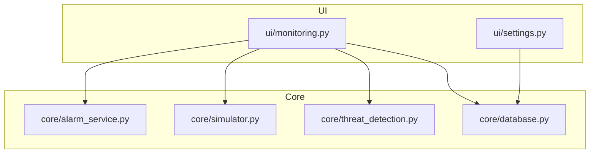
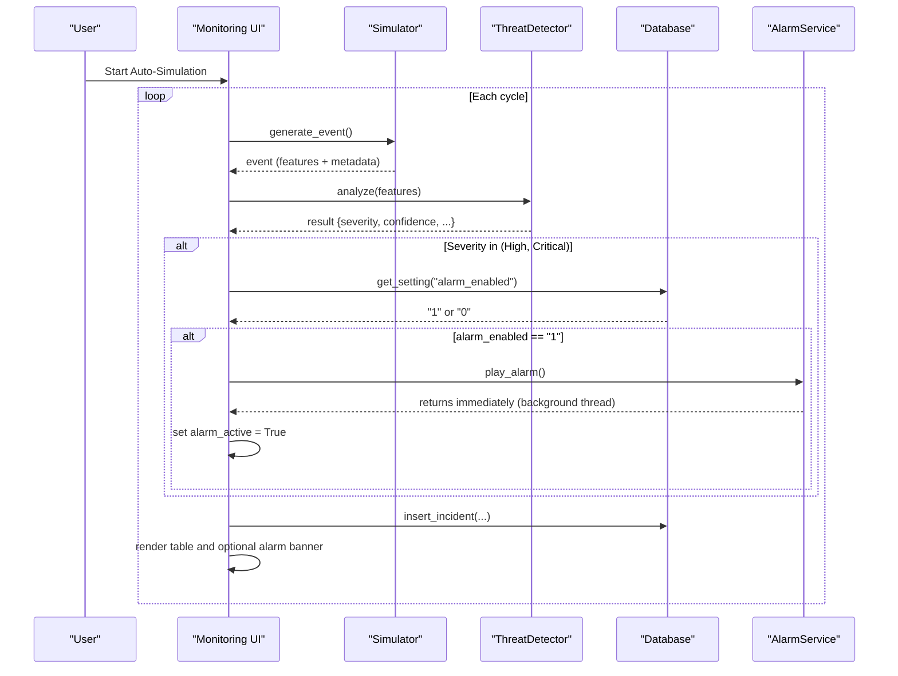
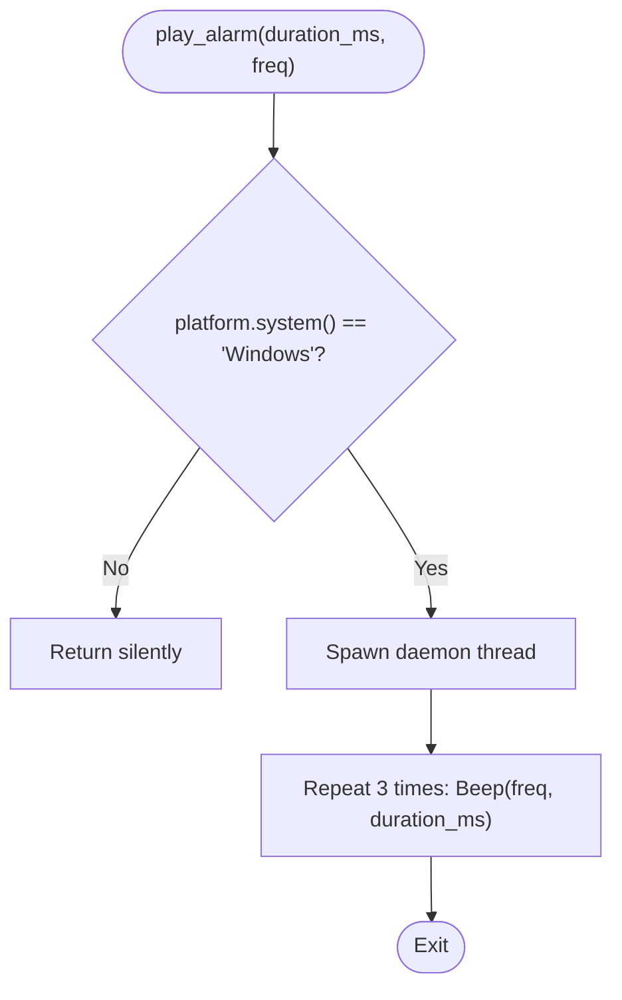
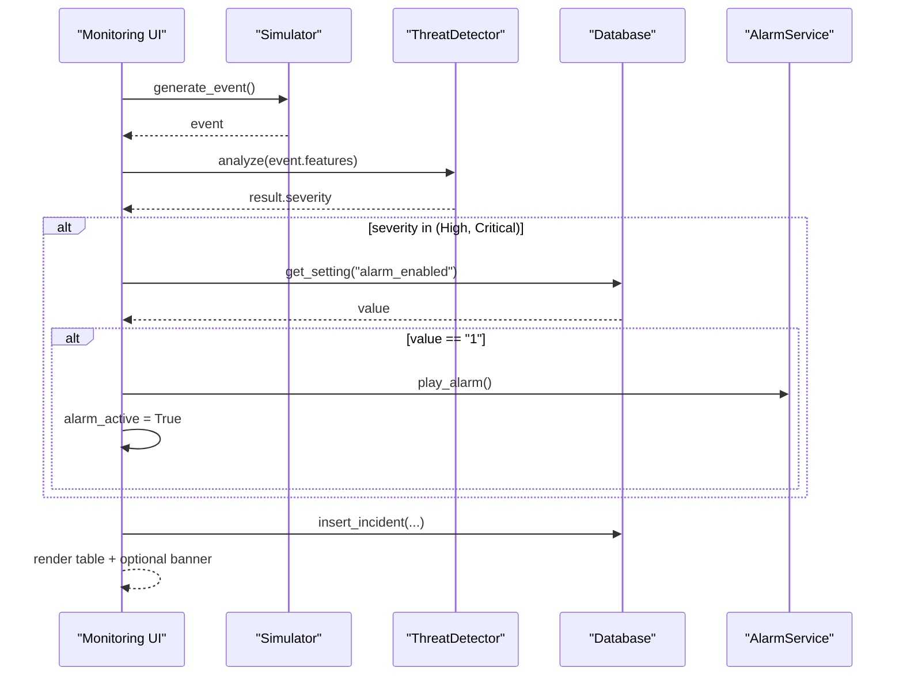
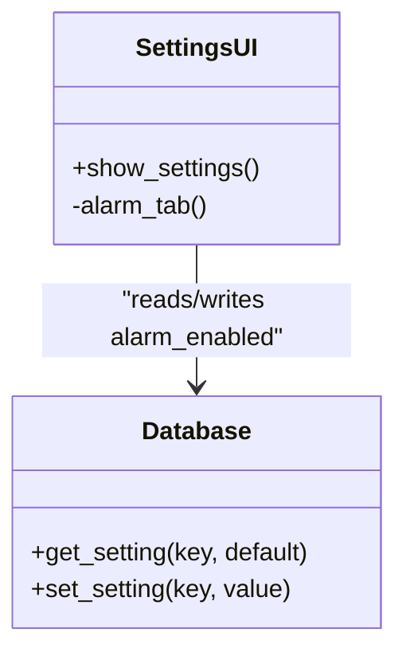
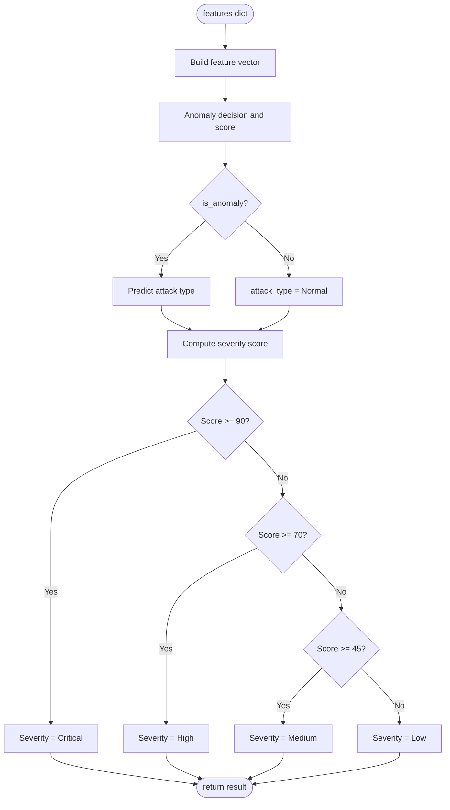
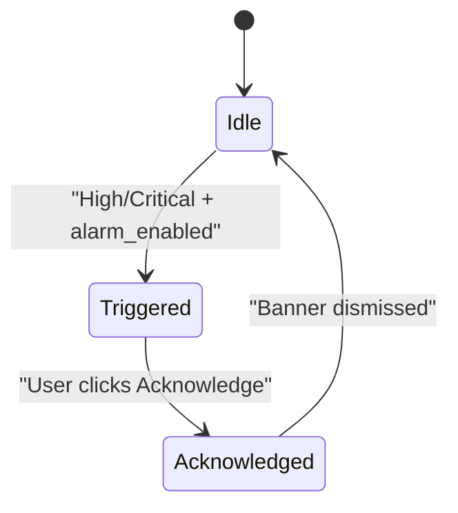
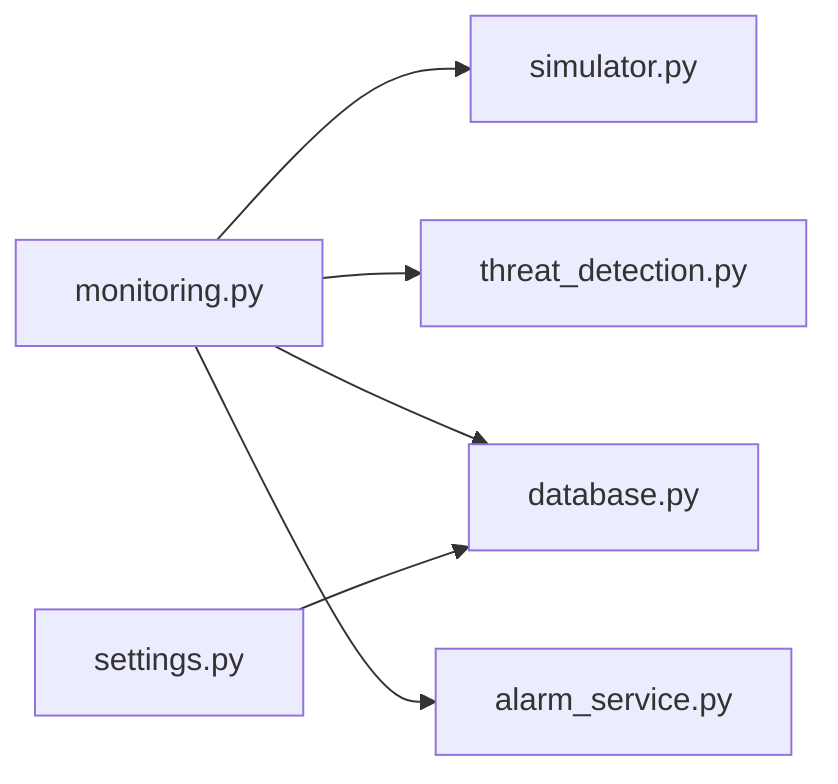

# Audio Alarm System

<cite>
**Referenced Files in This Document**
- [alarm_service.py](file://core/alarm_service.py)
- [monitoring.py](file://ui/monitoring.py)
- [settings.py](file://ui/settings.py)
- [database.py](file://core/database.py)
- [simulator.py](file://core/simulator.py)
- [threat_detection.py](file://core/threat_detection.py)
</cite>

## Table of Contents
1. [Introduction](#introduction)
2. [Project Structure](#project-structure)
3. [Core Components](#core-components)
4. [Architecture Overview](#architecture-overview)
5. [Detailed Component Analysis](#detailed-component-analysis)
6. [Dependency Analysis](#dependency-analysis)
7. [Performance Considerations](#performance-considerations)
8. [Troubleshooting Guide](#troubleshooting-guide)
9. [Conclusion](#conclusion)
10. [Appendices](#appendices)

## Introduction
This document explains the audio alarm system that provides audible alerts for critical security threats within the Autonomous AI Cyber Defense Platform. It covers how alarms are triggered by threat detection events, the cross-platform considerations and current Windows-only implementation, background thread processing, user-configurable preferences, and guidance for extending to other operating systems. It also includes examples for configuring alarm preferences, testing alert sounds, and handling device availability across platforms.

## Project Structure
The audio alarm functionality is implemented as a small service module and integrated into the live monitoring workflow. Configuration is exposed via the Settings UI and persisted in the application database.

**Diagram sources**
- [monitoring.py:1-133](file://ui/monitoring.py#L1-L133)
- [settings.py:1-110](file://ui/settings.py#L1-L110)
- [alarm_service.py:1-23](file://core/alarm_service.py#L1-L23)
- [simulator.py:1-76](file://core/simulator.py#L1-L76)
- [threat_detection.py:1-147](file://core/threat_detection.py#L1-L147)
- [database.py:1-262](file://core/database.py#L1-L262)

**Section sources**
- [monitoring.py:1-133](file://ui/monitoring.py#L1-L133)
- [settings.py:1-110](file://ui/settings.py#L1-L110)
- [alarm_service.py:1-23](file://core/alarm_service.py#L1-L23)
- [database.py:1-262](file://core/database.py#L1-L262)

## Core Components
- Alarm Service: Plays an audible beep on supported platforms using a background thread. Currently limited to Windows.
- Live Monitoring: Orchestrates event generation, AI analysis, incident persistence, and alarm triggering based on severity and settings.
- Settings UI: Provides a toggle to enable or disable alarms for High/Critical threats; persists the setting.
- Database: Stores the alarm_enabled flag and other app settings.
- Simulator and Threat Detector: Generate realistic events and compute severity used to decide whether to trigger alarms.

Key responsibilities:
- Alarm Service: platform check, sound playback, background execution, error suppression.
- Live Monitoring: evaluate severity, read settings, call alarm service, update UI state for visual alarm banner.
- Settings UI: allow users to enable/disable alarms and persist configuration.
- Database: provide default values and CRUD helpers for settings.

**Section sources**
- [alarm_service.py:1-23](file://core/alarm_service.py#L1-L23)
- [monitoring.py:1-133](file://ui/monitoring.py#L1-L133)
- [settings.py:1-110](file://ui/settings.py#L1-L110)
- [database.py:1-262](file://core/database.py#L1-L262)
- [simulator.py:1-76](file://core/simulator.py#L1-L76)
- [threat_detection.py:1-147](file://core/threat_detection.py#L1-L147)

## Architecture Overview
The alarm system integrates with the live monitoring pipeline. When a simulated or real event is analyzed, the system computes severity. If the severity is High or Critical and alarms are enabled, the alarm service plays a beep in a background thread and the UI shows a blinking banner until acknowledged.

**Diagram sources**
- [monitoring.py:91-133](file://ui/monitoring.py#L91-L133)
- [simulator.py:45-71](file://core/simulator.py#L45-L71)
- [threat_detection.py:92-127](file://core/threat_detection.py#L92-L127)
- [database.py:223-235](file://core/database.py#L223-L235)
- [alarm_service.py:8-23](file://core/alarm_service.py#L8-L23)

## Detailed Component Analysis

### Alarm Service (Windows-only beep)
- Behavior: Checks the OS; if not Windows, returns without playing sound. On Windows, spawns a daemon thread that plays a short beep sequence three times. Exceptions during playback are suppressed to avoid disrupting the main flow.
- Parameters: duration_ms and freq can be tuned per call site; currently uses defaults.
- Concurrency: Uses a daemon thread so it does not block the UI or event loop.

**Diagram sources**
- [alarm_service.py:8-23](file://core/alarm_service.py#L8-L23)

**Section sources**
- [alarm_service.py:1-23](file://core/alarm_service.py#L1-L23)

### Live Monitoring Integration
- Event processing: Generates an event, analyzes it with the AI detector, and records results.
- Alarm triggering: If severity is High or Critical and alarm_enabled is "1", calls play_alarm and sets a session flag to show a blinking banner.
- Acknowledgment: The banner can be dismissed by the user, clearing the flag and stopping the visual alarm.

**Diagram sources**
- [monitoring.py:91-133](file://ui/monitoring.py#L91-L133)
- [simulator.py:45-71](file://core/simulator.py#L45-L71)
- [threat_detection.py:92-127](file://core/threat_detection.py#L92-L127)
- [database.py:223-235](file://core/database.py#L223-L235)
- [alarm_service.py:8-23](file://core/alarm_service.py#L8-L23)

**Section sources**
- [monitoring.py:1-133](file://ui/monitoring.py#L1-L133)

### Settings and Configuration
- Alarm toggle: A checkbox enables or disables alarms for High/Critical threats.
- Persistence: The setting is stored under key alarm_enabled with default "1".
- UI behavior: Saving updates the setting and confirms success.

**Diagram sources**
- [settings.py:67-76](file://ui/settings.py#L67-L76)
- [database.py:165-178](file://core/database.py#L165-L178)
- [database.py:118-131](file://core/database.py#L118-L131)

**Section sources**
- [settings.py:1-110](file://ui/settings.py#L1-L110)
- [database.py:118-131](file://core/database.py#L118-L131)
- [database.py:165-178](file://core/database.py#L165-L178)

### Threat Detection and Severity Scoring
- Features: packets_per_sec, failed_logins, payload_size, unique_ports, entropy.
- Output: is_anomaly, attack_type, severity, confidence, anomaly_score.
- Severity thresholds: Critical >= 90, High >= 70, Medium >= 45, else Low.

**Diagram sources**
- [threat_detection.py:92-147](file://core/threat_detection.py#L92-L147)

**Section sources**
- [threat_detection.py:1-147](file://core/threat_detection.py#L1-L147)

### Conceptual Overview
The alarm system is designed to be non-blocking and resilient. It triggers only for high-severity events when enabled, and it gracefully handles unsupported platforms by doing nothing rather than raising errors.

[No sources needed since this diagram shows conceptual workflow, not actual code structure]

## Dependency Analysis
- monitoring.py depends on simulator.py, threat_detection.py, database.py, and alarm_service.py.
- settings.py depends on database.py for reading/writing settings.
- alarm_service.py has no internal dependencies beyond standard library modules and platform-specific audio APIs.

**Diagram sources**
- [monitoring.py:1-133](file://ui/monitoring.py#L1-L133)
- [settings.py:1-110](file://ui/settings.py#L1-L110)
- [alarm_service.py:1-23](file://core/alarm_service.py#L1-L23)
- [simulator.py:1-76](file://core/simulator.py#L1-L76)
- [threat_detection.py:1-147](file://core/threat_detection.py#L1-L147)
- [database.py:1-262](file://core/database.py#L1-L262)

**Section sources**
- [monitoring.py:1-133](file://ui/monitoring.py#L1-L133)
- [settings.py:1-110](file://ui/settings.py#L1-L110)
- [alarm_service.py:1-23](file://core/alarm_service.py#L1-L23)

## Performance Considerations
- Background threading: Alarms run in a daemon thread to avoid blocking the UI or event loop.
- Minimal overhead: The beep is short and repeated a fixed number of times; no heavy I/O.
- Session memory: Live events are kept in memory with a cap to prevent unbounded growth.
- Cross-platform fallback: Non-Windows platforms skip audio entirely, avoiding unnecessary work.
- Recommendations:
  - Avoid frequent re-initialization of detectors or services; reuse cached instances where possible.
  - Consider debouncing rapid successive alarms if multiple high-severity events occur in quick succession.
  - For continuous monitoring, ensure the event loop cadence and sleep intervals balance responsiveness and CPU usage.

[No sources needed since this section provides general guidance]

## Troubleshooting Guide
- No sound on non-Windows systems:
  - The alarm service intentionally skips playback outside Windows. To test on other platforms, extend the service to use platform-appropriate audio libraries.
- Sound not playing on Windows:
  - Ensure speakers are not muted and the system volume is adequate.
  - Verify that the process has permission to access audio devices.
- Alarm not triggering:
  - Confirm alarm_enabled is set to "1" in Settings.
  - Verify severity is High or Critical for the event being processed.
- Visual banner not appearing:
  - Check that alarm_active is set to True after triggering and cleared upon acknowledgment.
- Excessive CPU or memory usage:
  - Review the event loop cadence and the size of the in-memory event list.
  - Ensure no redundant computations are performed on each cycle.

**Section sources**
- [alarm_service.py:1-23](file://core/alarm_service.py#L1-L23)
- [monitoring.py:1-133](file://ui/monitoring.py#L1-L133)
- [settings.py:67-76](file://ui/settings.py#L67-L76)
- [database.py:118-131](file://core/database.py#L118-L131)

## Conclusion
The audio alarm system provides a lightweight, non-blocking audible alert mechanism for high-severity threats on Windows, integrated seamlessly into the live monitoring workflow. Users can enable or disable alarms through the Settings UI, and the system persists preferences in the database. While currently Windows-only, the design allows straightforward extension to other platforms. Proper resource management and clear integration points make it easy to enhance cross-platform support and add richer customization options.

[No sources needed since this section summarizes without analyzing specific files]

## Appendices

### Configuring Alarm Preferences
- Navigate to Settings > Alarm tab.
- Toggle “Enable alarm for High/Critical threats” to turn alarms on or off.
- Save changes; the setting is stored under alarm_enabled.

**Section sources**
- [settings.py:67-76](file://ui/settings.py#L67-L76)
- [database.py:118-131](file://core/database.py#L118-L131)

### Testing Alert Sounds
- Open Live Monitoring and enable Auto Simulate.
- Observe that High/Critical events trigger both a visual banner and an audible beep (on Windows).
- Click “Acknowledge & Mute Alarm” to dismiss the banner.

**Section sources**
- [monitoring.py:20-88](file://ui/monitoring.py#L20-L88)
- [monitoring.py:91-133](file://ui/monitoring.py#L91-L133)

### Handling Audio Device Availability Across Operating Systems
- Current behavior: Non-Windows platforms return early without playing sound.
- Recommended approach for cross-platform support:
  - Detect OS and select appropriate audio backend (e.g., winsound on Windows, pygame.mixer or platform-native APIs on others).
  - Gracefully handle missing audio devices or permissions by logging and falling back to silent mode.
  - Provide a user-facing indicator when audio is unavailable.

[No sources needed since this section provides general guidance]

### Example: Extending Alarm Service for Cross-Platform Playback
- Add OS detection branches to choose platform-specific audio libraries.
- Maintain the same function signature and background-thread behavior.
- Keep exception handling robust to avoid disrupting the main flow.

[No sources needed since this section provides general guidance]