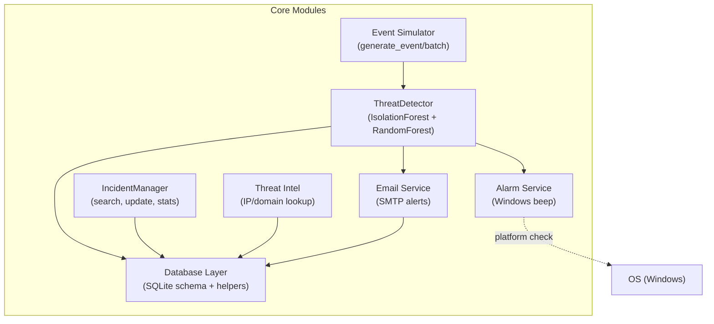
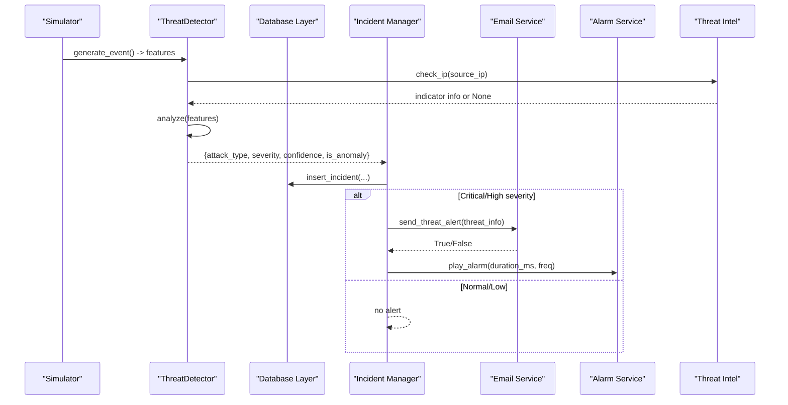
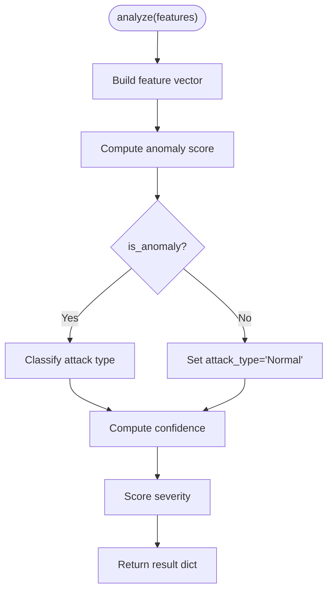
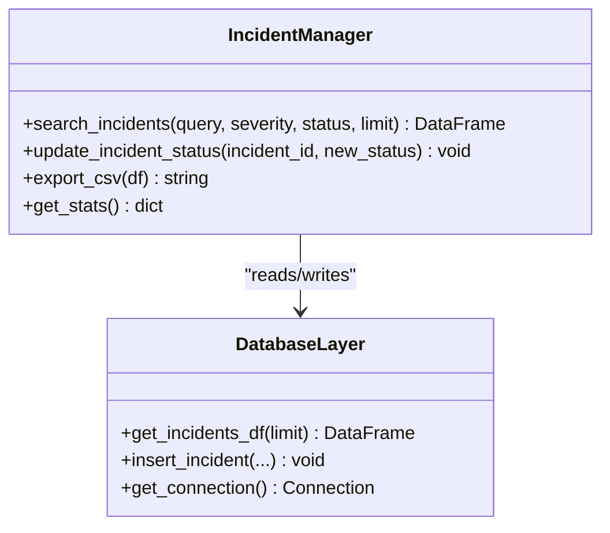
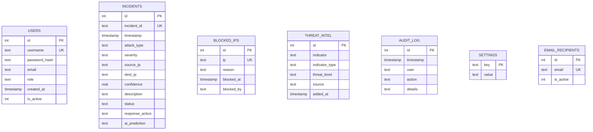
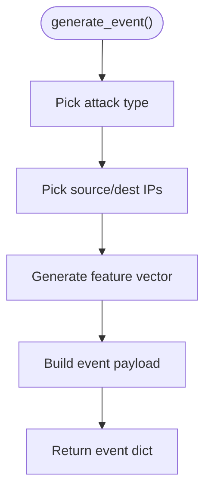
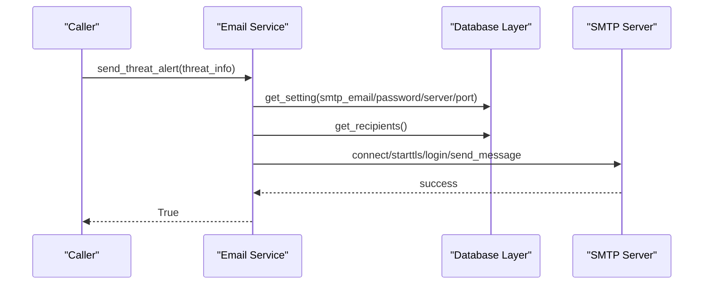
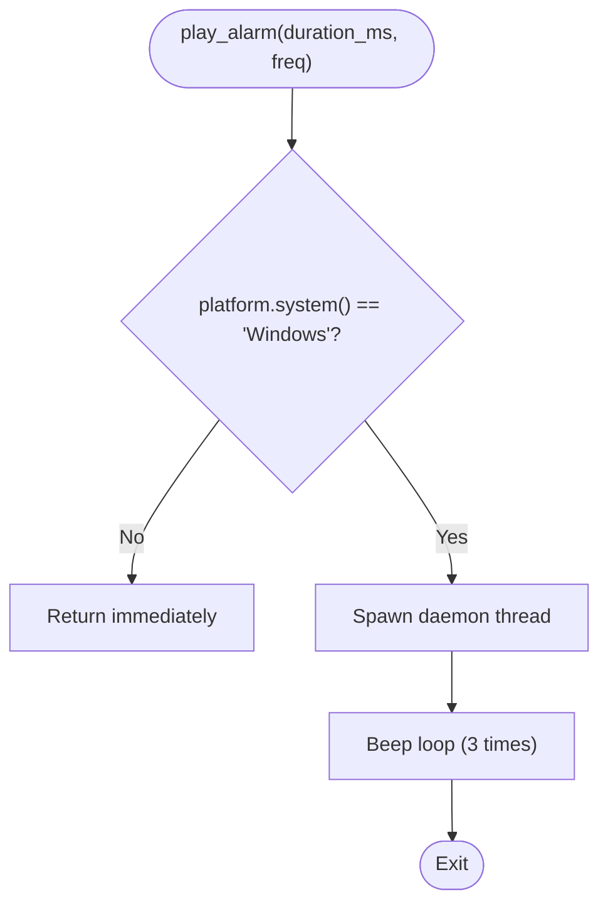
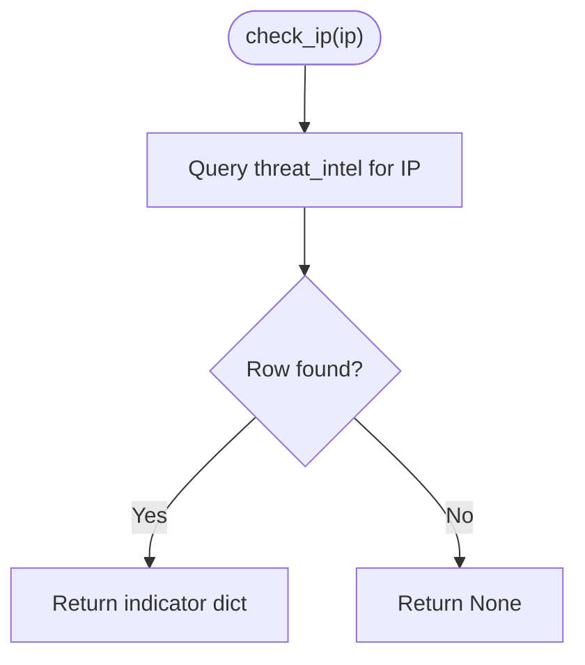
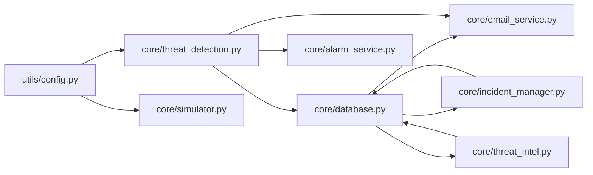

# Core Modules

<cite>
**Referenced Files in This Document**
- [threat_detection.py](file://core/threat_detection.py)
- [incident_manager.py](file://core/incident_manager.py)
- [database.py](file://core/database.py)
- [simulator.py](file://core/simulator.py)
- [email_service.py](file://core/email_service.py)
- [alarm_service.py](file://core/alarm_service.py)
- [threat_intel.py](file://core/threat_intel.py)
- [config.py](file://utils/config.py)
- [app.py](file://app.py)
</cite>

## Table of Contents
1. [Introduction](#introduction)
2. [Project Structure](#project-structure)
3. [Core Components](#core-components)
4. [Architecture Overview](#architecture-overview)
5. [Detailed Component Analysis](#detailed-component-analysis)
6. [Dependency Analysis](#dependency-analysis)
7. [Performance Considerations](#performance-considerations)
8. [Troubleshooting Guide](#troubleshooting-guide)
9. [Conclusion](#conclusion)

## Introduction
This document provides a comprehensive guide to the core business logic modules of the Autonomous AI Cyber Defense Platform. It explains how threat detection, incident management, persistence, simulation, notifications, alarms, and threat intelligence work together to deliver an end-to-end security operations workflow. The focus is on public interfaces, parameters, return values, integration patterns, practical usage examples, and error handling strategies across all core components.

## Project Structure
The core modules are organized by responsibility:
- Threat Detection Engine: anomaly and classification using Isolation Forest and Random Forest
- Incident Management: CRUD-like operations, search, export, and statistics
- Database Layer: SQLite schema, settings, and persistence helpers
- Network Event Simulator: realistic attack event generation
- Email Notification Service: SMTP-based alerting
- Audio Alarm System: platform-specific beep for critical alerts
- Threat Intelligence Module: indicator lookup and management

**Diagram sources**
- [threat_detection.py:15-127](file://core/threat_detection.py#L15-L127)
- [incident_manager.py:10-56](file://core/incident_manager.py#L10-L56)
- [database.py:16-136](file://core/database.py#L16-L136)
- [simulator.py:45-76](file://core/simulator.py#L45-L76)
- [email_service.py:37-92](file://core/email_service.py#L37-L92)
- [alarm_service.py:8-23](file://core/alarm_service.py#L8-L23)
- [threat_intel.py:7-31](file://core/threat_intel.py#L7-L31)

**Section sources**
- [app.py:102-106](file://app.py#L102-L106)
- [database.py:16-136](file://core/database.py#L16-L136)

## Core Components
This section summarizes each module’s purpose, key responsibilities, and how they integrate with others.

- Threat Detection Engine
  - Uses Isolation Forest for anomaly scoring and Random Forest for attack type classification
  - Provides analyze(features) returning anomaly flag, attack type, severity, confidence, and anomaly score
  - Persists trained models locally and bootstraps synthetic training data if needed

- Incident Management System
  - Search incidents by query, severity, status; supports CSV export
  - Updates incident status; computes summary statistics
  - Integrates with database layer via DataFrame queries and updates

- Database Layer
  - Initializes schema for users, incidents, blocked_ips, threat_intel, audit_log, settings, email_recipients
  - Seeds default settings and threat intel indicators
  - Provides helper functions for CRUD-like operations and read queries

- Network Event Simulator
  - Generates realistic events with features suitable for AI analysis
  - Returns structured payloads including timestamps, IPs, usernames, attack types, descriptions, and feature vectors

- Email Notification Service
  - Reads SMTP configuration from settings and recipient list from database
  - Sends formatted threat alerts via SMTP with TLS
  - Returns success/failure status

- Audio Alarm System
  - Plays a beep sound on Windows in a background thread
  - Skips execution on non-Windows platforms

- Threat Intelligence Module
  - Checks IP or domain against known-bad indicators stored in the database
  - Retrieves full indicator set and adds new indicators

**Section sources**
- [threat_detection.py:15-147](file://core/threat_detection.py#L15-L147)
- [incident_manager.py:10-56](file://core/incident_manager.py#L10-L56)
- [database.py:16-248](file://core/database.py#L16-L248)
- [simulator.py:45-76](file://core/simulator.py#L45-L76)
- [email_service.py:37-92](file://core/email_service.py#L37-L92)
- [alarm_service.py:8-23](file://core/alarm_service.py#L8-L23)
- [threat_intel.py:7-31](file://core/threat_intel.py#L7-L31)

## Architecture Overview
The system follows a modular pipeline:
- Events are generated by the simulator and fed into the threat detection engine
- The engine classifies anomalies and assigns severity/confidence
- Incidents are persisted through the database layer
- Alerts are sent via email and audio alarm when appropriate
- Threat intelligence enriches decisions by checking known indicators

**Diagram sources**
- [simulator.py:45-76](file://core/simulator.py#L45-L76)
- [threat_detection.py:92-127](file://core/threat_detection.py#L92-L127)
- [threat_intel.py:7-22](file://core/threat_intel.py#L7-L22)
- [incident_manager.py:29-36](file://core/incident_manager.py#L29-L36)
- [database.py:209-222](file://core/database.py#L209-L222)
- [email_service.py:37-92](file://core/email_service.py#L37-L92)
- [alarm_service.py:8-23](file://core/alarm_service.py#L8-L23)

## Detailed Component Analysis

### Threat Detection Engine
Responsibilities:
- Anomaly detection using Isolation Forest
- Attack classification using Random Forest
- Severity scoring based on features and confidence
- Model persistence and bootstrap training with synthetic data

Public interface:
- analyze(features: dict) -> dict
  - Parameters:
    - packets_per_sec: number
    - failed_logins: number
    - payload_size: number
    - unique_ports: number
    - entropy: float
  - Returns:
    - is_anomaly: bool
    - attack_type: string
    - severity: string ("Low", "Medium", "High", "Critical")
    - confidence: float (0..1)
    - anomaly_score: float

Integration patterns:
- Consumed by incident manager or UI workflows after event generation
- Optionally enriched by threat intelligence checks before classification

Error handling:
- If classifier fails during prediction, falls back to random selection from configured attack types
- Confidence and severity are bounded to safe ranges

Practical example:
- Generate an event via simulator, pass features to analyze, then decide whether to create an incident and trigger alerts

**Diagram sources**
- [threat_detection.py:92-127](file://core/threat_detection.py#L92-L127)
- [threat_detection.py:129-147](file://core/threat_detection.py#L129-L147)

**Section sources**
- [threat_detection.py:15-147](file://core/threat_detection.py#L15-L147)

### Incident Management System
Responsibilities:
- Search incidents with filters (severity, status, text query)
- Update incident status
- Export results to CSV
- Compute summary statistics

Public interfaces:
- search_incidents(query="", severity="All", status="All", limit=500) -> pandas.DataFrame
- update_incident_status(incident_id: str, new_status: str) -> void
- export_csv(df: pandas.DataFrame) -> str
- get_stats() -> dict

Integration patterns:
- Reads from database via get_incidents_df
- Writes status updates directly to the incidents table
- Used by UI pages for filtering and exporting

Error handling:
- Empty datasets handled gracefully
- SQL operations use parameterized queries to prevent injection

Practical example:
- Filter open high-severity incidents, export filtered results to CSV for reporting

**Diagram sources**
- [incident_manager.py:10-56](file://core/incident_manager.py#L10-L56)
- [database.py:200-222](file://core/database.py#L200-L222)

**Section sources**
- [incident_manager.py:10-56](file://core/incident_manager.py#L10-L56)

### Database Layer
Responsibilities:
- Initialize schema and seed defaults
- Provide connection factory
- CRUD helpers for incidents, blocked IPs, threat intel, audit log, settings, email recipients

Key schema elements:
- users: authentication and roles
- incidents: core security events
- blocked_ips: firewall-style blocklist
- threat_intel: known-bad indicators
- audit_log: user actions
- settings: application configuration
- email_recipients: notification targets

Public interfaces:
- init_db() -> void
- get_connection() -> sqlite3.Connection
- insert_incident(...) -> void
- get_incidents_df(limit) -> DataFrame
- block_ip(ip, reason, blocked_by) -> void
- unblock_ip(ip) -> void
- is_ip_blocked(ip) -> bool
- get_blocked_ips_df() -> DataFrame
- add_threat_intel(indicator, indicator_type, threat_level, source) -> void
- get_threat_intel_df() -> DataFrame
- log_audit(user, action, details) -> void
- get_setting(key, default) -> string
- set_setting(key, value) -> void

Integration patterns:
- All core modules depend on this layer for persistence
- Settings drive behavior of email service and other features

Error handling:
- Connections closed in finally blocks where applicable
- Parameterized SQL throughout

Practical example:
- Seed admin user and default settings at app startup; persist incidents and threat intel entries

**Diagram sources**
- [database.py:21-100](file://core/database.py#L21-L100)

**Section sources**
- [database.py:16-248](file://core/database.py#L16-L248)

### Network Event Simulator
Responsibilities:
- Generate realistic network/security events with plausible features
- Provide batch generation capability

Public interfaces:
- generate_event() -> dict
- generate_batch(n=10) -> list[dict]

Return structure highlights:
- timestamp, event_type, source_ip, dest_ip, username
- attack_type, description
- features: packets_per_sec, failed_logins, payload_size, unique_ports, entropy
- incident_id

Integration patterns:
- Feeds features into threat detection engine
- Supplies incident metadata for persistence

Error handling:
- Deterministic randomness seeded internally
- Safe fallbacks for missing keys

Practical example:
- Generate a batch of events, run each through the detector, and persist resulting incidents

**Diagram sources**
- [simulator.py:45-76](file://core/simulator.py#L45-L76)

**Section sources**
- [simulator.py:45-76](file://core/simulator.py#L45-L76)

### Email Notification Service
Responsibilities:
- Retrieve SMTP settings and recipients
- Compose and send threat alert emails
- Handle failures gracefully

Public interfaces:
- get_recipients() -> list[str]
- add_recipient(email: str) -> void
- remove_recipient(email: str) -> void
- send_threat_alert(threat_info: dict) -> bool

Parameters and return values:
- send_threat_alert expects a dict with keys like incident_id, attack_type, severity, source_ip, dest_ip, timestamp, confidence
- Returns True on successful send, False otherwise

Integration patterns:
- Reads settings from database layer
- Triggered by incident manager or detection workflow for high/critical threats

Error handling:
- Validates SMTP credentials presence
- Catches exceptions during SMTP operations and returns False

Practical example:
- On critical threat, call send_threat_alert with incident details; handle False by logging or retrying

**Diagram sources**
- [email_service.py:37-92](file://core/email_service.py#L37-L92)
- [database.py:151-165](file://core/database.py#L151-L165)

**Section sources**
- [email_service.py:37-92](file://core/email_service.py#L37-L92)

### Audio Alarm System
Responsibilities:
- Play a beep sound for critical alerts on Windows
- Run asynchronously without blocking main flow

Public interface:
- play_alarm(duration_ms=3000, freq=1000) -> void

Behavior:
- Non-Windows platforms skip execution silently
- Uses a daemon thread to avoid blocking

Integration patterns:
- Called by incident manager or detection workflow when severity reaches High/Critical

Error handling:
- Exceptions inside winsound calls are caught and ignored

Practical example:
- After sending email alert for a critical threat, trigger play_alarm to notify operators locally

**Diagram sources**
- [alarm_service.py:8-23](file://core/alarm_service.py#L8-L23)

**Section sources**
- [alarm_service.py:8-23](file://core/alarm_service.py#L8-L23)

### Threat Intelligence Module
Responsibilities:
- Check IP or domain against known-bad indicators
- Retrieve all indicators and add new ones

Public interfaces:
- check_ip(ip: str) -> dict | None
- check_domain(domain: str) -> dict | None
- get_all_intel() -> DataFrame
- add_intel(indicator: str, indicator_type: str, threat_level: str, source: str) -> void

Integration patterns:
- Used by threat detection to enrich context before classification
- Data sourced from database layer

Error handling:
- Returns None when no match found
- Safe database access via parameterized queries

Practical example:
- Before analyzing traffic, check source IP against threat intel; adjust severity or decision accordingly

**Diagram sources**
- [threat_intel.py:7-13](file://core/threat_intel.py#L7-L13)

**Section sources**
- [threat_intel.py:7-31](file://core/threat_intel.py#L7-L31)

## Dependency Analysis
Core dependencies and interactions:
- Threat Detection depends on config constants and optionally threat intel
- Incident Manager depends on database layer for reads and writes
- Email Service depends on database layer for settings and recipients
- Alarm Service depends on OS capabilities
- Threat Intel depends on database layer
- Simulator depends on config constants

**Diagram sources**
- [config.py:23-30](file://utils/config.py#L23-L30)
- [threat_detection.py:9-12](file://core/threat_detection.py#L9-L12)
- [simulator.py:8](file://core/simulator.py#L8)
- [incident_manager.py:7](file://core/incident_manager.py#L7)
- [email_service.py:7](file://core/email_service.py#L7)
- [threat_intel.py:4](file://core/threat_intel.py#L4)

**Section sources**
- [config.py:1-36](file://utils/config.py#L1-L36)
- [threat_detection.py:1-147](file://core/threat_detection.py#L1-L147)
- [incident_manager.py:1-57](file://core/incident_manager.py#L1-L57)
- [database.py:1-248](file://core/database.py#L1-L248)
- [simulator.py:1-76](file://core/simulator.py#L1-L76)
- [email_service.py:1-92](file://core/email_service.py#L1-L92)
- [alarm_service.py:1-23](file://core/alarm_service.py#L1-L23)
- [threat_intel.py:1-31](file://core/threat_intel.py#L1-L31)

## Performance Considerations
- Model training uses synthetic data and persists models to disk to avoid repeated training overhead
- Database queries use LIMIT clauses to control memory usage for large tables
- Email sending is synchronous; consider asynchronous queuing for high-throughput environments
- Alarm plays only on Windows and runs in a background thread to avoid blocking
- Feature vectors are small arrays; anomaly scoring is lightweight but can be optimized with caching for repeated inputs

[No sources needed since this section provides general guidance]

## Troubleshooting Guide
Common issues and resolutions:
- No incidents returned by search
  - Ensure database initialized and incidents inserted
  - Verify filters and limits
- Email alerts not sent
  - Validate SMTP settings and credentials in settings table
  - Confirm active recipients exist
- Alarms not playing
  - Running on non-Windows platform; alarm skips silently
- Models not loading
  - Check model files existence; retrain if missing
- Database errors
  - Use parameterized queries; ensure connections are closed properly

**Section sources**
- [incident_manager.py:10-26](file://core/incident_manager.py#L10-L26)
- [email_service.py:42-52](file://core/email_service.py#L42-L52)
- [alarm_service.py:10-11](file://core/alarm_service.py#L10-L11)
- [threat_detection.py:27-37](file://core/threat_detection.py#L27-L37)
- [database.py:167-184](file://core/database.py#L167-L184)

## Conclusion
The core modules form a cohesive, modular architecture enabling autonomous threat detection, incident lifecycle management, and alerting. By leveraging machine learning models, robust persistence, and configurable notifications, the platform supports realistic security operations workflows. Proper integration between components ensures scalability, reliability, and actionable insights for defenders.

[No sources needed since this section summarizes without analyzing specific files]