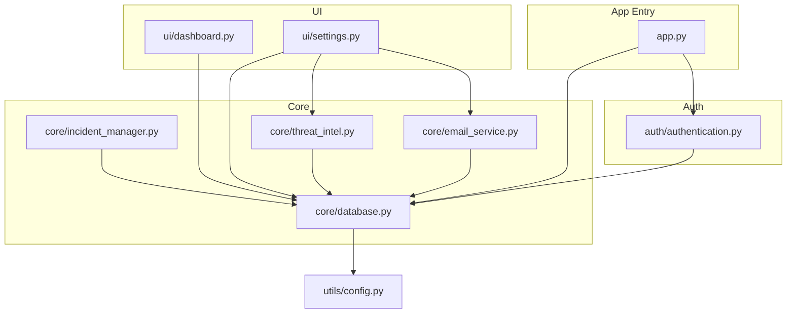
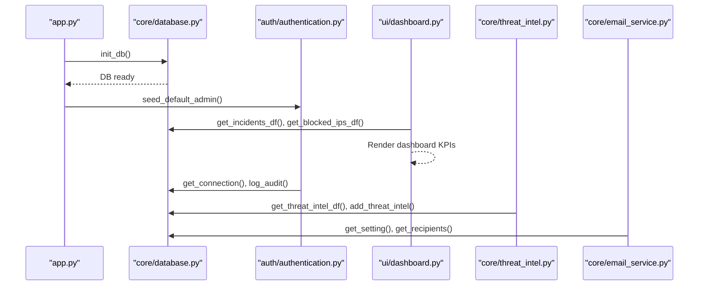
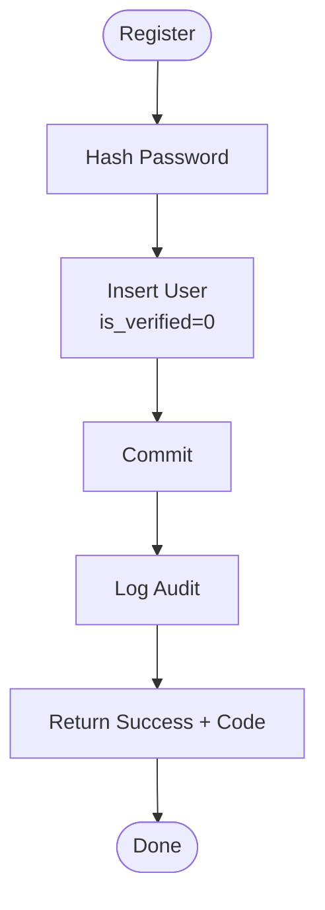
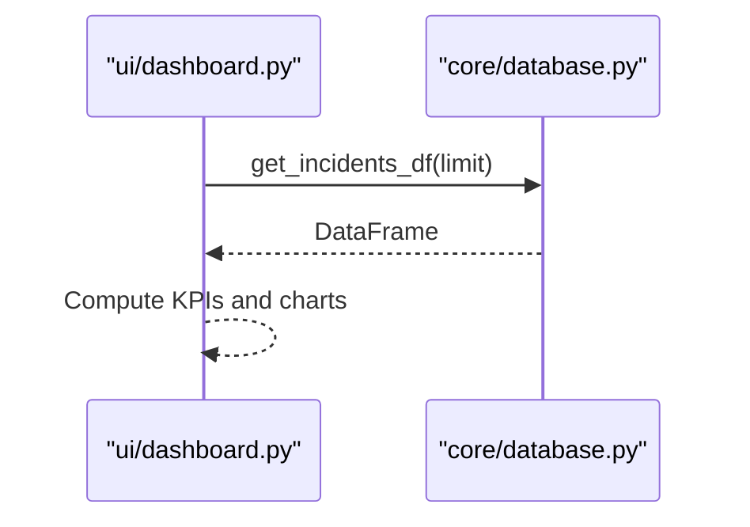
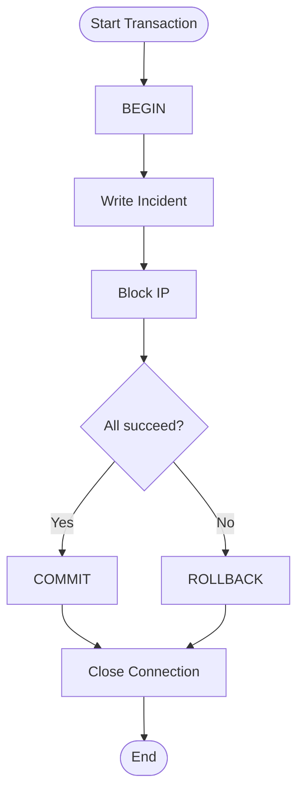
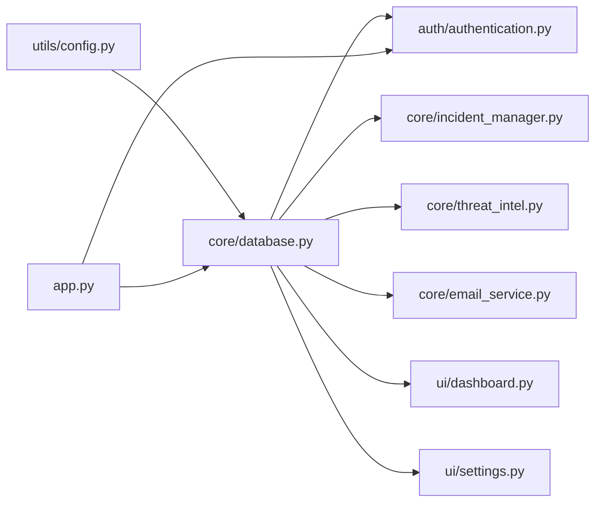

# Database Layer

<cite>
**Referenced Files in This Document**
- [database.py](file://core/database.py)
- [config.py](file://utils/config.py)
- [authentication.py](file://auth/authentication.py)
- [incident_manager.py](file://core/incident_manager.py)
- [threat_intel.py](file://core/threat_intel.py)
- [email_service.py](file://core/email_service.py)
- [dashboard.py](file://ui/dashboard.py)
- [settings.py](file://ui/settings.py)
- [app.py](file://app.py)
</cite>

## Table of Contents
1. [Introduction](#introduction)
2. [Project Structure](#project-structure)
3. [Core Components](#core-components)
4. [Architecture Overview](#architecture-overview)
5. [Detailed Component Analysis](#detailed-component-analysis)
6. [Dependency Analysis](#dependency-analysis)
7. [Performance Considerations](#performance-considerations)
8. [Troubleshooting Guide](#troubleshooting-guide)
9. [Conclusion](#conclusion)
10. [Appendices](#appendices)

## Introduction
This document provides comprehensive documentation for the database layer of the cyber defense platform, focusing on SQLite schema design, connection management, and data persistence operations. It covers all core tables (users, incidents, blocked_ips, threat_intel, audit_logs, settings), explains relationships and constraints, details CRUD operations, transaction handling, query optimization techniques, and outlines backup/recovery and migration strategies. It also documents connection pooling considerations, error handling patterns, and performance monitoring approaches used across the application.

## Project Structure
The database layer is implemented as a focused module that centralizes SQLite interactions and exposes helper functions to other modules. Configuration for the database file path is centralized in a configuration module. The application initializes the database at startup and uses the database helpers throughout UI and service components.

**Diagram sources**
- [app.py:102-106](file://app.py#L102-L106)
- [database.py:1-262](file://core/database.py#L1-L262)
- [config.py:1-36](file://utils/config.py#L1-L36)
- [authentication.py:1-180](file://auth/authentication.py#L1-L180)
- [incident_manager.py:1-57](file://core/incident_manager.py#L1-L57)
- [threat_intel.py:1-31](file://core/threat_intel.py#L1-L31)
- [email_service.py:1-185](file://core/email_service.py#L1-L185)
- [dashboard.py:1-119](file://ui/dashboard.py#L1-L119)
- [settings.py:1-99](file://ui/settings.py#L1-L99)

**Section sources**
- [app.py:102-106](file://app.py#L102-L106)
- [database.py:1-262](file://core/database.py#L1-L262)
- [config.py:1-36](file://utils/config.py#L1-L36)

## Core Components
- Connection management: A single function creates SQLite connections with row factory set to enable dictionary-like access by column name. Connections are created per call and closed explicitly in most helpers.
- Schema initialization: Creates all required tables, performs backward-compatible migrations, seeds default settings, and seeds initial threat intelligence indicators.
- Data persistence helpers: Functions for logging audits, reading/writing settings, blocking/unblocking IPs, inserting incidents, querying threat intel, and exporting data to pandas DataFrames.

Key responsibilities:
- Centralize SQL statements and parameter binding to prevent injection.
- Provide consistent defaults and seed data for out-of-the-box operation.
- Offer simple, reusable read/write functions for common operations.

**Section sources**
- [database.py:10-14](file://core/database.py#L10-L14)
- [database.py:16-150](file://core/database.py#L16-L150)
- [database.py:155-262](file://core/database.py#L155-L262)

## Architecture Overview
The database layer acts as the single source of truth for persistence. Application entry initializes the database and seeds admin user. UI and service modules consume database helpers to perform reads and writes. Settings and threat intel are managed via dedicated helpers. Email service depends on settings and recipient lists stored in the database.

**Diagram sources**
- [app.py:102-106](file://app.py#L102-L106)
- [database.py:16-150](file://core/database.py#L16-L150)
- [authentication.py:168-180](file://auth/authentication.py#L168-L180)
- [dashboard.py:32-48](file://ui/dashboard.py#L32-L48)
- [threat_intel.py:25-31](file://core/threat_intel.py#L25-L31)
- [email_service.py:10-16](file://core/email_service.py#L10-L16)

## Detailed Component Analysis

### SQLite Schema Design
- users
  - Primary key: id (autoincrement)
  - Unique constraint: username
  - Not null fields: username, password_hash
  - Defaults: role='analyst', created_at=CURRENT_TIMESTAMP, is_active=1, is_verified=0
  - Verification fields: verification_code, verification_expiry
  - Migration: Adds missing columns if present in older schemas and backfills verification state
- incidents
  - Primary key: id (autoincrement)
  - Unique constraint: incident_id
  - Timestamps: timestamp DEFAULT CURRENT_TIMESTAMP
  - Fields include attack_type, severity, source_ip, dest_ip, confidence, description, status, response_action, ai_prediction
- blocked_ips
  - Primary key: id (autoincrement)
  - Unique constraint: ip
  - Fields: reason, blocked_at DEFAULT CURRENT_TIMESTAMP, blocked_by DEFAULT 'system'
- threat_intel
  - Primary key: id (autoincrement)
  - Fields: indicator, indicator_type, threat_level, source, added_at DEFAULT CURRENT_TIMESTAMP
- audit_log
  - Primary key: id (autoincrement)
  - Fields: timestamp DEFAULT CURRENT_TIMESTAMP, user, action, details
- settings
  - Key-value store: key PRIMARY KEY, value TEXT
- email_recipients
  - Primary key: id (autoincrement)
  - Unique constraint: email
  - Field: is_active DEFAULT 1

Indexes and constraints:
- Unique indexes enforced by UNIQUE constraints on username, incident_id, ip, email
- No explicit secondary indexes defined; queries rely on primary keys and unique constraints
- Default values ensure consistent timestamps and flags

Relationships:
- Logical relationships exist conceptually (e.g., incidents may reference blocked_ips or threat_intel), but no foreign key constraints are declared in the schema. Integrity is maintained through application logic and unique constraints.

Seed data:
- Default settings for SMTP, alarms, auto-block, simulation speed
- Seed threat intelligence indicators for IPs, domains, and countries

**Section sources**
- [database.py:21-114](file://core/database.py#L21-L114)
- [database.py:118-149](file://core/database.py#L118-L149)

### Connection Management
- get_connection(): Opens a new SQLite connection to DB_PATH with check_same_thread=False and sets row_factory to sqlite3.Row for dict-like access.
- Connection lifecycle: Most helpers open a connection, execute statements, commit when needed, and close the connection explicitly. Some use try/finally to ensure closure.
- Thread safety: check_same_thread=False allows cross-thread usage within Streamlit’s execution model.

Connection pooling:
- No built-in connection pooling; each call opens a new connection. For high concurrency, consider implementing a lightweight pool or using a context manager pattern.

Error handling:
- Exceptions during registration are caught and converted into user-friendly responses.
- Audit logging and setting updates commit changes; failures should be handled by callers where necessary.

**Section sources**
- [database.py:10-14](file://core/database.py#L10-L14)
- [authentication.py:31-46](file://auth/authentication.py#L31-L46)
- [email_service.py:19-27](file://core/email_service.py#L19-L27)

### Data Persistence Operations

#### Users
- Registration: Inserts a new user with hashed password, sets is_verified=0, generates verification code and expiry, logs audit event.
- Verification: Validates code and expiry, activates account, clears verification fields, logs audit event.
- Login: Checks active status, verifies password, enforces verification requirement, logs audit events.
- Admin seeding: Creates a pre-verified admin user if none exists.
- User management: Retrieve users, soft-delete by deactivating, reset passwords.

**Diagram sources**
- [authentication.py:27-46](file://auth/authentication.py#L27-L46)

**Section sources**
- [authentication.py:27-46](file://auth/authentication.py#L27-L46)
- [authentication.py:50-80](file://auth/authentication.py#L50-L80)
- [authentication.py:98-112](file://auth/authentication.py#L98-L112)
- [authentication.py:168-180](file://auth/authentication.py#L168-L180)

#### Incidents
- Insert: Create an incident record with metadata and AI prediction.
- Query: Fetch recent incidents ordered by timestamp with limit.
- Update: Change incident status.
- Search and stats: Filter by severity/status, search across multiple fields, compute counts.

**Diagram sources**
- [dashboard.py:32-48](file://ui/dashboard.py#L32-L48)
- [database.py:214-221](file://core/database.py#L214-L221)

**Section sources**
- [database.py:223-236](file://core/database.py#L223-L236)
- [incident_manager.py:10-26](file://core/incident_manager.py#L10-L26)
- [incident_manager.py:29-35](file://core/incident_manager.py#L29-L35)
- [incident_manager.py:44-57](file://core/incident_manager.py#L44-L57)

#### Blocked IPs
- Block: Insert IP with reason and blocker identity; ignore duplicates.
- Unblock: Delete IP from blocked list.
- Check: Determine if IP is currently blocked.
- List: Retrieve all blocked IPs sorted by time.

**Section sources**
- [database.py:181-212](file://core/database.py#L181-L212)

#### Threat Intelligence
- Add: Insert indicator with type, threat level, and source.
- Lookup: Match IP or domain against known-bad indicators.
- List: Retrieve all indicators ordered by addition time.

**Section sources**
- [database.py:238-252](file://core/database.py#L238-L252)
- [threat_intel.py:7-13](file://core/threat_intel.py#L7-L13)
- [threat_intel.py:16-22](file://core/threat_intel.py#L16-L22)
- [threat_intel.py:25-31](file://core/threat_intel.py#L25-L31)

#### Audit Logs
- Log: Record user actions with details.

**Section sources**
- [database.py:155-162](file://core/database.py#L155-L162)

#### Settings
- Get: Read a setting by key with default fallback.
- Set: Upsert a key-value pair.

**Section sources**
- [database.py:165-178](file://core/database.py#L165-L178)

#### Email Recipients
- Add: Insert recipient ignoring duplicates.
- Remove: Delete recipient by email.
- List: Retrieve active recipients.

**Section sources**
- [email_service.py:10-16](file://core/email_service.py#L10-L16)
- [email_service.py:19-34](file://core/email_service.py#L19-L34)

### Transaction Handling
- Current pattern: Each helper opens a connection, executes statements, commits when necessary, and closes the connection. There is no multi-statement transaction wrapper in the current helpers.
- Recommendation: Group related writes (e.g., insert incident and block IP) into a single transaction to ensure atomicity. Use try/except to rollback on failure and finally to close connections.

Example transaction flow (conceptual):

[No sources needed since this diagram shows conceptual workflow, not actual code structure]

### Query Optimization Techniques
- Parameterized queries: All helpers use parameter binding to prevent SQL injection and leverage SQLite’s prepared statements.
- Limiting results: Queries like get_incidents_df and get_audit_df use LIMIT to reduce memory footprint and improve responsiveness.
- Ordering: Results are ordered by timestamp or insertion time to provide predictable pagination and display.
- Indexes: No custom indexes beyond primary keys and unique constraints. Consider adding indexes on frequently filtered columns (e.g., incidents.severity, incidents.status, blocked_ips.blocked_at) if query latency becomes an issue.

**Section sources**
- [database.py:214-221](file://core/database.py#L214-L221)
- [database.py:255-262](file://core/database.py#L255-L262)

## Dependency Analysis
The database module is depended on by authentication, incident management, threat intelligence, email service, and UI components. Configuration provides the database path.

**Diagram sources**
- [config.py:12-14](file://utils/config.py#L12-L14)
- [database.py:1-262](file://core/database.py#L1-L262)
- [authentication.py:10-10](file://auth/authentication.py#L10-L10)
- [incident_manager.py:7-7](file://core/incident_manager.py#L7-L7)
- [threat_intel.py:4-4](file://core/threat_intel.py#L4-L4)
- [email_service.py:7-7](file://core/email_service.py#L7-L7)
- [dashboard.py:7-7](file://ui/dashboard.py#L7-L7)
- [settings.py:5-5](file://ui/settings.py#L5-L5)
- [app.py:102-106](file://app.py#L102-L106)

**Section sources**
- [config.py:12-14](file://utils/config.py#L12-L14)
- [database.py:1-262](file://core/database.py#L1-L262)

## Performance Considerations
- Connection overhead: Opening a new SQLite connection per call can be costly under high concurrency. Consider implementing a connection pool or reusing connections within request scopes.
- Row factory: Using sqlite3.Row enables dict-like access but adds slight overhead; acceptable for typical workloads.
- Pandas integration: Converting query results to DataFrames is convenient for UI rendering; ensure LIMIT clauses to avoid large payloads.
- I/O bottlenecks: SQLite is file-based; disk latency affects read/write performance. Place the database on fast storage and consider WAL mode for concurrent reads.
- Monitoring: Track query latencies and error rates at the application layer; log slow queries and resource usage.

[No sources needed since this section provides general guidance]

## Troubleshooting Guide
Common issues and resolutions:
- Duplicate username during registration: Caught and returns a friendly message; verify uniqueness before attempting insert.
- Missing verification fields in older databases: init_db migrates by adding columns and backfilling verification state.
- Email sending failures: Ensure SMTP settings are configured; validate credentials and network connectivity.
- Blocked IP conflicts: INSERT OR IGNORE prevents duplicate entries; unblock by deleting the record.
- Audit logs not appearing: Ensure log_audit is called after critical actions; verify write permissions on the database file.

Operational tips:
- Always close connections in finally blocks to avoid leaks.
- Use parameterized queries consistently to prevent injection and errors.
- Validate inputs before executing SQL to reduce exceptions.

**Section sources**
- [authentication.py:31-46](file://auth/authentication.py#L31-L46)
- [database.py:36-46](file://core/database.py#L36-L46)
- [email_service.py:78-86](file://core/email_service.py#L78-L86)
- [database.py:181-191](file://core/database.py#L181-L191)

## Conclusion
The database layer provides a robust foundation for persistence in the cyber defense platform. It defines clear schemas, offers straightforward CRUD operations, and integrates seamlessly with UI and services. Future enhancements should focus on transactional grouping, indexing for frequent filters, and connection pooling to improve scalability and performance. Backup and recovery procedures, along with migration strategies, will ensure data integrity and evolution over time.

[No sources needed since this section summarizes without analyzing specific files]

## Appendices

### Backup and Recovery Procedures
- Backup: Copy the SQLite database file located at DATA_DIR/cyberdefense.db. For consistency, stop writes temporarily or enable WAL mode and perform a consistent snapshot.
- Restore: Replace the database file with the backup copy and restart the application to reinitialize.
- Export: Use pandas to export key tables to CSV for archival or analysis.

[No sources needed since this section provides general guidance]

### Migration Strategies
- Schema migrations: Use PRAGMA table_info to detect missing columns and ALTER TABLE to add them, as demonstrated in init_db.
- Data migrations: Backfill default values and compatibility flags during initialization.
- Versioning: Maintain a version field or separate migration scripts to track schema evolution and apply incremental changes safely.

**Section sources**
- [database.py:36-46](file://core/database.py#L36-L46)

### Example Common Database Operations
- Register a user: Insert with hashed password, generate verification code, log audit.
- Verify user: Validate code and expiry, activate account, clear verification fields.
- Insert incident: Record threat details and AI prediction.
- Block IP: Insert blocked IP with reason and blocker identity.
- Update incident status: Change status by incident_id.
- Query incidents: Fetch recent incidents with limit and ordering.
- Manage settings: Upsert key-value pairs for configuration.
- Manage recipients: Add/remove/list alert recipients.

**Section sources**
- [authentication.py:27-46](file://auth/authentication.py#L27-L46)
- [authentication.py:50-80](file://auth/authentication.py#L50-L80)
- [database.py:223-236](file://core/database.py#L223-L236)
- [database.py:181-212](file://core/database.py#L181-L212)
- [incident_manager.py:29-35](file://core/incident_manager.py#L29-L35)
- [database.py:214-221](file://core/database.py#L214-L221)
- [database.py:165-178](file://core/database.py#L165-L178)
- [email_service.py:19-34](file://core/email_service.py#L19-L34)