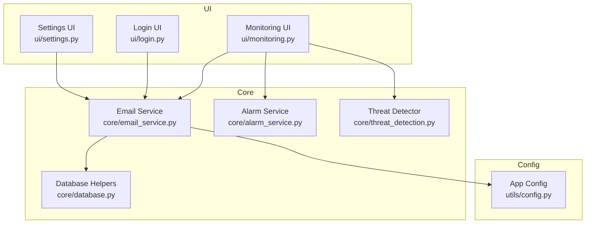
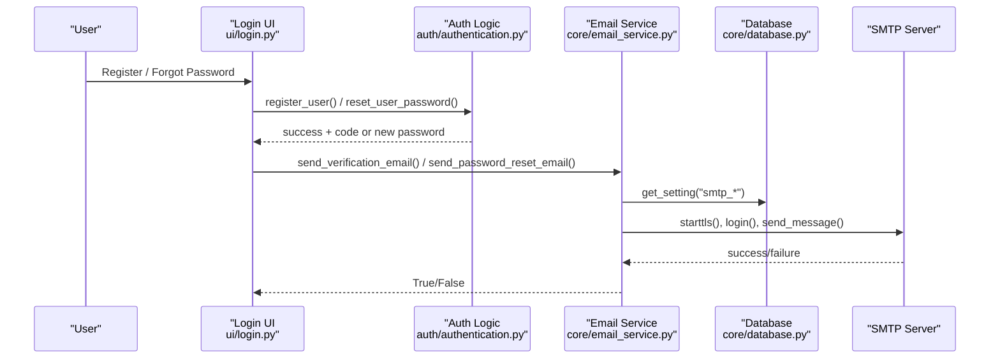
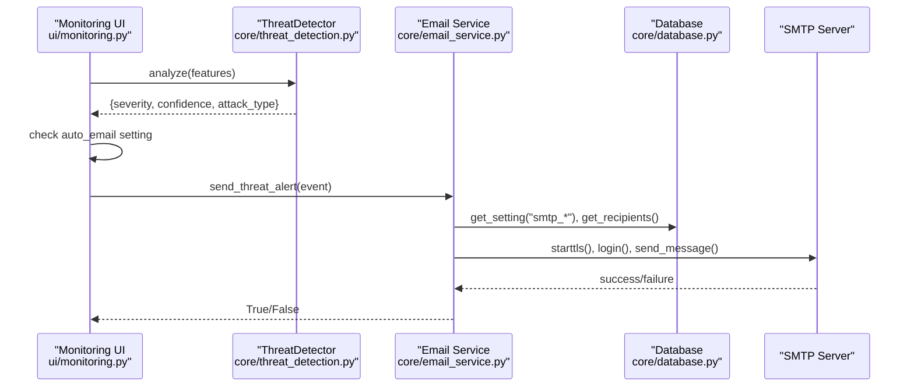
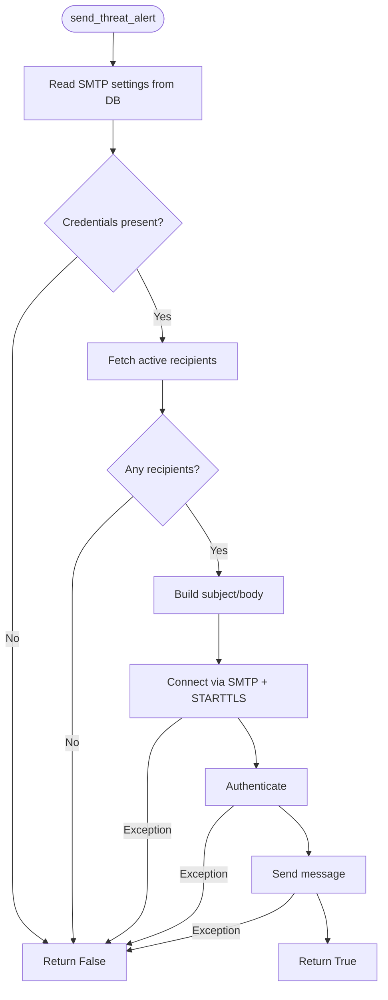
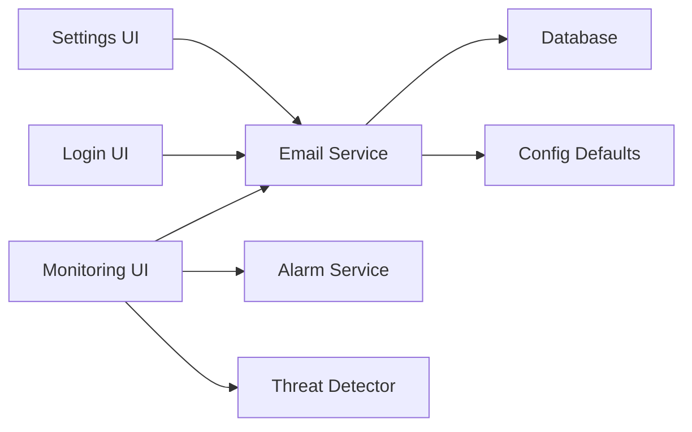

# Email Notification Service

<cite>
**Referenced Files in This Document**
- [email_service.py](file://core/email_service.py)
- [database.py](file://core/database.py)
- [settings.py](file://ui/settings.py)
- [login.py](file://ui/login.py)
- [monitoring.py](file://ui/monitoring.py)
- [config.py](file://utils/config.py)
- [alarm_service.py](file://core/alarm_service.py)
- [threat_detection.py](file://core/threat_detection.py)
</cite>

## Table of Contents
1. [Introduction](#introduction)
2. [Project Structure](#project-structure)
3. [Core Components](#core-components)
4. [Architecture Overview](#architecture-overview)
5. [Detailed Component Analysis](#detailed-component-analysis)
6. [Dependency Analysis](#dependency-analysis)
7. [Performance Considerations](#performance-considerations)
8. [Troubleshooting Guide](#troubleshooting-guide)
9. [Conclusion](#conclusion)
10. [Appendices](#appendices)

## Introduction
This document explains the email notification service that powers user verification, password reset notifications, and automated threat alerts in the platform. It covers SMTP configuration, recipient management, message formatting, integration with threat detection events, and operational considerations such as delivery failures and security best practices.

## Project Structure
The email functionality is implemented across a small set of focused modules:
- Core email sending logic and recipient management
- Settings UI for configuring SMTP and recipients
- Authentication flows that trigger verification and password reset emails
- Live monitoring that triggers automated threat alert emails
- Database schema and settings storage
- Configuration constants and defaults

**Diagram sources**
- [settings.py:1-110](file://ui/settings.py#L1-L110)
- [login.py:1-179](file://ui/login.py#L1-L179)
- [monitoring.py:1-133](file://ui/monitoring.py#L1-L133)
- [email_service.py:1-185](file://core/email_service.py#L1-L185)
- [database.py:1-262](file://core/database.py#L1-L262)
- [alarm_service.py:1-23](file://core/alarm_service.py#L1-L23)
- [threat_detection.py:1-147](file://core/threat_detection.py#L1-L147)
- [config.py:1-36](file://utils/config.py#L1-L36)

**Section sources**
- [email_service.py:1-185](file://core/email_service.py#L1-L185)
- [database.py:1-262](file://core/database.py#L1-L262)
- [settings.py:1-110](file://ui/settings.py#L1-L110)
- [login.py:1-179](file://ui/login.py#L1-L179)
- [monitoring.py:1-133](file://ui/monitoring.py#L1-L133)
- [config.py:1-36](file://utils/config.py#L1-L36)

## Core Components
- Email Service: Provides functions to send verification codes, password reset confirmations, and threat alerts; manages recipients via database queries.
- Database Module: Stores SMTP settings, recipients, incidents, and other app state; provides get_setting/set_setting helpers.
- Settings UI: Allows administrators to configure SMTP server, port, sender credentials, auto-email toggle, and manage recipient lists.
- Login UI: Triggers verification code emails on registration and password reset confirmation emails when passwords are changed.
- Monitoring UI: Integrates with threat detection to automatically send alert emails when High/Critical threats are detected (if enabled).
- Alarm Service: Plays an audible alarm on Windows for high/critical threats (non-email but related to alerting).
- Threat Detection: Classifies network events and assigns severity/confidence used by alerting logic.

**Section sources**
- [email_service.py:1-185](file://core/email_service.py#L1-L185)
- [database.py:1-262](file://core/database.py#L1-L262)
- [settings.py:1-110](file://ui/settings.py#L1-L110)
- [login.py:1-179](file://ui/login.py#L1-L179)
- [monitoring.py:1-133](file://ui/monitoring.py#L1-L133)
- [alarm_service.py:1-23](file://core/alarm_service.py#L1-L23)
- [threat_detection.py:1-147](file://core/threat_detection.py#L1-L147)

## Architecture Overview
The email pipeline is triggered from multiple UI flows and uses centralized SMTP configuration stored in the database.

**Diagram sources**
- [login.py:70-169](file://ui/login.py#L70-L169)
- [authentication.py:27-140](file://auth/authentication.py#L27-L140)
- [email_service.py:37-127](file://core/email_service.py#L37-L127)
- [database.py:165-178](file://core/database.py#L165-L178)

**Diagram sources**
- [monitoring.py:91-133](file://ui/monitoring.py#L91-L133)
- [threat_detection.py:92-147](file://core/threat_detection.py#L92-L147)
- [email_service.py:130-185](file://core/email_service.py#L130-L185)
- [database.py:165-178](file://core/database.py#L165-L178)

## Detailed Component Analysis

### Email Service (core/email_service.py)
Responsibilities:
- Retrieve active recipients from the database
- Send verification emails for new user registration
- Send password reset confirmation emails
- Send automated threat alert emails based on severity and settings

Key behaviors:
- SMTP parameters are read from settings at runtime (server, port, email, password)
- TLS is enabled via STARTTLS before authentication
- Plain text messages are constructed inline; no external template engine
- Recipients are fetched dynamically per alert send

Recipient management:
- get_recipients(): returns active recipients
- add_recipient(email): inserts if not exists
- remove_recipient(email): deletes by email

Error handling:
- Exceptions during SMTP operations are caught and logged; function returns False on failure

**Diagram sources**
- [email_service.py:130-185](file://core/email_service.py#L130-L185)
- [database.py:165-178](file://core/database.py#L165-L178)

**Section sources**
- [email_service.py:10-185](file://core/email_service.py#L10-L185)
- [database.py:108-114](file://core/database.py#L108-L114)

### Database Module (core/database.py)
Responsibilities:
- Initialize schema including settings and email_recipients tables
- Provide get_setting/set_setting for SMTP and feature flags
- Store incidents, blocked IPs, audit logs, and threat intel

Relevant defaults:
- smtp_server, smtp_port, smtp_email, smtp_password
- alarm_enabled, auto_block, auto_email, simulation_speed

Schema highlights:
- settings table stores key-value pairs for runtime configuration
- email_recipients table stores unique emails with active flag

**Section sources**
- [database.py:99-150](file://core/database.py#L99-L150)
- [database.py:165-178](file://core/database.py#L165-L178)

### Settings UI (ui/settings.py)
Capabilities:
- Configure SMTP server, port, sender email, and app password
- Toggle automatic email sending for High/Critical threats
- Manage alert recipients list (add/remove)

Operational notes:
- Displays current SMTP status and warns if not configured
- Persists changes to the settings table

**Section sources**
- [settings.py:18-66](file://ui/settings.py#L18-L66)

### Login UI (ui/login.py)
Triggers:
- On registration: sends verification code email
- On forgot password: resets password and sends confirmation email

Behavior:
- Checks SMTP configuration before attempting to send emails
- Guides users through verification flow and resend options

**Section sources**
- [login.py:70-169](file://ui/login.py#L70-L169)

### Monitoring UI (ui/monitoring.py)
Integration:
- Calls threat detector to classify events
- If severity is High/Critical and auto_email is enabled, calls send_threat_alert
- Also plays local alarm sound on Windows when enabled

**Section sources**
- [monitoring.py:91-133](file://ui/monitoring.py#L91-L133)

### Alarm Service (core/alarm_service.py)
Purpose:
- Plays an audible beep on Windows for High/Critical threats
- Runs in a background thread; non-blocking

Note: Not part of email pipeline but complements alerting UX.

**Section sources**
- [alarm_service.py:1-23](file://core/alarm_service.py#L1-L23)

### Threat Detection (core/threat_detection.py)
Purpose:
- Analyzes network features to detect anomalies and classify attacks
- Returns severity and confidence used by alerting logic

**Section sources**
- [threat_detection.py:92-147](file://core/threat_detection.py#L92-L147)

## Dependency Analysis
The email service depends on:
- Database for SMTP settings and recipient lists
- UI layers for triggering specific email types
- Optional alarm service for local alerting
- Threat detection for generating alert payloads

**Diagram sources**
- [settings.py:1-110](file://ui/settings.py#L1-L110)
- [login.py:1-179](file://ui/login.py#L1-L179)
- [monitoring.py:1-133](file://ui/monitoring.py#L1-L133)
- [email_service.py:1-185](file://core/email_service.py#L1-L185)
- [database.py:1-262](file://core/database.py#L1-L262)
- [alarm_service.py:1-23](file://core/alarm_service.py#L1-L23)
- [threat_detection.py:1-147](file://core/threat_detection.py#L1-L147)
- [config.py:1-36](file://utils/config.py#L1-L36)

**Section sources**
- [email_service.py:1-185](file://core/email_service.py#L1-L185)
- [database.py:1-262](file://core/database.py#L1-L262)

## Performance Considerations
- SMTP connections are created per send operation; consider connection pooling if volume increases significantly.
- Recipient list is queried from the database on each alert send; caching may be beneficial under high load.
- Message construction is lightweight plain text; HTML templates would increase complexity but improve readability.
- Auto-simulation speed can generate many events; ensure SMTP provider rate limits are respected.

[No sources needed since this section provides general guidance]

## Troubleshooting Guide
Common issues and resolutions:
- SMTP not configured:
  - Symptoms: Registration and password reset fail to send emails; threat alerts disabled.
  - Resolution: Configure SMTP server, port, sender email, and app password in Settings → Email.
- Delivery failures:
  - Symptoms: Error messages in UI; email not received.
  - Resolution: Verify credentials, ensure STARTTLS works, check provider restrictions and spam filters.
- No recipients:
  - Symptoms: Threat alerts do not send even when enabled.
  - Resolution: Add at least one active recipient in Settings → Email.
- Auto-email disabled:
  - Symptoms: Alerts only visible in UI, no emails sent.
  - Resolution: Enable “Auto-send email on High/Critical” in Settings → Email.

Operational checks:
- Confirm settings table contains valid smtp_* keys.
- Ensure email_recipients has at least one active entry.
- Validate SMTP server reachability and port correctness.

**Section sources**
- [settings.py:18-66](file://ui/settings.py#L18-L66)
- [email_service.py:130-185](file://core/email_service.py#L130-L185)
- [database.py:99-150](file://core/database.py#L99-L150)

## Conclusion
The email notification service integrates tightly with user workflows and threat detection to provide timely alerts. It relies on simple, robust SMTP communication with TLS and supports configurable recipients and automated alerting. Administrators can manage SMTP settings and recipients through the Settings UI, while developers can extend message formats and integrate additional channels as needed.

[No sources needed since this section summarizes without analyzing specific files]

## Appendices

### SMTP Configuration Examples
- Gmail:
  - Server: smtp.gmail.com
  - Port: 587
  - Use App Passwords for authentication
- Other providers:
  - Set appropriate server and port; ensure STARTTLS is supported

[No sources needed since this section provides general guidance]

### Template Management
Current implementation uses inline plain text bodies for verification, password reset, and threat alerts. To support custom templates:
- Introduce a template store (e.g., database or file-based)
- Render variables into templates before sending
- Maintain versioning and validation for templates

[No sources needed since this section provides general guidance]

### Security Considerations
- Authentication:
  - Use application-specific passwords rather than primary account passwords where possible.
- Encryption:
  - Always use STARTTLS/TLS for SMTP transport encryption.
- Spam prevention:
  - Avoid sensitive data in subjects; include minimal details in body.
  - Implement rate limiting and retry backoff to avoid provider throttling.
  - Consider DKIM/SPF alignment at the SMTP provider level.
- Secrets management:
  - Store SMTP credentials securely; avoid hardcoding in source.
  - Rotate credentials periodically and monitor for unauthorized access.

[No sources needed since this section provides general guidance]