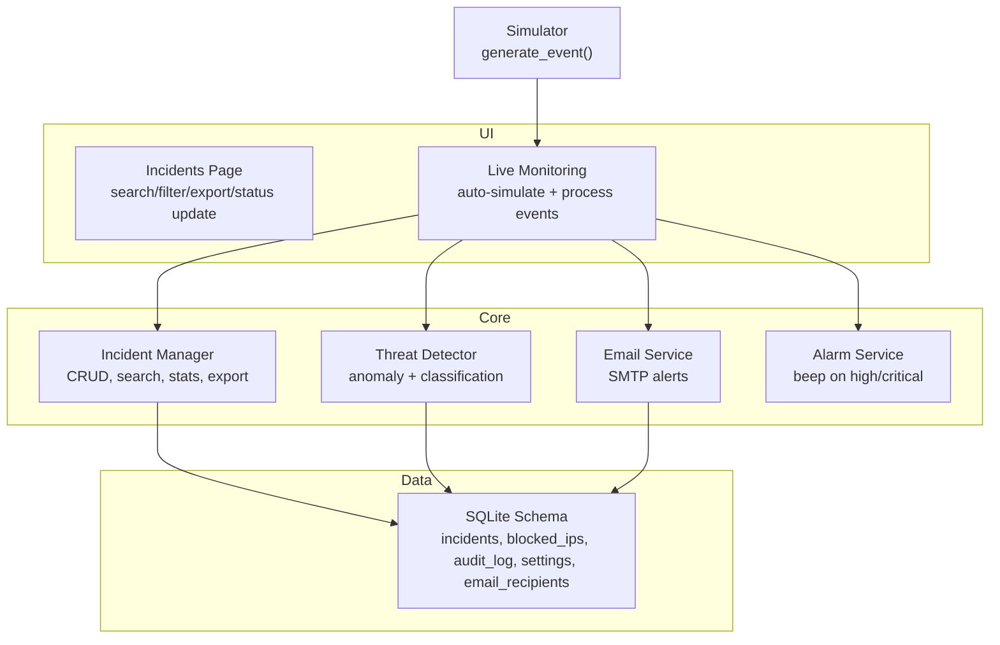
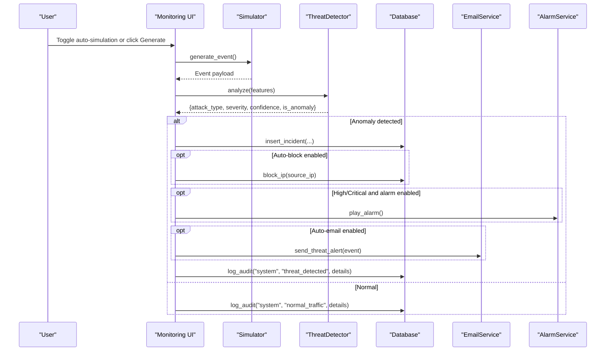
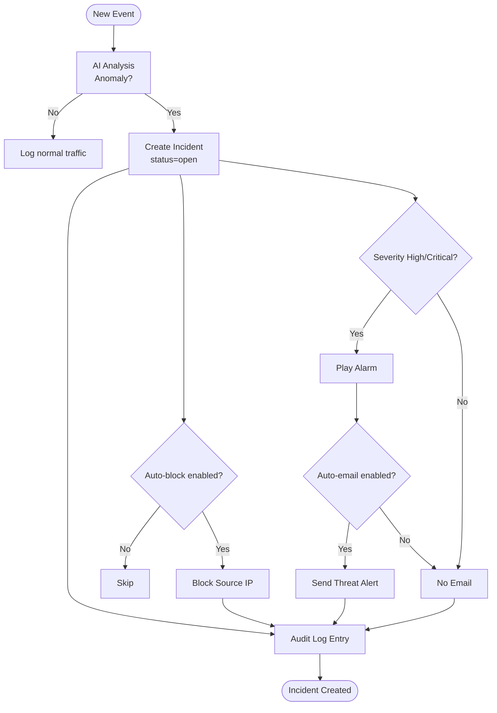
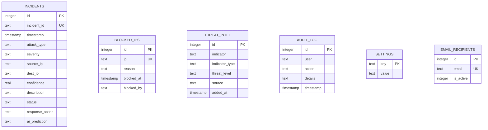
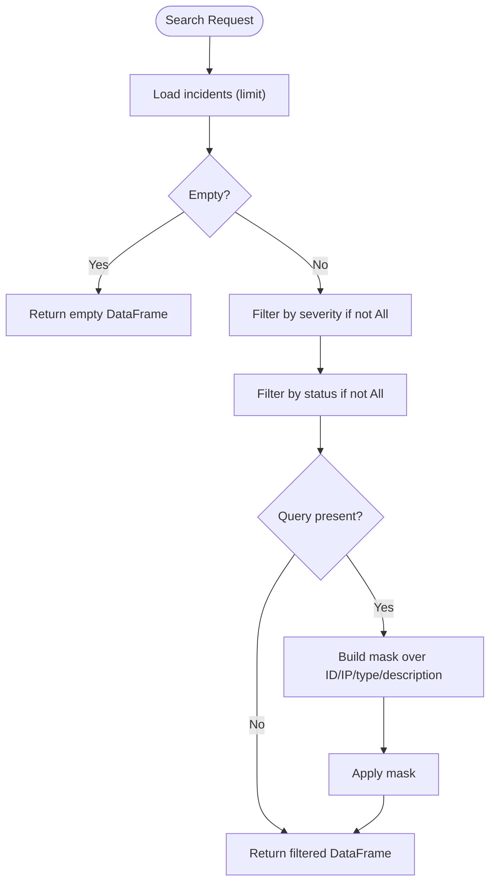
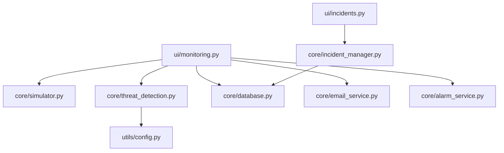

# Incident Management System

<cite>
**Referenced Files in This Document**
- [app.py](file://app.py)
- [database.py](file://core/database.py)
- [incident_manager.py](file://core/incident_manager.py)
- [incidents.py](file://ui/incidents.py)
- [monitoring.py](file://ui/monitoring.py)
- [simulator.py](file://core/simulator.py)
- [threat_detection.py](file://core/threat_detection.py)
- [email_service.py](file://core/email_service.py)
- [alarm_service.py](file://core/alarm_service.py)
- [config.py](file://utils/config.py)
</cite>

## Table of Contents
1. [Introduction](#introduction)
2. [Project Structure](#project-structure)
3. [Core Components](#core-components)
4. [Architecture Overview](#architecture-overview)
5. [Detailed Component Analysis](#detailed-component-analysis)
6. [Dependency Analysis](#dependency-analysis)
7. [Performance Considerations](#performance-considerations)
8. [Troubleshooting Guide](#troubleshooting-guide)
9. [Conclusion](#conclusion)
10. [Appendices](#appendices)

## Introduction
This document explains the incident management system’s end-to-end lifecycle, from threat detection and incident creation to status transitions, search, export, and integrations with notifications and audit logging. It covers CRUD operations for incidents, workflow state management (Open, Investigating, Resolved), priority handling via severity levels, database schema and indexing considerations, bulk operations patterns, and relationships between incidents and threat detections. Practical examples are provided as references to code paths rather than inline code snippets.

## Project Structure
The incident management functionality spans UI, core services, and data layers:
- UI layer provides interactive controls for searching, filtering, exporting, and updating incident statuses.
- Core services implement incident CRUD, search, statistics, and integrations (email, alarms).
- Data layer defines the SQLite schema and helper functions for reading/writing incidents and related entities.
- Simulation and AI detection generate synthetic events and classify them into attack types and severities.

**Diagram sources**
- [incidents.py:1-118](file://ui/incidents.py#L1-L118)
- [monitoring.py:1-133](file://ui/monitoring.py#L1-L133)
- [incident_manager.py:1-57](file://core/incident_manager.py#L1-L57)
- [threat_detection.py:1-147](file://core/threat_detection.py#L1-L147)
- [email_service.py:1-185](file://core/email_service.py#L1-L185)
- [alarm_service.py:1-23](file://core/alarm_service.py#L1-L23)
- [database.py:1-262](file://core/database.py#L1-L262)
- [simulator.py:1-76](file://core/simulator.py#L1-L76)

**Section sources**
- [app.py:101-106](file://app.py#L101-L106)
- [database.py:16-150](file://core/database.py#L16-L150)

## Core Components
- Incident Manager: Provides search by query, severity, and status; updates incident status; exports CSV; computes summary statistics.
- Database Layer: Defines tables including incidents, blocked_ips, audit_log, settings, email_recipients; exposes helpers for querying and inserting incidents.
- Live Monitoring: Generates simulated events, runs AI analysis, persists incidents, triggers alarms and emails based on severity and settings.
- Threat Detection: Classifies traffic features into attack types and severity, returns confidence and anomaly flags.
- Email Service: Sends alert emails using SMTP configuration stored in settings; manages recipients.
- Alarm Service: Plays a beep on Windows when high/critical threats are detected.

Key responsibilities:
- Creation: insert_incident is called during event processing.
- Search: search_incidents filters in-memory after loading recent incidents.
- Status transitions: update_incident_status sets new status values.
- Export: export_csv converts filtered results to CSV; PDF generation is available in the UI.
- Notifications: send_threat_alert integrates with SMTP; play_alarm triggers audio alerts.

**Section sources**
- [incident_manager.py:10-56](file://core/incident_manager.py#L10-L56)
- [database.py:214-236](file://core/database.py#L214-L236)
- [monitoring.py:91-133](file://ui/monitoring.py#L91-L133)
- [threat_detection.py:92-147](file://core/threat_detection.py#L92-L147)
- [email_service.py:130-185](file://core/email_service.py#L130-L185)
- [alarm_service.py:8-23](file://core/alarm_service.py#L8-L23)

## Architecture Overview
The system follows a layered architecture:
- UI orchestrates user actions and displays real-time data.
- Core modules encapsulate business logic (AI analysis, incident management, notifications).
- Data module abstracts SQLite interactions and schema initialization.

**Diagram sources**
- [monitoring.py:91-133](file://ui/monitoring.py#L91-L133)
- [simulator.py:45-76](file://core/simulator.py#L45-L76)
- [threat_detection.py:92-147](file://core/threat_detection.py#L92-L147)
- [database.py:223-236](file://core/database.py#L223-L236)
- [email_service.py:130-185](file://core/email_service.py#L130-L185)
- [alarm_service.py:8-23](file://core/alarm_service.py#L8-L23)

## Detailed Component Analysis

### Incident Lifecycle and Workflow State Management
- Creation: Incidents are created when an anomaly is detected during live monitoring. The system inserts a record with fields such as incident_id, attack_type, severity, source_ip, dest_ip, confidence, description, response_action, and ai_prediction. Default status is open.
- Status Transitions: Users can transition incidents to investigating or resolved via the Incident Center UI. These calls update the status field directly.
- Priority Handling: Severity levels (Low, Medium, High, Critical) influence alerting and visual emphasis. High/Critical trigger alarms and optional email notifications.
- Resolution: Marking as resolved updates the status accordingly; statistics reflect counts of open vs resolved.

**Diagram sources**
- [monitoring.py:91-133](file://ui/monitoring.py#L91-L133)
- [database.py:223-236](file://core/database.py#L223-L236)
- [email_service.py:130-185](file://core/email_service.py#L130-L185)
- [alarm_service.py:8-23](file://core/alarm_service.py#L8-L23)

**Section sources**
- [monitoring.py:91-133](file://ui/monitoring.py#L91-L133)
- [incident_manager.py:29-36](file://core/incident_manager.py#L29-L36)
- [database.py:48-63](file://core/database.py#L48-L63)

### Database Schema and Indexing Strategy
- Schema includes:
  - incidents: primary key id, unique incident_id, timestamp, attack_type, severity, source_ip, dest_ip, confidence, description, status, response_action, ai_prediction.
  - blocked_ips: ip, reason, blocked_at, blocked_by.
  - threat_intel: indicator, indicator_type, threat_level, source, added_at.
  - audit_log: user, action, details, timestamp.
  - settings: key-value pairs for app configuration.
  - email_recipients: active recipient emails.
- Indexing strategy:
  - No explicit indexes are defined in the schema. For efficient querying at scale, consider adding indexes on frequently filtered columns such as status, severity, timestamp, and source_ip.
  - Unique constraint on incident_id prevents duplicates.
- Bulk operations:
  - Insertion uses single-row inserts; for bulk ingestion, batched inserts would improve performance.
  - Reading uses LIMIT-based queries to cap result sizes.

**Diagram sources**
- [database.py:48-114](file://core/database.py#L48-L114)

**Section sources**
- [database.py:48-114](file://core/database.py#L48-L114)
- [database.py:214-236](file://core/database.py#L214-L236)

### Search and Filtering Capabilities
- In-memory search supports:
  - Text search across incident_id, attack_type, source_ip, description.
  - Filter by severity and status.
  - Limit parameter controls maximum rows loaded.
- Performance note: Current implementation loads up to a configured limit and applies pandas filters. For large datasets, consider server-side filtering or indexed queries.

**Diagram sources**
- [incident_manager.py:10-26](file://core/incident_manager.py#L10-L26)

**Section sources**
- [incident_manager.py:10-26](file://core/incident_manager.py#L10-L26)

### Creating Incidents Programmatically
- Programmatic creation path:
  - Use insert_incident with required fields: incident_id, attack_type, severity, source_ip, dest_ip, confidence, description, response_action, ai_prediction.
  - Typically invoked within event processing pipelines after AI analysis determines anomaly and severity.

Example references:
- [Insert incident call:107-114](file://ui/monitoring.py#L107-L114)
- [Insert function definition:223-236](file://core/database.py#L223-L236)

**Section sources**
- [monitoring.py:107-114](file://ui/monitoring.py#L107-L114)
- [database.py:223-236](file://core/database.py#L223-L236)

### Updating Statuses and Workflow Transitions
- Status update function accepts incident_id and new_status, performing an UPDATE on the incidents table.
- UI provides buttons to mark incidents as investigating or resolved.

References:
- [Update status function:29-36](file://core/incident_manager.py#L29-L36)
- [UI status update calls:68-81](file://ui/incidents.py#L68-L81)

**Section sources**
- [incident_manager.py:29-36](file://core/incident_manager.py#L29-L36)
- [incidents.py:68-81](file://ui/incidents.py#L68-L81)

### Exporting Data (CSV and PDF)
- CSV export:
  - export_csv converts a DataFrame to CSV string for download.
- PDF export:
  - _generate_pdf builds a formatted report with headers, summary, and limited rows.

References:
- [CSV export:38-41](file://core/incident_manager.py#L38-L41)
- [PDF generation:84-118](file://ui/incidents.py#L84-L118)

**Section sources**
- [incident_manager.py:38-41](file://core/incident_manager.py#L38-L41)
- [incidents.py:84-118](file://ui/incidents.py#L84-L118)

### Relationship Between Incidents and Threat Detections
- Each incident corresponds to a threat detection event generated by the simulator and analyzed by the ThreatDetector.
- Fields like attack_type, severity, confidence, and ai_prediction originate from the AI analysis pipeline.
- Optional integration with threat intelligence checks enriches context for source IPs.

References:
- [Event generation](file://core/simulator.py:45-L76)
- [AI analysis](file://core/threat_detection.py:92-L147)
- [Threat intel check usage](file://ui/detection.py:86-L92)

**Section sources**
- [simulator.py:45-76](file://core/simulator.py#L45-L76)
- [threat_detection.py:92-147](file://core/threat_detection.py#L92-L147)
- [detection.py:86-92](file://ui/detection.py#L86-L92)

### Audit Logging
- Every significant action is logged to audit_log with user, action, and details.
- Examples include logout, threat detection, blocking/unblocking IPs, and user management actions.

References:
- [Audit log insertion](file://core/database.py:155-L162)
- [Audit entries in monitoring](file://ui/monitoring.py:124-L125)
- [Admin panel audit actions](file://ui/admin.py:58-L96)

**Section sources**
- [database.py:155-162](file://core/database.py#L155-L162)
- [monitoring.py:124-125](file://ui/monitoring.py#L124-L125)
- [admin.py:58-96](file://ui/admin.py#L58-L96)

### Integration with Notification Systems
- Email alerts:
  - send_threat_alert composes and sends emails using SMTP settings from the database.
  - Recipients are managed via email_recipients table.
- Audio alarms:
  - play_alarm plays a beep on Windows for high/critical threats.

References:
- [Email alert function](file://core/email_service.py:130-L185)
- [Recipient management](file://core/email_service.py:10-L34)
- [Alarm service](file://core/alarm_service.py:8-L23)

**Section sources**
- [email_service.py:130-185](file://core/email_service.py#L130-L185)
- [email_service.py:10-34](file://core/email_service.py#L10-L34)
- [alarm_service.py:8-23](file://core/alarm_service.py#L8-L23)

## Dependency Analysis
The incident management components have clear dependencies:
- UI pages depend on core services for data operations and integrations.
- Core services depend on the database module for persistence and configuration.
- Threat detection relies on ML libraries and model artifacts.
- Email and alarm services depend on OS capabilities and SMTP configuration.

**Diagram sources**
- [incidents.py:1-118](file://ui/incidents.py#L1-L118)
- [monitoring.py:1-133](file://ui/monitoring.py#L1-L133)
- [incident_manager.py:1-57](file://core/incident_manager.py#L1-L57)
- [simulator.py:1-76](file://core/simulator.py#L1-L76)
- [threat_detection.py:1-147](file://core/threat_detection.py#L1-L147)
- [database.py:1-262](file://core/database.py#L1-L262)
- [email_service.py:1-185](file://core/email_service.py#L1-L185)
- [alarm_service.py:1-23](file://core/alarm_service.py#L1-L23)
- [config.py:1-36](file://utils/config.py#L1-L36)

**Section sources**
- [app.py:172-200](file://app.py#L172-L200)

## Performance Considerations
- Data loading limits: get_incidents_df uses LIMIT to control memory usage; adjust limits based on dataset size.
- In-memory filtering: search_incidents applies pandas filters; for large datasets, consider SQL-level filtering or indexes.
- Model caching: ThreatDetector is cached in UI to avoid retraining/loading per request.
- Batch operations: insert_incident is single-row; batching would improve throughput for high-volume ingestion.
- Indexing recommendations: Add indexes on status, severity, timestamp, source_ip to accelerate common queries.

[No sources needed since this section provides general guidance]

## Troubleshooting Guide
- Incidents not appearing:
  - Verify get_incidents_df limit and ensure incidents are inserted via insert_incident.
  - Check for duplicate incident_id constraints that may prevent insertion.
- Status updates failing:
  - Ensure incident_id exists and is unique; verify update_incident_status parameters.
- Emails not sent:
  - Confirm SMTP settings in settings table and active recipients in email_recipients.
  - Inspect error logs in email_service for SMTP exceptions.
- Alarms not playing:
  - Alarm service is Windows-only; verify platform and alarm_enabled setting.
- Audit logs missing:
  - Ensure log_audit is called for relevant actions; check audit_log table.

**Section sources**
- [database.py:214-236](file://core/database.py#L214-L236)
- [incident_manager.py:29-36](file://core/incident_manager.py#L29-L36)
- [email_service.py:130-185](file://core/email_service.py#L130-L185)
- [alarm_service.py:8-23](file://core/alarm_service.py#L8-L23)

## Conclusion
The incident management system provides a cohesive workflow for detecting threats, creating incidents, managing their lifecycle, and integrating with notifications and audit logging. While current search and persistence rely on in-memory filtering and single-row inserts, scaling strategies such as indexing and batch operations can enhance performance. The modular design separates UI, core logic, and data access, enabling extensibility and maintainability.

[No sources needed since this section summarizes without analyzing specific files]

## Appendices

### Example References for Common Operations
- Create incident programmatically:
  - [Insert call in monitoring:107-114](file://ui/monitoring.py#L107-L114)
  - [Insert function:223-236](file://core/database.py#L223-L236)
- Filter by criteria:
  - [Search function:10-26](file://core/incident_manager.py#L10-L26)
- Update status:
  - [Update function:29-36](file://core/incident_manager.py#L29-L36)
  - [UI buttons:68-81](file://ui/incidents.py#L68-L81)
- Export data:
  - [CSV export:38-41](file://core/incident_manager.py#L38-L41)
  - [PDF generation:84-118](file://ui/incidents.py#L84-L118)

**Section sources**
- [monitoring.py:107-114](file://ui/monitoring.py#L107-L114)
- [database.py:223-236](file://core/database.py#L223-L236)
- [incident_manager.py:10-26](file://core/incident_manager.py#L10-L26)
- [incident_manager.py:29-36](file://core/incident_manager.py#L29-L36)
- [incidents.py:68-81](file://ui/incidents.py#L68-L81)
- [incidents.py:84-118](file://ui/incidents.py#L84-L118)