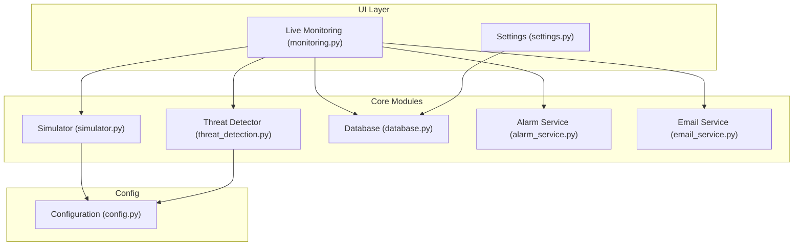
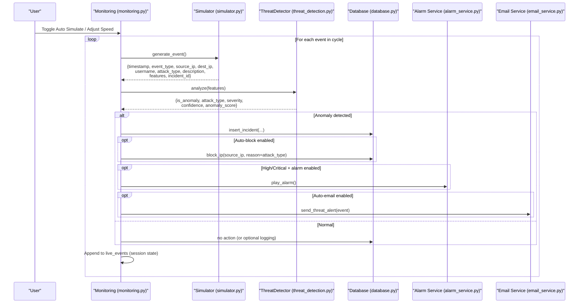
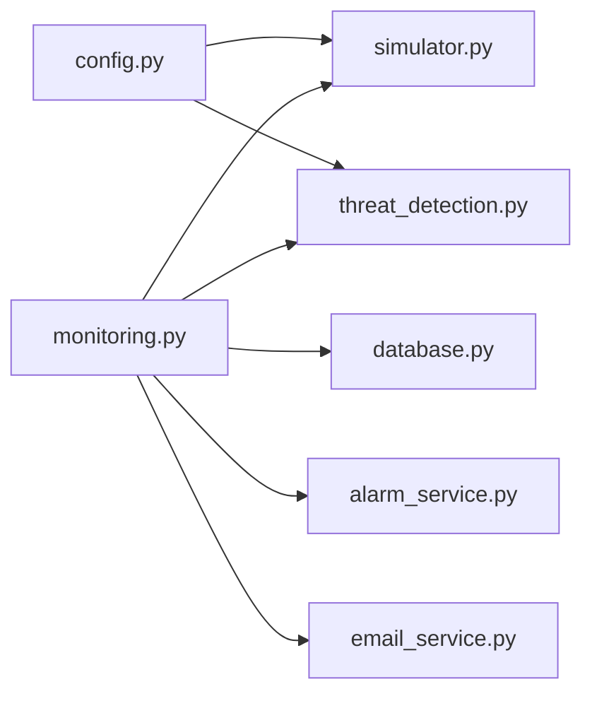
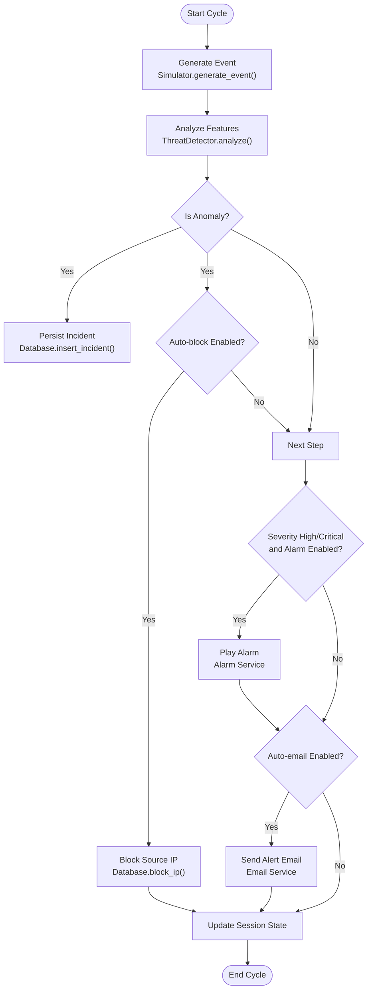

# Network Event Simulator

<cite>
**Referenced Files in This Document**
- [simulator.py](file://core/simulator.py)
- [threat_detection.py](file://core/threat_detection.py)
- [config.py](file://utils/config.py)
- [monitoring.py](file://ui/monitoring.py)
- [database.py](file://core/database.py)
- [alarm_service.py](file://core/alarm_service.py)
- [email_service.py](file://core/email_service.py)
- [settings.py](file://ui/settings.py)
- [app.py](file://app.py)
</cite>

## Table of Contents
1. [Introduction](#introduction)
2. [Project Structure](#project-structure)
3. [Core Components](#core-components)
4. [Architecture Overview](#architecture-overview)
5. [Detailed Component Analysis](#detailed-component-analysis)
6. [Dependency Analysis](#dependency-analysis)
7. [Performance Considerations](#performance-considerations)
8. [Troubleshooting Guide](#troubleshooting-guide)
9. [Conclusion](#conclusion)
10. [Appendices](#appendices)

## Introduction
This document explains the network event simulator module that generates realistic attack scenarios and normal traffic patterns, and how it integrates with the threat detection engine to produce actionable insights for the cybersecurity platform. It covers simulation algorithms, feature generation, statistical distributions, event pipeline, timing controls, configuration options, and example usage patterns.

## Project Structure
The simulator is implemented as a lightweight module that produces synthetic events with realistic features. These events are consumed by the live monitoring UI, analyzed by an AI-based threat detector, persisted to a SQLite database, and optionally trigger alarms or emails.

**Diagram sources**
- [monitoring.py:1-133](file://ui/monitoring.py#L1-L133)
- [simulator.py:1-76](file://core/simulator.py#L1-L76)
- [threat_detection.py:1-147](file://core/threat_detection.py#L1-L147)
- [database.py:1-262](file://core/database.py#L1-L262)
- [alarm_service.py:1-23](file://core/alarm_service.py#L1-L23)
- [email_service.py:1-185](file://core/email_service.py#L1-L185)
- [config.py:1-36](file://utils/config.py#L1-L36)
- [settings.py:1-99](file://ui/settings.py#L1-L99)

**Section sources**
- [app.py:1-200](file://app.py#L1-L200)
- [monitoring.py:1-133](file://ui/monitoring.py#L1-L133)
- [simulator.py:1-76](file://core/simulator.py#L1-L76)
- [threat_detection.py:1-147](file://core/threat_detection.py#L1-L147)
- [database.py:1-262](file://core/database.py#L1-L262)
- [config.py:1-36](file://utils/config.py#L1-L36)
- [settings.py:1-99](file://ui/settings.py#L1-L99)

## Core Components
- Simulator: Generates single or batched events with realistic IP pools, usernames, event types, and feature vectors using statistical distributions.
- Threat Detector: Uses Isolation Forest for anomaly detection and a Random Forest classifier trained on synthetic data to classify attacks; computes severity and confidence.
- Database: Persists incidents, blocked IPs, settings, audit logs, and threat intelligence.
- Alarm and Email Services: Provide audible alerts and SMTP-based notifications for high/critical threats.
- Settings UI: Configures simulation speed, auto-blocking, alarm behavior, and email parameters.

**Section sources**
- [simulator.py:1-76](file://core/simulator.py#L1-L76)
- [threat_detection.py:1-147](file://core/threat_detection.py#L1-L147)
- [database.py:1-262](file://core/database.py#L1-L262)
- [alarm_service.py:1-23](file://core/alarm_service.py#L1-L23)
- [email_service.py:1-185](file://core/email_service.py#L1-L185)
- [settings.py:1-99](file://ui/settings.py#L1-L99)

## Architecture Overview
The event generation pipeline runs inside the Live Monitoring page. Each cycle, the UI requests one or more events from the simulator, analyzes them with the threat detector, persists results, and triggers responses based on severity and configured policies.

**Diagram sources**
- [monitoring.py:20-133](file://ui/monitoring.py#L20-L133)
- [simulator.py:45-76](file://core/simulator.py#L45-L76)
- [threat_detection.py:92-147](file://core/threat_detection.py#L92-L147)
- [database.py:223-236](file://core/database.py#L223-L236)
- [alarm_service.py:8-23](file://core/alarm_service.py#L8-L23)
- [email_service.py:130-185](file://core/email_service.py#L130-L185)

## Detailed Component Analysis

### Simulator Module
Responsibilities:
- Selects attack type from a configurable list.
- Chooses realistic external/internal IP addresses and usernames.
- Generates event metadata and a feature vector for downstream analysis.
- Provides batch generation for throughput testing.

Feature generation and distributions:
- packets_per_sec: exponential distribution (rate parameter tuned for realistic burstiness).
- failed_logins: Poisson distribution (captures sporadic login failures).
- payload_size: exponential distribution (long-tailed payloads).
- unique_ports: Poisson distribution (port scan breadth).
- entropy: uniform distribution across a plausible range.

Attack types and descriptions:
- Attack types are defined centrally and used by both simulator and detector.
- Descriptions map attack types to human-readable summaries.

Batching:
- A helper function returns multiple events for rapid ingestion.

Configuration integration:
- Attack types are imported from the central configuration module.

**Section sources**
- [simulator.py:10-76](file://core/simulator.py#L10-L76)
- [config.py:26-30](file://utils/config.py#L26-L30)

### Threat Detection Engine
Responsibilities:
- Loads or trains models on synthetic data.
- Classifies anomalies and assigns severity/confidence.
- Persists model artifacts for reuse.

Model training:
- Anomaly model: Isolation Forest fitted on synthetic normal vs. attack feature sets.
- Classifier: Random Forest trained on labeled synthetic attack samples via rule-based labels.

Analysis flow:
- Converts event features into a fixed-order vector.
- Computes anomaly score and binary decision.
- Predicts attack type when anomalous; otherwise marks as Normal.
- Calculates severity based on confidence and feature thresholds.

Rule-based labeling during training:
- Heuristics assign labels such as Brute Force, Port Scan, Ransomware, DDoS, SQL Injection, and others based on feature thresholds.

**Section sources**
- [threat_detection.py:15-90](file://core/threat_detection.py#L15-L90)
- [threat_detection.py:92-147](file://core/threat_detection.py#L92-L147)

### Live Monitoring Integration
Responsibilities:
- Drives the simulation loop with user-configurable speed.
- Calls the simulator and detector per event.
- Persists incidents and blocks IPs when configured.
- Triggers alarms and emails for severe threats.
- Maintains a rolling window of recent events in session state.

Timing controls:
- Auto-run toggles continuous generation.
- Events per cycle slider controls throughput.
- Sleep interval between cycles provides pacing.

Response actions:
- Auto-block policy controlled via settings.
- Alarm and email policies controlled via settings.

**Section sources**
- [monitoring.py:20-133](file://ui/monitoring.py#L20-L133)
- [settings.py:66-77](file://ui/settings.py#L66-L77)

### Database and Persistence
Responsibilities:
- Initializes schema and seeds defaults.
- Stores incidents, blocked IPs, settings, audit logs, and threat intel.
- Provides query helpers for UI components.

Key tables:
- incidents: stores threat details, severity, confidence, AI prediction, response action.
- blocked_ips: tracks blocked source IPs and reasons.
- settings: key-value store for application configuration.
- audit_log: records system actions.
- threat_intel: indicator database.

Insertion path:
- Incidents inserted upon anomaly detection with full context.

**Section sources**
- [database.py:16-150](file://core/database.py#L16-L150)
- [database.py:223-236](file://core/database.py#L223-L236)

### Alarm and Email Services
Alarm service:
- Plays a beep sound on Windows systems for high/critical threats.
- Runs asynchronously to avoid blocking.

Email service:
- Sends alert emails via SMTP when configured.
- Supports recipients management and formatted threat summaries.

**Section sources**
- [alarm_service.py:8-23](file://core/alarm_service.py#L8-L23)
- [email_service.py:130-185](file://core/email_service.py#L130-L185)

### Configuration
Centralized configuration includes:
- Base paths and default file locations.
- Severity levels enumeration.
- Attack types list shared across modules.
- App metadata.

**Section sources**
- [config.py:1-36](file://utils/config.py#L1-L36)

## Dependency Analysis
The simulator depends on configuration for attack types. The monitoring UI orchestrates the pipeline by calling the simulator and detector, then interacting with the database and services. The detector depends on configuration for severity levels and attack types.

**Diagram sources**
- [config.py:1-36](file://utils/config.py#L1-L36)
- [simulator.py:1-76](file://core/simulator.py#L1-L76)
- [threat_detection.py:1-147](file://core/threat_detection.py#L1-L147)
- [monitoring.py:1-133](file://ui/monitoring.py#L1-L133)
- [database.py:1-262](file://core/database.py#L1-L262)
- [alarm_service.py:1-23](file://core/alarm_service.py#L1-L23)
- [email_service.py:1-185](file://core/email_service.py#L1-L185)

**Section sources**
- [monitoring.py:1-133](file://ui/monitoring.py#L1-L133)
- [simulator.py:1-76](file://core/simulator.py#L1-L76)
- [threat_detection.py:1-147](file://core/threat_detection.py#L1-L147)
- [database.py:1-262](file://core/database.py#L1-L262)

## Performance Considerations
- Feature generation uses NumPy distributions which are efficient for bulk operations.
- Model loading caches trained models to disk to avoid repeated training.
- Session state maintains a rolling window of events to limit memory usage.
- Database writes are minimal and transactional; consider batching if throughput increases significantly.
- Alarm and email operations are non-blocking where possible to prevent UI stalls.

[No sources needed since this section provides general guidance]

## Troubleshooting Guide
Common issues and resolutions:
- No events appear: Ensure auto-simulate is enabled and speed > 0.
- Models not found: First run will train and persist models under data/models; ensure write permissions.
- Emails not sent: Verify SMTP settings and active recipients in settings.
- Alarms not playing: On non-Windows platforms, the alarm service is a no-op by design.
- Duplicate incidents: Rare due to UUID collisions; handled gracefully by ignoring duplicates.

**Section sources**
- [monitoring.py:20-133](file://ui/monitoring.py#L20-L133)
- [threat_detection.py:27-72](file://core/threat_detection.py#L27-L72)
- [email_service.py:130-185](file://core/email_service.py#L130-L185)
- [alarm_service.py:8-23](file://core/alarm_service.py#L8-L23)

## Conclusion
The network event simulator provides a robust foundation for generating realistic traffic and attack scenarios. Combined with the AI-driven threat detection engine, it enables dynamic visualization, automated responses, and comprehensive analytics. Users can configure simulation parameters through the settings UI and observe real-time outcomes in the monitoring dashboard.

[No sources needed since this section summarizes without analyzing specific files]

## Appendices

### Simulation Algorithms and Statistical Distributions
- Attack selection: Uniform random choice from configured attack types.
- IP selection: Uniform random choice from predefined external and internal pools.
- Feature distributions:
  - packets_per_sec: Exponential distribution.
  - failed_logins: Poisson distribution.
  - payload_size: Exponential distribution.
  - unique_ports: Poisson distribution.
  - entropy: Uniform distribution.

These distributions emulate realistic network behaviors and attack signatures for effective model training and evaluation.

**Section sources**
- [simulator.py:45-76](file://core/simulator.py#L45-L76)
- [config.py:26-30](file://utils/config.py#L26-L30)

### Event Generation Pipeline Flow

**Diagram sources**
- [monitoring.py:91-133](file://ui/monitoring.py#L91-L133)
- [database.py:223-236](file://core/database.py#L223-L236)
- [alarm_service.py:8-23](file://core/alarm_service.py#L8-L23)
- [email_service.py:130-185](file://core/email_service.py#L130-L185)

### Configuring Simulation Parameters
- Enable/disable auto-simulation and set events per cycle in the Live Monitoring page.
- Configure default simulation speed and auto-blocking in Settings > Simulation.
- Configure alarm and email behaviors in Settings > Alarm and Settings > Email.

**Section sources**
- [monitoring.py:27-36](file://ui/monitoring.py#L27-L36)
- [settings.py:66-77](file://ui/settings.py#L66-L77)
- [settings.py:57-65](file://ui/settings.py#L57-L65)
- [settings.py:19-34](file://ui/settings.py#L19-L34)

### Generating Specific Attack Patterns
To emphasize certain attack characteristics:
- Increase failed_logins and reduce unique_ports to simulate Brute Force.
- Increase unique_ports to simulate Port Scans.
- Increase packets_per_sec to simulate DDoS.
- Increase payload_size and entropy to simulate Malware/Ransomware.
- Use moderate payload_size with SQL-like indicators to simulate SQL Injection.

Note: The current simulator uses random distributions; to bias toward specific patterns, extend the generator to conditionally sample features based on selected attack type.

**Section sources**
- [simulator.py:45-76](file://core/simulator.py#L45-L76)
- [threat_detection.py:74-90](file://core/threat_detection.py#L74-L90)

### Analyzing Simulated Data Outputs
- Dashboard displays total threats, critical count, today’s attacks, blocked IPs, and average confidence.
- Recent threats table shows timestamps, incident IDs, attack types, severity, source/destination IPs, and confidence.
- Severity distribution pie chart visualizes threat categories.

**Section sources**
- [dashboard.py:32-119](file://ui/dashboard.py#L32-L119)