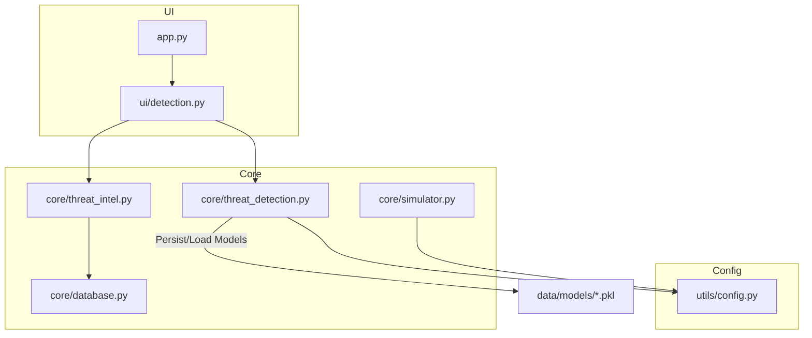
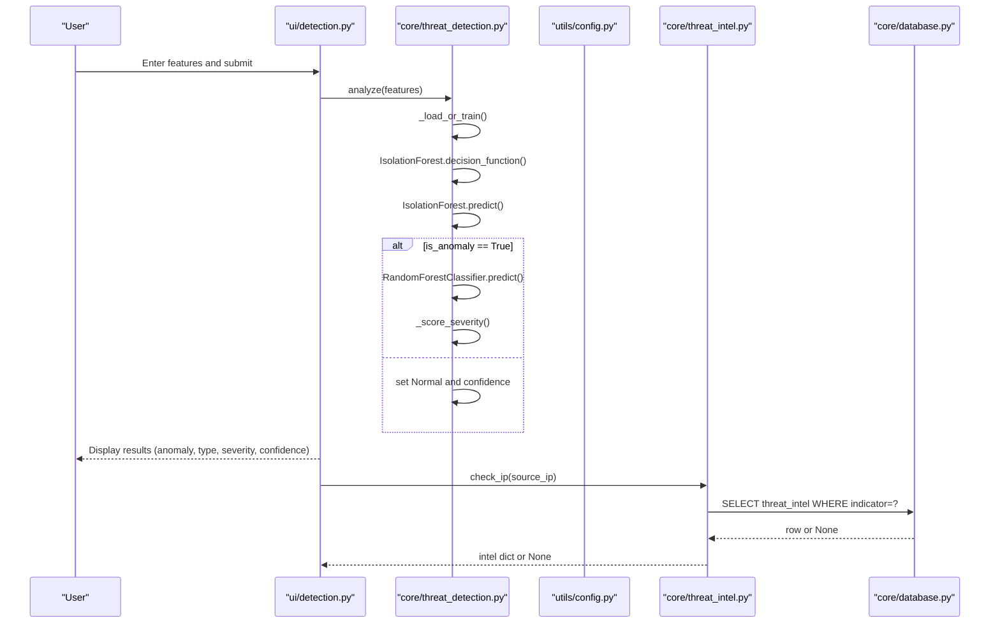
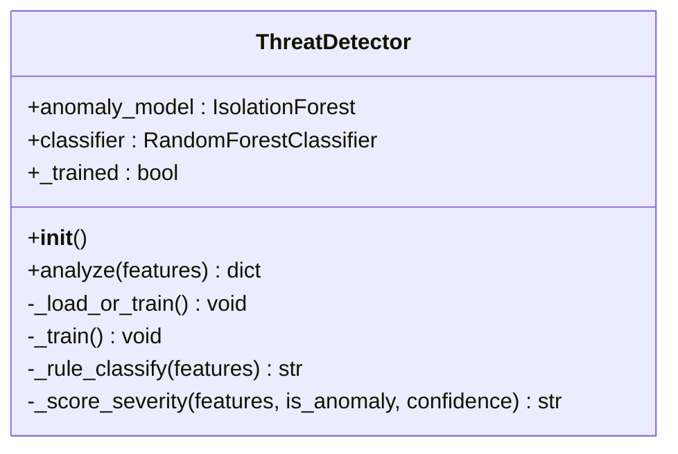
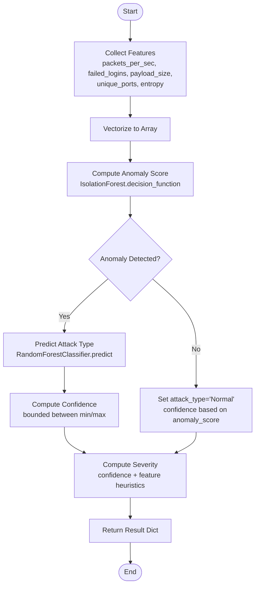
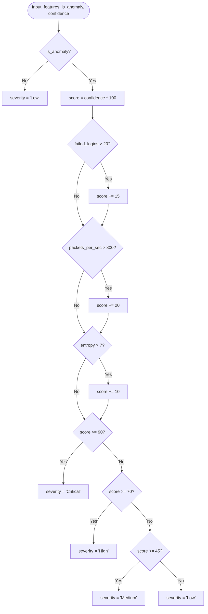
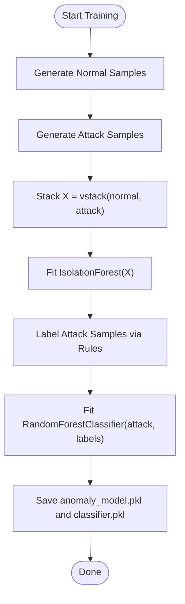
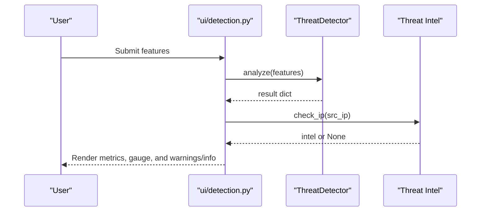
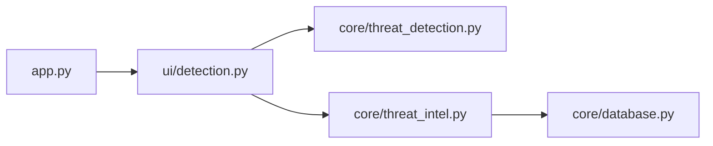
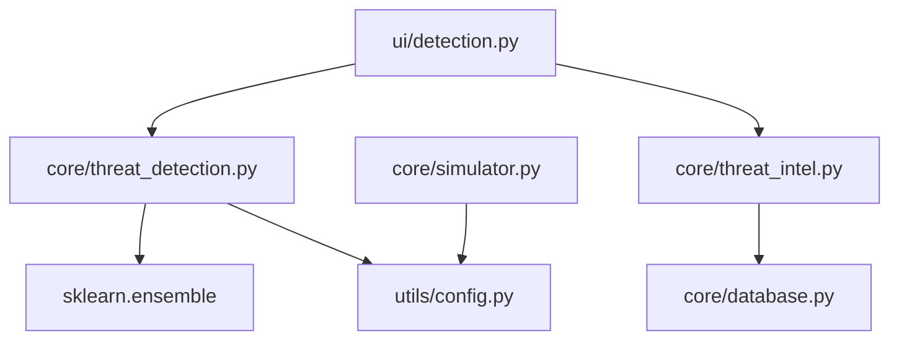

# Threat Detection Engine

<cite>
**Referenced Files in This Document**
- [threat_detection.py](file://core/threat_detection.py)
- [simulator.py](file://core/simulator.py)
- [detection.py](file://ui/detection.py)
- [config.py](file://utils/config.py)
- [database.py](file://core/database.py)
- [threat_intel.py](file://core/threat_intel.py)
- [app.py](file://app.py)
</cite>

## Table of Contents
1. [Introduction](#introduction)
2. [Project Structure](#project-structure)
3. [Core Components](#core-components)
4. [Architecture Overview](#architecture-overview)
5. [Detailed Component Analysis](#detailed-component-analysis)
6. [Dependency Analysis](#dependency-analysis)
7. [Performance Considerations](#performance-considerations)
8. [Troubleshooting Guide](#troubleshooting-guide)
9. [Conclusion](#conclusion)
10. [Appendices](#appendices)

## Introduction
This document explains the Threat Detection Engine module, which implements a dual-model architecture:
- An Isolation Forest for unsupervised anomaly detection to flag suspicious traffic.
- A Random Forest classifier for supervised attack classification on anomalous events.

The engine extracts five key features from network traffic, trains models on synthetic data, and exposes a real-time analysis pipeline through a Streamlit UI. It also includes a severity scoring algorithm that blends model confidence with feature-based heuristics, and persists trained models for reuse across sessions.

## Project Structure
The threat detection functionality spans core logic, simulation utilities, UI integration, configuration, and persistence:
- Core logic: anomaly detection and classification in the ThreatDetector class.
- Simulation: realistic event generation with feature vectors for training and testing.
- UI: manual analysis page that feeds features into the detector and displays results.
- Configuration: shared constants for attack types and severity levels.
- Persistence: SQLite schema for incidents, threat intelligence, and settings; model files stored under data/models.
- Integration: app routing connects the UI to the detection module.

**Diagram sources**
- [app.py:179-181](file://app.py#L179-L181)
- [detection.py:1-96](file://ui/detection.py#L1-L96)
- [threat_detection.py:1-147](file://core/threat_detection.py#L1-L147)
- [simulator.py:1-76](file://core/simulator.py#L1-L76)
- [database.py:1-262](file://core/database.py#L1-L262)
- [threat_intel.py:1-31](file://core/threat_intel.py#L1-L31)
- [config.py:1-36](file://utils/config.py#L1-L36)

**Section sources**
- [app.py:179-181](file://app.py#L179-L181)
- [detection.py:1-96](file://ui/detection.py#L1-L96)
- [threat_detection.py:1-147](file://core/threat_detection.py#L1-L147)
- [simulator.py:1-76](file://core/simulator.py#L1-L76)
- [database.py:1-262](file://core/database.py#L1-L262)
- [threat_intel.py:1-31](file://core/threat_intel.py#L1-L31)
- [config.py:1-36](file://utils/config.py#L1-L36)

## Core Components
- ThreatDetector (Isolation Forest + Random Forest):
  - Loads or trains models on startup using synthetic data.
  - Exposes analyze(features) returning is_anomaly, attack_type, severity, confidence, anomaly_score.
- Simulator:
  - Generates realistic events with feature vectors for training/testing and dashboard simulation.
- UI Detection Page:
  - Accepts user-entered features, calls ThreatDetector.analyze(), and visualizes results including confidence gauge and optional threat intel lookup.
- Configuration:
  - Centralizes attack types and severity levels used by both models and UI.
- Database and Threat Intel:
  - Stores incidents and threat indicators; threat intel can be consulted during analysis.

Key responsibilities:
- Feature extraction: packets_per_sec, failed_logins, payload_size, unique_ports, entropy.
- Model training: synthetic normal vs attack distributions; rule-based labeling for classifier training.
- Real-time analysis: vectorize inputs, run anomaly detection, classify if anomalous, compute severity.
- Persistence: pickle-based model storage under data/models.

**Section sources**
- [threat_detection.py:15-147](file://core/threat_detection.py#L15-L147)
- [simulator.py:45-76](file://core/simulator.py#L45-L76)
- [detection.py:15-96](file://ui/detection.py#L15-L96)
- [config.py:23-30](file://utils/config.py#L23-L30)
- [database.py:48-86](file://core/database.py#L48-L86)
- [threat_intel.py:7-13](file://core/threat_intel.py#L7-L13)

## Architecture Overview
The Threat Detection Engine integrates three layers:
- Data ingestion layer: simulator generates events with features; UI accepts manual input.
- AI inference layer: ThreatDetector performs anomaly detection and classification.
- Persistence and enrichment layer: models are persisted as pickle files; threat intel is queried from SQLite; incidents may be recorded via database helpers.

**Diagram sources**
- [detection.py:24-96](file://ui/detection.py#L24-L96)
- [threat_detection.py:92-147](file://core/threat_detection.py#L92-L147)
- [threat_intel.py:7-13](file://core/threat_intel.py#L7-L13)
- [database.py:238-242](file://core/database.py#L238-L242)

## Detailed Component Analysis

### ThreatDetector Class
Responsibilities:
- Initialize Isolation Forest and Random Forest with default hyperparameters.
- Load pre-trained models if available; otherwise train on synthetic data.
- Analyze incoming feature vectors and return structured results.

Training process:
- Synthetic data generation:
  - Normal traffic: lower packet rates, fewer failed logins, smaller payloads, fewer unique ports, moderate entropy.
  - Attack traffic: higher packet rates, many failed logins, larger payloads, more unique ports, higher entropy.
- Labeling strategy:
  - Rule-based classifier assigns attack labels to synthetic attack samples.
  - Classifier trained only on labeled attack samples; normal traffic is handled by anomaly detection.

Analysis pipeline:
- Vectorize features into fixed order.
- Compute anomaly score and binary decision.
- If anomalous, predict attack type and compute confidence derived from anomaly score.
- Compute severity using confidence and feature thresholds.

Persistence:
- Models saved to data/models/anomaly_model.pkl and data/models/classifier.pkl.

**Diagram sources**
- [threat_detection.py:15-147](file://core/threat_detection.py#L15-L147)

**Section sources**
- [threat_detection.py:15-147](file://core/threat_detection.py#L15-L147)

### Feature Extraction and Real-Time Pipeline
Features:
- packets_per_sec: rate of incoming packets per second.
- failed_logins: number of failed login attempts observed.
- payload_size: size of payload in bytes.
- unique_ports: count of distinct destination ports.
- entropy: measure of randomness in payload content.

Real-time flow:
- UI collects features from user input or simulated events.
- ThreatDetector.analyze converts features to a NumPy array and runs inference.
- Results include anomaly flag, predicted attack type, severity, confidence, and anomaly score.

**Diagram sources**
- [threat_detection.py:92-147](file://core/threat_detection.py#L92-L147)
- [detection.py:35-96](file://ui/detection.py#L35-L96)

**Section sources**
- [threat_detection.py:92-147](file://core/threat_detection.py#L92-L147)
- [detection.py:35-96](file://ui/detection.py#L35-L96)

### Severity Scoring Algorithm
Severity combines model confidence with feature-based heuristics:
- Base score starts at confidence * 100.
- Additive bonuses:
  - failed_logins > 20: +15
  - packets_per_sec > 800: +20
  - entropy > 7: +10
- Thresholds:
  - >= 90: Critical
  - >= 70: High
  - >= 45: Medium
  - < 45: Low
- Non-anomalous traffic defaults to Low severity.

**Diagram sources**
- [threat_detection.py:129-147](file://core/threat_detection.py#L129-L147)

**Section sources**
- [threat_detection.py:129-147](file://core/threat_detection.py#L129-L147)

### Model Training on Synthetic Data
Synthetic dataset:
- Two classes: normal and attack.
- Normal distribution parameters tuned to reflect typical traffic patterns.
- Attack distribution parameters tuned to reflect malicious behavior.

Labeling:
- Rule-based function maps attack feature vectors to specific attack types.
- Classifier trained on labeled attack samples only.

Persistence:
- After training, models are serialized and saved to disk for subsequent loads.

**Diagram sources**
- [threat_detection.py:39-72](file://core/threat_detection.py#L39-L72)

**Section sources**
- [threat_detection.py:39-72](file://core/threat_detection.py#L39-L72)

### UI Integration and Manual Analysis
The UI provides:
- Input fields for each feature.
- Optional source IP for threat intel lookup.
- Visualization of results including metrics and a confidence gauge.

Integration points:
- Calls ThreatDetector.analyze(features).
- Optionally queries threat_intel.check_ip(source_ip).
- Displays JSON summary of features.

**Diagram sources**
- [detection.py:24-96](file://ui/detection.py#L24-L96)
- [threat_intel.py:7-13](file://core/threat_intel.py#L7-L13)

**Section sources**
- [detection.py:24-96](file://ui/detection.py#L24-L96)

### Model Persistence Mechanism
- Storage location: data/models directory created automatically.
- Files:
  - anomaly_model.pkl: Isolation Forest instance.
  - classifier.pkl: Random Forest instance.
- Loading:
  - On initialization, check existence; load if present; otherwise train and save.

Operational notes:
- Ensure write permissions to data/models.
- Replace models by deleting existing .pkl files to force retraining.

**Section sources**
- [threat_detection.py:11-12](file://core/threat_detection.py#L11-L12)
- [threat_detection.py:27-37](file://core/threat_detection.py#L27-L37)
- [threat_detection.py:68-72](file://core/threat_detection.py#L68-L72)

### Retraining Procedures
To retrain models:
- Delete existing model files in data/models.
- Reinitialize ThreatDetector to trigger synthetic training and persistence.
- Validate new models by running sample analyses and reviewing outputs.

Best practices:
- Periodically refresh synthetic distributions to reflect evolving traffic patterns.
- Consider augmenting synthetic data with domain-specific rules or limited labeled datasets when available.

**Section sources**
- [threat_detection.py:27-37](file://core/threat_detection.py#L27-L37)
- [threat_detection.py:39-72](file://core/threat_detection.py#L39-L72)

### Integration Patterns with Other Modules
- App routing:
  - The main app routes to the Threat Detection page.
- Threat Intelligence:
  - UI optionally checks source IPs against known-bad indicators stored in SQLite.
- Incidents and Logging:
  - Database schema supports storing incidents and audit logs; detection results can be persisted via incident insertion functions.

**Diagram sources**
- [app.py:179-181](file://app.py#L179-L181)
- [detection.py:1-96](file://ui/detection.py#L1-L96)
- [threat_intel.py:1-31](file://core/threat_intel.py#L1-L31)
- [database.py:1-262](file://core/database.py#L1-L262)

**Section sources**
- [app.py:179-181](file://app.py#L179-L181)
- [detection.py:1-96](file://ui/detection.py#L1-L96)
- [threat_intel.py:1-31](file://core/threat_intel.py#L1-L31)
- [database.py:1-262](file://core/database.py#L1-L262)

## Dependency Analysis
Key dependencies:
- ThreatDetector depends on sklearn IsolationForest and RandomForestClassifier.
- ThreatDetector uses utils.config for ATTACK_TYPES and SEVERITY_LEVELS.
- UI depends on ThreatDetector and Threat Intel for enrichment.
- Threat Intel depends on core.database for SQLite access.
- Simulator depends on utils.config for attack types.

Coupling and cohesion:
- ThreatDetector encapsulates all ML logic and persistence, maintaining high cohesion.
- UI isolates presentation and user interaction, delegating analysis to ThreatDetector.
- Threat Intel abstracts database queries, keeping SQL details out of UI and detection modules.

Potential circular dependencies:
- None detected among analyzed modules.

External dependencies:
- numpy, pickle, sklearn, sqlite3, pandas.

**Diagram sources**
- [threat_detection.py:1-10](file://core/threat_detection.py#L1-L10)
- [detection.py:1-10](file://ui/detection.py#L1-L10)
- [threat_intel.py:1-5](file://core/threat_intel.py#L1-L5)
- [database.py:1-8](file://core/database.py#L1-L8)
- [simulator.py:1-9](file://core/simulator.py#L1-L9)

**Section sources**
- [threat_detection.py:1-10](file://core/threat_detection.py#L1-L10)
- [detection.py:1-10](file://ui/detection.py#L1-L10)
- [threat_intel.py:1-5](file://core/threat_intel.py#L1-L5)
- [database.py:1-8](file://core/database.py#L1-L8)
- [simulator.py:1-9](file://core/simulator.py#L1-L9)

## Performance Considerations
- Model loading:
  - Pre-trained models avoid repeated training overhead on startup.
- Inference latency:
  - Isolation Forest decision_function and predict are lightweight for small feature vectors.
  - Random Forest prediction is fast for small trees and few estimators.
- Memory usage:
  - Synthetic training uses modest arrays; ensure sufficient memory for large batches if extended.
- Disk I/O:
  - Model persistence uses pickle; ensure fast storage for frequent reloads.
- Scalability:
  - For real-time streaming, consider batching requests and caching detector instances.

[No sources needed since this section provides general guidance]

## Troubleshooting Guide
Common issues and resolutions:
- Missing model files:
  - Symptom: Models not found on first run.
  - Resolution: Allow training to complete; verify data/models exists and is writable.
- Incorrect feature keys:
  - Symptom: Unexpected results or errors.
  - Resolution: Ensure feature names match expected keys exactly.
- Low confidence scores:
  - Symptom: Confidence near minimum values.
  - Resolution: Review feature distributions; adjust synthetic training parameters or add labeled data.
- Severity always Low:
  - Symptom: Non-anomalous detections.
  - Resolution: Verify anomaly threshold and feature ranges; tune contamination parameter if necessary.
- Threat intel not found:
  - Symptom: No warning for source IP.
  - Resolution: Populate threat_intel table with relevant indicators.

**Section sources**
- [threat_detection.py:27-37](file://core/threat_detection.py#L27-L37)
- [threat_detection.py:92-127](file://core/threat_detection.py#L92-L127)
- [threat_intel.py:7-13](file://core/threat_intel.py#L7-L13)

## Conclusion
The Threat Detection Engine delivers a practical, dual-model approach combining unsupervised anomaly detection with supervised classification. Its synthetic training pipeline enables immediate operation without labeled data, while the severity scoring algorithm balances model confidence with actionable heuristics. The Streamlit UI facilitates interactive analysis and visualization, and persistence ensures efficient reuse across sessions. With clear extension points for retraining and integration with threat intelligence and incident management, the engine serves as a robust foundation for real-time cyber defense operations.

[No sources needed since this section summarizes without analyzing specific files]

## Appendices

### Practical Examples
- Analyzing network traffic features:
  - Provide packets_per_sec, failed_logins, payload_size, unique_ports, entropy via the UI form.
  - Interpret results:
    - is_anomaly indicates whether traffic deviates from normal patterns.
    - attack_type suggests the likely attack category when anomalous.
    - severity reflects combined confidence and heuristic scoring.
    - confidence quantifies model certainty.
- Customizing detection thresholds:
  - Adjust Isolation Forest contamination to change sensitivity.
  - Modify severity thresholds in the scoring function to align with organizational risk tolerance.
  - Update rule-based classifier logic to incorporate domain-specific indicators.

[No sources needed since this section provides general guidance]