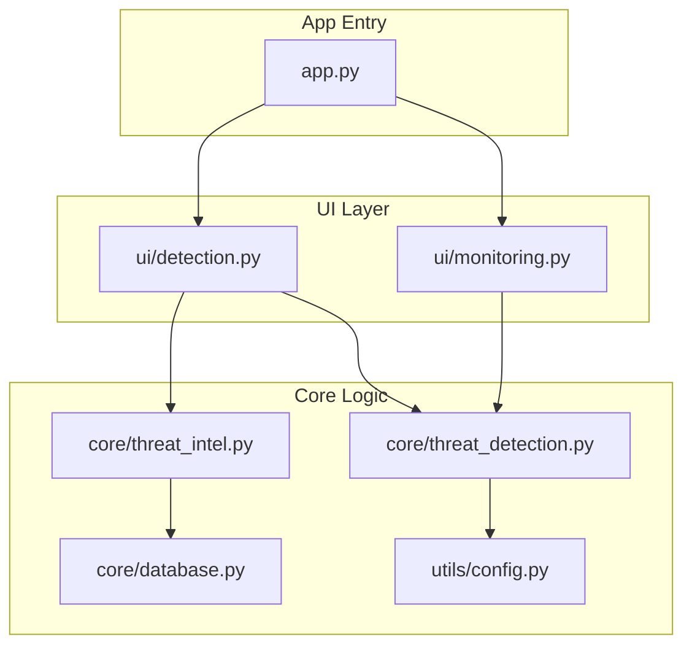
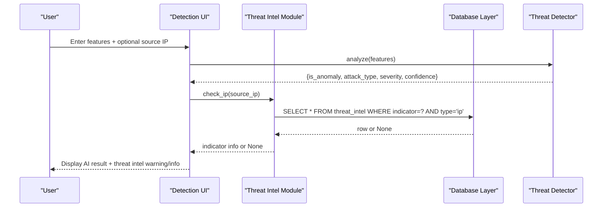
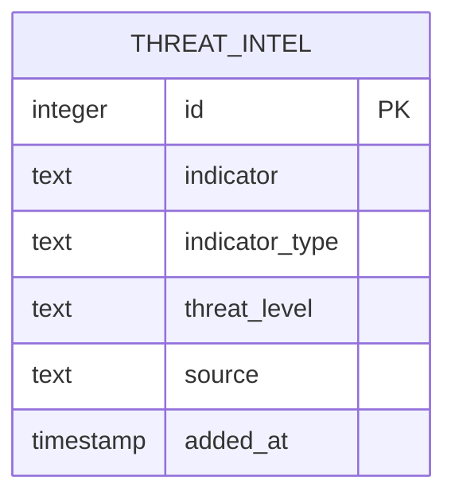
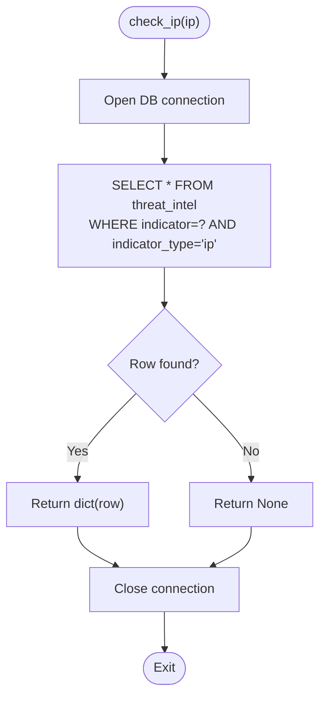
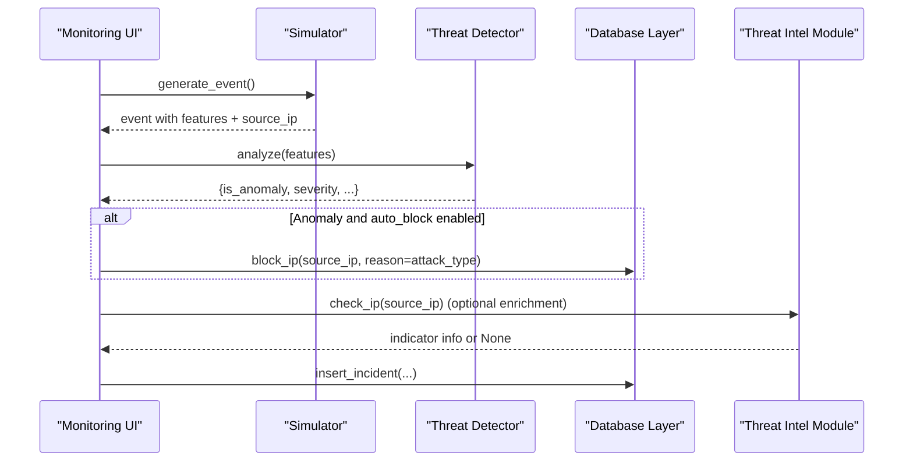
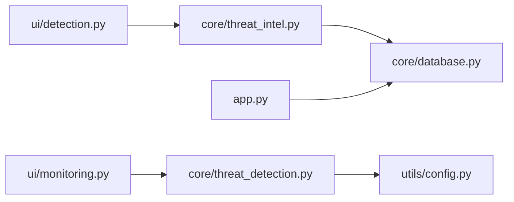

# Threat Intelligence Module

<cite>
**Referenced Files in This Document**
- [core/threat_intel.py](file://core/threat_intel.py)
- [core/database.py](file://core/database.py)
- [core/threat_detection.py](file://core/threat_detection.py)
- [ui/detection.py](file://ui/detection.py)
- [ui/monitoring.py](file://ui/monitoring.py)
- [utils/config.py](file://utils/config.py)
- [app.py](file://app.py)
</cite>

## Table of Contents
1. [Introduction](#introduction)
2. [Project Structure](#project-structure)
3. [Core Components](#core-components)
4. [Architecture Overview](#architecture-overview)
5. [Detailed Component Analysis](#detailed-component-analysis)
6. [Dependency Analysis](#dependency-analysis)
7. [Performance Considerations](#performance-considerations)
8. [Troubleshooting Guide](#troubleshooting-guide)
9. [Conclusion](#conclusion)
10. [Appendices](#appendices)

## Introduction
This document explains the threat intelligence module that manages known threat indicators and integrates with detection workflows. It covers:
- The threat indicator database schema and how indicators are stored and queried
- IP reputation checking and domain lookups against local threat intel
- Pattern matching and AI-based anomaly detection used alongside threat intel
- Integration points for external feeds, local databases, and real-time blocking
- Procedures to add new indicators, query the database, implement custom rules, update feeds, and validate incoming data

## Project Structure
The threat intelligence functionality is implemented across a small set of focused modules:
- Database layer defines the threat_intel table and helper functions
- Threat intel module provides lookup and add operations
- UI pages integrate threat intel checks into manual analysis and live monitoring
- Configuration constants define severity levels and attack types used by detection logic

**Diagram sources**
- [app.py:102-106](file://app.py#L102-L106)
- [ui/detection.py:1-96](file://ui/detection.py#L1-L96)
- [ui/monitoring.py:1-133](file://ui/monitoring.py#L1-L133)
- [core/threat_intel.py:1-31](file://core/threat_intel.py#L1-L31)
- [core/threat_detection.py:1-147](file://core/threat_detection.py#L1-L147)
- [core/database.py:1-262](file://core/database.py#L1-L262)
- [utils/config.py:1-36](file://utils/config.py#L1-L36)

**Section sources**
- [app.py:102-106](file://app.py#L102-L106)
- [core/database.py:76-86](file://core/database.py#L76-L86)
- [core/threat_intel.py:1-31](file://core/threat_intel.py#L1-L31)
- [ui/detection.py:1-96](file://ui/detection.py#L1-L96)
- [ui/monitoring.py:1-133](file://ui/monitoring.py#L1-L133)
- [utils/config.py:23-30](file://utils/config.py#L23-L30)

## Core Components
- Threat Intel Module: Provides functions to check IPs/domains against the threat_intel table and to add new indicators.
- Database Layer: Defines the threat_intel schema, seeds initial indicators, and exposes helpers to read/write threat intel and related tables (incidents, blocked_ips).
- Threat Detection: Implements AI-based anomaly detection and classification; while not part of threat intel per se, it complements indicator checks with behavioral analysis.
- UI Pages: Integrate threat intel lookups into manual analysis and display results to users.

Key responsibilities:
- Store and retrieve threat indicators (IPs, domains, countries)
- Provide fast exact-match lookups for reputation checks
- Support adding new indicators from feeds or manual curation
- Persist incidents and block lists for real-time response

**Section sources**
- [core/threat_intel.py:7-31](file://core/threat_intel.py#L7-L31)
- [core/database.py:76-149](file://core/database.py#L76-L149)
- [core/database.py:238-252](file://core/database.py#L238-L252)
- [ui/detection.py:85-92](file://ui/detection.py#L85-L92)

## Architecture Overview
The threat intelligence module integrates with the application’s detection pipeline and UI:

**Diagram sources**
- [ui/detection.py:35-92](file://ui/detection.py#L35-L92)
- [core/threat_intel.py:7-13](file://core/threat_intel.py#L7-L13)
- [core/database.py:238-242](file://core/database.py#L238-L242)

## Detailed Component Analysis

### Threat Indicator Database Schema
The threat_intel table stores known-bad indicators with metadata:
- id: auto-increment primary key
- indicator: the value to match (e.g., IP, domain, country code)
- indicator_type: category such as ip, domain, country
- threat_level: severity label (Low, Medium, High, Critical)
- source: feed or origin of the indicator
- added_at: timestamp when inserted

Initial seed data includes sample IPs, domains, and country codes to demonstrate usage.

**Diagram sources**
- [core/database.py:76-86](file://core/database.py#L76-L86)

**Section sources**
- [core/database.py:76-86](file://core/database.py#L76-L86)
- [core/database.py:133-149](file://core/database.py#L133-L149)

### IP Reputation Checking and Domain Lookups
Functions provided:
- check_ip(ip): Exact match on indicator_type='ip'
- check_domain(domain): Exact match on indicator_type='domain'
- get_all_intel(): Returns all indicators as a DataFrame
- add_intel(indicator, indicator_type, threat_level, source): Inserts a new indicator

These functions use parameterized queries to prevent injection and return structured results.

**Diagram sources**
- [core/threat_intel.py:7-13](file://core/threat_intel.py#L7-L13)
- [core/database.py:10-13](file://core/database.py#L10-L13)

**Section sources**
- [core/threat_intel.py:7-31](file://core/threat_intel.py#L7-L31)
- [core/database.py:238-252](file://core/database.py#L238-L252)

### Integration with Real-Time Blocking
While threat intel focuses on indicator reputation, the system supports real-time blocking via:
- Blocked IPs table and helpers (block_ip, unblock_ip, is_ip_blocked)
- Live monitoring flow that blocks detected threats based on settings

Integration example:
- Monitoring generates events, runs AI analysis, and if an anomaly is detected, may block the source IP automatically depending on configuration.
- Threat intel can be used to enrich alerts (e.g., warn if source IP is known-bad).

**Diagram sources**
- [ui/monitoring.py:91-133](file://ui/monitoring.py#L91-L133)
- [core/database.py:181-205](file://core/database.py#L181-L205)
- [core/threat_intel.py:7-13](file://core/threat_intel.py#L7-L13)

**Section sources**
- [ui/monitoring.py:91-133](file://ui/monitoring.py#L91-L133)
- [core/database.py:181-205](file://core/database.py#L181-L205)

### Pattern Matching Capabilities
Threat intel uses exact string matching on indicator values. For broader pattern matching (e.g., CIDR ranges, regex), extend the lookup functions:
- Add support for prefix matching on IPs
- Implement regex-based domain matching
- Maintain a separate patterns table if needed

Current implementation is optimized for fast exact matches using indexed columns (conceptually) and simple SQL queries.

**Section sources**
- [core/threat_intel.py:7-22](file://core/threat_intel.py#L7-L22)

### Adding New Threat Indicators
Use the provided API to add indicators:
- add_intel(indicator, indicator_type, threat_level, source)
- Directly via database helper: add_threat_intel(...)

Recommended fields:
- indicator: the value to match
- indicator_type: ip, domain, country, etc.
- threat_level: Low, Medium, High, Critical
- source: feed name or internal tag

Validation recommendations:
- Normalize inputs (trim whitespace, lowercase domains)
- Validate indicator_type against allowed values
- Enforce threat_level against configured SEVERITY_LEVELS

**Section sources**
- [core/threat_intel.py:29-31](file://core/threat_intel.py#L29-L31)
- [core/database.py:245-252](file://core/database.py#L245-L252)
- [utils/config.py:23-24](file://utils/config.py#L23-L24)

### Querying Threat Databases
- get_all_intel(): Retrieve all indicators as a DataFrame for inspection or export
- check_ip/check_domain: Single-record lookups for enrichment

Best practices:
- Use parameterized queries (already implemented)
- Cache frequent lookups at the application level if needed
- Paginate large datasets when exporting

**Section sources**
- [core/threat_intel.py:25-27](file://core/threat_intel.py#L25-L27)
- [core/database.py:238-242](file://core/database.py#L238-L242)

### Implementing Custom Threat Detection Rules
Custom rules can complement indicator checks:
- Extend _rule_classify in ThreatDetector to add heuristic thresholds
- Combine indicator presence with behavioral signals (e.g., high entropy + known-bad IP)
- Persist rule outcomes in incidents for auditability

Example integration points:
- In UI detection page, after AI analysis, apply additional rules before presenting results
- In monitoring flow, enforce policy decisions based on combined signals

**Section sources**
- [core/threat_detection.py:74-89](file://core/threat_detection.py#L74-L89)
- [ui/detection.py:35-92](file://ui/detection.py#L35-L92)

### External Threat Intelligence Sources
To integrate external feeds:
- Create a feed ingestion script that:
  - Downloads indicators from remote sources
  - Normalizes and validates entries
  - Uses add_threat_intel to persist them
  - Logs ingestion results and errors
- Schedule periodic updates via cron or task scheduler
- Maintain versioning and deduplication strategies

Considerations:
- Rate limiting and retries for remote calls
- Signature verification for signed feeds
- Quarantine unknown indicators until validated

[No sources needed since this section provides general guidance]

### Update Procedures for Threat Intelligence Feeds
Proposed workflow:
- Download feed file(s)
- Parse and normalize records
- Validate fields (indicator_type, threat_level)
- Upsert into threat_intel with source tracking
- Generate change reports and audit logs
- Rollback on validation failures

Operational steps:
- Run ingestion script with dry-run mode first
- Apply changes during maintenance windows
- Monitor error logs and reconcile discrepancies

[No sources needed since this section provides general guidance]

### Validation Processes for Incoming Threat Data
Validation checklist:
- Type checks for indicator_type (ip, domain, country)
- Format checks (IPv4/IPv6, FQDN, ISO country codes)
- Allowed threat_level values
- Source attribution required
- Duplicate prevention (ignore or merge)

Implementation suggestions:
- Centralize validators in utils/validation.py
- Raise descriptive errors for invalid inputs
- Log rejected entries for review

[No sources needed since this section provides general guidance]

## Dependency Analysis
The threat intelligence module depends on the database layer and is consumed by UI components. Threat detection is independent but complementary.

**Diagram sources**
- [ui/detection.py:1-96](file://ui/detection.py#L1-L96)
- [ui/monitoring.py:1-133](file://ui/monitoring.py#L1-L133)
- [core/threat_intel.py:1-31](file://core/threat_intel.py#L1-L31)
- [core/threat_detection.py:1-147](file://core/threat_detection.py#L1-L147)
- [core/database.py:1-262](file://core/database.py#L1-L262)
- [utils/config.py:1-36](file://utils/config.py#L1-L36)
- [app.py:102-106](file://app.py#L102-L106)

**Section sources**
- [core/threat_intel.py:1-31](file://core/threat_intel.py#L1-L31)
- [core/database.py:1-262](file://core/database.py#L1-L262)
- [ui/detection.py:1-96](file://ui/detection.py#L1-L96)
- [ui/monitoring.py:1-133](file://ui/monitoring.py#L1-L133)

## Performance Considerations
- Exact-match queries on threat_intel are efficient; consider indexing indicator and indicator_type for large datasets.
- Cache frequent lookups in memory for hot paths (e.g., repeated IP checks in tight loops).
- Batch inserts when ingesting feeds to reduce transaction overhead.
- Avoid heavy computations in UI threads; offload model training and feed processing to background tasks.

[No sources needed since this section provides general guidance]

## Troubleshooting Guide
Common issues and resolutions:
- No indicators returned: Verify indicator_type and exact string match; ensure data was seeded or ingested.
- Insert failures: Check constraints and duplicate keys; validate input formats.
- Slow queries: Add indexes on frequently queried columns; paginate results.
- Missing threat intel warnings in UI: Ensure source_ip is provided and correctly formatted.

Operational checks:
- Confirm DB initialization and seeding run at startup.
- Validate settings like auto_block and alarm_enabled.
- Review audit logs for actions and errors.

**Section sources**
- [core/database.py:155-162](file://core/database.py#L155-L162)
- [core/database.py:165-178](file://core/database.py#L165-L178)
- [ui/monitoring.py:117-125](file://ui/monitoring.py#L117-L125)

## Conclusion
The threat intelligence module provides a robust foundation for managing known-bad indicators and integrating with detection workflows. With clear APIs for lookups and additions, it supports both manual and automated operations. Extending pattern matching, integrating external feeds, and implementing validation will further strengthen its capabilities.

[No sources needed since this section summarizes without analyzing specific files]

## Appendices

### Example Workflows

#### Adding a New Threat Indicator
Steps:
- Prepare indicator details (value, type, threat_level, source)
- Call add_intel or add_threat_intel
- Verify insertion via get_all_intel

**Section sources**
- [core/threat_intel.py:29-31](file://core/threat_intel.py#L29-L31)
- [core/database.py:245-252](file://core/database.py#L245-L252)

#### Querying the Threat Database
Steps:
- Use get_all_intel to fetch all indicators
- Filter locally or via SQL for specific types
- Export to CSV for reporting

**Section sources**
- [core/threat_intel.py:25-27](file://core/threat_intel.py#L25-L27)
- [core/database.py:238-242](file://core/database.py#L238-L242)

#### Implementing Custom Detection Rules
Steps:
- Extend rule classifier in ThreatDetector
- Combine indicator presence with behavioral signals
- Log outcomes and persist incidents

**Section sources**
- [core/threat_detection.py:74-89](file://core/threat_detection.py#L74-L89)
- [ui/detection.py:35-92](file://ui/detection.py#L35-L92)