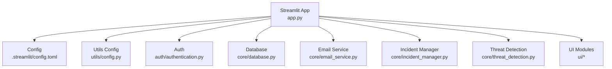
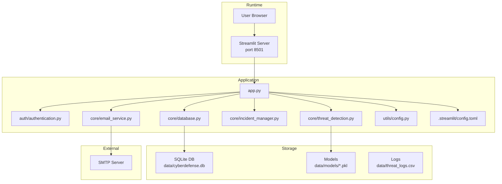
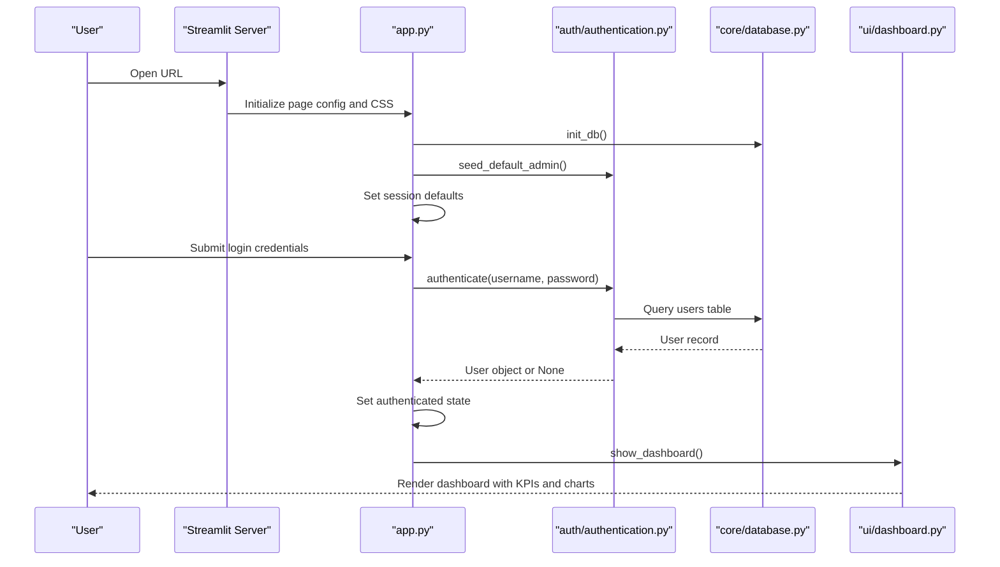
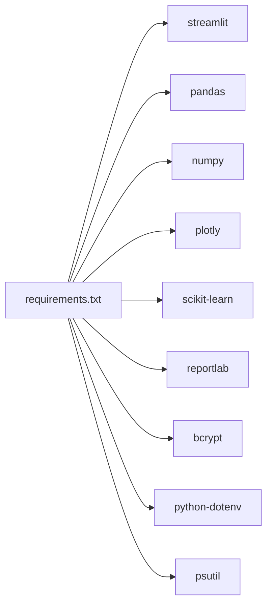

# Deployment & Operations

<cite>
**Referenced Files in This Document**
- [app.py](file://app.py)
- [requirements.txt](file://requirements.txt)
- [.streamlit/config.toml](file://.streamlit/config.toml)
- [utils/config.py](file://utils/config.py)
- [core/database.py](file://core/database.py)
- [auth/authentication.py](file://auth/authentication.py)
- [core/email_service.py](file://core/email_service.py)
- [core/incident_manager.py](file://core/incident_manager.py)
- [core/threat_detection.py](file://core/threat_detection.py)
- [ui/dashboard.py](file://ui/dashboard.py)
</cite>

## Table of Contents
1. Introduction
2. Project Structure
3. Core Components
4. Architecture Overview
5. Detailed Component Analysis
6. Dependency Analysis
7. Performance Considerations
8. Troubleshooting Guide
9. Conclusion
10. Appendices

## Introduction
This document provides operational guidance for deploying, configuring, and maintaining the Autonomous AI Cyber Defense Platform across development, staging, and production environments. It covers environment setup, containerization options, cloud deployment considerations, monitoring and logging, backup and recovery, performance optimization, scaling strategies, troubleshooting, security hardening, update procedures, and disaster recovery planning. The platform is a Streamlit-based application with an SQLite data store, SMTP-based alerting, and ML-driven threat detection.

## Project Structure
The application follows a modular structure:
- Entry point and UI routing: app.py
- Configuration: .streamlit/config.toml, utils/config.py
- Data layer: core/database.py (SQLite schema and helpers)
- Authentication: auth/authentication.py
- Services: core/email_service.py, core/incident_manager.py, core/threat_detection.py
- UI modules: ui/* (dashboard, login, etc.)
- Dependencies: requirements.txt

**Diagram sources**
- [app.py:1-200](file://app.py#L1-L200)
- [.streamlit/config.toml:1-14](file://.streamlit/config.toml#L1-L14)
- [utils/config.py:1-36](file://utils/config.py#L1-L36)
- [core/database.py:1-248](file://core/database.py#L1-L248)
- [auth/authentication.py:1-99](file://auth/authentication.py#L1-L99)
- [core/email_service.py:1-92](file://core/email_service.py#L1-L92)
- [core/incident_manager.py:1-57](file://core/incident_manager.py#L1-L57)
- [core/threat_detection.py:1-147](file://core/threat_detection.py#L1-L147)
- [ui/dashboard.py:1-119](file://ui/dashboard.py#L1-L119)

**Section sources**
- [app.py:1-200](file://app.py#L1-L200)
- [requirements.txt:1-10](file://requirements.txt#L1-L10)
- [.streamlit/config.toml:1-14](file://.streamlit/config.toml#L1-L14)
- [utils/config.py:1-36](file://utils/config.py#L1-L36)

## Core Components
- Application entrypoint initializes page config, global CSS, database, default admin, session state, and routes to UI pages based on sidebar selection.
- Database module defines SQLite schema, seeds defaults, and exposes helper functions for incidents, blocked IPs, audit logs, settings, and threat intel.
- Authentication handles password hashing, user registration, login, and admin seeding.
- Email service sends SMTP alerts using configured credentials and recipients.
- Incident manager provides search, status updates, CSV export, and statistics.
- Threat detection uses IsolationForest and RandomForestClassifier with synthetic training data and persists models under data/models.

Key runtime behaviors:
- On startup, the app initializes the database and seeds a default admin if none exists.
- Session state controls authentication and active sessions.
- Dashboard displays KPIs, system resources, and recent threats.

**Section sources**
- [app.py:101-120](file://app.py#L101-L120)
- [core/database.py:16-136](file://core/database.py#L16-L136)
- [auth/authentication.py:89-99](file://auth/authentication.py#L89-L99)
- [core/email_service.py:37-92](file://core/email_service.py#L37-L92)
- [core/incident_manager.py:10-57](file://core/incident_manager.py#L10-L57)
- [core/threat_detection.py:15-73](file://core/threat_detection.py#L15-L73)
- [ui/dashboard.py:32-119](file://ui/dashboard.py#L32-L119)

## Architecture Overview
The platform runs as a Streamlit web application backed by SQLite. External integrations include SMTP for email alerts and optional OS-specific alarm sounds. Models are persisted locally for reuse.

**Diagram sources**
- [app.py:1-200](file://app.py#L1-L200)
- [.streamlit/config.toml:8-11](file://.streamlit/config.toml#L8-L11)
- [utils/config.py:8-21](file://utils/config.py#L8-L21)
- [core/database.py:10-16](file://core/database.py#L10-L16)
- [core/email_service.py:37-92](file://core/email_service.py#L37-L92)
- [core/threat_detection.py:11-12](file://core/threat_detection.py#L11-L12)

## Detailed Component Analysis

### Streamlit Server and Configuration
- Server mode is headless with port 8501 defined in configuration.
- Theme and browser telemetry settings are centralized.
- Application sets page title, icon, layout, and global CSS at startup.

Operational notes:
- Ensure the server port is available or reconfigure via configuration file.
- Disable usage stats in production to avoid external telemetry.

**Section sources**
- [.streamlit/config.toml:8-14](file://.streamlit/config.toml#L8-L14)
- [app.py:8-13](file://app.py#L8-L13)

### Database Initialization and Schema
- SQLite database path is derived from base directory and stored under data/.
- Tables include users, incidents, blocked_ips, threat_intel, audit_log, settings, email_recipients.
- Default settings and threat intelligence indicators are seeded on first run.

Operational notes:
- Back up data/cyberdefense.db regularly.
- Validate schema migrations before upgrades.

**Section sources**
- [utils/config.py:8-13](file://utils/config.py#L8-L13)
- [core/database.py:16-136](file://core/database.py#L16-L136)

### Authentication Flow
- Passwords are hashed using bcrypt; login validates against active users.
- Audit events are logged for successful and failed logins.
- Default admin is seeded if no admin exists.

Security notes:
- Change default admin credentials immediately after deployment.
- Enforce strong passwords and consider adding MFA at the reverse proxy level.

**Section sources**
- [auth/authentication.py:9-44](file://auth/authentication.py#L9-L44)
- [auth/authentication.py:89-99](file://auth/authentication.py#L89-L99)

### Email Alerting
- SMTP settings are read from settings table; requires smtp_email and smtp_password to be set.
- Recipients are managed in email_recipients table.
- Alerts include structured details about detected threats.

Operational notes:
- Configure SMTP credentials securely via environment variables or secrets management.
- Test connectivity to SMTP server during deployment validation.

**Section sources**
- [core/email_service.py:37-92](file://core/email_service.py#L37-L92)
- [core/database.py:151-165](file://core/database.py#L151-L165)

### Incident Management
- Search supports filtering by severity, status, and free-text query.
- Status updates persist changes to incidents table.
- CSV export enables offline analysis and reporting.

Operational notes:
- Use export functionality for compliance and archival.
- Implement access controls to restrict incident modifications.

**Section sources**
- [core/incident_manager.py:10-41](file://core/incident_manager.py#L10-L41)
- [core/incident_manager.py:44-57](file://core/incident_manager.py#L44-L57)

### Threat Detection Model Lifecycle
- Models are loaded from data/models/ if present; otherwise trained on synthetic data and saved.
- Anomaly detection uses IsolationForest; classification uses RandomForestClassifier.
- Severity scoring combines confidence and feature thresholds.

Operational notes:
- Persist models across deployments to avoid retraining overhead.
- Monitor model drift and schedule periodic retraining with real-world data.

**Section sources**
- [core/threat_detection.py:15-73](file://core/threat_detection.py#L15-L73)
- [core/threat_detection.py:92-147](file://core/threat_detection.py#L92-L147)

### Dashboard and System Monitoring
- Displays KPIs, severity distribution, and recent threats.
- Shows CPU, RAM, and disk usage via psutil.

Operational notes:
- Integrate with external metrics collectors (e.g., Prometheus) for production monitoring.
- Replace local resource checks with container orchestrator health endpoints.

**Section sources**
- [ui/dashboard.py:32-119](file://ui/dashboard.py#L32-L119)

## Architecture Overview
The following sequence illustrates the login flow and subsequent dashboard rendering.

**Diagram sources**
- [app.py:101-120](file://app.py#L101-L120)
- [auth/authentication.py:33-44](file://auth/authentication.py#L33-L44)
- [core/database.py:16-31](file://core/database.py#L16-L31)
- [ui/dashboard.py:32-67](file://ui/dashboard.py#L32-L67)

## Dependency Analysis
Dependencies are declared in requirements.txt and include Streamlit, data science libraries, and utilities.

**Diagram sources**
- [requirements.txt:1-10](file://requirements.txt#L1-L10)

**Section sources**
- [requirements.txt:1-10](file://requirements.txt#L1-L10)

## Performance Considerations
- Database:
  - Use connection pooling patterns where possible; ensure proper transaction boundaries.
  - Index frequently queried columns (e.g., timestamp, severity, status) to improve search performance.
- Models:
  - Cache and reuse trained models to avoid repeated training.
  - Periodically retrain with updated datasets to maintain accuracy.
- UI:
  - Minimize heavy computations in render loops; precompute KPIs and cache results.
  - Limit data fetch sizes (e.g., LIMIT clauses) to reduce memory usage.
- Resources:
  - Monitor CPU, RAM, and disk usage; scale horizontally by running multiple Streamlit instances behind a load balancer.
- Logging:
  - Centralize logs and rotate files to prevent disk exhaustion.

[No sources needed since this section provides general guidance]

## Troubleshooting Guide
Common issues and resolutions:
- Cannot connect to SMTP:
  - Verify smtp_server, smtp_port, smtp_email, and smtp_password in settings.
  - Check network connectivity and firewall rules to the SMTP server.
- No alerts sent:
  - Ensure at least one active recipient exists in email_recipients.
  - Confirm auto_email setting is enabled if automated sending is expected.
- Login failures:
  - Confirm user is active and credentials are correct.
  - Review audit_log for failed attempts and reasons.
- Database errors:
  - Validate SQLite file permissions and integrity.
  - Re-run initialization only when necessary to avoid overwriting data.
- High resource usage:
  - Inspect dashboard resource indicators and optimize queries.
  - Reduce dataset sizes and limit refresh rates.

Health check procedures:
- HTTP health endpoint: Expose a lightweight endpoint returning 200 OK when the app is responsive.
- Database health: Attempt a simple SELECT query to verify connectivity.
- SMTP health: Send a test email and confirm delivery.
- Model availability: Check existence of model files and validate load success.

Backup and recovery:
- Backup data/cyberdefense.db and data/models/*.pkl regularly.
- Store backups offsite and encrypt them.
- Test restore procedures periodically to ensure recoverability.

Security hardening:
- Change default admin credentials immediately.
- Enforce HTTPS via reverse proxy (e.g., Nginx).
- Restrict access to sensitive endpoints using authentication and authorization.
- Rotate SMTP credentials and use least-privilege accounts.

Update procedures:
- Version dependencies in requirements.txt and pin versions for reproducibility.
- Apply schema migrations carefully and back up the database before upgrades.
- Validate model compatibility and retrain if necessary.

Disaster recovery planning:
- Define RTO/RPO targets for critical components.
- Maintain runbooks for common failure scenarios.
- Automate backups and restores where feasible.

**Section sources**
- [core/email_service.py:37-92](file://core/email_service.py#L37-L92)
- [core/database.py:141-148](file://core/database.py#L141-L148)
- [auth/authentication.py:33-44](file://auth/authentication.py#L33-L44)
- [ui/dashboard.py:96-110](file://ui/dashboard.py#L96-L110)

## Conclusion
This guide outlines how to deploy, configure, monitor, and maintain the cyber defense platform effectively. By following the recommended practices for environment setup, security, performance, and operations, teams can ensure reliable and secure operation across all environments. Continuous improvement through monitoring, backups, and updates will sustain platform resilience and effectiveness.

[No sources needed since this section summarizes without analyzing specific files]

## Appendices

### Environment Setup
- Development:
  - Install dependencies from requirements.txt.
  - Run Streamlit app locally; adjust port if needed.
- Staging:
  - Mirror production configuration; disable telemetry.
  - Configure SMTP and recipients for testing.
- Production:
  - Deploy behind a reverse proxy with TLS termination.
  - Harden OS and container images; enforce least privilege.

### Containerization Options
- Dockerfile recommendations:
  - Use a minimal Python base image.
  - Copy application code and install dependencies.
  - Expose port 8501 and run Streamlit in headless mode.
- Orchestration:
  - Use Kubernetes or Docker Compose for multi-instance deployments.
  - Mount persistent volumes for data and models.

### Cloud Deployment Considerations
- Managed services:
  - Use managed databases if migrating from SQLite for scalability.
  - Utilize secret managers for credentials.
- Scaling:
  - Horizontal scaling with load balancers.
  - Auto-scaling policies based on CPU/memory or custom metrics.

### Monitoring and Logging
- Metrics:
  - Export application metrics to a time-series database.
  - Track request latency, error rates, and resource utilization.
- Logging:
  - Centralize logs with structured formats.
  - Implement log rotation and retention policies.

### Security Hardening Checklist
- Enforce HTTPS and secure headers.
- Rotate secrets regularly.
- Enable audit logging for administrative actions.
- Regularly scan dependencies for vulnerabilities.

### Backup and Recovery Procedures
- Automated daily backups of database and models.
- Encrypted storage with restricted access.
- Periodic restore drills to validate integrity.

[No sources needed since this section provides general guidance]