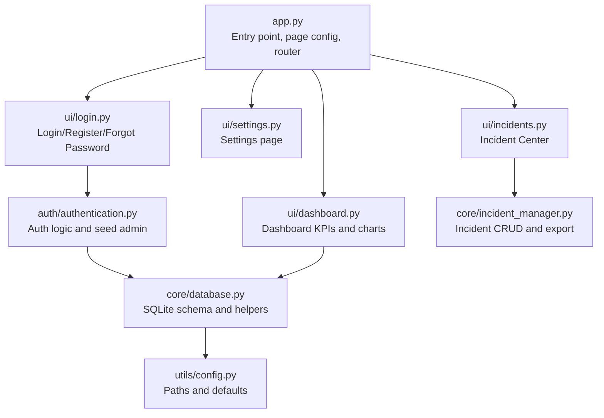
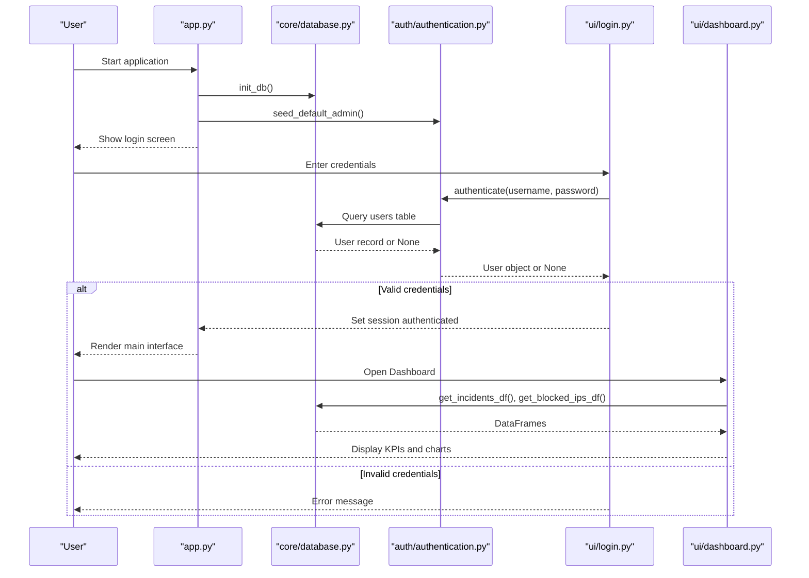
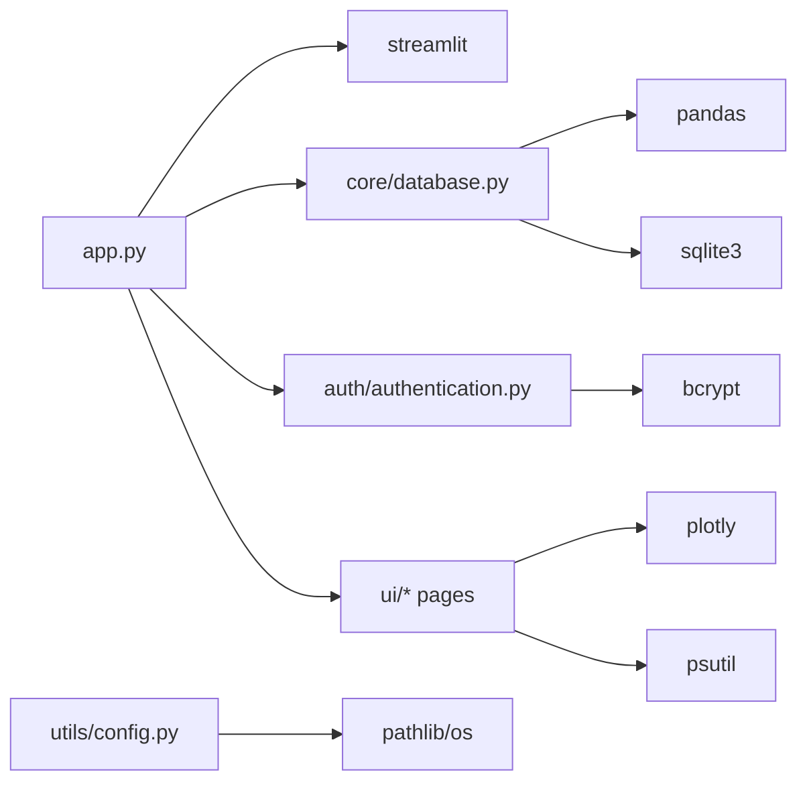

# Getting Started Guide

<cite>
**Referenced Files in This Document**
- [app.py](file://app.py)
- [requirements.txt](file://requirements.txt)
- [utils/config.py](file://utils/config.py)
- [core/database.py](file://core/database.py)
- [auth/authentication.py](file://auth/authentication.py)
- [ui/login.py](file://ui/login.py)
- [ui/dashboard.py](file://ui/dashboard.py)
- [core/incident_manager.py](file://core/incident_manager.py)
</cite>

## Table of Contents
1. Introduction
2. Project Structure
3. Core Components
4. Architecture Overview
5. Detailed Component Analysis
6. Dependency Analysis
7. Performance Considerations
8. Troubleshooting Guide
9. Conclusion
10. Appendices

## Introduction
This guide helps you install, configure, and run the Cyber Defense Platform for the first time. You will set up a Python environment, install dependencies, initialize the database, create the default admin account, launch the application, and perform basic tasks such as monitoring threats, creating incidents, and configuring settings. The instructions are beginner-friendly and include verification steps to ensure everything is working correctly.

## Project Structure
The platform is a Streamlit-based web application with modular components:
- Application entry point and routing
- Authentication and user management
- Database schema and helpers
- UI pages (login, dashboard, monitoring, incidents, etc.)
- Configuration constants and paths

**Diagram sources**
- [app.py:1-200](file://app.py#L1-L200)
- [ui/login.py:1-102](file://ui/login.py#L1-L102)
- [ui/dashboard.py:1-119](file://ui/dashboard.py#L1-L119)
- [auth/authentication.py:1-99](file://auth/authentication.py#L1-L99)
- [core/database.py:1-248](file://core/database.py#L1-L248)
- [core/incident_manager.py:1-57](file://core/incident_manager.py#L1-L57)
- [utils/config.py:1-36](file://utils/config.py#L1-L36)

**Section sources**
- [app.py:1-200](file://app.py#L1-L200)
- [utils/config.py:1-36](file://utils/config.py#L1-L36)

## Core Components
- Entry point and navigation: app.py initializes the Streamlit page, sets global CSS, seeds the database and default admin, enforces login, and routes to feature pages via sidebar selection.
- Authentication: auth/authentication.py provides password hashing, user registration, authentication, and seeding a default admin account if none exists.
- Database: core/database.py defines SQLite tables, seeds default settings and threat intelligence, and exposes helper functions for queries and mutations.
- UI pages: ui/login.py handles login/register/forgot-password; ui/dashboard.py shows KPIs, severity distribution, and system resources; other pages provide additional functionality.
- Incident management: core/incident_manager.py supports searching, status updates, CSV export, and statistics for incidents.
- Configuration: utils/config.py centralizes paths, email defaults, severity levels, attack types, and app metadata.

**Section sources**
- [app.py:101-200](file://app.py#L101-L200)
- [auth/authentication.py:1-99](file://auth/authentication.py#L1-L99)
- [core/database.py:16-136](file://core/database.py#L16-L136)
- [ui/login.py:1-102](file://ui/login.py#L1-L102)
- [ui/dashboard.py:32-119](file://ui/dashboard.py#L32-L119)
- [core/incident_manager.py:10-57](file://core/incident_manager.py#L10-L57)
- [utils/config.py:1-36](file://utils/config.py#L1-L36)

## Architecture Overview
At startup, the application initializes the database, seeds default settings and an admin user, then presents a login gate. After successful authentication, the sidebar navigates to different modules that read from and write to the SQLite database.

**Diagram sources**
- [app.py:101-120](file://app.py#L101-L120)
- [core/database.py:16-136](file://core/database.py#L16-L136)
- [auth/authentication.py:33-44](file://auth/authentication.py#L33-L44)
- [ui/login.py:38-54](file://ui/login.py#L38-L54)
- [ui/dashboard.py:36-48](file://ui/dashboard.py#L36-L48)

## Detailed Component Analysis

### Installation and Environment Setup
- Install Python 3.10+ on your system.
- Create a virtual environment and activate it.
- Install dependencies listed in requirements.txt using pip.
- Verify installation by running the application.

Verification tips:
- Ensure streamlit is installed and can start without errors.
- Confirm that the data directory and SQLite database file are created after the first run.

**Section sources**
- [requirements.txt:1-10](file://requirements.txt#L1-L10)
- [app.py:1-20](file://app.py#L1-L20)

### Initial Configuration
- The application uses a local SQLite database stored under the data directory.
- Default SMTP server and port are defined in configuration; these can be overridden via the Settings UI.
- Severity levels and attack types are predefined and used across the UI and database.

Configuration highlights:
- Database path and log path are derived from base directory.
- Email defaults include SMTP server, port, and default admin email.
- App metadata includes title, icon, and version.

**Section sources**
- [utils/config.py:8-36](file://utils/config.py#L8-L36)
- [core/database.py:104-117](file://core/database.py#L104-L117)

### First Launch Process
- Run the Streamlit app from the project root.
- On first run, the database is initialized and default settings are seeded.
- A default admin account is created automatically if no admin exists.
- The login screen appears; use the default admin credentials to sign in.

Default admin credentials:
- Username: admin
- Password: admin123

After logging in, the sidebar displays navigation options including Dashboard, Live Monitoring, Threat Detection, Analytics, Incident Center, Reports, AI Assistant, Settings, and Admin Panel.

**Section sources**
- [app.py:101-120](file://app.py#L101-L120)
- [auth/authentication.py:89-99](file://auth/authentication.py#L89-L99)
- [ui/login.py:97-101](file://ui/login.py#L97-L101)

### Basic Navigation
- Use the sidebar radio menu to switch between pages.
- The Dashboard shows KPI cards, severity distribution, and recent threats.
- The Incident Center allows searching, updating statuses, and exporting data.
- Settings lets you adjust SMTP and operational toggles.

Navigation flow:
- Select a page from the sidebar.
- The corresponding module loads and renders its content.
- Data is fetched from the database and displayed in charts or tables.

**Section sources**
- [app.py:147-200](file://app.py#L147-L200)
- [ui/dashboard.py:32-119](file://ui/dashboard.py#L32-L119)
- [core/incident_manager.py:10-57](file://core/incident_manager.py#L10-L57)

### Quick Start Examples

#### Monitor Threats
- Go to the Dashboard to see total threats, critical count, today’s attacks, blocked IPs, detection percentage, and AI confidence.
- View the severity distribution pie chart and recent threats table.
- System resource gauges show CPU, RAM, and Disk usage.

What happens behind the scenes:
- The dashboard queries incidents and blocked IPs from the database.
- It computes counts and averages and renders Plotly charts and progress bars.

**Section sources**
- [ui/dashboard.py:36-119](file://ui/dashboard.py#L36-L119)
- [core/database.py:200-206](file://core/database.py#L200-L206)

#### Create Incidents
- While the simulator populates incidents automatically, you can also manage them via the Incident Center.
- Search incidents by ID, attack type, source IP, or description.
- Update incident status (e.g., open, resolved).
- Export results to CSV for offline analysis.

Underlying operations:
- search_incidents filters the dataset based on query parameters.
- update_incident_status writes new status to the database.
- export_csv converts the DataFrame to a CSV string for download.

**Section sources**
- [core/incident_manager.py:10-41](file://core/incident_manager.py#L10-L41)
- [core/database.py:200-206](file://core/database.py#L200-L206)

#### Configure Basic Settings
- Open the Settings page to configure SMTP server, port, and toggles for alarms, auto-blocking, and auto-email.
- These values are stored in the settings table and used by services like email notifications.

Key settings:
- smtp_server, smtp_port, smtp_email, smtp_password
- alarm_enabled, auto_block, auto_email, simulation_speed

**Section sources**
- [core/database.py:104-117](file://core/database.py#L104-L117)
- [utils/config.py:18-21](file://utils/config.py#L18-L21)

### Verification Steps
- Confirm the application starts without errors.
- Log in with the default admin credentials.
- Check the Dashboard for KPIs and charts.
- Verify that the data directory contains the SQLite database file.
- Test creating or updating an incident and exporting CSV.

If any step fails, review the troubleshooting section below.

**Section sources**
- [app.py:101-120](file://app.py#L101-L120)
- [ui/dashboard.py:32-119](file://ui/dashboard.py#L32-L119)
- [core/incident_manager.py:38-41](file://core/incident_manager.py#L38-L41)

## Dependency Analysis
The application depends on several libraries for UI, data processing, visualization, and security:
- streamlit: Web UI framework
- pandas and numpy: Data manipulation
- plotly: Interactive charts
- scikit-learn: Machine learning utilities
- reportlab: PDF/report generation
- bcrypt: Password hashing
- python-dotenv: Environment variable loading
- psutil: System resource monitoring

**Diagram sources**
- [app.py:1-20](file://app.py#L1-L20)
- [core/database.py:1-10](file://core/database.py#L1-L10)
- [auth/authentication.py:1-10](file://auth/authentication.py#L1-L10)
- [ui/dashboard.py:1-10](file://ui/dashboard.py#L1-L10)
- [utils/config.py:1-10](file://utils/config.py#L1-L10)
- [requirements.txt:1-10](file://requirements.txt#L1-L10)

**Section sources**
- [requirements.txt:1-10](file://requirements.txt#L1-L10)
- [core/database.py:1-10](file://core/database.py#L1-L10)
- [auth/authentication.py:1-10](file://auth/authentication.py#L1-L10)
- [ui/dashboard.py:1-10](file://ui/dashboard.py#L1-L10)
- [utils/config.py:1-10](file://utils/config.py#L1-L10)

## Performance Considerations
- The database is SQLite; keep queries efficient and avoid excessive reads/writes in tight loops.
- Use limits when fetching large datasets (e.g., incident queries) to prevent memory spikes.
- Streamlit reruns the script on interactions; cache expensive computations where appropriate.
- Monitor system resources via the Dashboard to identify bottlenecks.

[No sources needed since this section provides general guidance]

## Troubleshooting Guide
Common issues and resolutions:
- Cannot start Streamlit:
  - Ensure all dependencies from requirements.txt are installed.
  - Verify Python version compatibility.
- Login fails:
  - Confirm the default admin credentials are correct.
  - Check that the database was initialized and the users table exists.
- No data on Dashboard:
  - Wait for the simulator to populate incidents or manually add incidents via the Incident Center.
- Settings not saving:
  - Ensure the settings table is present and writable.
  - Restart the app to reload configurations.

Where to look:
- Database initialization and seeding: core/database.py
- Authentication flow and error messages: auth/authentication.py and ui/login.py
- Dashboard data queries: ui/dashboard.py and core/database.py

**Section sources**
- [core/database.py:16-136](file://core/database.py#L16-L136)
- [auth/authentication.py:33-44](file://auth/authentication.py#L33-L44)
- [ui/login.py:38-54](file://ui/login.py#L38-L54)
- [ui/dashboard.py:36-48](file://ui/dashboard.py#L36-L48)

## Conclusion
You now have a fully functional Cyber Defense Platform running locally. Use the Dashboard to monitor threats, the Incident Center to manage incidents, and Settings to configure operational parameters. As you become more comfortable, explore additional modules like Threat Detection, Analytics, Reports, and the AI Assistant to extend your defensive capabilities.

[No sources needed since this section summarizes without analyzing specific files]

## Appendices

### Step-by-Step Installation Checklist
- Install Python 3.10+.
- Create and activate a virtual environment.
- Install dependencies from requirements.txt.
- Run the Streamlit app from the project root.
- Verify database creation and default admin account.
- Log in with default admin credentials.
- Navigate to Dashboard and confirm KPIs and charts render.

**Section sources**
- [requirements.txt:1-10](file://requirements.txt#L1-L10)
- [app.py:101-120](file://app.py#L101-L120)
- [auth/authentication.py:89-99](file://auth/authentication.py#L89-L99)
- [ui/dashboard.py:32-119](file://ui/dashboard.py#L32-L119)