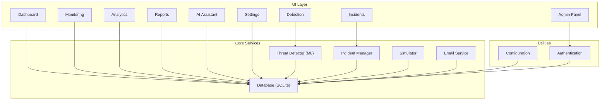
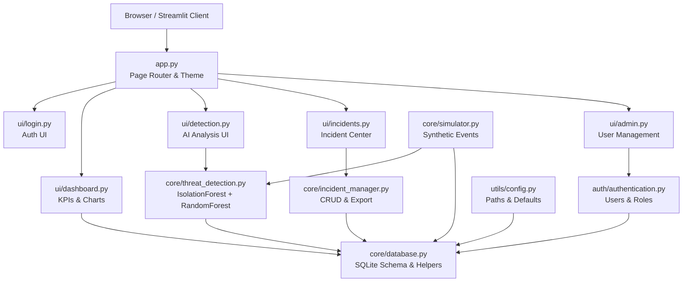
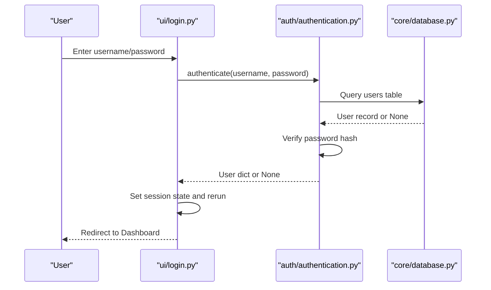
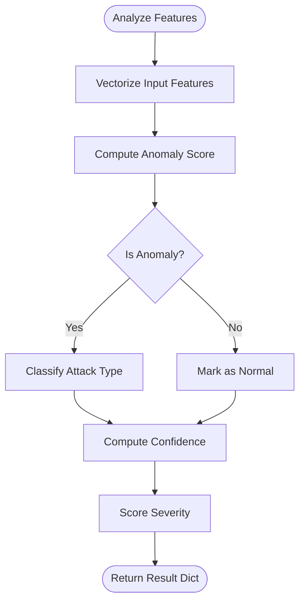
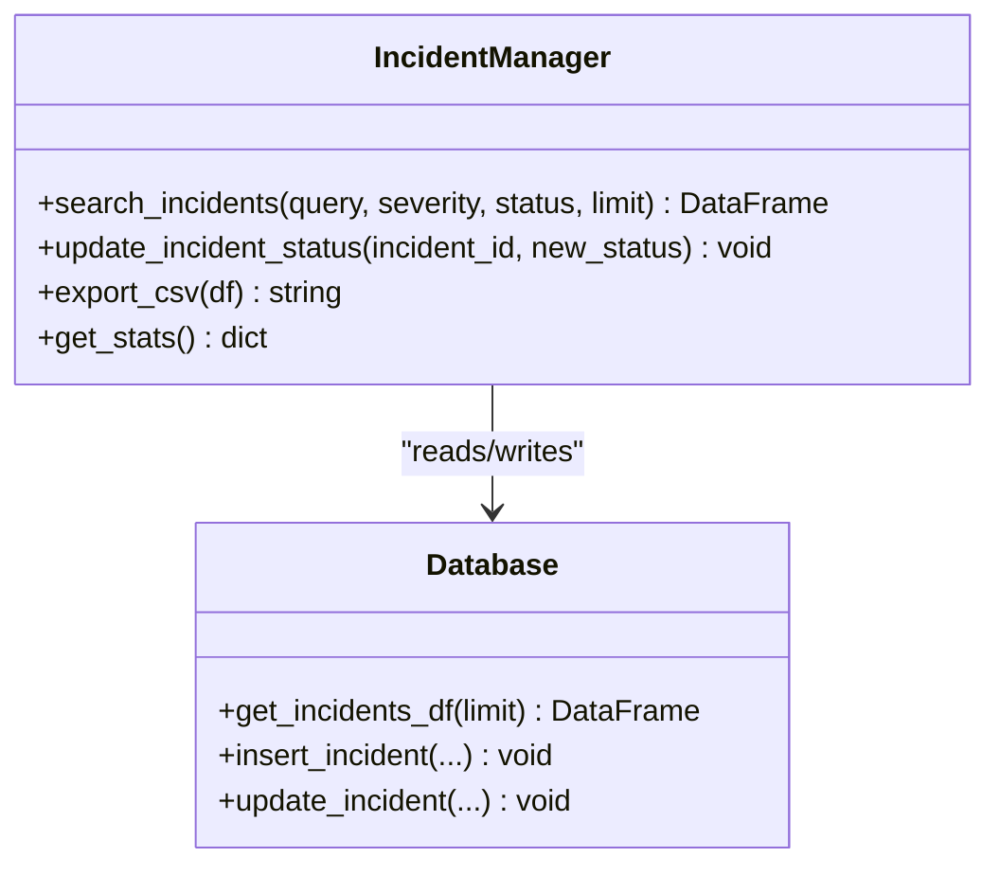
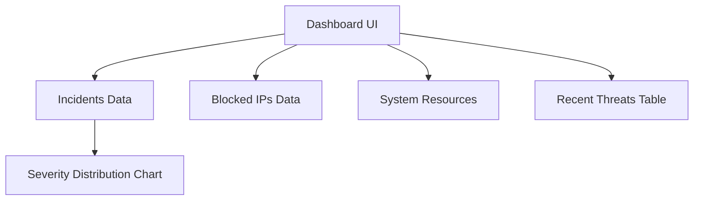
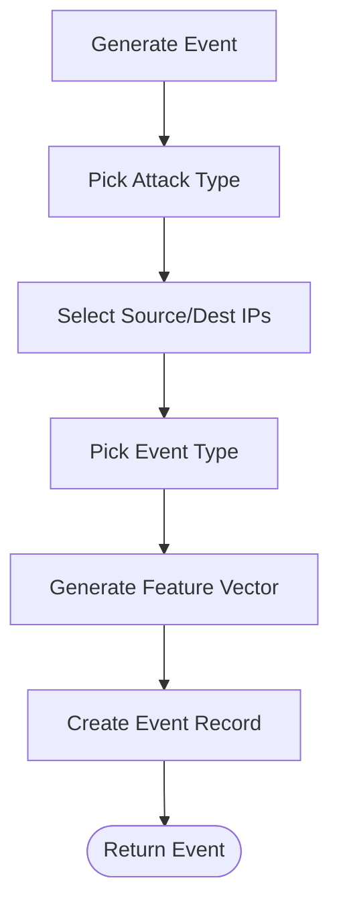
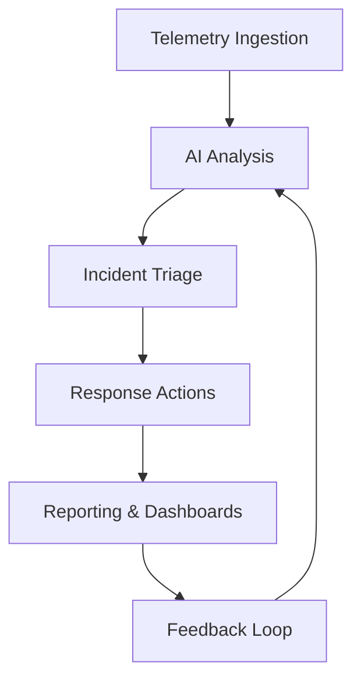
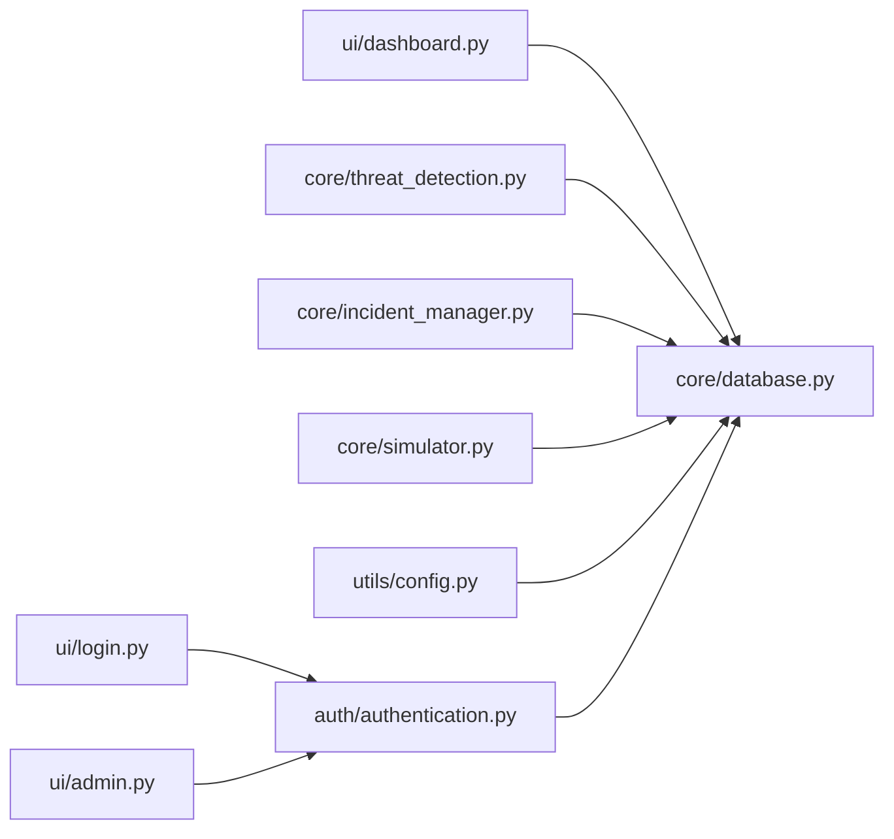

# Project Overview

<cite>
**Referenced Files in This Document**
- [app.py](file://app.py)
- [requirements.txt](file://requirements.txt)
- [utils/config.py](file://utils/config.py)
- [core/database.py](file://core/database.py)
- [auth/authentication.py](file://auth/authentication.py)
- [ui/dashboard.py](file://ui/dashboard.py)
- [core/incident_manager.py](file://core/incident_manager.py)
- [core/threat_detection.py](file://core/threat_detection.py)
- [core/simulator.py](file://core/simulator.py)
</cite>

## Table of Contents
1. Introduction
2. Project Structure
3. Core Components
4. Architecture Overview
5. Detailed Component Analysis
6. Dependency Analysis
7. Performance Considerations
8. Troubleshooting Guide
9. Conclusion

## Introduction
The Autonomous AI Cyber Defense Platform is a Streamlit-based cybersecurity monitoring and response application that combines real-time threat detection, incident management, and interactive dashboards to help security teams respond faster and more effectively. It leverages machine learning for anomaly detection and classification, an SQLite database for persistent storage, and a modern web UI for operational visibility. The platform is designed for security analysts, IT administrators, and cybersecurity professionals who need actionable insights and streamlined workflows to manage threats at scale.

Key capabilities include:
- Real-time threat detection using AI-driven anomaly scoring and classification
- Centralized incident management with search, status updates, and export
- Interactive dashboards with KPIs, severity distributions, and system resource monitors
- Secure authentication and role-aware navigation
- Configurable settings and extensible architecture for future integrations

Target audience:
- Security analysts and SOC operators
- IT administrators and DevSecOps engineers
- Cybersecurity professionals seeking automation and visualization

Use cases:
- Continuous network and endpoint telemetry monitoring
- Automated triage and prioritization of alerts
- Incident lifecycle tracking and reporting
- Threat intelligence ingestion and correlation
- Operational dashboards for situational awareness

Technology stack highlights:
- Streamlit for the web interface and rapid prototyping
- scikit-learn for Isolation Forest anomaly detection and Random Forest classification
- SQLite for lightweight, embedded persistence
- Pandas and Plotly for data handling and visualizations
- bcrypt for secure password hashing
- psutil for system resource monitoring

System requirements and installation prerequisites:
- Python 3.x environment (recommended 3.9+)
- pip package manager
- Internet access for initial dependency installation
- Optional: SMTP credentials for email notifications (configurable via Settings)

Installation steps:
- Install dependencies from requirements.txt
- Run the application entry point to initialize the database and default admin user
- Access the login page and use the default admin credentials provided by the app

High-level architecture overview:
- UI layer built with Streamlit pages for Dashboard, Monitoring, Detection, Analytics, Incidents, Reports, AI Assistant, Settings, and Admin Panel
- Core services for database operations, threat detection, incident management, simulation, and optional email/alerting
- Configuration module centralizes paths, defaults, and metadata
- Authentication module manages users, roles, and session state

[No sources needed since this section provides general guidance]

## Project Structure
The repository follows a modular layout separating UI, core services, utilities, and configuration:
- app.py: Application bootstrap, global styling, session initialization, and page routing
- ui/: Streamlit pages for each functional area
- core/: Business logic including database schema, threat detection models, incident management, simulation, and alerting
- auth/: Authentication and user management
- utils/: Shared configuration and constants
- data/: Runtime data directory for SQLite and model artifacts
- requirements.txt: Python dependencies

**Diagram sources**
- [app.py:101-200](file://app.py#L101-L200)
- [ui/dashboard.py:1-119](file://ui/dashboard.py#L1-L119)
- [core/database.py:1-248](file://core/database.py#L1-L248)
- [core/threat_detection.py:1-147](file://core/threat_detection.py#L1-L147)
- [core/incident_manager.py:1-57](file://core/incident_manager.py#L1-L57)
- [core/simulator.py:1-76](file://core/simulator.py#L1-L76)
- [utils/config.py:1-36](file://utils/config.py#L1-L36)
- [auth/authentication.py:1-99](file://auth/authentication.py#L1-L99)

**Section sources**
- [app.py:1-200](file://app.py#L1-L200)
- [requirements.txt:1-10](file://requirements.txt#L1-L10)

## Core Components
This section outlines the primary modules and their responsibilities:

- Application bootstrap and routing (app.py): Initializes DB, seeds admin, sets up session state, applies theme, and routes to UI pages based on sidebar selection.
- Database layer (core/database.py): Defines SQLite schema, seeds defaults, and exposes helper functions for incidents, blocked IPs, threat intel, audit logs, and settings.
- Authentication (auth/authentication.py): Handles password hashing, registration, login, user listing, deactivation, and password reset; audits actions.
- Threat detection (core/threat_detection.py): Implements Isolation Forest for anomaly detection and Random Forest for attack classification; computes severity and confidence scores.
- Incident management (core/incident_manager.py): Provides search, filtering, status updates, CSV export, and statistics aggregation.
- Simulator (core/simulator.py): Generates realistic synthetic events with features for ML analysis and populates the system for demonstration.
- Configuration (utils/config.py): Centralizes paths, defaults, severity levels, attack types, and app metadata.

Operational flow:
- On startup, the app initializes the database and ensures a default admin exists.
- Users authenticate via the login page; successful login sets session state and grants access to the dashboard and other pages.
- The simulator generates events, which are analyzed by the threat detector and persisted as incidents.
- Dashboards visualize metrics, severity distribution, and system resources; incidents can be searched, updated, and exported.

**Section sources**
- [app.py:101-200](file://app.py#L101-L200)
- [core/database.py:16-136](file://core/database.py#L16-L136)
- [auth/authentication.py:17-44](file://auth/authentication.py#L17-L44)
- [core/threat_detection.py:15-127](file://core/threat_detection.py#L15-L127)
- [core/incident_manager.py:10-57](file://core/incident_manager.py#L10-L57)
- [core/simulator.py:45-76](file://core/simulator.py#L45-L76)
- [utils/config.py:12-36](file://utils/config.py#L12-L36)

## Architecture Overview
The platform follows a layered architecture:
- Presentation layer: Streamlit UI pages provide interactive dashboards, monitoring views, and administrative controls.
- Service layer: Core modules encapsulate business logic for threat detection, incident management, simulation, and alerting.
- Data layer: SQLite stores users, incidents, blocked IPs, threat intelligence, audit logs, and settings.
- Utilities: Configuration and authentication support cross-cutting concerns.

**Diagram sources**
- [app.py:101-200](file://app.py#L101-L200)
- [ui/dashboard.py:1-119](file://ui/dashboard.py#L1-L119)
- [core/database.py:1-248](file://core/database.py#L1-L248)
- [core/threat_detection.py:1-147](file://core/threat_detection.py#L1-L147)
- [core/incident_manager.py:1-57](file://core/incident_manager.py#L1-L57)
- [core/simulator.py:1-76](file://core/simulator.py#L1-L76)
- [auth/authentication.py:1-99](file://auth/authentication.py#L1-L99)
- [utils/config.py:1-36](file://utils/config.py#L1-L36)

## Detailed Component Analysis

### Authentication Flow
The authentication process secures access to the platform and tracks user activity:
- Users log in via the login page; credentials are validated against hashed passwords stored in SQLite.
- Successful authentication sets session state and redirects to the main dashboard.
- Registration allows new users to be created with roles; password resets update hashes securely.
- Audit logging records login attempts and user management actions.

**Diagram sources**
- [ui/login.py:38-54](file://ui/login.py#L38-L54)
- [auth/authentication.py:33-44](file://auth/authentication.py#L33-L44)
- [core/database.py:141-148](file://core/database.py#L141-L148)

**Section sources**
- [ui/login.py:38-54](file://ui/login.py#L38-L54)
- [auth/authentication.py:33-44](file://auth/authentication.py#L33-L44)
- [core/database.py:141-148](file://core/database.py#L141-L148)

### Threat Detection Pipeline
The threat detection component uses machine learning to identify anomalies and classify attacks:
- Anomaly detection via Isolation Forest scores traffic features.
- If anomalous, a Random Forest classifier predicts the attack type.
- Severity is computed based on confidence and feature thresholds.
- Results are returned for display and persistence.

**Diagram sources**
- [core/threat_detection.py:92-127](file://core/threat_detection.py#L92-L127)
- [core/threat_detection.py:129-147](file://core/threat_detection.py#L129-L147)

**Section sources**
- [core/threat_detection.py:15-127](file://core/threat_detection.py#L15-L127)
- [core/threat_detection.py:129-147](file://core/threat_detection.py#L129-L147)

### Incident Management
The incident manager supports searching, filtering, updating, and exporting incidents:
- Search across incident IDs, attack types, source IPs, and descriptions.
- Filter by severity and status.
- Update incident status to reflect resolution progress.
- Export results to CSV for offline analysis.

**Diagram sources**
- [core/incident_manager.py:10-57](file://core/incident_manager.py#L10-L57)
- [core/database.py:200-222](file://core/database.py#L200-L222)

**Section sources**
- [core/incident_manager.py:10-57](file://core/incident_manager.py#L10-L57)
- [core/database.py:200-222](file://core/database.py#L200-L222)

### Dashboard and Visualization
The dashboard aggregates key performance indicators and visualizes threat data:
- KPI cards show total threats, critical count, today’s attacks, blocked IPs, active sessions, detection percentage, and AI confidence.
- Severity distribution chart displays breakdown by severity level.
- System resource monitors show CPU, RAM, and disk usage.
- Recent threats table lists latest incidents with relevant fields.

**Diagram sources**
- [ui/dashboard.py:32-119](file://ui/dashboard.py#L32-L119)
- [core/database.py:200-228](file://core/database.py#L200-L228)

**Section sources**
- [ui/dashboard.py:32-119](file://ui/dashboard.py#L32-L119)

### Simulation Engine
The simulator generates realistic synthetic events to populate the system for demonstration:
- Creates event records with timestamps, IPs, usernames, attack types, and descriptive text.
- Produces feature vectors used by the threat detector for analysis.
- Assigns unique incident IDs for traceability.

**Diagram sources**
- [core/simulator.py:45-76](file://core/simulator.py#L45-L76)

**Section sources**
- [core/simulator.py:45-76](file://core/simulator.py#L45-L76)

### Conceptual Overview
Conceptually, the platform integrates continuous monitoring, AI-driven analysis, and operational workflows into a cohesive defense system:
- Ingestion: Synthetic or real telemetry feeds into the analyzer.
- Analysis: ML models score anomalies and classify threats.
- Response: Incidents are tracked, prioritized, and resolved with auditable actions.
- Visibility: Dashboards and reports provide situational awareness and insights.

[No sources needed since this diagram shows conceptual workflow, not actual code structure]

## Dependency Analysis
Dependencies between components are structured to maintain clear separation of concerns:
- UI modules depend on core services for data and logic.
- Core services depend on the database layer for persistence.
- Configuration centralizes shared constants and paths.
- Authentication interacts with the database and logs audit events.

**Diagram sources**
- [ui/dashboard.py:1-119](file://ui/dashboard.py#L1-L119)
- [ui/login.py:1-102](file://ui/login.py#L1-L102)
- [ui/admin.py:33-64](file://ui/admin.py#L33-L64)
- [core/threat_detection.py:1-147](file://core/threat_detection.py#L1-L147)
- [core/incident_manager.py:1-57](file://core/incident_manager.py#L1-L57)
- [core/simulator.py:1-76](file://core/simulator.py#L1-L76)
- [utils/config.py:1-36](file://utils/config.py#L1-L36)
- [auth/authentication.py:1-99](file://auth/authentication.py#L1-L99)
- [core/database.py:1-248](file://core/database.py#L1-L248)

**Section sources**
- [core/database.py:1-248](file://core/database.py#L1-L248)
- [auth/authentication.py:1-99](file://auth/authentication.py#L1-L99)
- [core/threat_detection.py:1-147](file://core/threat_detection.py#L1-L147)
- [core/incident_manager.py:1-57](file://core/incident_manager.py#L1-L57)
- [core/simulator.py:1-76](file://core/simulator.py#L1-L76)
- [utils/config.py:1-36](file://utils/config.py#L1-L36)

## Performance Considerations
- Model training occurs once on first run and persists artifacts to avoid repeated computation.
- SQLite queries are optimized with LIMIT clauses and indexed columns where applicable.
- Dashboard charts and tables load limited datasets to ensure responsiveness.
- System resource monitoring uses efficient sampling intervals.
- Recommendations:
  - Scale out by decoupling ingestion and analysis pipelines.
  - Cache frequent queries and aggregate metrics.
  - Use connection pooling for higher concurrency.
  - Optimize model inference with batch processing.

[No sources needed since this section provides general guidance]

## Troubleshooting Guide
Common issues and resolutions:
- Database initialization errors: Ensure write permissions to the data directory and verify SQLite availability.
- Authentication failures: Confirm password hashing and user activation flags; check audit logs for failed attempts.
- Missing threat data: Verify simulator execution and event generation; inspect incident insertion routines.
- Dashboard empty or stale: Refresh the page; confirm database connectivity and query limits.
- Email notifications not sending: Validate SMTP settings in configuration and test connectivity.

Operational checks:
- Inspect audit logs for user actions and errors.
- Review incident records for completeness and accuracy.
- Validate configuration values for paths, ports, and defaults.

**Section sources**
- [core/database.py:141-148](file://core/database.py#L141-L148)
- [core/database.py:200-228](file://core/database.py#L200-L228)
- [auth/authentication.py:33-44](file://auth/authentication.py#L33-L44)
- [utils/config.py:12-36](file://utils/config.py#L12-L36)

## Conclusion
The Autonomous AI Cyber Defense Platform delivers a comprehensive, AI-powered approach to cybersecurity monitoring and response. By integrating real-time threat detection, centralized incident management, and interactive dashboards, it empowers security teams to detect, analyze, and mitigate threats efficiently. Built on Streamlit, machine learning algorithms, and SQLite, the platform balances usability with robust functionality, addressing modern cybersecurity challenges through automation and continuous monitoring. Its modular design supports future enhancements and integrations, making it a solid foundation for evolving defensive strategies.

[No sources needed since this section summarizes without analyzing specific files]