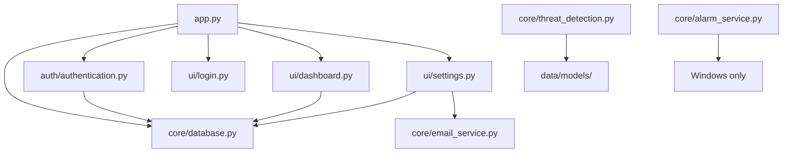
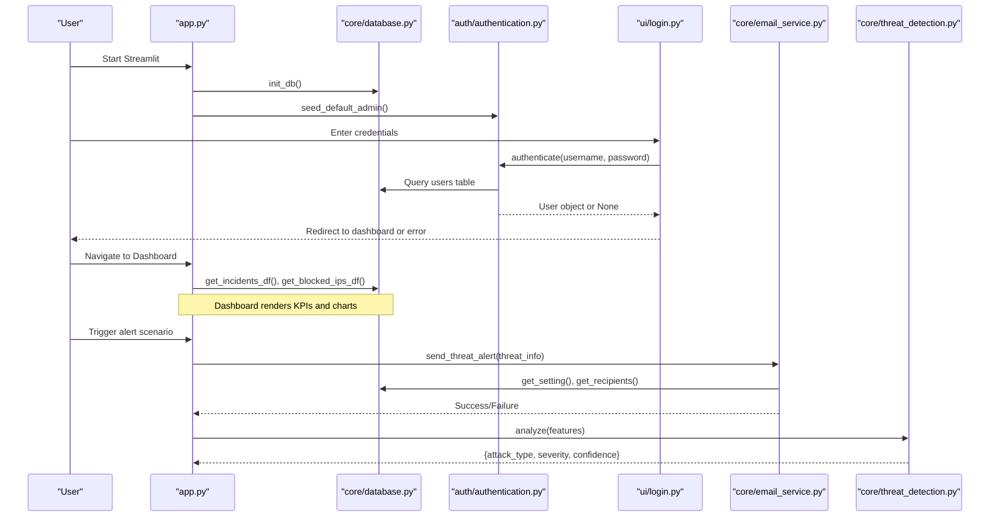
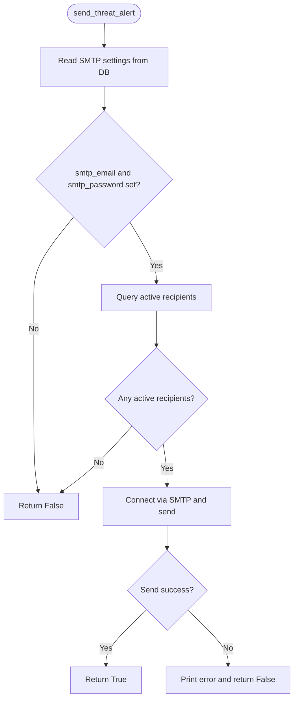
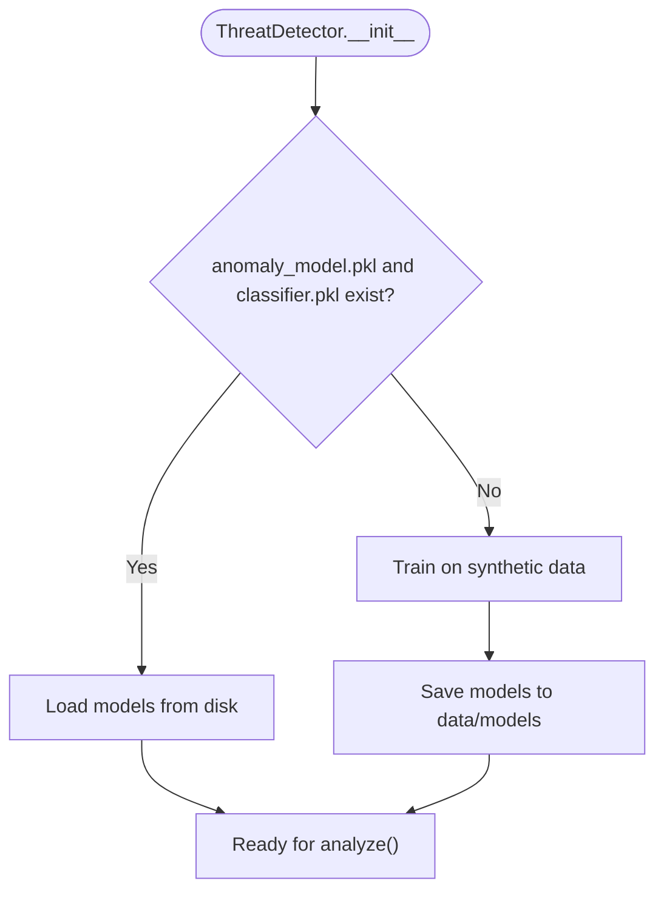

# Troubleshooting & FAQ

<cite>
**Referenced Files in This Document**
- [app.py](file://app.py)
- [config.py](file://utils/config.py)
- [database.py](file://core/database.py)
- [email_service.py](file://core/email_service.py)
- [authentication.py](file://auth/authentication.py)
- [threat_detection.py](file://core/threat_detection.py)
- [alarm_service.py](file://core/alarm_service.py)
- [dashboard.py](file://ui/dashboard.py)
- [incident_manager.py](file://core/incident_manager.py)
- [login.py](file://ui/login.py)
- [settings.py](file://ui/settings.py)
- [requirements.txt](file://requirements.txt)
- [config.toml](file://.streamlit/config.toml)
</cite>

## Table of Contents
1. [Introduction](#introduction)
2. [Project Structure](#project-structure)
3. [Core Components](#core-components)
4. [Architecture Overview](#architecture-overview)
5. [Detailed Component Analysis](#detailed-component-analysis)
6. [Dependency Analysis](#dependency-analysis)
7. [Performance Considerations](#performance-considerations)
8. [Troubleshooting Guide](#troubleshooting-guide)
9. [Conclusion](#conclusion)
10. [Appendices](#appendices)

## Introduction
This document provides comprehensive troubleshooting and FAQ guidance for the Autonomous AI Cyber Defense Platform. It focuses on installation, configuration, database connectivity, email service failures, ML model loading issues, and operational problems during setup, daily use, and maintenance. It also includes diagnostic procedures, log analysis techniques, performance optimization tips, and answers to frequently asked questions about system requirements, compatibility, and feature limitations.

## Project Structure
The platform is a Streamlit-based application with modular components:
- Entry point and routing: app.py
- Configuration: utils/config.py, .streamlit/config.toml
- Data layer: core/database.py (SQLite schema and helpers)
- Authentication: auth/authentication.py
- Email alerts: core/email_service.py
- ML threat detection: core/threat_detection.py
- UI modules: ui/* (dashboard, login, settings, etc.)
- Utilities and extras: core/alarm_service.py, core/incident_manager.py
- Dependencies: requirements.txt



**Diagram sources**
- [app.py:102-106](file://app.py#L102-L106)
- [database.py:16-150](file://core/database.py#L16-L150)
- [authentication.py:88-99](file://auth/authentication.py#L88-L99)
- [email_service.py:37-92](file://core/email_service.py#L37-L92)
- [threat_detection.py:11-37](file://core/threat_detection.py#L11-L37)
- [alarm_service.py:8-23](file://core/alarm_service.py#L8-L23)
- [dashboard.py:32-119](file://ui/dashboard.py#L32-L119)
- [settings.py:10-29](file://ui/settings.py#L10-L29)

**Section sources**
- [app.py:1-200](file://app.py#L1-L200)
- [config.py:1-36](file://utils/config.py#L1-L36)
- [database.py:1-262](file://core/database.py#L1-L262)
- [requirements.txt:1-10](file://requirements.txt#L1-L10)
- [config.toml:1-14](file://.streamlit/config.toml#L1-L14)

## Core Components
- Database initialization and seeding: creates tables, seeds default settings and threat intel, supports migrations for new columns.
- Authentication: user registration, login, password reset, admin seeding.
- Email alerting: SMTP configuration via settings, recipient management, sending critical/high threat alerts.
- Threat detection: IsolationForest + RandomForest classifier; loads or trains models from data/models.
- Alarm service: optional Windows beep for high/critical threats.
- UI pages: dashboard, login, settings, incident management.

Key responsibilities and failure points are mapped below to guide diagnostics.

**Section sources**
- [database.py:16-150](file://core/database.py#L16-L150)
- [authentication.py:17-44](file://auth/authentication.py#L17-L44)
- [email_service.py:37-92](file://core/email_service.py#L37-L92)
- [threat_detection.py:15-37](file://core/threat_detection.py#L15-L37)
- [alarm_service.py:8-23](file://core/alarm_service.py#L8-L23)
- [dashboard.py:32-119](file://ui/dashboard.py#L32-L119)
- [settings.py:10-29](file://ui/settings.py#L10-L29)

## Architecture Overview
High-level flow:
- Application startup initializes DB and seeds admin.
- User authenticates via login page.
- Dashboard and other UI pages read/write to SQLite.
- Email alerts are sent based on settings and recipients.
- ML models are loaded or trained on first run.



**Diagram sources**
- [app.py:102-106](file://app.py#L102-L106)
- [database.py:16-150](file://core/database.py#L16-L150)
- [authentication.py:33-44](file://auth/authentication.py#L33-L44)
- [login.py:38-54](file://ui/login.py#L38-L54)
- [email_service.py:37-92](file://core/email_service.py#L37-L92)
- [threat_detection.py:92-127](file://core/threat_detection.py#L92-L127)
- [dashboard.py:36-48](file://ui/dashboard.py#L36-L48)

## Detailed Component Analysis

### Installation and Environment
Common issues:
- Missing dependencies or version mismatches.
- Streamlit server port conflicts.
- Incompatible Python versions.

Resolution steps:
- Install dependencies from requirements.txt.
- Verify Streamlit config in .streamlit/config.toml (headless mode and port).
- Ensure Python environment matches package versions.

Diagnostics:
- Check pip install output for errors.
- Confirm Streamlit runs on configured port.

**Section sources**
- [requirements.txt:1-10](file://requirements.txt#L1-L10)
- [config.toml:8-11](file://.streamlit/config.toml#L8-L11)

### Configuration Errors
Symptoms:
- Incorrect SMTP defaults not applied.
- Settings not persisting.
- Paths misconfigured.

Resolution steps:
- Use Settings UI to update SMTP server, port, sender email, and app password.
- Verify settings stored in database settings table.
- Confirm base paths in utils/config.py.

Diagnostics:
- Inspect settings via Settings page.
- Validate DB_PATH and DATA_DIR existence.

**Section sources**
- [settings.py:10-29](file://ui/settings.py#L10-L29)
- [database.py:118-131](file://core/database.py#L118-L131)
- [config.py:8-21](file://utils/config.py#L8-L21)

### Database Connectivity Issues
Symptoms:
- Application fails to start due to DB initialization.
- Tables missing or schema mismatch.
- Permission errors writing to data directory.

Resolution steps:
- Ensure data directory exists and is writable.
- Re-run init_db to create/migrate tables.
- Verify SQLite file path and permissions.

Diagnostics:
- Check for exceptions during init_db.
- Validate tables exist: users, incidents, blocked_ips, threat_intel, audit_log, settings, email_recipients.

**Section sources**
- [database.py:16-150](file://core/database.py#L16-L150)
- [config.py:8-16](file://utils/config.py#L8-L16)

### Email Service Failures
Symptoms:
- No emails sent despite critical threats.
- SMTP authentication errors.
- Recipients list empty.

Resolution steps:
- Configure SMTP server, port, sender email, and app password in Settings.
- Add active recipients to email_recipients table.
- Ensure auto_email setting is enabled if required.

Diagnostics:
- Review send_threat_alert return value and printed errors.
- Validate get_setting values and recipients query results.



**Diagram sources**
- [email_service.py:37-92](file://core/email_service.py#L37-L92)
- [database.py:165-178](file://core/database.py#L165-L178)

**Section sources**
- [email_service.py:37-92](file://core/email_service.py#L37-L92)
- [database.py:108-114](file://core/database.py#L108-L114)

### ML Model Loading Problems
Symptoms:
- Models fail to load on startup.
- First-run training takes time.
- Prediction errors due to missing files.

Resolution steps:
- Ensure data/models directory exists and is writable.
- Allow initial training to complete and generate anomaly_model.pkl and classifier.pkl.
- Validate scikit-learn and numpy versions.

Diagnostics:
- Check model file existence and sizes.
- Monitor training logs and exceptions during _load_or_train.



**Diagram sources**
- [threat_detection.py:15-37](file://core/threat_detection.py#L15-L37)
- [threat_detection.py:39-72](file://core/threat_detection.py#L39-L72)

**Section sources**
- [threat_detection.py:11-37](file://core/threat_detection.py#L11-L37)
- [threat_detection.py:39-72](file://core/threat_detection.py#L39-L72)

### Authentication and Login Issues
Symptoms:
- Default admin cannot log in.
- Registration fails with duplicate username.
- Password reset not working.

Resolution steps:
- Verify admin seeding occurred at startup.
- Ensure users table has correct schema and roles.
- Reset passwords via Settings or forgot-password flow.

Diagnostics:
- Check authentication function returns and audit logs.
- Validate bcrypt hashing and password comparison.

**Section sources**
- [authentication.py:88-99](file://auth/authentication.py#L88-L99)
- [authentication.py:17-44](file://auth/authentication.py#L17-L44)
- [login.py:38-54](file://ui/login.py#L38-L54)

### Alarm Service (Windows Only)
Symptoms:
- No alarm sound on non-Windows systems.
- Beep not playing due to OS restrictions.

Resolution steps:
- Use Windows environment for alarm sounds.
- Ignore alarms on non-Windows platforms.

Diagnostics:
- Confirm platform.system() equals "Windows".
- Check winsound availability.

**Section sources**
- [alarm_service.py:8-23](file://core/alarm_service.py#L8-L23)

### Dashboard and Incident Management
Symptoms:
- Dashboard shows no data.
- Incidents not updating.
- Export CSV fails.

Resolution steps:
- Ensure incidents are being inserted into the database.
- Verify get_incidents_df returns data.
- Check CSV export buffer creation.

Diagnostics:
- Inspect incidents table content.
- Validate DataFrame operations and column presence.

**Section sources**
- [dashboard.py:36-48](file://ui/dashboard.py#L36-L48)
- [incident_manager.py:10-26](file://core/incident_manager.py#L10-L26)
- [incident_manager.py:38-41](file://core/incident_manager.py#L38-L41)

## Dependency Analysis
Component relationships and coupling:
- app.py orchestrates DB initialization and UI routing.
- UI modules depend on core/database.py for data access.
- email_service.py depends on settings and recipients from DB.
- threat_detection.py relies on scikit-learn and numpy; persists models to disk.
- alarm_service.py is platform-specific and optional.

```mermaid
graph TB
subgraph "Entry and Routing"
APP["app.py"]
end
subgraph "Data Layer"
DB["core/database.py"]
end
subgraph "Auth"
AUTH["auth/authentication.py"]
end
subgraph "Email"
EMAIL["core/email_service.py"]
end
subgraph "ML"
ML["core/threat_detection.py"]
end
subgraph "UI"
LOGIN["ui/login.py"]
DASH["ui/dashboard.py"]
SETTINGS["ui/settings.py"]
end
subgraph "Extras"
ALARM["core/alarm_service.py"]
INCIDENTS["core/incident_manager.py"]
end
APP --> DB
APP --> LOGIN
APP --> DASH
APP --> SETTINGS
LOGIN --> AUTH
AUTH --> DB
DASH --> DB
SETTINGS --> DB
SETTINGS --> EMAIL
EMAIL --> DB
ML --> |"loads/trains"| MODELS["data/models/"]
ALARM --> |"optional"| OS["OS-specific"]
INCIDENTS --> DB
```

**Diagram sources**
- [app.py:102-106](file://app.py#L102-L106)
- [database.py:16-150](file://core/database.py#L16-L150)
- [authentication.py:33-44](file://auth/authentication.py#L33-L44)
- [email_service.py:37-92](file://core/email_service.py#L37-L92)
- [threat_detection.py:11-37](file://core/threat_detection.py#L11-L37)
- [alarm_service.py:8-23](file://core/alarm_service.py#L8-L23)
- [dashboard.py:36-48](file://ui/dashboard.py#L36-L48)
- [incident_manager.py:10-26](file://core/incident_manager.py#L10-L26)

**Section sources**
- [app.py:1-200](file://app.py#L1-L200)
- [database.py:1-262](file://core/database.py#L1-L262)
- [email_service.py:1-92](file://core/email_service.py#L1-L92)
- [threat_detection.py:1-147](file://core/threat_detection.py#L1-L147)
- [alarm_service.py:1-23](file://core/alarm_service.py#L1-L23)
- [dashboard.py:1-119](file://ui/dashboard.py#L1-L119)
- [incident_manager.py:1-57](file://core/incident_manager.py#L1-L57)

## Performance Considerations
- Database queries: Limit result sets using LIMIT parameters to avoid large DataFrame loads.
- Model training: Initial training can be CPU-intensive; allow completion before heavy UI usage.
- Streamlit reruns: Minimize redundant computations by caching where appropriate.
- System resources: Monitor CPU/RAM/Disk via psutil in dashboard; adjust simulation speed if needed.

[No sources needed since this section provides general guidance]

## Troubleshooting Guide

### Installation Problems
- Symptom: ImportError or ModuleNotFoundError.
  - Action: Install dependencies from requirements.txt; verify Python version compatibility.
- Symptom: Streamlit server does not start.
  - Action: Check .streamlit/config.toml headless and port settings; ensure port is free.

**Section sources**
- [requirements.txt:1-10](file://requirements.txt#L1-L10)
- [config.toml:8-11](file://.streamlit/config.toml#L8-L11)

### Configuration Errors
- Symptom: SMTP settings not applied.
  - Action: Update SMTP fields in Settings UI; confirm persistence in settings table.
- Symptom: Paths incorrect.
  - Action: Verify BASE_DIR and DATA_DIR in utils/config.py; ensure directories exist.

**Section sources**
- [settings.py:10-29](file://ui/settings.py#L10-L29)
- [config.py:8-21](file://utils/config.py#L8-L21)

### Database Connectivity Issues
- Symptom: Initialization fails.
  - Action: Re-run init_db; check data directory permissions; validate SQLite file path.
- Symptom: Schema mismatch.
  - Action: Ensure migration code adds missing columns; reinitialize if necessary.

**Section sources**
- [database.py:16-46](file://core/database.py#L16-L46)
- [config.py:12-16](file://utils/config.py#L12-L16)

### Email Service Failures
- Symptom: No emails sent.
  - Action: Configure SMTP server, port, sender email, and app password; add active recipients.
- Symptom: Authentication errors.
  - Action: Verify credentials; ensure TLS and port settings match provider requirements.

**Section sources**
- [email_service.py:37-92](file://core/email_service.py#L37-L92)
- [database.py:118-131](file://core/database.py#L118-L131)

### ML Model Loading Problems
- Symptom: Models missing or corrupted.
  - Action: Delete existing models and allow retraining; ensure data/models is writable.
- Symptom: Prediction errors.
  - Action: Validate feature inputs; check scikit-learn/numpy versions.

**Section sources**
- [threat_detection.py:11-37](file://core/threat_detection.py#L11-L37)
- [threat_detection.py:39-72](file://core/threat_detection.py#L39-L72)

### Authentication and Login Issues
- Symptom: Admin login fails.
  - Action: Verify admin seeding; reset password via forgot-password flow.
- Symptom: Registration duplicates.
  - Action: Ensure unique usernames; handle exceptions gracefully.

**Section sources**
- [authentication.py:88-99](file://auth/authentication.py#L88-L99)
- [authentication.py:17-28](file://auth/authentication.py#L17-L28)
- [login.py:38-54](file://ui/login.py#L38-L54)

### Alarm Service (Windows Only)
- Symptom: No alarm on non-Windows.
  - Action: Accept that alarms are Windows-only; focus on email alerts.

**Section sources**
- [alarm_service.py:8-23](file://core/alarm_service.py#L8-L23)

### Dashboard and Incident Management
- Symptom: Empty dashboard.
  - Action: Generate incidents via simulator or manual insertion; verify DB queries.
- Symptom: CSV export fails.
  - Action: Ensure DataFrame is not empty; check buffer creation.

**Section sources**
- [dashboard.py:36-48](file://ui/dashboard.py#L36-L48)
- [incident_manager.py:38-41](file://core/incident_manager.py#L38-L41)

### Log Analysis Techniques
- Audit logs: Use get_audit_df to review user actions and login attempts.
- Email logs: Inspect print statements in email_service for send errors.
- Model logs: Monitor training outputs and file creation in data/models.

**Section sources**
- [database.py:255-261](file://core/database.py#L255-L261)
- [email_service.py:83-91](file://core/email_service.py#L83-L91)
- [threat_detection.py:39-72](file://core/threat_detection.py#L39-L72)

### Performance Optimization Tips
- Reduce query limits in dashboards to improve rendering speed.
- Cache frequent computations in Streamlit where possible.
- Adjust simulation speed via settings to balance realism and performance.

[No sources needed since this section provides general guidance]

## Conclusion
This troubleshooting guide addresses common installation, configuration, database, email, and ML model issues encountered when operating the cyber defense platform. By following the diagnostic procedures and resolution steps outlined, users can efficiently identify and resolve problems, optimize performance, and maintain reliable operation.

[No sources needed since this section summarizes without analyzing specific files]

## Appendices

### Frequently Asked Questions
- What are the system requirements?
  - Python environment supporting listed packages in requirements.txt; Streamlit server configuration in .streamlit/config.toml.
- Is the platform compatible with all operating systems?
  - Core functionality is cross-platform; alarm service is Windows-only.
- Can I customize SMTP settings?
  - Yes, via Settings UI; values are persisted in the database settings table.
- How do I recover from a corrupted database?
  - Reinitialize by running init_db; ensure data directory is writable.
- Why are no emails sent?
  - Verify SMTP credentials, recipients, and auto_email setting; check send_threat_alert return value.
- How do I fix ML model loading errors?
  - Ensure data/models exists and is writable; allow initial training to complete.

[No sources needed since this section provides general guidance]