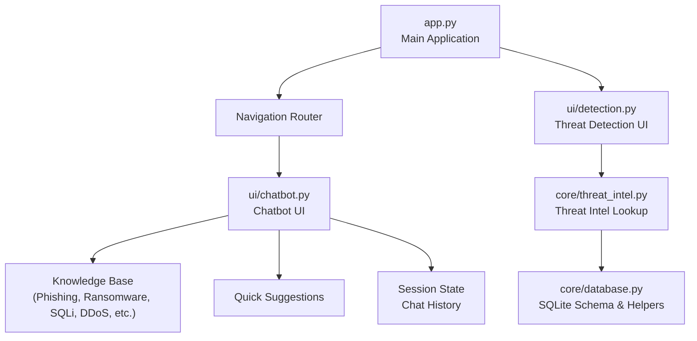
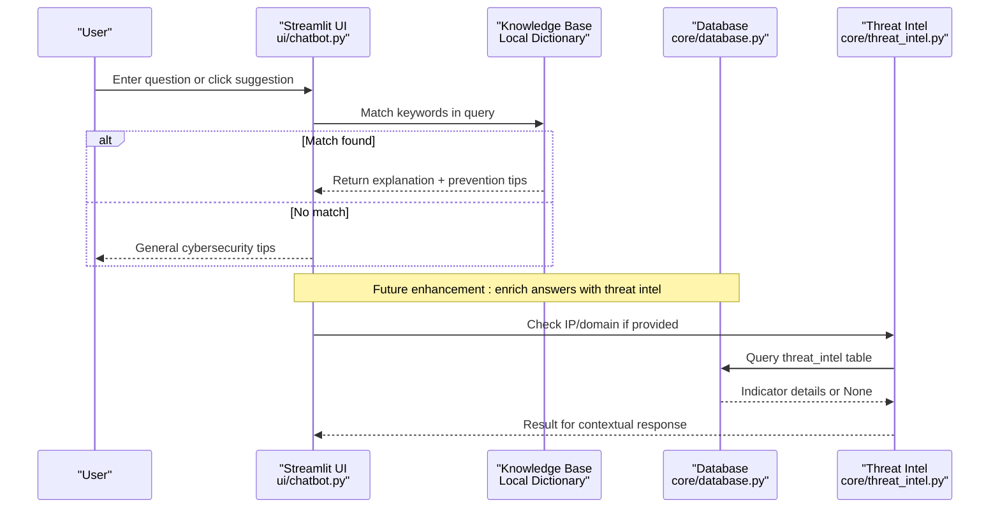
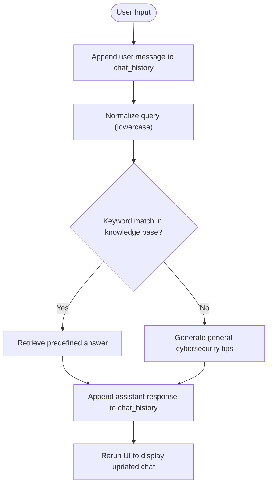
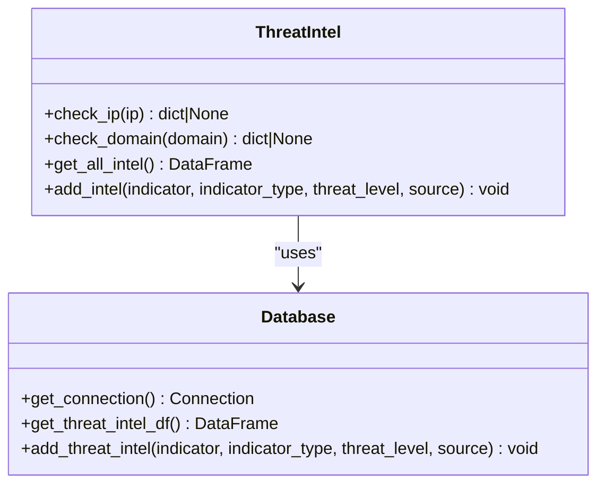
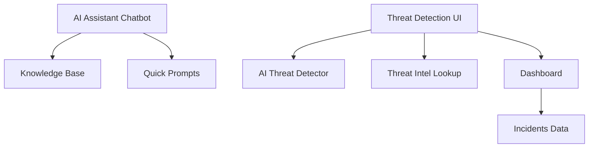
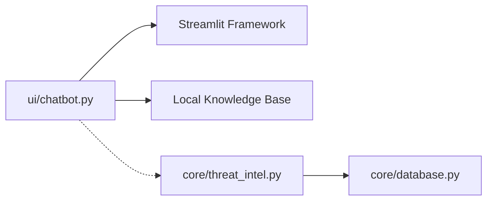

# AI Assistant Chatbot Interface

<cite>
**Referenced Files in This Document**
- [app.py](file://app.py)
- [chatbot.py](file://ui/chatbot.py)
- [threat_intel.py](file://core/threat_intel.py)
- [database.py](file://core/database.py)
- [config.py](file://utils/config.py)
- [detection.py](file://ui/detection.py)
</cite>

## Table of Contents
1. [Introduction](#introduction)
2. [Project Structure](#project-structure)
3. [Core Components](#core-components)
4. [Architecture Overview](#architecture-overview)
5. [Detailed Component Analysis](#detailed-component-analysis)
6. [Dependency Analysis](#dependency-analysis)
7. [Performance Considerations](#performance-considerations)
8. [Troubleshooting Guide](#troubleshooting-guide)
9. [Conclusion](#conclusion)
10. [Appendices](#appendices)

## Introduction
This document explains the AI assistant chatbot interface that provides conversational cybersecurity guidance. It covers how users interact with the chatbot, how natural language queries are processed, and how threat analysis assistance and security guidance features are delivered. The chatbot currently uses a curated knowledge base to answer questions about common threats and best practices, and it is designed to integrate with the platform’s threat intelligence database for accurate information retrieval.

The goal is to help users:
- Ask questions about detected or potential threats
- Get recommendations for response actions
- Access security best practices
- Receive clear explanations of complex security concepts
- Benefit from context-aware responses when integrated with live threat data

## Project Structure
The chatbot is part of a Streamlit-based application. The main app routes navigation to different pages, including the AI Assistant page that renders the chatbot UI.

**Diagram sources**
- [app.py:148-199](file://app.py#L148-L199)
- [chatbot.py:118-179](file://ui/chatbot.py#L118-L179)
- [detection.py:1-42](file://ui/detection.py#L1-L42)
- [threat_intel.py:1-31](file://core/threat_intel.py#L1-L31)
- [database.py:16-150](file://core/database.py#L16-L150)

**Section sources**
- [app.py:148-199](file://app.py#L148-L199)
- [chatbot.py:118-179](file://ui/chatbot.py#L118-L179)

## Core Components
- Chatbot UI: Renders the conversation interface, displays history, and processes user input.
- Knowledge Base: Curated content covering major threat categories and prevention strategies.
- Session State: Maintains conversation history across interactions within a session.
- Threat Intelligence Integration (planned/current): Provides lookups for IPs/domains against known-bad indicators stored in the SQLite database.

Key responsibilities:
- Present a friendly, guided experience with suggested prompts
- Match user queries to relevant knowledge entries
- Provide general cybersecurity tips when no specific match is found
- Prepare for integration with threat intel and detection modules for richer context

**Section sources**
- [chatbot.py:6-109](file://ui/chatbot.py#L6-L109)
- [chatbot.py:118-179](file://ui/chatbot.py#L118-L179)

## Architecture Overview
The chatbot follows a simple, modular architecture:
- UI Layer: Streamlit components render messages and capture input
- Processing Layer: Query matching against the knowledge base
- Data Layer: Optional access to threat intelligence via database helpers

**Diagram sources**
- [chatbot.py:118-179](file://ui/chatbot.py#L118-L179)
- [threat_intel.py:7-31](file://core/threat_intel.py#L7-L31)
- [database.py:238-252](file://core/database.py#L238-L252)

## Detailed Component Analysis

### Chatbot UI and Conversation Flow
The chatbot UI:
- Initializes a chat history in session state
- Displays previous messages using Streamlit chat message components
- Offers quick suggestions to guide users
- Processes user input by appending to history and generating an assistant response
- Uses keyword matching against a curated knowledge base

**Diagram sources**
- [chatbot.py:118-179](file://ui/chatbot.py#L118-L179)

**Section sources**
- [chatbot.py:118-179](file://ui/chatbot.py#L118-L179)

### Knowledge Base Content and Coverage
The knowledge base includes concise explanations and prevention/mitigation guidance for:
- Phishing
- Ransomware
- SQL Injection
- DDoS
- Brute Force
- XSS
- Malware
- Secure Network Practices
- Insider Threats
- Credential Theft
- Port Scanning

Each entry provides:
- A clear definition of the threat
- Actionable prevention or mitigation steps
- Best practices aligned with industry standards

**Section sources**
- [chatbot.py:6-109](file://ui/chatbot.py#L6-L109)

### Threat Intelligence Integration
The threat intelligence module allows checking indicators (IPs, domains) against known-bad lists stored in the database. While the current chatbot does not directly call these functions, the integration points exist and can be leveraged to enrich responses with real-time context.

**Diagram sources**
- [threat_intel.py:1-31](file://core/threat_intel.py#L1-L31)
- [database.py:238-252](file://core/database.py#L238-L252)

**Section sources**
- [threat_intel.py:1-31](file://core/threat_intel.py#L1-L31)
- [database.py:238-252](file://core/database.py#L238-L252)

### Natural Language Query Processing
Current processing approach:
- Lowercase normalization
- Keyword matching against knowledge base keys
- Fallback to general tips when no match is found

Future enhancements could include:
- Intent classification (e.g., “explain,” “how-to,” “recommendation”)
- Named entity recognition to extract IPs/domains for threat intel checks
- Contextual memory to reference prior conversation topics

**Section sources**
- [chatbot.py:153-179](file://ui/chatbot.py#L153-L179)

### Security Guidance Features
The chatbot delivers:
- Clear definitions of threats
- Step-by-step prevention/mitigation guidance
- Best practices for securing networks and systems
- Tips on MFA, patching, backups, monitoring, and least privilege

These features align with the knowledge base entries and provide actionable advice tailored to common scenarios.

**Section sources**
- [chatbot.py:6-109](file://ui/chatbot.py#L6-L109)

### Integration with Threat Detection and Dashboard
While the chatbot is primarily informational, it complements other modules:
- Threat Detection UI allows manual analysis and integrates with the AI model and threat intel lookup
- Dashboard shows KPIs and recent incidents, providing context for users who ask about trends or severity distributions

**Diagram sources**
- [detection.py:1-42](file://ui/detection.py#L1-L42)
- [dashboard.py:1-119](file://ui/dashboard.py#L1-L119)

**Section sources**
- [detection.py:1-42](file://ui/detection.py#L1-L42)
- [dashboard.py:1-119](file://ui/dashboard.py#L1-L119)

## Dependency Analysis
The chatbot depends on:
- Streamlit for UI rendering and session state management
- Local knowledge base dictionary for immediate responses
- Potential future dependencies on threat intel and detection modules for enriched context

**Diagram sources**
- [chatbot.py:118-179](file://ui/chatbot.py#L118-L179)
- [threat_intel.py:1-31](file://core/threat_intel.py#L1-L31)
- [database.py:16-150](file://core/database.py#L16-L150)

**Section sources**
- [chatbot.py:118-179](file://ui/chatbot.py#L118-L179)
- [threat_intel.py:1-31](file://core/threat_intel.py#L1-L31)
- [database.py:16-150](file://core/database.py#L16-L150)

## Performance Considerations
- Lightweight keyword matching ensures fast responses without heavy computation
- Session state keeps chat history in memory; consider pagination or truncation for long sessions
- Threat intel lookups involve SQLite queries; caching results may improve performance under high load
- Avoid unnecessary reruns; batch updates where possible

[No sources needed since this section provides general guidance]

## Troubleshooting Guide
Common issues and resolutions:
- No response or blank chat: Ensure Streamlit session state is initialized and chat_history exists
- Unexpected generic tips: Verify keyword matching logic and ensure query contains recognized terms
- Missing threat intel data: Confirm database initialization and seed data insertion
- Slow responses: Check for excessive reruns or large chat histories

**Section sources**
- [chatbot.py:118-179](file://ui/chatbot.py#L118-L179)
- [database.py:16-150](file://core/database.py#L16-L150)

## Conclusion
The AI assistant chatbot interface provides a straightforward, effective way to deliver cybersecurity knowledge and guidance through natural language conversations. With a robust knowledge base and optional threat intelligence integration, it supports users in understanding threats, implementing best practices, and making informed decisions. Future enhancements can introduce advanced NLP techniques and deeper integration with detection and analytics modules for richer, context-aware responses.

[No sources needed since this section summarizes without analyzing specific files]

## Appendices

### Example Conversation Flows
- User asks: “What is phishing?”
  - System responds with definition and prevention steps
- User asks: “How do I secure my network?”
  - System provides layered security guidance
- User asks: “Tell me about ransomware”
  - System explains encryption tactics and mitigation strategies

[No sources needed since this section doesn't analyze specific files]

### Context-Aware Responses
- If a user mentions an IP or domain, the system can check threat intel for additional context
- If prior conversation referenced a specific attack type, follow-up questions can build on that context

[No sources needed since this section doesn't analyze specific files]