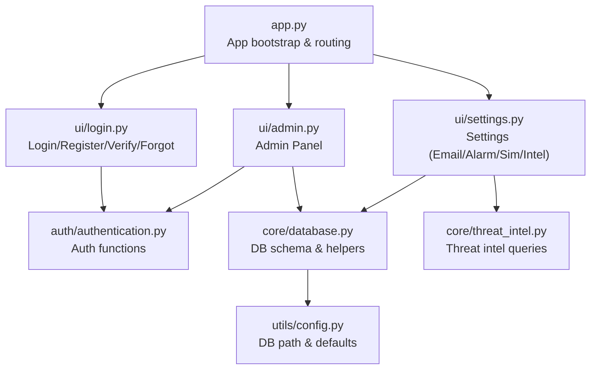
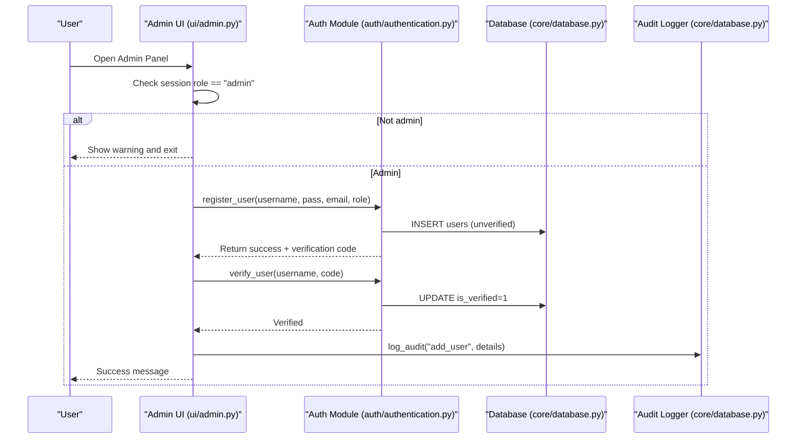
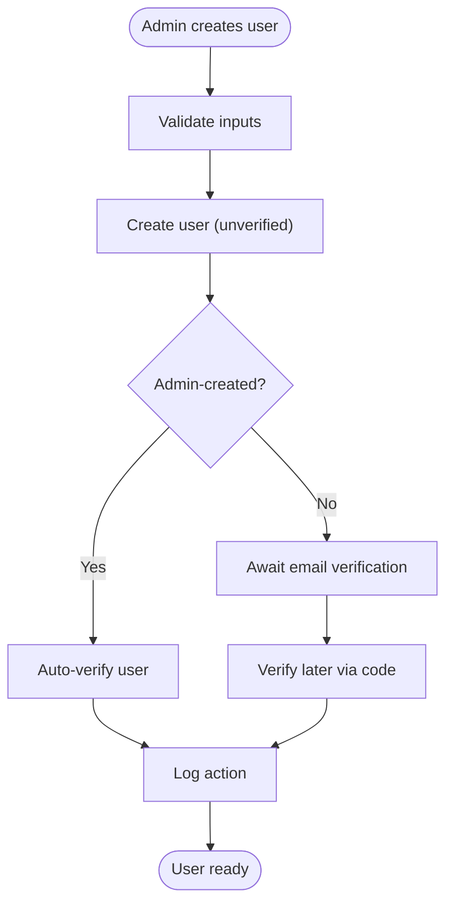
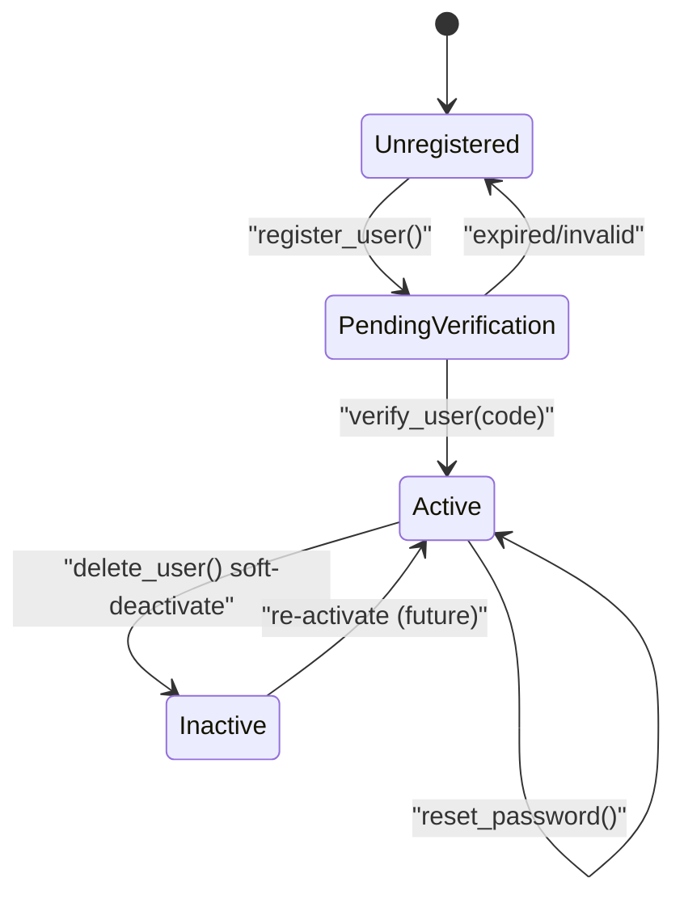
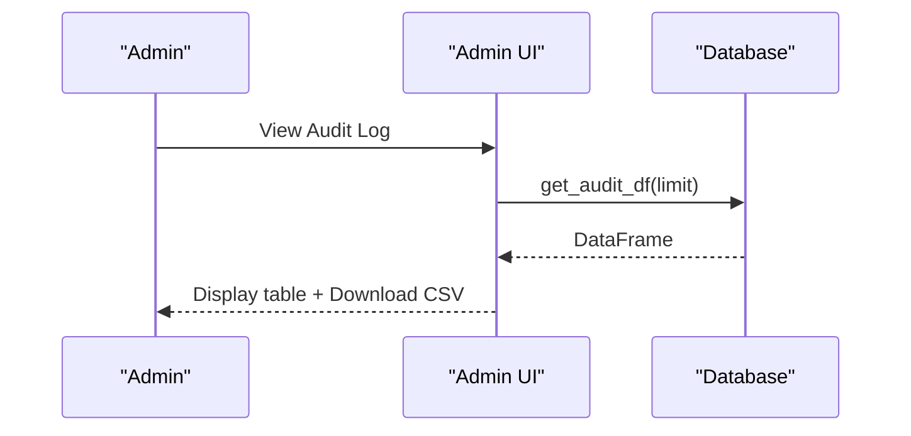
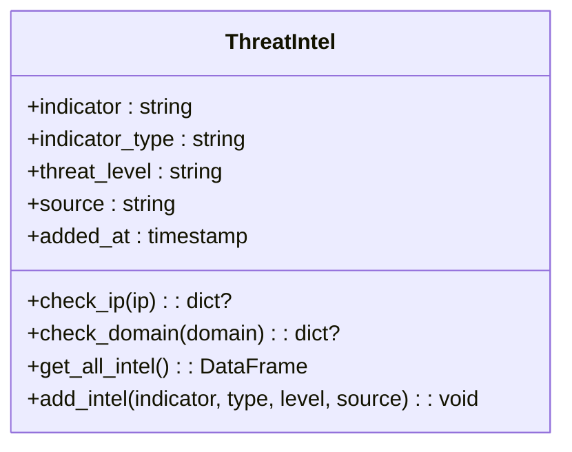
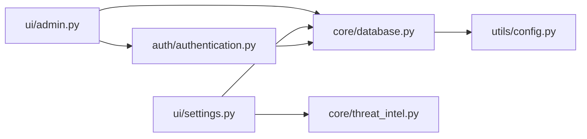

# Administrative Controls Interface

<cite>
**Referenced Files in This Document**
- [app.py](file://app.py)
- [ui/admin.py](file://ui/admin.py)
- [ui/login.py](file://ui/login.py)
- [auth/authentication.py](file://auth/authentication.py)
- [core/database.py](file://core/database.py)
- [core/threat_intel.py](file://core/threat_intel.py)
- [utils/config.py](file://utils/config.py)
</cite>

## Table of Contents
1. [Introduction](#introduction)
2. [Project Structure](#project-structure)
3. [Core Components](#core-components)
4. [Architecture Overview](#architecture-overview)
5. [Detailed Component Analysis](#detailed-component-analysis)
6. [Dependency Analysis](#dependency-analysis)
7. [Performance Considerations](#performance-considerations)
8. [Troubleshooting Guide](#troubleshooting-guide)
9. [Conclusion](#conclusion)
10. [Appendices](#appendices)

## Introduction
This document explains the administrative controls interface for the cybersecurity platform, focusing on user management (registration, role assignment, permissions), account lifecycle operations, audit log viewing, system health and configuration, threat intelligence management, and administrative overrides. It provides practical examples of role hierarchies, permission matrices, audit trail analysis, and scalable administrative workflows.

## Project Structure
The administrative controls are implemented as a Streamlit application with clear separation between UI, authentication, core services, and data persistence:
- Application entry point and navigation routing
- Admin panel UI for users, IP controls, and audit logs
- Authentication module for registration, verification, login, and password resets
- Database schema and helpers for users, incidents, blocked IPs, threat intel, audit logs, and settings
- Threat intelligence utilities
- Configuration constants

**Diagram sources**
- [app.py:102-200](file://app.py#L102-L200)
- [ui/admin.py:1-111](file://ui/admin.py#L1-L111)
- [ui/login.py:1-179](file://ui/login.py#L1-L179)
- [auth/authentication.py:1-180](file://auth/authentication.py#L1-L180)
- [core/database.py:1-262](file://core/database.py#L1-L262)
- [core/threat_intel.py:1-31](file://core/threat_intel.py#L1-L31)
- [utils/config.py:1-36](file://utils/config.py#L1-L36)

**Section sources**
- [app.py:102-200](file://app.py#L102-L200)
- [ui/admin.py:1-111](file://ui/admin.py#L1-L111)
- [ui/login.py:1-179](file://ui/login.py#L1-L179)
- [auth/authentication.py:1-180](file://auth/authentication.py#L1-L180)
- [core/database.py:1-262](file://core/database.py#L1-L262)
- [core/threat_intel.py:1-31](file://core/threat_intel.py#L1-L31)
- [utils/config.py:1-36](file://utils/config.py#L1-L36)

## Core Components
- Admin Panel UI: Provides tabs for Users, Blocked IPs, and Audit Log; enforces admin-only access; supports user creation, deactivation, password reset, IP blocking/unblocking, and audit log export.
- Authentication Module: Implements secure password hashing, email verification code generation and validation, login gating for verified accounts, and default admin seeding.
- Database Layer: Defines SQLite schema for users, incidents, blocked IPs, threat intel, audit log, settings, and email recipients; includes helper functions for CRUD and queries.
- Threat Intelligence: Functions to query and add indicators by type (IP, domain, country).
- Settings UI: Configure SMTP, alarm toggles, simulation speed, and manage threat intel entries.

Key capabilities covered:
- User registration and verification workflow
- Role-based access control (RBAC) at the UI level
- Account lifecycle management (create, verify, deactivate, password reset)
- IP allow/deny list administration
- Audit logging and export
- System configuration and threat intel management

**Section sources**
- [ui/admin.py:12-111](file://ui/admin.py#L12-L111)
- [auth/authentication.py:27-180](file://auth/authentication.py#L27-L180)
- [core/database.py:16-150](file://core/database.py#L16-L150)
- [core/threat_intel.py:7-31](file://core/threat_intel.py#L7-L31)
- [ui/settings.py:10-110](file://ui/settings.py#L10-L110)

## Architecture Overview
The administrative controls follow a layered architecture:
- Presentation layer (Streamlit UI) handles user interactions and displays data.
- Business logic layer encapsulates authentication and security operations.
- Data layer persists entities and provides query helpers.
- Configuration defines paths, defaults, and enumerations.

**Diagram sources**
- [ui/admin.py:24-42](file://ui/admin.py#L24-L42)
- [auth/authentication.py:27-80](file://auth/authentication.py#L27-L80)
- [core/database.py:155-162](file://core/database.py#L155-L162)

## Detailed Component Analysis

### User Management and RBAC
- Registration: Admin can create users with roles "analyst" or "admin". Admin-created users are auto-verified via internal verification flow.
- Verification: Email-based 6-digit code with expiry; admins can bypass verification when creating users internally.
- Deactivation: Soft delete by setting is_active=0; users remain in the database but cannot log in.
- Password Reset: Admins can reset passwords for any user; changes are logged.
- Role Hierarchy: Two roles exist—analyst and admin. Admin-only features include user management, IP controls, and audit log access.

**Diagram sources**
- [ui/admin.py:26-42](file://ui/admin.py#L26-L42)
- [auth/authentication.py:27-80](file://auth/authentication.py#L27-L80)

**Section sources**
- [ui/admin.py:24-72](file://ui/admin.py#L24-L72)
- [auth/authentication.py:27-80](file://auth/authentication.py#L27-L80)
- [core/database.py:21-46](file://core/database.py#L21-L46)

### Permission Matrix
- Admin: Full access to Admin Panel (Users, Blocked IPs, Audit Log), Settings, and all other modules.
- Analyst: Access to standard operational modules (Dashboard, Monitoring, Detection, Analytics, Incidents, Reports, AI Assistant, Settings limited to view where applicable). Cannot access Admin Panel.

Access enforcement:
- Admin Panel checks session role before rendering content.
- Other modules may enforce additional checks if needed.

**Section sources**
- [ui/admin.py:12-16](file://ui/admin.py#L12-L16)
- [app.py:148-199](file://app.py#L148-L199)

### Account Lifecycle Management
- Registration: Creates unverified account with hashed password and verification metadata.
- Verification: Validates code and expiry; marks account verified.
- Login: Only verified and active accounts can authenticate; failed attempts and pending verification are logged.
- Deactivation: Sets is_active=0; prevents login while preserving history.
- Password Reset: Updates hash and logs change.

**Diagram sources**
- [auth/authentication.py:27-112](file://auth/authentication.py#L27-L112)
- [core/database.py:124-139](file://core/database.py#L124-L139)

**Section sources**
- [auth/authentication.py:27-112](file://auth/authentication.py#L27-L112)
- [core/database.py:124-139](file://core/database.py#L124-L139)

### Audit Log Viewing and Export
- All critical actions are logged: registration, verification, login, failed login, password reset, user deletion, IP block/unblock, logout.
- Admin Panel displays recent audit entries and allows CSV download.

**Diagram sources**
- [ui/admin.py:102-111](file://ui/admin.py#L102-L111)
- [core/database.py:255-261](file://core/database.py#L255-L261)

**Section sources**
- [ui/admin.py:102-111](file://ui/admin.py#L102-L111)
- [core/database.py:155-162](file://core/database.py#L155-L162)
- [core/database.py:255-261](file://core/database.py#L255-L261)

### System Health Monitoring and Configuration
- Settings UI manages:
  - SMTP server, port, sender email, app password, and auto-email toggle
  - Alarm enable/disable for High/Critical threats
  - Simulation speed and auto-block behavior
- These settings influence email notifications, alarms, and automated responses.

Operational guidance:
- Ensure SMTP is configured to enable verification emails and password reset notifications.
- Enable alarms for high-severity events to maintain situational awareness.
- Adjust simulation speed based on environment capacity.

**Section sources**
- [ui/settings.py:10-110](file://ui/settings.py#L10-L110)
- [core/database.py:119-131](file://core/database.py#L119-L131)

### Threat Intelligence Management
- View existing indicators (IP, domain, country) with threat levels and source.
- Add new indicators with type, threat level, and source.
- Threat intel is used by detection components to match traffic against known-bad indicators.

**Diagram sources**
- [core/threat_intel.py:7-31](file://core/threat_intel.py#L7-L31)
- [core/database.py:77-86](file://core/database.py#L77-L86)

**Section sources**
- [core/threat_intel.py:7-31](file://core/threat_intel.py#L7-L31)
- [ui/settings.py:91-110](file://ui/settings.py#L91-L110)

### Administrative Overrides
- Admins can bypass email verification when creating users internally.
- Admins can reset any user’s password without requiring current credentials.
- Admins can block/unblock IPs and record reasons for compliance and traceability.

Best practices:
- Always provide a reason when blocking IPs.
- Use audit logs to review administrative actions regularly.
- Limit admin accounts to trusted personnel.

**Section sources**
- [ui/admin.py:26-42](file://ui/admin.py#L26-L42)
- [ui/admin.py:64-72](file://ui/admin.py#L64-L72)
- [ui/admin.py:74-99](file://ui/admin.py#L74-L99)

## Dependency Analysis
Administrative controls rely on well-defined modules:
- UI depends on auth and database layers for operations.
- Auth depends on database for persistence and audit logging.
- Settings UI depends on database for configuration storage and threat intel for indicator management.

**Diagram sources**
- [ui/admin.py:1-10](file://ui/admin.py#L1-L10)
- [ui/settings.py:1-8](file://ui/settings.py#L1-L8)
- [auth/authentication.py:1-11](file://auth/authentication.py#L1-L11)
- [core/database.py:1-8](file://core/database.py#L1-L8)

**Section sources**
- [ui/admin.py:1-10](file://ui/admin.py#L1-L10)
- [ui/settings.py:1-8](file://ui/settings.py#L1-L8)
- [auth/authentication.py:1-11](file://auth/authentication.py#L1-L11)
- [core/database.py:1-8](file://core/database.py#L1-L8)

## Performance Considerations
- Database: SQLite is suitable for single-instance deployments; ensure periodic backups and consider read replicas for heavy analytics.
- Audit Logs: Limit returned rows via limit parameters to avoid large payloads; paginate or filter by date/time in future enhancements.
- Email: SMTP calls should be asynchronous in production to prevent UI blocking.
- Session State: Keep session state minimal; avoid storing sensitive data beyond necessary tokens.

[No sources needed since this section provides general guidance]

## Troubleshooting Guide
Common issues and resolutions:
- Cannot register: SMTP not configured. Configure SMTP in Settings → Email.
- Verification code invalid/expired: Request resend; check time window and correct username.
- Login blocked due to pending verification: Complete email verification first.
- Admin Panel shows warning: Ensure session role is "admin"; re-login after role change.
- Audit log empty: Confirm actions were performed by authenticated users; check database integrity.
- IP block/unblock not reflected: Refresh page; verify database entries; ensure no conflicting rules elsewhere.

**Section sources**
- [ui/login.py:71-108](file://ui/login.py#L71-L108)
- [ui/login.py:110-147](file://ui/login.py#L110-L147)
- [ui/admin.py:12-16](file://ui/admin.py#L12-L16)
- [core/database.py:155-162](file://core/database.py#L155-L162)

## Conclusion
The administrative controls interface provides robust user management, RBAC enforcement, audit logging, system configuration, and threat intelligence management. By following the documented workflows and best practices, administrators can operate the cybersecurity platform securely and efficiently at scale.

[No sources needed since this section summarizes without analyzing specific files]

## Appendices

### Example Role Hierarchies
- Admin: Full privileges including user management, IP controls, audit log access, and settings.
- Analyst: Operational access to monitoring, detection, analytics, incidents, reports, and AI assistant; limited settings visibility.

### Example Permission Matrix
- Admin Panel: Admin only
- User Management: Admin only
- IP Controls: Admin only
- Audit Log: Admin only
- Settings: Admin full access; Analyst view-only (as implemented per module)

### Audit Trail Analysis Tips
- Filter by action types (login_failed, delete_user, block_ip, unblock_ip, password_reset).
- Correlate timestamps with incident timelines.
- Export CSV for external SIEM integration.

### Administrative Workflows for Scale
- Standardize user provisioning templates (role, email format).
- Enforce least privilege; promote analysts to admin only when necessary.
- Regularly review audit logs and blocked IPs; purge stale entries.
- Maintain threat intel hygiene; remove obsolete indicators and update threat levels.

[No sources needed since this section provides general guidance]