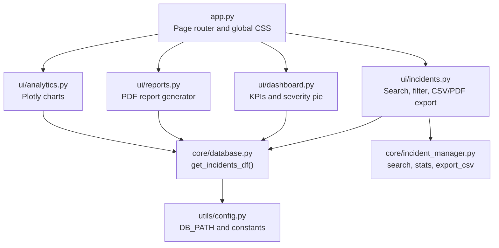
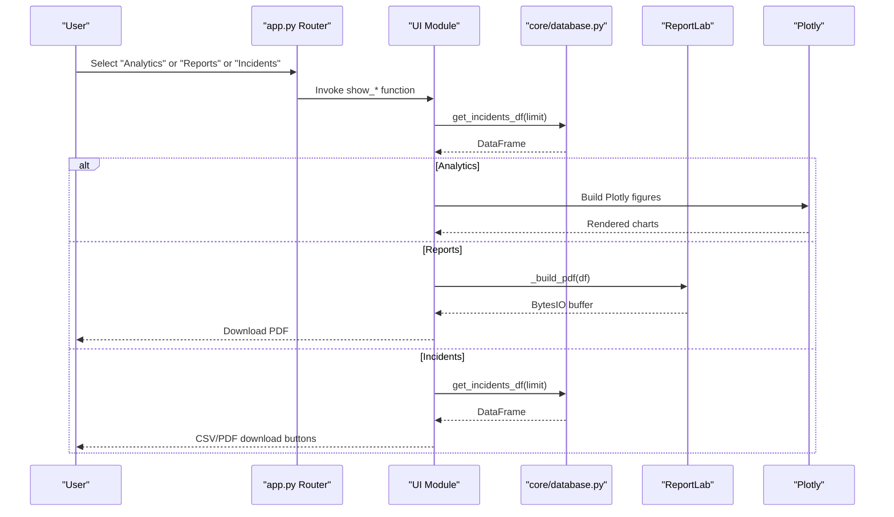
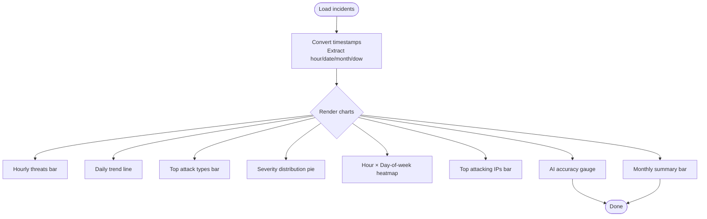
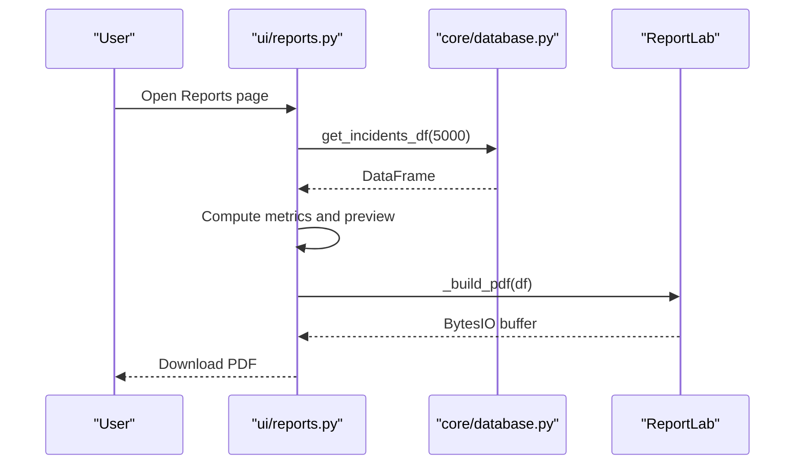
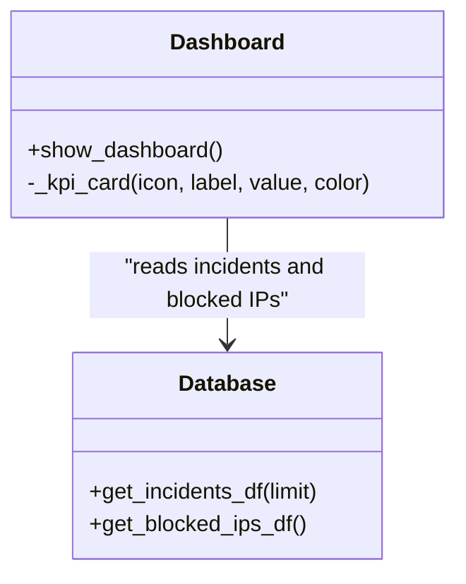
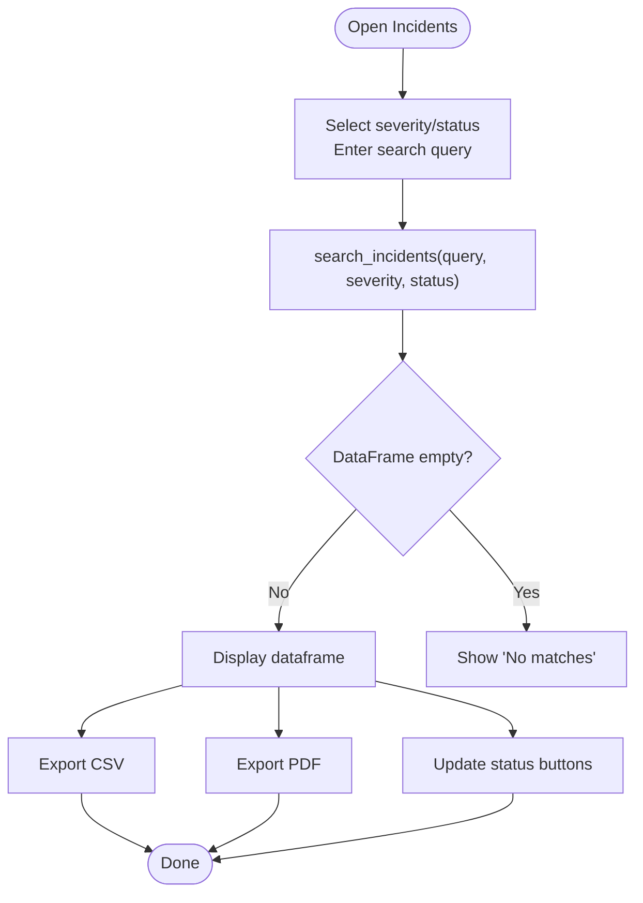
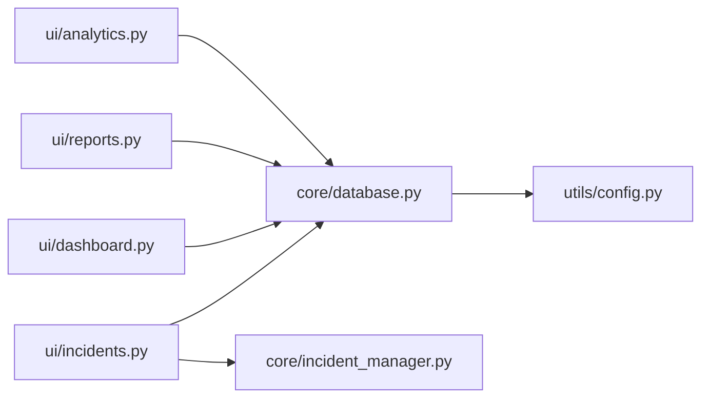

# Analytics and Reporting Interface

<cite>
**Referenced Files in This Document**
- [app.py](file://app.py)
- [analytics.py](file://ui/analytics.py)
- [reports.py](file://ui/reports.py)
- [dashboard.py](file://ui/dashboard.py)
- [incidents.py](file://ui/incidents.py)
- [database.py](file://core/database.py)
- [incident_manager.py](file://core/incident_manager.py)
- [config.py](file://utils/config.py)
</cite>

## Table of Contents
1. [Introduction](#introduction)
2. [Project Structure](#project-structure)
3. [Core Components](#core-components)
4. [Architecture Overview](#architecture-overview)
5. [Detailed Component Analysis](#detailed-component-analysis)
6. [Dependency Analysis](#dependency-analysis)
7. [Performance Considerations](#performance-considerations)
8. [Troubleshooting Guide](#troubleshooting-guide)
9. [Conclusion](#conclusion)
10. [Appendices](#appendices)

## Introduction
This document explains the analytics and reporting interface components of the platform, focusing on:
- Statistical analysis tools for threat intelligence and trends
- Interactive chart visualizations using Plotly
- PDF report generation capabilities
- Export functionality for threat data (CSV and PDF)
- How users can generate custom reports, filter by date ranges and threat types, create visual summaries of security posture, and export findings in multiple formats
- Examples of report templates, chart customization options, and guidance for automated report scheduling

The analytics and reporting features are built with Streamlit for UI, Plotly for interactive charts, and ReportLab for PDF generation. Data is sourced from a SQLite database via helper functions.

## Project Structure
The analytics and reporting features span several modules:
- App routing and global theme configuration
- Analytics page with Plotly-based visualizations
- Reports page with PDF generation and download
- Dashboard KPIs and severity distribution
- Incident Center with search, filtering, CSV/PDF export
- Database schema and query helpers
- Configuration constants for paths and enums

**Diagram sources**
- [app.py:172-200](file://app.py#L172-L200)
- [analytics.py:1-126](file://ui/analytics.py#L1-L126)
- [reports.py:1-133](file://ui/reports.py#L1-L133)
- [dashboard.py:1-119](file://ui/dashboard.py#L1-L119)
- [incidents.py:1-118](file://ui/incidents.py#L1-L118)
- [database.py:214-221](file://core/database.py#L214-L221)
- [incident_manager.py:1-57](file://core/incident_manager.py#L1-L57)
- [config.py:1-36](file://utils/config.py#L1-L36)

**Section sources**
- [app.py:1-200](file://app.py#L1-L200)
- [database.py:1-262](file://core/database.py#L1-L262)
- [config.py:1-36](file://utils/config.py#L1-L36)

## Core Components
- Analytics Page: Provides interactive Plotly charts including hourly threats, daily trend, top attack types, severity distribution, heatmap by hour and day-of-week, top attacking IPs, AI detection accuracy gauge, and monthly summary.
- Reports Page: Presents a preview of key metrics and top attacks, then builds a downloadable PDF executive report with summary statistics, attack breakdown, recent incidents, and recommendations.
- Dashboard: Displays KPI cards, severity distribution pie chart, system resource gauges, and recent threats table.
- Incident Center: Enables searching and filtering incidents by severity and status, exporting filtered results to CSV or PDF, and updating incident statuses.

Key data access:
- get_incidents_df(limit) returns incidents ordered by timestamp descending
- get_blocked_ips_df() returns blocked IPs
- get_stats() aggregates counts by severity and status

**Section sources**
- [analytics.py:12-126](file://ui/analytics.py#L12-L126)
- [reports.py:17-133](file://ui/reports.py#L17-L133)
- [dashboard.py:32-119](file://ui/dashboard.py#L32-L119)
- [incidents.py:15-118](file://ui/incidents.py#L15-L118)
- [database.py:214-221](file://core/database.py#L214-L221)
- [incident_manager.py:44-57](file://core/incident_manager.py#L44-L57)

## Architecture Overview
The analytics and reporting flow follows a clear separation between UI, business logic, and data persistence:
- The app routes user selections to specific UI modules
- Each UI module loads data from core.database helpers
- Analytics renders Plotly figures; Reports and Incidents build PDFs with ReportLab
- Dashboard provides real-time KPIs and system resources

**Diagram sources**
- [app.py:172-200](file://app.py#L172-L200)
- [analytics.py:12-126](file://ui/analytics.py#L12-L126)
- [reports.py:17-133](file://ui/reports.py#L17-L133)
- [incidents.py:15-118](file://ui/incidents.py#L15-L118)
- [database.py:214-221](file://core/database.py#L214-L221)

## Detailed Component Analysis

### Analytics Page: Statistical Analysis and Interactive Charts
- Data preparation: Converts timestamps to datetime, extracts hour, date, month, and day-of-week for grouping and heatmaps
- Visualizations:
  - Hourly threats bar chart
  - Daily trend line chart with markers
  - Top attack types horizontal bar chart
  - Severity distribution donut/pie chart
  - Heatmap of attacks by hour and day-of-week
  - Top attacking IPs bar chart
  - AI detection accuracy gauge indicator
  - Monthly summary bar chart
- Styling: Dark theme layout applied consistently across charts

**Diagram sources**
- [analytics.py:16-126](file://ui/analytics.py#L16-L126)

**Section sources**
- [analytics.py:12-126](file://ui/analytics.py#L12-L126)

### Reports Page: PDF Executive Report Generation
- Preview section shows total incidents, critical/high counts, average confidence, and top attack types
- Recommendations list provided inline
- PDF builder constructs sections:
  - Title and timestamp
  - Summary statistics with severity breakdown
  - Attack type breakdown table
  - Recent incidents table (top 20)
  - Recommendations list
- Output delivered via Streamlit download button

**Diagram sources**
- [reports.py:17-133](file://ui/reports.py#L17-L133)
- [database.py:214-221](file://core/database.py#L214-L221)

**Section sources**
- [reports.py:17-133](file://ui/reports.py#L17-L133)

### Dashboard: KPI Cards and Severity Distribution
- KPI cards include total threats, critical count, today’s attacks, blocked IPs, active sessions, detection percentage, and AI confidence
- Severity distribution pie chart with color mapping per severity level
- System resources gauges for CPU, RAM, and disk usage
- Recent threats table showing latest incidents

**Diagram sources**
- [dashboard.py:12-119](file://ui/dashboard.py#L12-L119)
- [database.py:214-221](file://core/database.py#L214-L221)

**Section sources**
- [dashboard.py:32-119](file://ui/dashboard.py#L32-L119)

### Incident Center: Search, Filter, and Export
- Filters by severity and status; supports free-text search across ID, IP, attack type, and description
- Displays filtered results in a dataframe
- Actions:
  - Export CSV of current filtered dataset
  - Export PDF of current filtered dataset
  - Mark incidents as resolved or investigating

**Diagram sources**
- [incidents.py:15-118](file://ui/incidents.py#L15-L118)
- [incident_manager.py:10-41](file://core/incident_manager.py#L10-L41)

**Section sources**
- [incidents.py:15-118](file://ui/incidents.py#L15-L118)
- [incident_manager.py:1-57](file://core/incident_manager.py#L1-L57)

## Dependency Analysis
- UI modules depend on core.database for data retrieval
- Reports and Incidents use ReportLab for PDF generation
- Analytics uses Plotly for interactive charts
- Config defines DB path and enumerations used across modules

**Diagram sources**
- [analytics.py:1-126](file://ui/analytics.py#L1-L126)
- [reports.py:1-133](file://ui/reports.py#L1-L133)
- [dashboard.py:1-119](file://ui/dashboard.py#L1-L119)
- [incidents.py:1-118](file://ui/incidents.py#L1-L118)
- [database.py:1-262](file://core/database.py#L1-L262)
- [incident_manager.py:1-57](file://core/incident_manager.py#L1-L57)
- [config.py:1-36](file://utils/config.py#L1-L36)

**Section sources**
- [app.py:172-200](file://app.py#L172-L200)
- [database.py:1-262](file://core/database.py#L1-L262)
- [config.py:1-36](file://utils/config.py#L1-L36)

## Performance Considerations
- Data limits: get_incidents_df uses LIMIT to control memory usage; adjust limit based on dataset size
- Chart rendering: Large datasets may slow Plotly rendering; consider aggregating or sampling for heavy visuals
- PDF generation: Building tables and paragraphs is CPU-bound; keep row limits reasonable (e.g., top 20/30)
- Session state: Live monitoring stores events in session state; cap at 500 entries to avoid excessive memory usage
- Database connections: Ensure connections are closed after queries to prevent leaks

[No sources needed since this section provides general guidance]

## Troubleshooting Guide
- No data available:
  - Analytics and Reports pages display informational messages when incidents are empty; ensure simulator generates data
- Empty filters:
  - Incidents Center shows “No incidents match your filters” if query yields no results; verify filter values
- Missing columns:
  - Some metrics check column presence before computing averages; ensure incidents have expected fields like confidence
- PDF generation errors:
  - Verify ReportLab dependencies and that input dataframes contain required columns
- Slow performance:
  - Reduce limits in get_incidents_df calls and minimize rows rendered in PDFs

**Section sources**
- [analytics.py:16-19](file://ui/analytics.py#L16-L19)
- [reports.py:21-24](file://ui/reports.py#L21-L24)
- [incidents.py:45-47](file://ui/incidents.py#L45-L47)
- [database.py:214-221](file://core/database.py#L214-L221)

## Conclusion
The analytics and reporting interface provides comprehensive visualization and export capabilities for threat data. Users can explore trends, filter incidents, and generate both PDF and CSV exports. The modular design separates UI, data access, and report generation, enabling maintainability and scalability. For advanced needs, extend filters, add more chart types, and implement scheduled report generation through external task runners.

[No sources needed since this section summarizes without analyzing specific files]

## Appendices

### Customizing Charts and Templates
- Plotly customization:
  - Use color_discrete_sequence and color_continuous_scale for consistent themes
  - Apply dark layout dictionaries for background and font colors
- PDF templates:
  - Extend sections with additional tables or images
  - Customize styles via TableStyle and getSampleStyleSheet

[No sources needed since this section provides general guidance]

### Automated Report Scheduling
- Current implementation does not include built-in scheduling
- Recommended approach:
  - Use an external scheduler (e.g., cron, APScheduler) to call a script that invokes report generation functions
  - Store generated PDFs in a shared directory or send via email service
  - Log execution results to audit_log for traceability

[No sources needed since this section provides general guidance]