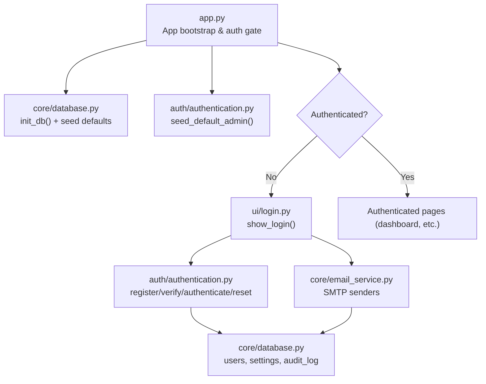
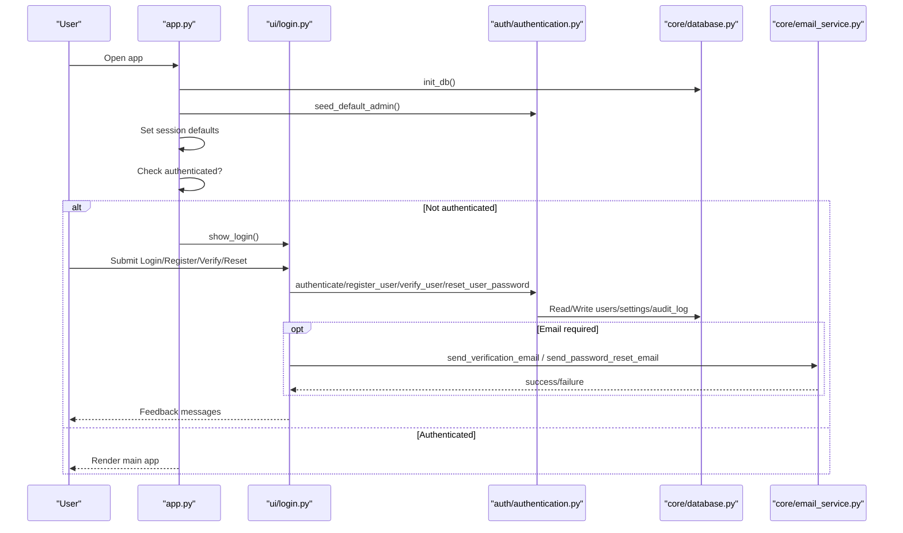
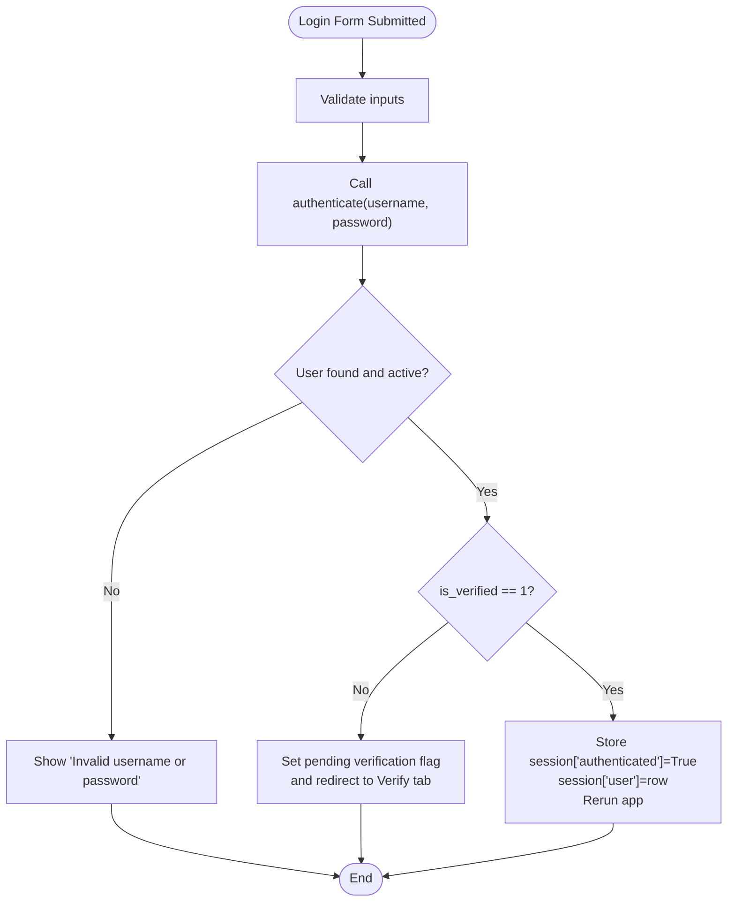
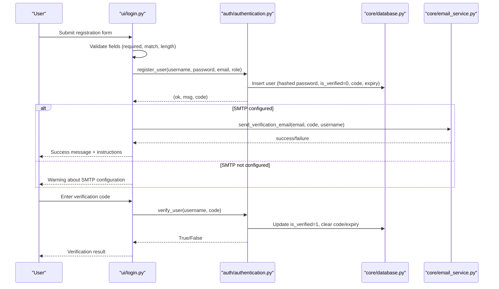
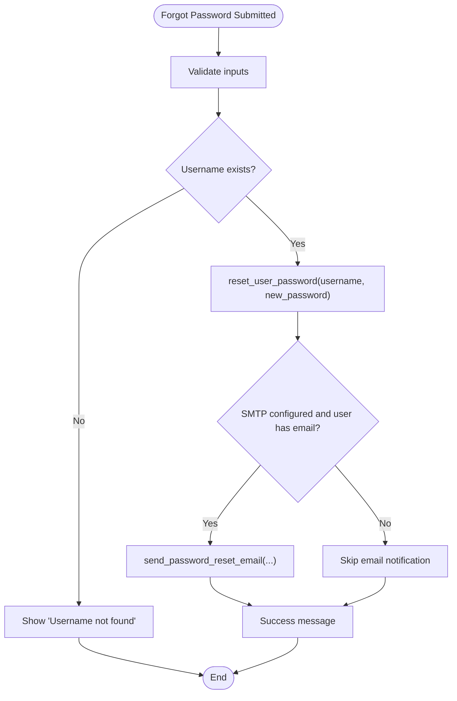
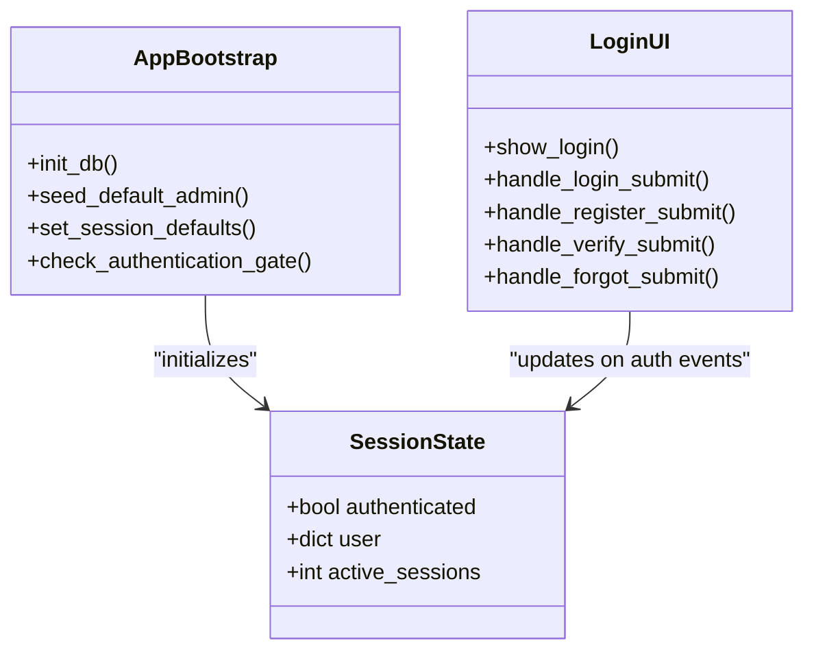
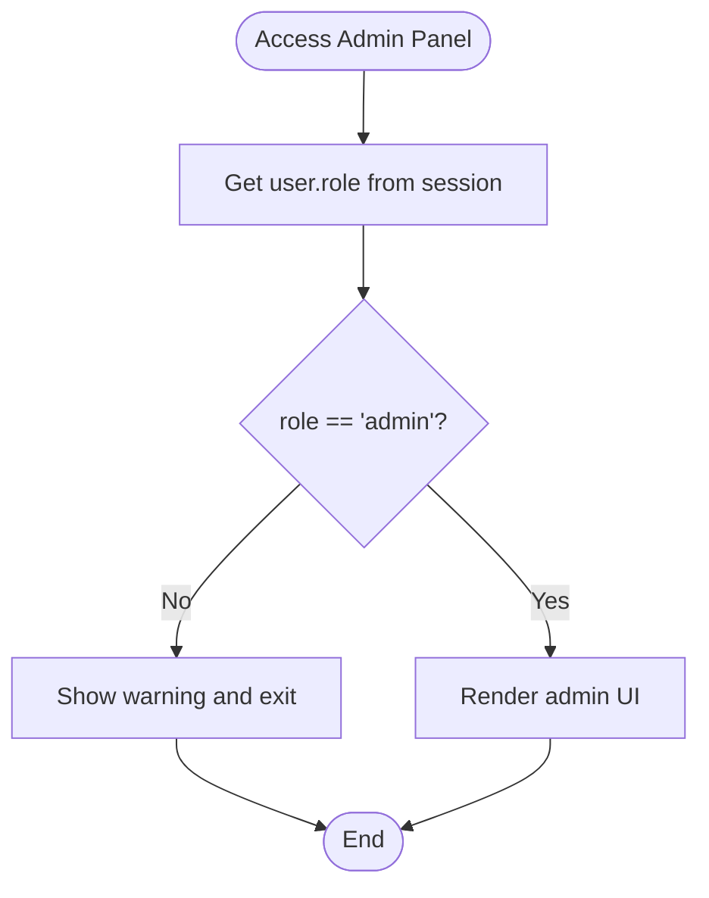
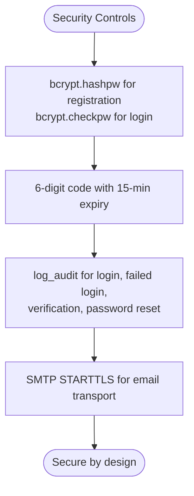
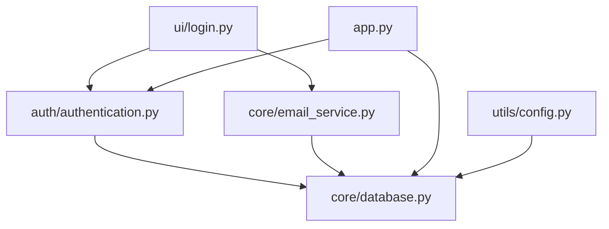

# Authentication and Login Interface

<cite>
**Referenced Files in This Document**
- [app.py](file://app.py)
- [authentication.py](file://auth/authentication.py)
- [login.py](file://ui/login.py)
- [database.py](file://core/database.py)
- [email_service.py](file://core/email_service.py)
- [config.py](file://utils/config.py)
- [admin.py](file://ui/admin.py)
</cite>

## Table of Contents
1. [Introduction](#introduction)
2. [Project Structure](#project-structure)
3. [Core Components](#core-components)
4. [Architecture Overview](#architecture-overview)
5. [Detailed Component Analysis](#detailed-component-analysis)
6. [Dependency Analysis](#dependency-analysis)
7. [Performance Considerations](#performance-considerations)
8. [Troubleshooting Guide](#troubleshooting-guide)
9. [Conclusion](#conclusion)
10. [Appendices](#appendices)

## Introduction
This document explains the authentication and login interface for the platform, including user registration, email verification, password reset, session management, role-based access control, and security measures such as password hashing and secure session handling. It also covers integration points with the email service and database, error handling patterns, and guidance for customizing the login theme.

## Project Structure
The authentication flow spans a small set of focused modules:
- Application entrypoint initializes the database and enforces authentication gating.
- UI login page provides tabs for Login, Register, Verify Email, and Forgot Password.
- Authentication module implements password hashing, registration, verification, login, and password reset.
- Database module defines schema, settings storage, and audit logging.
- Email service sends verification and reset emails via SMTP.
- Admin panel enforces role-based access to administrative functions.

**Diagram sources**
- [app.py:101-120](file://app.py#L101-L120)
- [database.py:16-150](file://core/database.py#L16-L150)
- [authentication.py:167-180](file://auth/authentication.py#L167-L180)
- [login.py:19-45](file://ui/login.py#L19-L45)
- [email_service.py:37-86](file://core/email_service.py#L37-L86)

**Section sources**
- [app.py:101-120](file://app.py#L101-L120)
- [database.py:16-150](file://core/database.py#L16-L150)
- [authentication.py:167-180](file://auth/authentication.py#L167-L180)
- [login.py:19-45](file://ui/login.py#L19-L45)
- [email_service.py:37-86](file://core/email_service.py#L37-L86)

## Core Components
- Authentication module: password hashing, verification code generation, registration, verification, login, and password reset.
- Login UI: tabbed interface for login, registration, email verification, and password reset with form validation and feedback.
- Database layer: SQLite schema for users, settings, audit logs; helper functions for CRUD and configuration.
- Email service: SMTP-based sending of verification and reset emails using configured credentials.
- Application bootstrap: initializes DB, seeds default admin, sets session defaults, and gates unauthenticated access.

Key responsibilities:
- Secure password storage using bcrypt.
- Enforce verified accounts before allowing login.
- Maintain an audit trail for critical actions.
- Provide configurable SMTP for email workflows.
- Role-based access checks for admin-only features.

**Section sources**
- [authentication.py:13-18](file://auth/authentication.py#L13-L18)
- [authentication.py:27-46](file://auth/authentication.py#L27-L46)
- [authentication.py:50-80](file://auth/authentication.py#L50-L80)
- [authentication.py:98-112](file://auth/authentication.py#L98-L112)
- [authentication.py:131-140](file://auth/authentication.py#L131-L140)
- [login.py:48-68](file://ui/login.py#L48-L68)
- [login.py:71-108](file://ui/login.py#L71-L108)
- [login.py:110-147](file://ui/login.py#L110-L147)
- [login.py:149-169](file://ui/login.py#L149-L169)
- [database.py:21-46](file://core/database.py#L21-L46)
- [database.py:155-162](file://core/database.py#L155-L162)
- [email_service.py:37-86](file://core/email_service.py#L37-L86)
- [email_service.py:89-127](file://core/email_service.py#L89-L127)
- [app.py:101-120](file://app.py#L101-L120)

## Architecture Overview
The authentication architecture follows a clear separation of concerns:
- The application bootstrap ensures the database is initialized and a default admin exists.
- Unauthenticated requests are redirected to the login UI.
- The login UI orchestrates user interactions and delegates to the authentication module.
- The authentication module interacts with the database for persistence and auditing.
- Email operations are delegated to the email service, which reads SMTP settings from the database.

**Diagram sources**
- [app.py:101-120](file://app.py#L101-L120)
- [login.py:48-68](file://ui/login.py#L48-L68)
- [authentication.py:98-112](file://auth/authentication.py#L98-L112)
- [email_service.py:37-86](file://core/email_service.py#L37-L86)
- [database.py:155-162](file://core/database.py#L155-L162)

## Detailed Component Analysis

### User Login Flow
- The login form collects username and password, supports a “Remember Me” option, and validates inputs.
- On submit, the authentication module checks the user’s existence, active status, and password hash.
- Verified status is enforced; unverified users are directed to verify their email.
- Successful login stores user data in the session state and reruns the app to render authenticated UI.

**Diagram sources**
- [login.py:48-68](file://ui/login.py#L48-L68)
- [authentication.py:98-112](file://auth/authentication.py#L98-L112)

**Section sources**
- [login.py:48-68](file://ui/login.py#L48-L68)
- [authentication.py:98-112](file://auth/authentication.py#L98-L112)

### Registration and Email Verification
- Registration creates a new user with a hashed password, assigns a role, marks the account unverified, and generates a 6-digit verification code with a 15-minute expiry.
- If SMTP is configured, a verification email is sent; otherwise, the UI warns about missing SMTP configuration.
- The Verify Email tab allows entering the code; on success, the account is marked verified and the user can log in.
- Resend functionality issues a fresh code if the user is still unverified.

**Diagram sources**
- [login.py:71-108](file://ui/login.py#L71-L108)
- [authentication.py:27-46](file://auth/authentication.py#L27-L46)
- [authentication.py:50-80](file://auth/authentication.py#L50-L80)
- [email_service.py:37-86](file://core/email_service.py#L37-L86)
- [database.py:21-46](file://core/database.py#L21-L46)

**Section sources**
- [login.py:71-108](file://ui/login.py#L71-L108)
- [authentication.py:27-46](file://auth/authentication.py#L27-L46)
- [authentication.py:50-80](file://auth/authentication.py#L50-L80)
- [email_service.py:37-86](file://core/email_service.py#L37-L86)
- [database.py:21-46](file://core/database.py#L21-L46)

### Password Reset
- The Forgot Password tab accepts a username and a new password.
- If the username exists, the password is updated with a new hash and an optional confirmation email is sent when SMTP is configured.
- Audit logging records the reset action.

**Diagram sources**
- [login.py:149-169](file://ui/login.py#L149-L169)
- [authentication.py:131-140](file://auth/authentication.py#L131-L140)
- [email_service.py:89-127](file://core/email_service.py#L89-L127)

**Section sources**
- [login.py:149-169](file://ui/login.py#L149-L169)
- [authentication.py:131-140](file://auth/authentication.py#L131-L140)
- [email_service.py:89-127](file://core/email_service.py#L89-L127)

### Session Management
- Session variables include authenticated flag, user object, and active sessions counter.
- On successful login, the authenticated flag and user object are set; the app reruns to render authenticated content.
- Logout clears session flags and logs the action.

**Diagram sources**
- [app.py:108-120](file://app.py#L108-L120)
- [login.py:55-68](file://ui/login.py#L55-L68)

**Section sources**
- [app.py:108-120](file://app.py#L108-L120)
- [login.py:55-68](file://ui/login.py#L55-L68)

### Role-Based Access Control
- Roles are stored per user (e.g., analyst, admin).
- Admin-only features check the current user’s role before rendering sensitive controls.
- Default admin is seeded pre-verified to allow initial setup.

**Diagram sources**
- [admin.py:12-16](file://ui/admin.py#L12-L16)
- [authentication.py:167-180](file://auth/authentication.py#L167-L180)

**Section sources**
- [admin.py:12-16](file://ui/admin.py#L12-L16)
- [authentication.py:167-180](file://auth/authentication.py#L167-L180)

### Security Measures
- Password hashing uses bcrypt with salted hashes; passwords are never stored in plaintext.
- Verification codes are time-bound (15 minutes) and cleared upon successful verification.
- Audit logging captures key events: login attempts, failures, verification, resets, and admin actions.
- SMTP credentials are read from settings; email transport uses TLS.

**Diagram sources**
- [authentication.py:13-18](file://auth/authentication.py#L13-L18)
- [authentication.py:21-24](file://auth/authentication.py#L21-L24)
- [database.py:155-162](file://core/database.py#L155-L162)
- [email_service.py:78-86](file://core/email_service.py#L78-L86)

**Section sources**
- [authentication.py:13-18](file://auth/authentication.py#L13-L18)
- [authentication.py:21-24](file://auth/authentication.py#L21-L24)
- [database.py:155-162](file://core/database.py#L155-L162)
- [email_service.py:78-86](file://core/email_service.py#L78-L86)

### Multi-Factor Authentication Setup
- Current implementation uses email-based verification as a single-factor step prior to login.
- There is no dedicated multi-factor authentication (MFA) mechanism beyond email verification.
- To implement MFA, consider adding TOTP or SMS verification flows and storing related secrets securely.

[No sources needed since this section provides general guidance]

## Dependency Analysis
The authentication system depends on:
- Streamlit session state for managing authentication state across reruns.
- SQLite database for persistent storage of users, settings, and audit logs.
- SMTP email service for verification and reset notifications.
- Configuration constants for paths and defaults.

**Diagram sources**
- [login.py:5-11](file://ui/login.py#L5-L11)
- [authentication.py:10](file://auth/authentication.py#L10)
- [email_service.py:7](file://core/email_service.py#L7)
- [database.py:7](file://core/database.py#L7)
- [app.py:102-106](file://app.py#L102-L106)

**Section sources**
- [login.py:5-11](file://ui/login.py#L5-L11)
- [authentication.py:10](file://auth/authentication.py#L10)
- [email_service.py:7](file://core/email_service.py#L7)
- [database.py:7](file://core/database.py#L7)
- [app.py:102-106](file://app.py#L102-L106)

## Performance Considerations
- Password hashing with bcrypt is intentionally slow to resist brute-force attacks; keep login responses responsive by avoiding unnecessary retries.
- Database operations use lightweight SQLite; ensure proper connection closure to avoid leaks.
- Email sending is synchronous; consider asynchronous queues for high-volume scenarios.
- Session state is in-memory; be mindful of memory usage for large user objects.

[No sources needed since this section provides general guidance]

## Troubleshooting Guide
Common issues and resolutions:
- SMTP not configured:
  - Symptom: Registration warns that verification cannot be sent; password reset confirmation may not be emailed.
  - Resolution: Configure SMTP server, port, sender email, and app password in Settings → Email.
- Invalid or expired verification code:
  - Symptom: Verification fails with invalid or expired code.
  - Resolution: Request a new code via resend; ensure code is entered within 15 minutes.
- Login blocked due to unverified account:
  - Symptom: Login indicates pending verification.
  - Resolution: Complete email verification before attempting to log in again.
- Username not found during password reset:
  - Symptom: Reset fails because username does not exist.
  - Resolution: Confirm the correct username or create a new account.

**Section sources**
- [login.py:71-77](file://ui/login.py#L71-L77)
- [login.py:120-147](file://ui/login.py#L120-L147)
- [login.py:149-169](file://ui/login.py#L149-L169)
- [authentication.py:98-112](file://auth/authentication.py#L98-L112)

## Conclusion
The authentication and login interface provides a secure, auditable, and user-friendly experience with email-based verification and password reset. It leverages bcrypt for password hashing, maintains strict verification requirements, and enforces role-based access for administrative functions. While robust, it currently lacks dedicated multi-factor authentication beyond email verification. Future enhancements could include MFA, rate limiting, and more granular authorization policies.

[No sources needed since this section summarizes without analyzing specific files]

## Appendices

### Custom Login Theme Examples
- The login page includes inline CSS for a dark cyber-themed container, title styling, and subtext color.
- Global styles define background gradients, sidebar colors, button styles, and alert borders.
- To customize:
  - Modify the login container CSS block to adjust colors, fonts, and layout.
  - Adjust global styles in the application bootstrap for consistent theming across pages.

**Section sources**
- [login.py:20-41](file://ui/login.py#L20-L41)
- [app.py:16-99](file://app.py#L16-L99)

### Error Handling Patterns
- Input validation returns warnings or errors directly in the UI.
- Authentication failures log audit entries and display generic error messages to avoid leaking information.
- Email failures print exceptions and return failure indicators to the caller, which then informs the user.

**Section sources**
- [login.py:87-108](file://ui/login.py#L87-L108)
- [authentication.py:98-112](file://auth/authentication.py#L98-L112)
- [email_service.py:78-86](file://core/email_service.py#L78-L86)

### Security Best Practices
- Always use strong password hashing (bcrypt) and never store plaintext passwords.
- Enforce email verification before allowing login.
- Limit verification code lifetime and invalidate after use.
- Log all authentication-related actions for auditability.
- Use TLS for email transport and protect SMTP credentials via settings.
- Implement role checks at every protected endpoint.
- Avoid exposing internal details in error messages.

[No sources needed since this section provides general guidance]