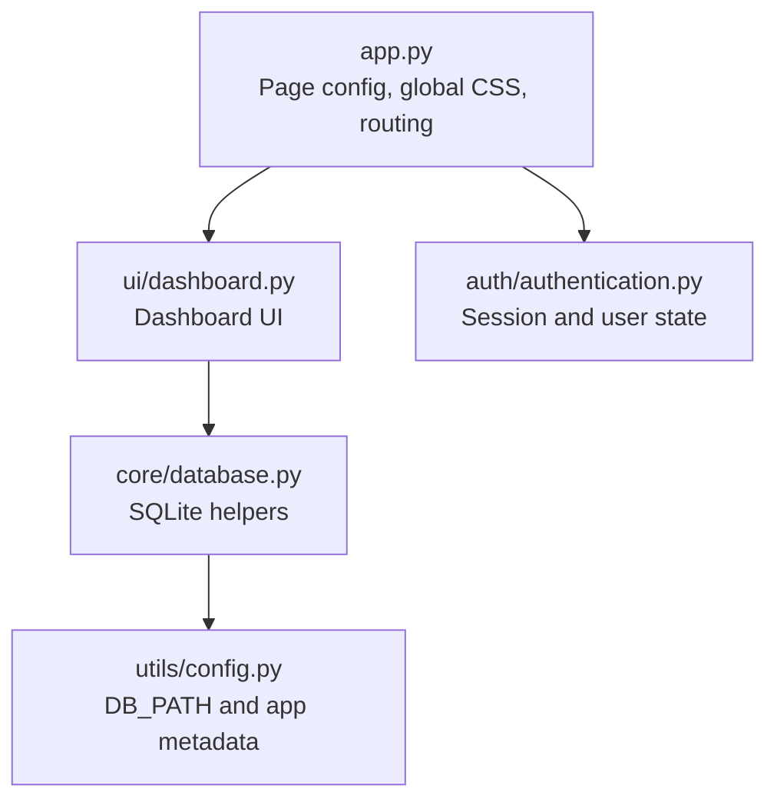
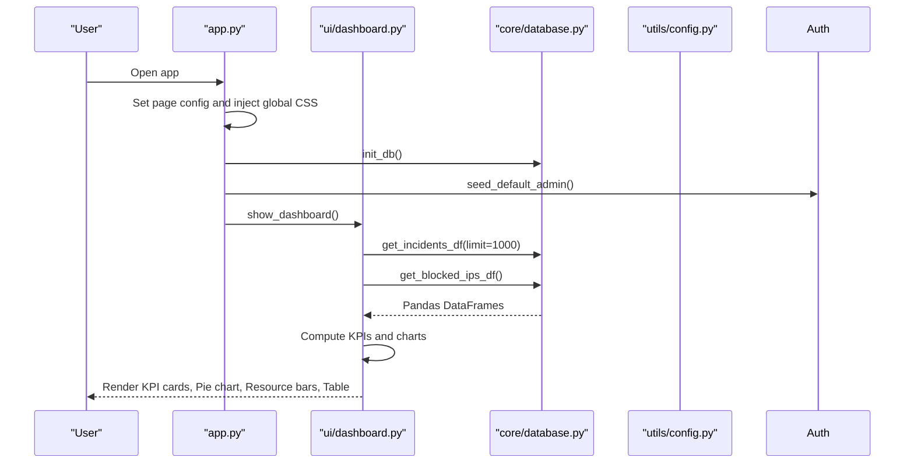
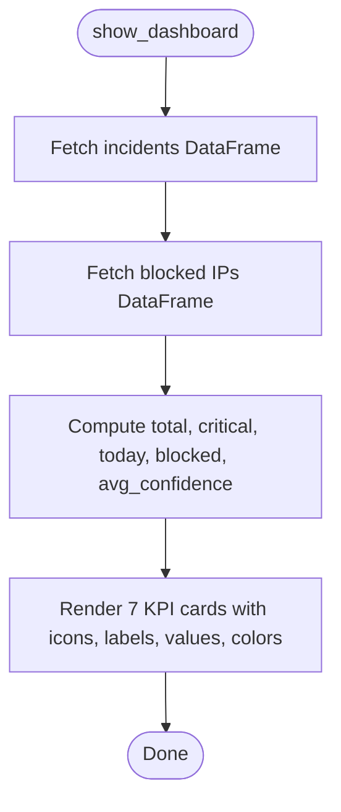
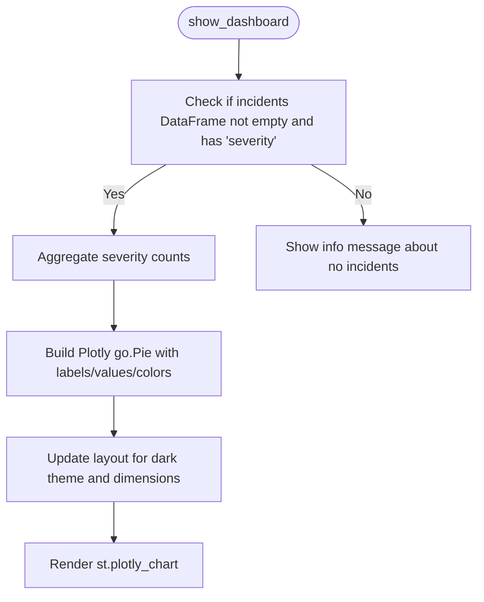
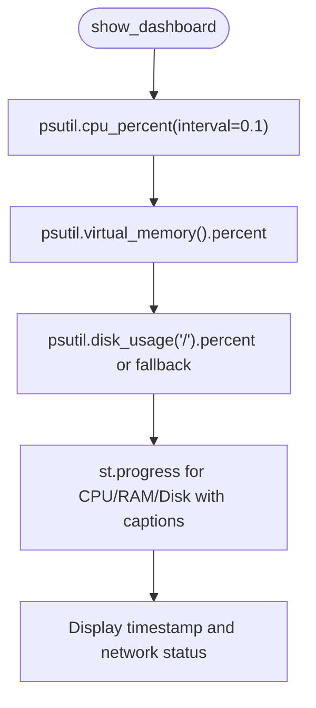
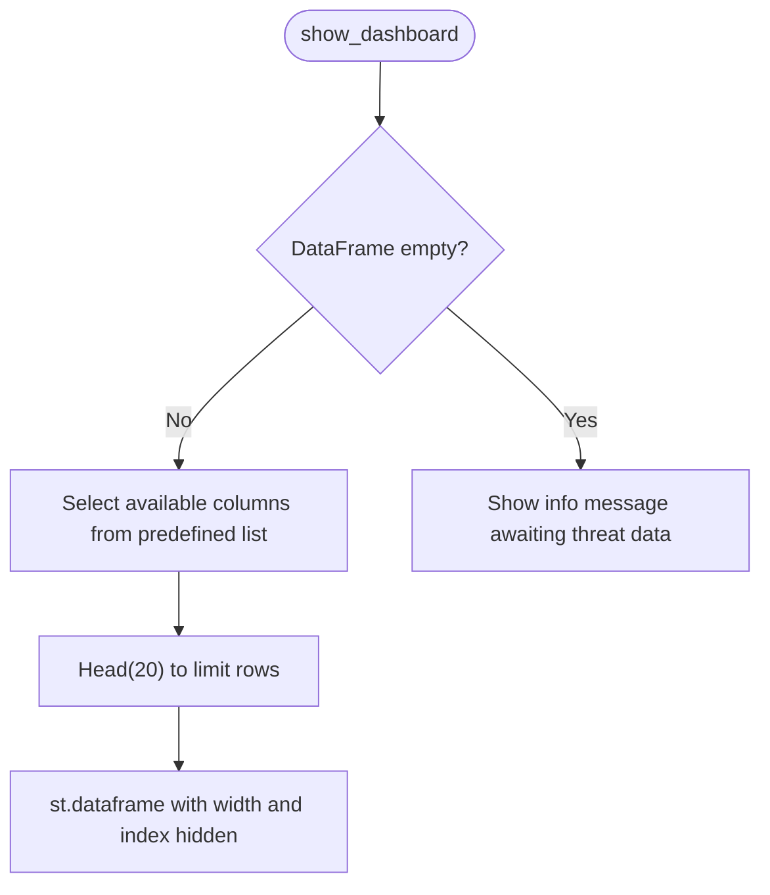
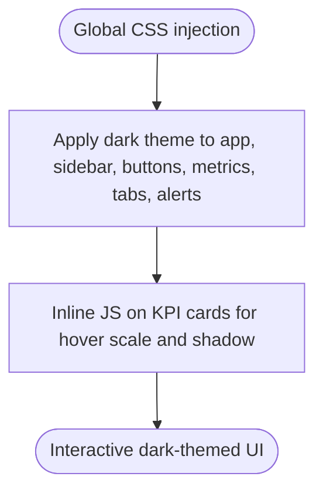
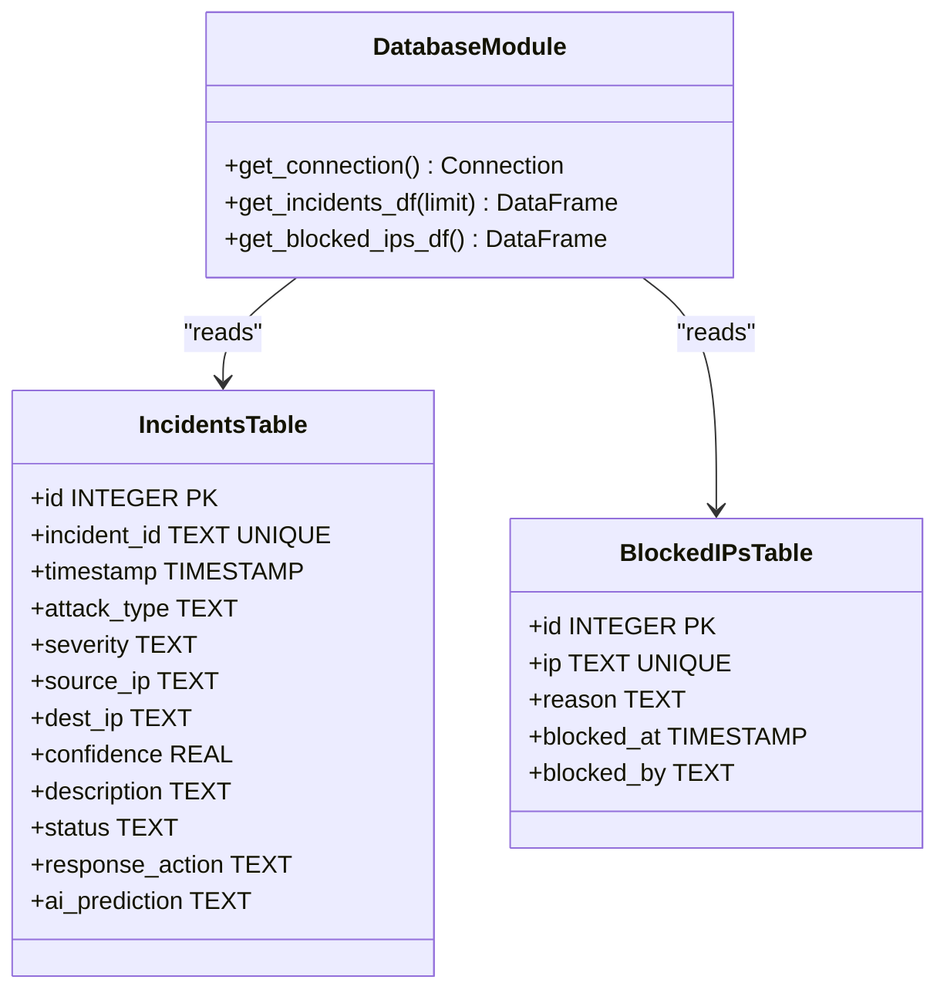
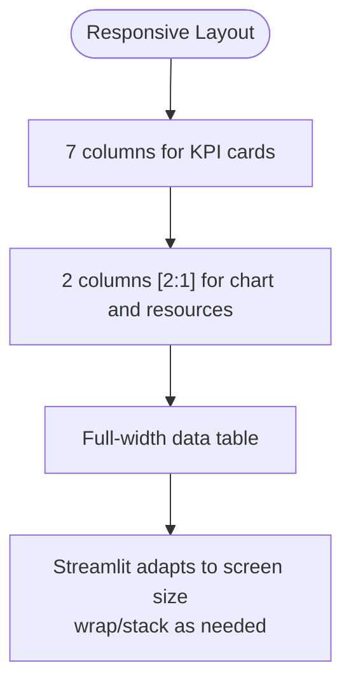
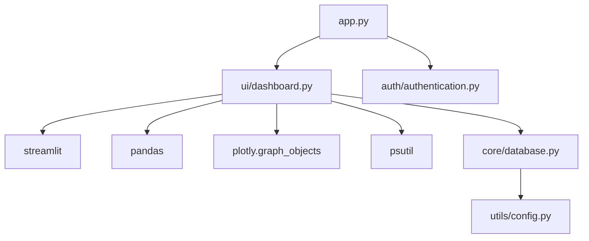

# Dashboard Interface

<cite>
**Referenced Files in This Document**
- [app.py](file://app.py)
- [dashboard.py](file://ui/dashboard.py)
- [database.py](file://core/database.py)
- [config.py](file://utils/config.py)
- [authentication.py](file://auth/authentication.py)
</cite>

## Table of Contents
1. [Introduction](#introduction)
2. [Project Structure](#project-structure)
3. [Core Components](#core-components)
4. [Architecture Overview](#architecture-overview)
5. [Detailed Component Analysis](#detailed-component-analysis)
6. [Dependency Analysis](#dependency-analysis)
7. [Performance Considerations](#performance-considerations)
8. [Troubleshooting Guide](#troubleshooting-guide)
9. [Conclusion](#conclusion)
10. [Appendices](#appendices)

## Introduction
This document provides a comprehensive guide to the main dashboard interface component of the Autonomous AI Cyber Defense Platform. It explains how KPI cards, severity distribution visualization, real-time system resource monitoring, and the recent threats table are implemented and integrated with the database for live threat data. It also covers custom CSS styling for the dark theme, interactive hover effects on KPI cards, responsive column layout behavior across screen sizes, and the data flow from the SQLite database to the UI components.

## Project Structure
The dashboard is part of a Streamlit-based application. The entry point configures global styles, initializes the database, manages authentication, and routes navigation to the dashboard module. The dashboard module renders KPI cards, Plotly visualizations, system resource monitors, and a data table. Database access is abstracted through helper functions that read from and write to an SQLite database. Configuration constants define paths and metadata.

**Diagram sources**
- [app.py:8-13](file://app.py#L8-L13)
- [app.py:16-99](file://app.py#L16-L99)
- [app.py:172-175](file://app.py#L172-L175)
- [dashboard.py:1-10](file://ui/dashboard.py#L1-L10)
- [database.py:10-13](file://core/database.py#L10-L13)
- [config.py:12-14](file://utils/config.py#L12-L14)
- [authentication.py:1-10](file://auth/authentication.py#L1-L10)

**Section sources**
- [app.py:8-13](file://app.py#L8-L13)
- [app.py:16-99](file://app.py#L16-L99)
- [app.py:172-175](file://app.py#L172-L175)
- [dashboard.py:1-10](file://ui/dashboard.py#L1-L10)
- [database.py:10-13](file://core/database.py#L10-L13)
- [config.py:12-14](file://utils/config.py#L12-L14)
- [authentication.py:1-10](file://auth/authentication.py#L1-L10)

## Core Components
- KPI Cards: Seven metric cards display Total Threats, Critical incidents, Today's Attacks, Blocked IPs, Active Sessions, Detection %, and AI Confidence. Each card uses custom HTML/CSS for dark theme styling and hover scaling.
- Severity Distribution Chart: A donut pie chart rendered via Plotly shows counts by severity level using colors aligned with the platform’s dark theme.
- System Resources Monitor: Real-time CPU, RAM, and Disk usage displayed as progress bars with percentage captions.
- Recent Threats Table: A data table showing the latest incidents with selected columns (timestamp, incident_id, attack_type, severity, source_ip, confidence).

These components are orchestrated within the dashboard function, which fetches data from the database and computes metrics before rendering.

**Section sources**
- [dashboard.py:12-29](file://ui/dashboard.py#L12-L29)
- [dashboard.py:32-67](file://ui/dashboard.py#L32-L67)
- [dashboard.py:70-94](file://ui/dashboard.py#L70-L94)
- [dashboard.py:96-110](file://ui/dashboard.py#L96-L110)
- [dashboard.py:111-119](file://ui/dashboard.py#L111-L119)

## Architecture Overview
The dashboard integrates with the database to retrieve incidents and blocked IPs, computes summary metrics, and renders visualizations and tables. Global CSS defines the dark theme and interactive styles applied across the application. Authentication ensures only authenticated users can access the dashboard.

**Diagram sources**
- [app.py:8-13](file://app.py#L8-L13)
- [app.py:16-99](file://app.py#L16-L99)
- [app.py:102-106](file://app.py#L102-L106)
- [app.py:172-175](file://app.py#L172-L175)
- [dashboard.py:32-67](file://ui/dashboard.py#L32-L67)
- [database.py:214-221](file://core/database.py#L214-L221)
- [database.py:207-212](file://core/database.py#L207-L212)
- [config.py:12-14](file://utils/config.py#L12-L14)

## Detailed Component Analysis

### KPI Cards System
- Metrics computed:
  - Total Threats: Count of all incidents.
  - Critical: Count where severity equals "Critical".
  - Today's Attacks: Count where timestamp date matches today.
  - Blocked IPs: Length of blocked IPs DataFrame.
  - Active Sessions: Read from session state defaulting to 1.
  - Detection %: Average confidence converted to percentage.
  - AI Confidence: Same as Detection % for consistency.
- Rendering:
  - Uses a custom HTML card with gradient background, border, shadow, and hover transform scale.
  - Colors vary per card to highlight different metrics.
  - Responsive layout achieved via seven columns; Streamlit adapts to smaller screens by wrapping or stacking.

**Diagram sources**
- [dashboard.py:32-67](file://ui/dashboard.py#L32-L67)

**Section sources**
- [dashboard.py:12-29](file://ui/dashboard.py#L12-L29)
- [dashboard.py:32-67](file://ui/dashboard.py#L32-L67)

### Severity Distribution Pie Chart (Plotly)
- Data aggregation:
  - Counts by severity using value_counts.
- Visualization:
  - Donut pie chart with hole size 0.55.
  - Colors mapped to severity levels: Low (green), Medium (yellow), High (orange), Critical (red).
  - Dark theme layout with paper_bgcolor and plot_bgcolor set to dark hex values.
  - Height and margins configured for compact display.

**Diagram sources**
- [dashboard.py:70-94](file://ui/dashboard.py#L70-L94)

**Section sources**
- [dashboard.py:70-94](file://ui/dashboard.py#L70-L94)

### Real-Time System Resource Monitoring
- Metrics:
  - CPU percent via psutil with short interval.
  - RAM percent via virtual_memory.
  - Disk percent via disk_usage with fallback handling.
- Rendering:
  - Progress bars for each metric with caption showing percentage.
  - Timestamp and network status indicator below resources.

**Diagram sources**
- [dashboard.py:96-110](file://ui/dashboard.py#L96-L110)

**Section sources**
- [dashboard.py:96-110](file://ui/dashboard.py#L96-L110)

### Recent Threats Data Table
- Columns displayed:
  - timestamp, incident_id, attack_type, severity, source_ip, confidence.
- Filtering:
  - Only available columns present in the DataFrame are shown.
  - Limited to top 20 rows for performance.
- Styling:
  - use_container_width=True and hide_index=True for clean presentation.

**Diagram sources**
- [dashboard.py:111-119](file://ui/dashboard.py#L111-L119)

**Section sources**
- [dashboard.py:111-119](file://ui/dashboard.py#L111-L119)

### Custom CSS Styling and Interactive Hover Effects
- Global dark theme:
  - Background gradients, sidebar styling, text colors, button gradients, hover glow animations, scrollbar customization.
- KPI card hover effect:
  - Inline JavaScript transforms scale up on mouseover and reset on mouseout.
  - Box-shadow color varies per card based on passed color parameter.

**Diagram sources**
- [app.py:16-99](file://app.py#L16-L99)
- [dashboard.py:12-29](file://ui/dashboard.py#L12-L29)

**Section sources**
- [app.py:16-99](file://app.py#L16-L99)
- [dashboard.py:12-29](file://ui/dashboard.py#L12-L29)

### Database Integration for Live Threat Data
- Functions used:
  - get_incidents_df(limit): Retrieves incidents ordered by timestamp descending with limit.
  - get_blocked_ips_df(): Retrieves blocked IPs ordered by blocked_at descending.
  - get_connection(): Establishes SQLite connection with row_factory for dict-like access.
- Schema relevant to dashboard:
  - incidents table includes fields like incident_id, timestamp, attack_type, severity, source_ip, dest_ip, confidence, description, status, response_action, ai_prediction.
  - blocked_ips table includes ip, reason, blocked_at, blocked_by.

**Diagram sources**
- [database.py:10-13](file://core/database.py#L10-L13)
- [database.py:48-74](file://core/database.py#L48-L74)
- [database.py:214-221](file://core/database.py#L214-L221)
- [database.py:207-212](file://core/database.py#L207-L212)

**Section sources**
- [database.py:10-13](file://core/database.py#L10-L13)
- [database.py:48-74](file://core/database.py#L48-L74)
- [database.py:214-221](file://core/database.py#L214-L221)
- [database.py:207-212](file://core/database.py#L207-L212)

### Responsive Column Layout and Adaptation
- Row 1 uses seven columns for KPI cards; Streamlit automatically wraps or stacks them on narrower screens.
- Row 2 splits into two columns with ratio [2, 1] for chart and resource monitor; adapts to vertical stacking on small devices.
- Row 3 displays a full-width data table; uses container width for optimal fit.

[No sources needed since this diagram shows conceptual workflow, not actual code structure]

**Section sources**
- [dashboard.py:52-67](file://ui/dashboard.py#L52-L67)
- [dashboard.py:70-94](file://ui/dashboard.py#L70-L94)
- [dashboard.py:111-119](file://ui/dashboard.py#L111-L119)

## Dependency Analysis
The dashboard depends on:
- Streamlit for UI components and layout.
- Pandas for DataFrame operations and aggregations.
- Plotly for interactive charts.
- psutil for system resource metrics.
- core.database for SQLite interactions.
- utils.config for DB path and app metadata.
- auth.authentication for session state and user context.

**Diagram sources**
- [dashboard.py:1-10](file://ui/dashboard.py#L1-L10)
- [database.py:1-8](file://core/database.py#L1-L8)
- [config.py:1-10](file://utils/config.py#L1-L10)
- [app.py:1-10](file://app.py#L1-L10)
- [authentication.py:1-10](file://auth/authentication.py#L1-L10)

**Section sources**
- [dashboard.py:1-10](file://ui/dashboard.py#L1-L10)
- [database.py:1-8](file://core/database.py#L1-L8)
- [config.py:1-10](file://utils/config.py#L1-L10)
- [app.py:1-10](file://app.py#L1-L10)
- [authentication.py:1-10](file://auth/authentication.py#L1-L10)

## Performance Considerations
- Limit incident queries to a reasonable number (e.g., 1000) to avoid heavy loads.
- Use head(20) for the recent threats table to reduce rendering overhead.
- Short intervals for CPU sampling minimize blocking while providing near-real-time updates.
- Avoid excessive re-renders by keeping computations minimal and leveraging pandas vectorized operations.
- Ensure proper closing of database connections in helper functions to prevent leaks.

[No sources needed since this section provides general guidance]

## Troubleshooting Guide
- No incidents yet:
  - If the incidents DataFrame is empty, the dashboard shows an info message indicating no incidents. Ensure the simulator or threat ingestion process populates the incidents table.
- Missing columns:
  - The recent threats table filters to available columns; verify schema alignment if expected columns are missing.
- Disk usage attribute error:
  - The disk usage retrieval includes a fallback check; ensure psutil returns expected attributes on your OS.
- Session state defaults:
  - Active sessions default to 1 if not set; verify session initialization in the app entry point.

**Section sources**
- [dashboard.py:93-94](file://ui/dashboard.py#L93-L94)
- [dashboard.py:113-119](file://ui/dashboard.py#L113-L119)
- [dashboard.py:98-101](file://ui/dashboard.py#L98-L101)
- [app.py:113-114](file://app.py#L113-L114)

## Conclusion
The dashboard interface delivers a cohesive, dark-themed command center for cyber defense analytics. It combines KPI cards, severity distribution visualization, real-time system resource monitoring, and a concise recent threats table. The integration with SQLite ensures live data updates, while custom CSS and inline JavaScript provide interactive and visually appealing elements. Responsive layout guarantees usability across devices, and careful performance practices keep the interface smooth under load.

[No sources needed since this section summarizes without analyzing specific files]

## Appendices

### Example Paths for Key Implementation Patterns
- KPI card rendering with hover effects: [dashboard.py:12-29](file://ui/dashboard.py#L12-L29)
- KPI metrics computation and display: [dashboard.py:32-67](file://ui/dashboard.py#L32-L67)
- Severity distribution pie chart construction: [dashboard.py:70-94](file://ui/dashboard.py#L70-L94)
- System resource monitoring with progress bars: [dashboard.py:96-110](file://ui/dashboard.py#L96-L110)
- Recent threats table rendering: [dashboard.py:111-119](file://ui/dashboard.py#L111-L119)
- Database helper functions for incidents and blocked IPs: [database.py:207-221](file://core/database.py#L207-L221)
- Global CSS dark theme and hover animations: [app.py:16-99](file://app.py#L16-L99)
- Session state initialization for active sessions: [app.py:113-114](file://app.py#L113-L114)

**Section sources**
- [dashboard.py:12-29](file://ui/dashboard.py#L12-L29)
- [dashboard.py:32-67](file://ui/dashboard.py#L32-L67)
- [dashboard.py:70-94](file://ui/dashboard.py#L70-L94)
- [dashboard.py:96-110](file://ui/dashboard.py#L96-L110)
- [dashboard.py:111-119](file://ui/dashboard.py#L111-L119)
- [database.py:207-221](file://core/database.py#L207-L221)
- [app.py:16-99](file://app.py#L16-L99)
- [app.py:113-114](file://app.py#L113-L114)