# Incident Management Interface

<cite>
**Referenced Files in This Document**
- [app.py](file://app.py)
- [ui/incidents.py](file://ui/incidents.py)
- [core/incident_manager.py](file://core/incident_manager.py)
- [core/database.py](file://core/database.py)
- [core/email_service.py](file://core/email_service.py)
- [ui/monitoring.py](file://ui/monitoring.py)
- [core/simulator.py](file://core/simulator.py)
- [core/threat_detection.py](file://core/threat_detection.py)
- [utils/config.py](file://utils/config.py)
</cite>

## Table of Contents
1. [Introduction](#introduction)
2. [Project Structure](#project-structure)
3. [Core Components](#core-components)
4. [Architecture Overview](#architecture-overview)
5. [Detailed Component Analysis](#detailed-component-analysis)
6. [Dependency Analysis](#dependency-analysis)
7. [Performance Considerations](#performance-considerations)
8. [Troubleshooting Guide](#troubleshooting-guide)
9. [Conclusion](#conclusion)
10. [Appendices](#appendices)

## Introduction
This document explains the incident management interface used by security analysts to investigate, triage, and resolve cyber incidents. It covers:
- How new incidents are created (automated via live monitoring and simulation)
- Status management (Open, Investigating, Resolved)
- Search and filtering capabilities
- CSV export functionality
- Case tracking features and collaboration workflows
- Integration with email notifications for critical alerts

The interface is built on Streamlit and integrates with a SQLite database, an AI threat detection pipeline, and an SMTP-based email service.

## Project Structure
The incident management feature spans UI components, core business logic, data persistence, and integrations:
- UI layer: Streamlit pages for navigation and user interactions
- Core layer: Incident search, status updates, statistics, and exports
- Data layer: SQLite schema and helpers for incidents and related tables
- Integrations: Email alerts and simulated event generation

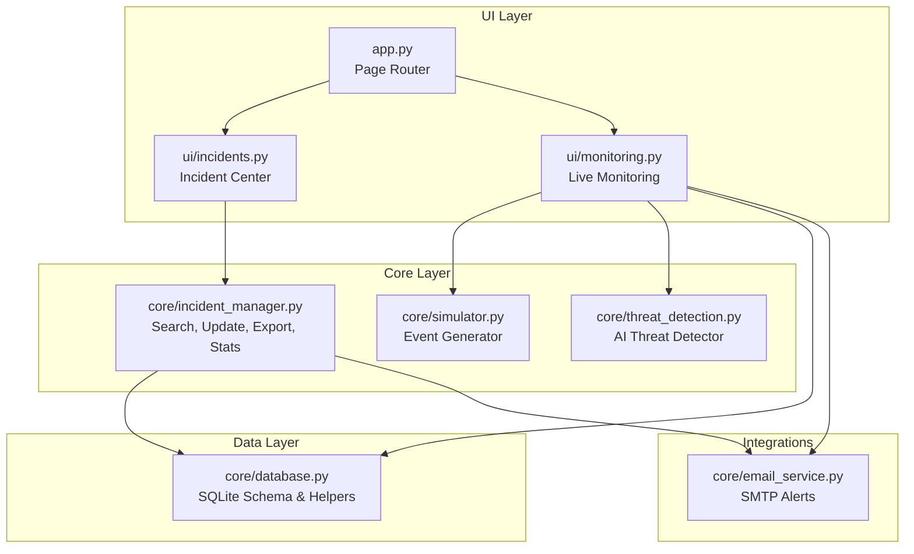

**Diagram sources**
- [app.py:148-187](file://app.py#L148-L187)
- [ui/incidents.py:15-82](file://ui/incidents.py#L15-L82)
- [ui/monitoring.py:91-133](file://ui/monitoring.py#L91-L133)
- [core/incident_manager.py:10-57](file://core/incident_manager.py#L10-L57)
- [core/threat_detection.py:15-147](file://core/threat_detection.py#L15-L147)
- [core/simulator.py:45-76](file://core/simulator.py#L45-L76)
- [core/database.py:16-150](file://core/database.py#L16-L150)
- [core/email_service.py:130-185](file://core/email_service.py#L130-L185)

**Section sources**
- [app.py:148-187](file://app.py#L148-L187)
- [ui/incidents.py:15-82](file://ui/incidents.py#L15-L82)
- [ui/monitoring.py:91-133](file://ui/monitoring.py#L91-L133)
- [core/incident_manager.py:10-57](file://core/incident_manager.py#L10-L57)
- [core/database.py:16-150](file://core/database.py#L16-L150)
- [core/email_service.py:130-185](file://core/email_service.py#L130-L185)
- [core/simulator.py:45-76](file://core/simulator.py#L45-L76)
- [core/threat_detection.py:15-147](file://core/threat_detection.py#L15-L147)
- [utils/config.py:23-30](file://utils/config.py#L23-L30)

## Core Components
- Incident Center UI: Provides metrics, search/filter, display, actions (mark resolved/investigating), and export buttons (CSV/PDF).
- Incident Manager: Implements search, status update, CSV export, and statistics aggregation.
- Database Module: Defines the incidents table schema and provides helper functions to read/write incidents and settings.
- Email Service: Sends threat alerts via SMTP based on configured recipients and settings.
- Live Monitoring: Generates events, runs AI analysis, persists incidents, triggers alarms, and optionally emails alerts.
- Simulator: Produces realistic synthetic network events with features for AI classification.
- Threat Detection: Classifies anomalies and assigns severity/confidence scores.

Key responsibilities:
- Creation: Automated via Live Monitoring and Simulator; persisted through Database insert_incident.
- Status management: Open → Investigating → Resolved via Incident Manager update function.
- Search/filter: By query text, severity, and status using Incident Manager search.
- Export: CSV via Incident Manager; PDF via Incident Center UI.
- Notifications: Optional automated email alerts for High/Critical threats.

**Section sources**
- [ui/incidents.py:15-82](file://ui/incidents.py#L15-L82)
- [core/incident_manager.py:10-57](file://core/incident_manager.py#L10-L57)
- [core/database.py:48-63](file://core/database.py#L48-L63)
- [core/email_service.py:130-185](file://core/email_service.py#L130-L185)
- [ui/monitoring.py:91-133](file://ui/monitoring.py#L91-L133)
- [core/simulator.py:45-76](file://core/simulator.py#L45-L76)
- [core/threat_detection.py:92-147](file://core/threat_detection.py#L92-L147)

## Architecture Overview
The incident lifecycle flows from event generation to storage, visibility, and optional notification:

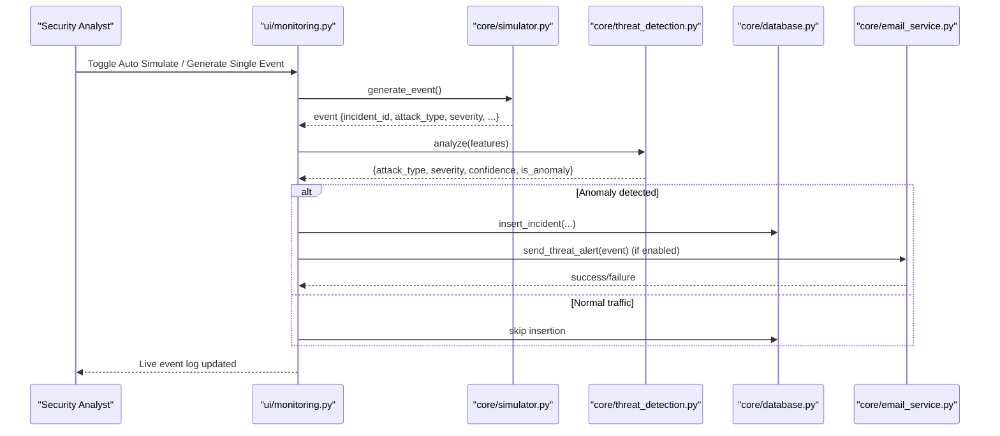

**Diagram sources**
- [ui/monitoring.py:91-133](file://ui/monitoring.py#L91-L133)
- [core/simulator.py:45-76](file://core/simulator.py#L45-L76)
- [core/threat_detection.py:92-147](file://core/threat_detection.py#L92-L147)
- [core/database.py:223-236](file://core/database.py#L223-L236)
- [core/email_service.py:130-185](file://core/email_service.py#L130-L185)

## Detailed Component Analysis

### Incident Center UI (Search, Filter, Actions, Export)
- Displays KPI metrics (total, critical, high, open, resolved).
- Allows filtering by severity and status, and free-text search across ID, IP, attack type, and description.
- Presents a tabular view of incidents with key columns.
- Provides actions:
  - Mark selected incident as Resolved or Investigating.
  - Export filtered results to CSV and PDF.
- Uses Incident Manager functions for search, status updates, and CSV export.

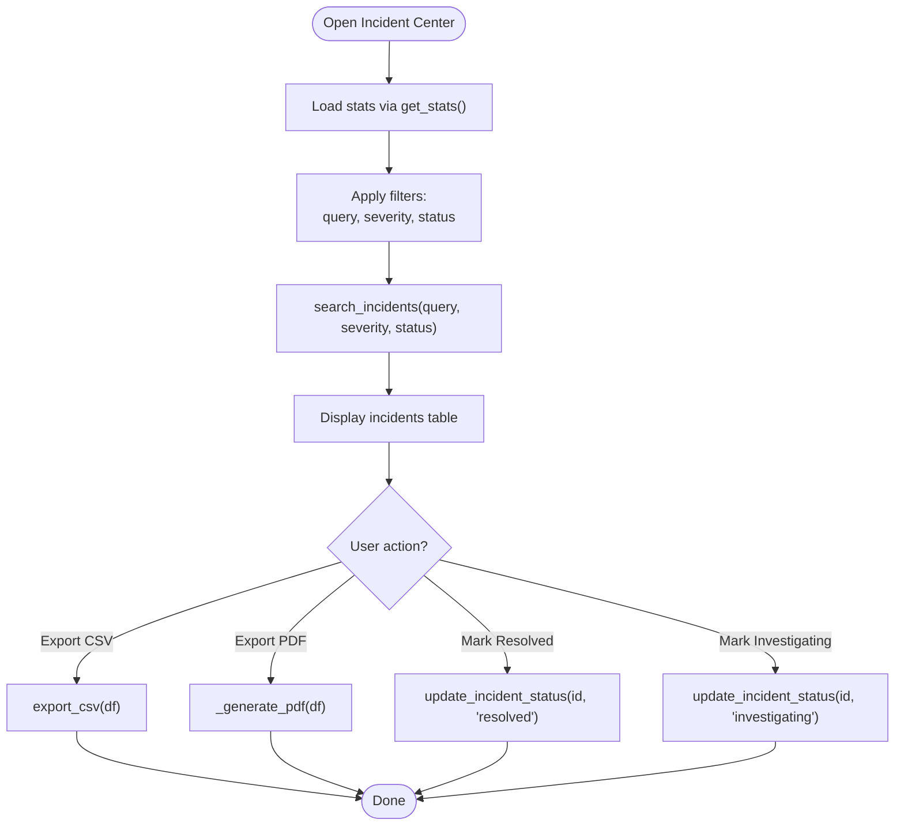

**Diagram sources**
- [ui/incidents.py:15-82](file://ui/incidents.py#L15-L82)
- [core/incident_manager.py:10-41](file://core/incident_manager.py#L10-L41)

**Section sources**
- [ui/incidents.py:15-82](file://ui/incidents.py#L15-L82)
- [core/incident_manager.py:10-41](file://core/incident_manager.py#L10-L41)

### Incident Manager (Search, Update, Export, Stats)
- search_incidents: Loads incidents into a DataFrame and applies filters for severity, status, and free-text query across multiple fields.
- update_incident_status: Updates the status field for a given incident_id.
- export_csv: Converts a DataFrame to CSV string for download.
- get_stats: Aggregates counts by severity and status for dashboard metrics.

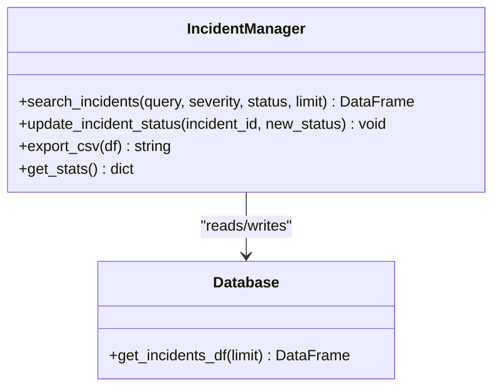

**Diagram sources**
- [core/incident_manager.py:10-57](file://core/incident_manager.py#L10-L57)
- [core/database.py:214-221](file://core/database.py#L214-L221)

**Section sources**
- [core/incident_manager.py:10-57](file://core/incident_manager.py#L10-L57)
- [core/database.py:214-221](file://core/database.py#L214-L221)

### Database Schema and Helpers (Incidents, Settings, Recipients)
- Incidents table includes fields for incident_id, timestamp, attack_type, severity, source_ip, dest_ip, confidence, description, status, response_action, ai_prediction.
- Default status is "open".
- Helper functions provide CRUD operations for incidents, settings, and audit logging.
- Email recipients table supports alert distribution.

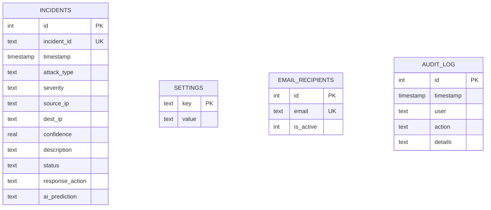

**Diagram sources**
- [core/database.py:48-114](file://core/database.py#L48-L114)

**Section sources**
- [core/database.py:48-114](file://core/database.py#L48-L114)
- [core/database.py:223-236](file://core/database.py#L223-L236)

### Live Monitoring and Incident Creation Workflow
- Auto-simulate generates events at a configurable rate.
- Each event is analyzed by the AI detector to determine anomaly, attack type, severity, and confidence.
- On anomaly, the system inserts an incident record and may block the source IP if auto-block is enabled.
- For High/Critical severity, it can trigger an audible alarm and optionally send an email alert.

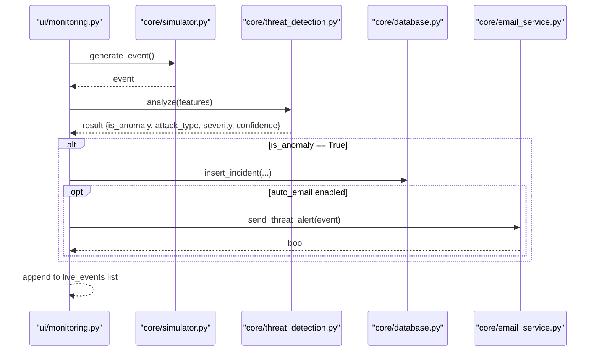

**Diagram sources**
- [ui/monitoring.py:91-133](file://ui/monitoring.py#L91-L133)
- [core/simulator.py:45-76](file://core/simulator.py#L45-L76)
- [core/threat_detection.py:92-147](file://core/threat_detection.py#L92-L147)
- [core/database.py:223-236](file://core/database.py#L223-L236)
- [core/email_service.py:130-185](file://core/email_service.py#L130-L185)

**Section sources**
- [ui/monitoring.py:91-133](file://ui/monitoring.py#L91-L133)
- [core/simulator.py:45-76](file://core/simulator.py#L45-L76)
- [core/threat_detection.py:92-147](file://core/threat_detection.py#L92-L147)
- [core/database.py:223-236](file://core/database.py#L223-L236)
- [core/email_service.py:130-185](file://core/email_service.py#L130-L185)

### Email Notification System Integration
- Configured via SMTP settings stored in the database.
- Recipients are managed in the email_recipients table.
- send_threat_alert composes and sends an alert email when High/Critical threats are detected.
- Returns success/failure and logs errors internally.

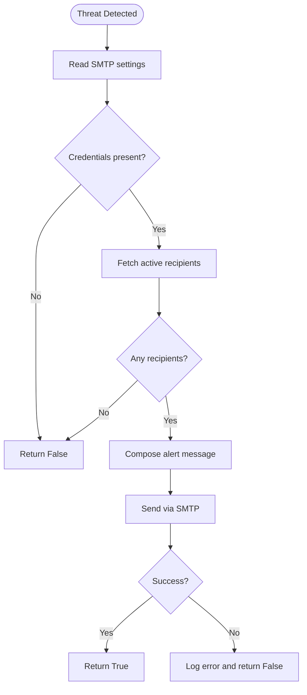

**Diagram sources**
- [core/email_service.py:130-185](file://core/email_service.py#L130-L185)
- [core/database.py:165-178](file://core/database.py#L165-L178)

**Section sources**
- [core/email_service.py:130-185](file://core/email_service.py#L130-L185)
- [core/database.py:165-178](file://core/database.py#L165-L178)

### Status Management System (Open, Investigating, Resolved)
- Default status is "open" upon creation.
- Analysts can change status to "investigating" or "resolved" via the Incident Center UI.
- The update function writes directly to the incidents table.

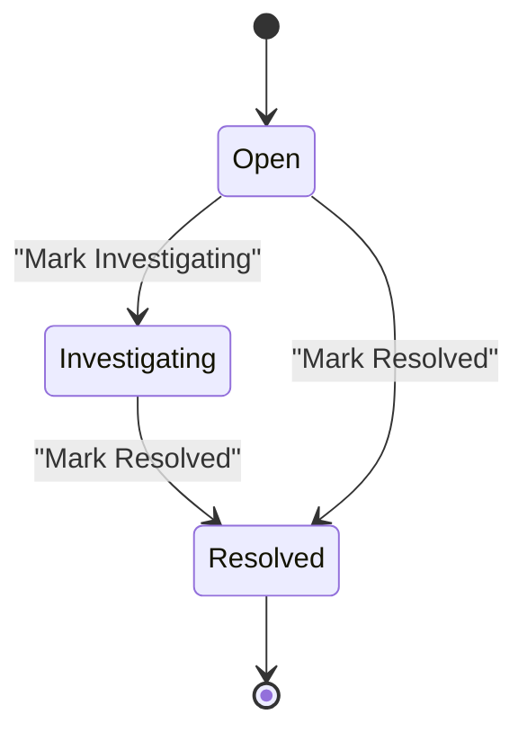

**Diagram sources**
- [core/database.py:48-63](file://core/database.py#L48-L63)
- [ui/incidents.py:68-81](file://ui/incidents.py#L68-L81)
- [core/incident_manager.py:29-35](file://core/incident_manager.py#L29-L35)

**Section sources**
- [core/database.py:48-63](file://core/database.py#L48-L63)
- [ui/incidents.py:68-81](file://ui/incidents.py#L68-L81)
- [core/incident_manager.py:29-35](file://core/incident_manager.py#L29-L35)

### Search and Filtering Capabilities
- Free-text search across incident_id, attack_type, source_ip, and description.
- Dropdown filters for severity and status.
- Results limited by default to a manageable size for performance.

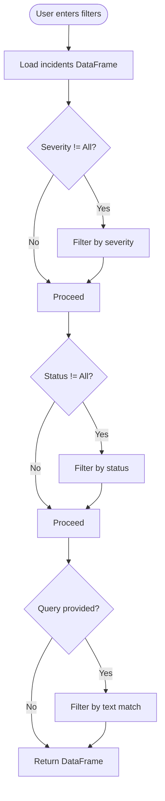

**Diagram sources**
- [core/incident_manager.py:10-26](file://core/incident_manager.py#L10-L26)

**Section sources**
- [core/incident_manager.py:10-26](file://core/incident_manager.py#L10-L26)

### CSV Export Functionality
- Incident Center UI calls export_csv to convert the filtered DataFrame to CSV.
- Download button triggers browser download with filename "incidents.csv".

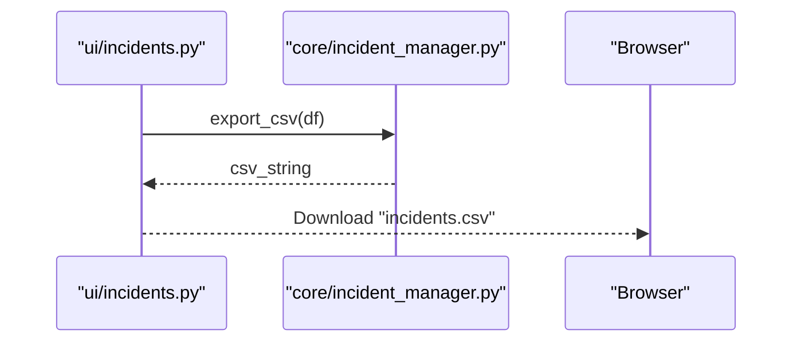

**Diagram sources**
- [ui/incidents.py:59-61](file://ui/incidents.py#L59-L61)
- [core/incident_manager.py:38-41](file://core/incident_manager.py#L38-L41)

**Section sources**
- [ui/incidents.py:59-61](file://ui/incidents.py#L59-L61)
- [core/incident_manager.py:38-41](file://core/incident_manager.py#L38-L41)

### Case Tracking Features and Collaboration
- Case tracking is achieved through persistent incident records with unique IDs, timestamps, and evolving status.
- Notes and evidence: While not explicitly modeled in the current schema, the description and response_action fields can be used to capture analyst notes and actions taken.
- Collaboration: Multiple analysts can access the same dataset; changes to status are reflected immediately due to shared SQLite backend. Audit logging captures user actions for accountability.

Best practices:
- Use description to document initial observations and evidence references.
- Use response_action to record remediation steps (e.g., blocked IP, isolated host).
- Leverage audit_log to track who changed what and when.

**Section sources**
- [core/database.py:48-63](file://core/database.py#L48-L63)
- [core/database.py:88-97](file://core/database.py#L88-97)
- [ui/incidents.py:50-53](file://ui/incidents.py#L50-L53)

### Examples of Incident Lifecycle Management
- Create: Live Monitoring detects anomaly → insert_incident creates "open" incident.
- Investigate: Analyst marks status to "investigating" via Incident Center.
- Resolve: Analyst marks status to "resolved" after remediation.
- Notify: If severity is High/Critical and auto_email is enabled, an email alert is sent to configured recipients.

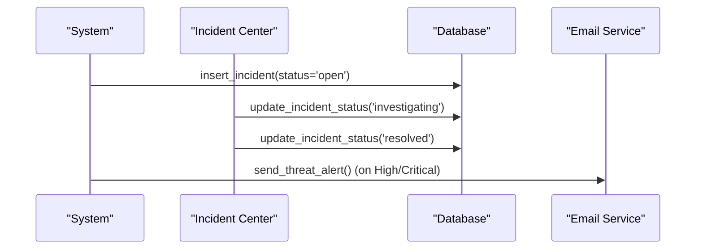

**Diagram sources**
- [ui/monitoring.py:107-125](file://ui/monitoring.py#L107-L125)
- [ui/incidents.py:68-81](file://ui/incidents.py#L68-L81)
- [core/incident_manager.py:29-35](file://core/incident_manager.py#L29-L35)
- [core/email_service.py:130-185](file://core/email_service.py#L130-L185)

**Section sources**
- [ui/monitoring.py:107-125](file://ui/monitoring.py#L107-L125)
- [ui/incidents.py:68-81](file://ui/incidents.py#L68-L81)
- [core/incident_manager.py:29-35](file://core/incident_manager.py#L29-L35)
- [core/email_service.py:130-185](file://core/email_service.py#L130-L185)

### Bulk Operations
- Current implementation supports single-incident status updates via explicit IDs.
- Bulk operations (e.g., marking multiple incidents as resolved) are not exposed in the UI; they can be implemented by extending the Incident Manager with batch update functions and adding corresponding UI controls.

Recommendation:
- Add a bulk update endpoint that accepts a list of incident_ids and a target status.
- Provide checkboxes in the Incident Center to select multiple rows and apply actions.

[No sources needed since this section proposes enhancements not present in the codebase]

## Dependency Analysis
The incident management system has clear separation between UI, core logic, data, and integrations. Dependencies are primarily one-directional:
- UI depends on core modules for business logic and data access.
- Core modules depend on database helpers and configuration.
- Email service depends on database settings and recipients.

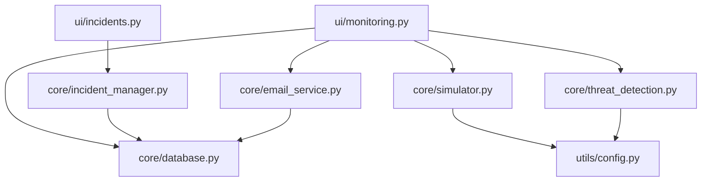

**Diagram sources**
- [ui/incidents.py:15-82](file://ui/incidents.py#L15-L82)
- [ui/monitoring.py:91-133](file://ui/monitoring.py#L91-L133)
- [core/incident_manager.py:10-57](file://core/incident_manager.py#L10-L57)
- [core/database.py:214-236](file://core/database.py#L214-L236)
- [core/email_service.py:130-185](file://core/email_service.py#L130-L185)
- [core/simulator.py:45-76](file://core/simulator.py#L45-L76)
- [core/threat_detection.py:92-147](file://core/threat_detection.py#L92-L147)
- [utils/config.py:23-30](file://utils/config.py#L23-L30)

**Section sources**
- [ui/incidents.py:15-82](file://ui/incidents.py#L15-L82)
- [ui/monitoring.py:91-133](file://ui/monitoring.py#L91-L133)
- [core/incident_manager.py:10-57](file://core/incident_manager.py#L10-L57)
- [core/database.py:214-236](file://core/database.py#L214-L236)
- [core/email_service.py:130-185](file://core/email_service.py#L130-L185)
- [core/simulator.py:45-76](file://core/simulator.py#L45-L76)
- [core/threat_detection.py:92-147](file://core/threat_detection.py#L92-L147)
- [utils/config.py:23-30](file://utils/config.py#L23-L30)

## Performance Considerations
- Limiting queries: get_incidents_df uses LIMIT to avoid loading large datasets into memory.
- DataFrame filtering: In-memory filtering is efficient for moderate sizes; consider server-side filtering for very large datasets.
- Model caching: ThreatDetector loads models once per process to avoid repeated training/loading overhead.
- Session state: Live events are capped at 500 entries to prevent unbounded growth.

Recommendations:
- Implement pagination or virtual scrolling for large incident lists.
- Cache frequently accessed stats and filter results where appropriate.
- Optimize PDF generation for large datasets by limiting rows or streaming output.

[No sources needed since this section provides general guidance]

## Troubleshooting Guide
Common issues and resolutions:
- No incidents displayed: Ensure simulator is running and events are being generated; check database connectivity and schema initialization.
- Status updates not applied: Verify incident_id matches exactly; confirm write permissions to SQLite file.
- Email alerts not sent: Validate SMTP settings (server, port, credentials); ensure active recipients exist; check network connectivity and firewall rules.
- Slow search/filter: Reduce limit parameter or add indexes on frequently filtered columns (incident_id, severity, status).

Operational checks:
- Confirm init_db has run successfully during application startup.
- Review audit_log for recent actions and errors.
- Inspect settings table for correct SMTP configuration.

**Section sources**
- [core/database.py:16-150](file://core/database.py#L16-L150)
- [core/email_service.py:130-185](file://core/email_service.py#L130-L185)
- [core/incident_manager.py:29-35](file://core/incident_manager.py#L29-L35)

## Conclusion
The incident management interface provides a robust foundation for SOC analysts to monitor, investigate, and resolve cyber incidents. It combines automated threat detection, intuitive UI controls, and reliable data persistence. Future enhancements could include bulk operations, richer note/evidence fields, and advanced collaboration features such as assignment and comments.

[No sources needed since this section summarizes without analyzing specific files]

## Appendices
- Severity levels: Low, Medium, High, Critical
- Attack types: Malware, Ransomware, DDoS, Brute Force, SQL Injection, XSS, Phishing, Insider Threat, Credential Theft, Port Scan
- Default incident status: open

**Section sources**
- [utils/config.py:23-30](file://utils/config.py#L23-L30)
- [core/database.py:48-63](file://core/database.py#L48-L63)