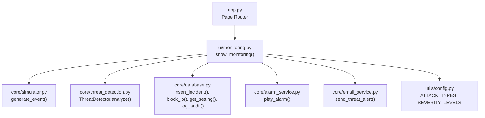
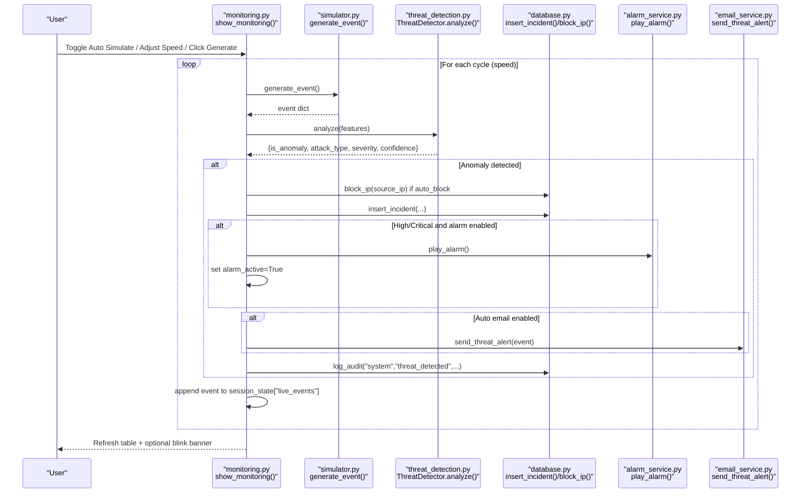
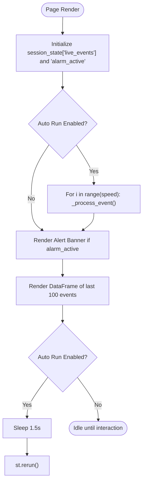
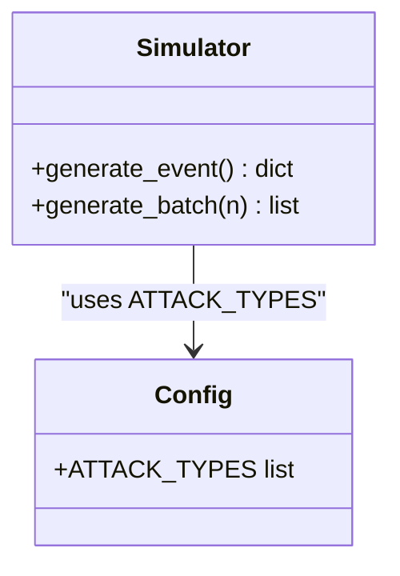
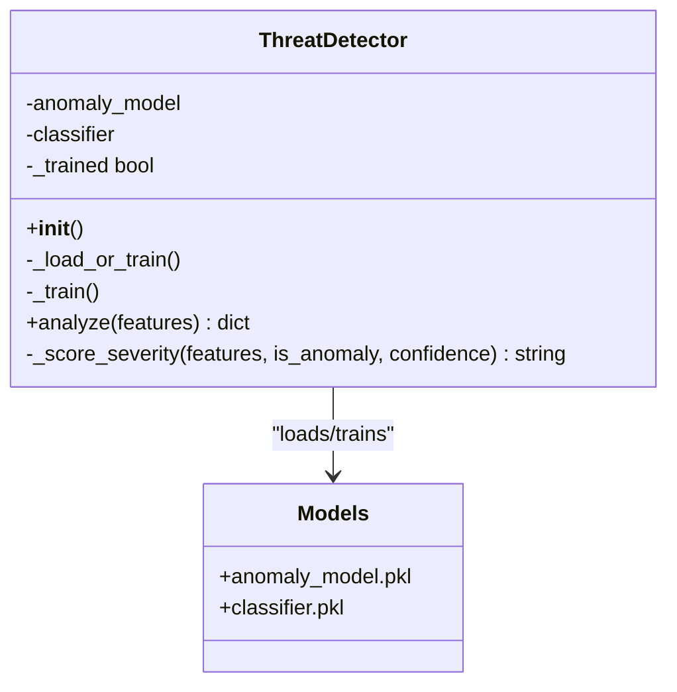
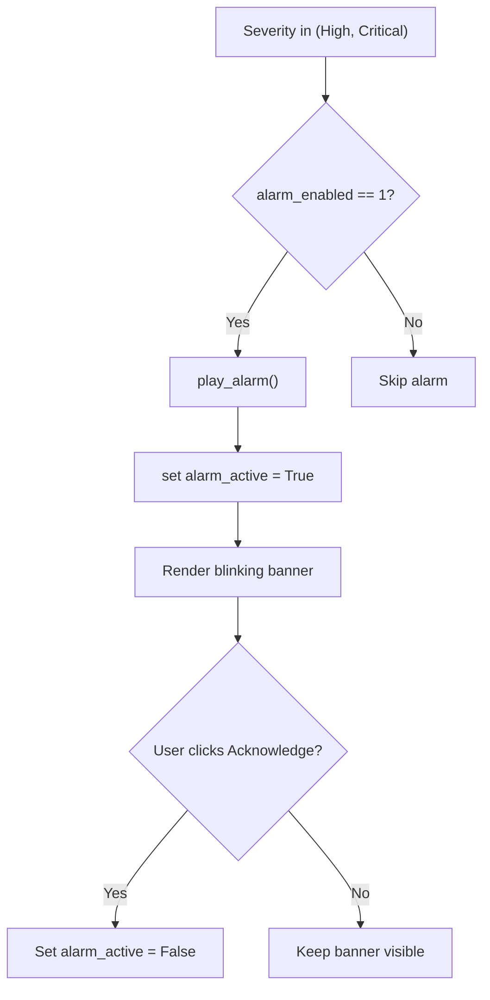
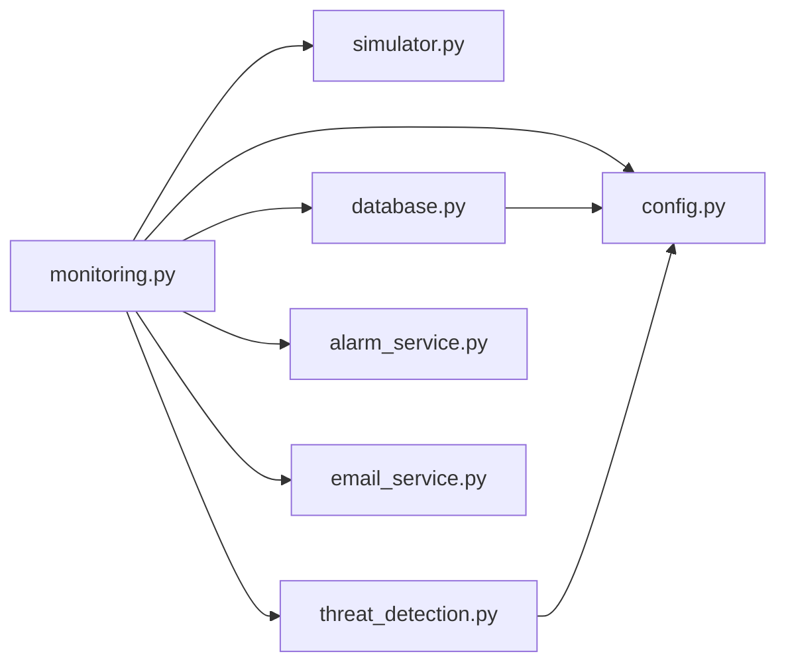

# Live Monitoring Interface

<cite>
**Referenced Files in This Document**
- [app.py](file://app.py)
- [monitoring.py](file://ui/monitoring.py)
- [simulator.py](file://core/simulator.py)
- [threat_detection.py](file://core/threat_detection.py)
- [database.py](file://core/database.py)
- [alarm_service.py](file://core/alarm_service.py)
- [email_service.py](file://core/email_service.py)
- [config.py](file://utils/config.py)
</cite>

## Table of Contents
1. [Introduction](#introduction)
2. [Project Structure](#project-structure)
3. [Core Components](#core-components)
4. [Architecture Overview](#architecture-overview)
5. [Detailed Component Analysis](#detailed-component-analysis)
6. [Dependency Analysis](#dependency-analysis)
7. [Performance Considerations](#performance-considerations)
8. [Troubleshooting Guide](#troubleshooting-guide)
9. [Conclusion](#conclusion)

## Introduction
This document explains the real-time monitoring interface that streams live security events, simulates network traffic, and provides immediate threat notifications via an alert banner. It covers how incoming events are displayed and auto-refreshed, how users can control simulation speed and generation, and how the system integrates with the AI threat detection engine for live analysis. It also describes drill-down capabilities through incident records and audit logs, and outlines event visualization patterns used across the platform.

## Project Structure
The monitoring feature is implemented as a Streamlit page integrated into the main application router. The core logic spans:
- UI layer: live controls, event table, and alert banner
- Simulation layer: realistic attack event generation
- Detection layer: anomaly detection and classification
- Persistence and orchestration: database operations, settings, alarms, and email alerts

**Diagram sources**
- [app.py:172-178](file://app.py#L172-L178)
- [monitoring.py:20-88](file://ui/monitoring.py#L20-L88)
- [simulator.py:45-71](file://core/simulator.py#L45-L71)
- [threat_detection.py:92-127](file://core/threat_detection.py#L92-L127)
- [database.py:165-170](file://core/database.py#L165-L170)
- [alarm_service.py:8-22](file://core/alarm_service.py#L8-L22)
- [email_service.py:130-184](file://core/email_service.py#L130-L184)
- [config.py:23-30](file://utils/config.py#L23-L30)

**Section sources**
- [app.py:172-178](file://app.py#L172-L178)
- [monitoring.py:20-88](file://ui/monitoring.py#L20-L88)

## Core Components
- Live Monitoring Page: Provides auto-simulation toggle, speed control, single-event generation, live event table, and alarm banner.
- Event Simulator: Generates realistic network/security events with features suitable for AI analysis.
- Threat Detector: Uses IsolationForest for anomaly detection and RandomForest for attack classification; computes severity and confidence.
- Database Layer: Persists incidents, manages blocked IPs, stores settings, and logs audits.
- Alarm Service: Plays a Windows beep on high/critical threats when enabled.
- Email Alert Service: Sends structured threat emails to configured recipients.

Key responsibilities and interactions are detailed in subsequent sections.

**Section sources**
- [monitoring.py:20-88](file://ui/monitoring.py#L20-L88)
- [simulator.py:45-71](file://core/simulator.py#L45-L71)
- [threat_detection.py:15-127](file://core/threat_detection.py#L15-L127)
- [database.py:165-170](file://core/database.py#L165-L170)
- [alarm_service.py:8-22](file://core/alarm_service.py#L8-L22)
- [email_service.py:130-184](file://core/email_service.py#L130-L184)

## Architecture Overview
The monitoring pipeline processes each simulated event through the AI detector, updates session state for live display, persists relevant data, and triggers alerts based on severity and configuration.

**Diagram sources**
- [monitoring.py:20-88](file://ui/monitoring.py#L20-L88)
- [monitoring.py:91-133](file://ui/monitoring.py#L91-L133)
- [simulator.py:45-71](file://core/simulator.py#L45-L71)
- [threat_detection.py:92-127](file://core/threat_detection.py#L92-L127)
- [database.py:181-191](file://core/database.py#L181-L191)
- [database.py:223-235](file://core/database.py#L223-L235)
- [alarm_service.py:8-22](file://core/alarm_service.py#L8-L22)
- [email_service.py:130-184](file://core/email_service.py#L130-L184)

## Detailed Component Analysis

### Live Monitoring Page (UI Controls and Display)
- Controls:
  - Auto-simulation toggle enables continuous event generation.
  - Speed slider controls number of events per cycle.
  - Single-event button generates one event on demand.
- Live Event Table:
  - Displays the most recent up to 100 events from session state.
  - Columns include timestamp, incident_id, event_type, attack_type, severity, source_ip, dest_ip, confidence.
- Auto-refresh:
  - When auto-run is enabled, the page sleeps briefly and reruns to keep the view fresh.
- Alert Banner:
  - A blinking banner appears when a High or Critical threat is detected and alarm is active.
  - Users can acknowledge and mute the banner.

**Diagram sources**
- [monitoring.py:20-88](file://ui/monitoring.py#L20-L88)
- [monitoring.py:85-88](file://ui/monitoring.py#L85-L88)

**Section sources**
- [monitoring.py:20-88](file://ui/monitoring.py#L20-L88)

### Network Traffic Simulation
- Event Generation:
  - Randomly selects attack type from configured list.
  - Chooses source and destination IPs from predefined pools.
  - Creates a feature vector with metrics like packets_per_sec, failed_logins, payload_size, unique_ports, entropy.
- Batch Generation:
  - Supports generating multiple events at once for testing.

**Diagram sources**
- [simulator.py:45-71](file://core/simulator.py#L45-L71)
- [config.py:27-30](file://utils/config.py#L27-L30)

**Section sources**
- [simulator.py:45-71](file://core/simulator.py#L45-L71)

### AI Threat Detection Engine
- Anomaly Detection:
  - IsolationForest scores and predicts anomalies based on feature vectors.
- Classification:
  - RandomForest classifier predicts attack type for anomalous events.
- Severity Scoring:
  - Combines confidence and feature thresholds to assign Low/Medium/High/Critical.
- Model Management:
  - Loads pre-trained models if available; otherwise trains on synthetic data and persists models.

**Diagram sources**
- [threat_detection.py:15-72](file://core/threat_detection.py#L15-L72)
- [threat_detection.py:92-127](file://core/threat_detection.py#L92-L127)
- [threat_detection.py:129-147](file://core/threat_detection.py#L129-L147)

**Section sources**
- [threat_detection.py:15-127](file://core/threat_detection.py#L15-L127)
- [threat_detection.py:129-147](file://core/threat_detection.py#L129-L147)

### Alert Banner System
- Trigger Conditions:
  - High or Critical severity detected.
  - Alarm setting enabled.
- Behavior:
  - Plays a background beep (Windows only).
  - Sets session state to show blinking banner.
  - Allows user to acknowledge and mute.

**Diagram sources**
- [monitoring.py:117-125](file://ui/monitoring.py#L117-L125)
- [alarm_service.py:8-22](file://core/alarm_service.py#L8-L22)

**Section sources**
- [monitoring.py:117-125](file://ui/monitoring.py#L117-L125)
- [alarm_service.py:8-22](file://core/alarm_service.py#L8-L22)

### Interactive Controls for Starting/Stopping Simulations
- Auto-simulation toggle:
  - Enables/disables continuous event generation.
- Speed slider:
  - Controls number of events processed per cycle.
- Single-event generator:
  - Produces one event immediately without enabling auto-run.

These controls directly influence the processing loop and refresh behavior.

**Section sources**
- [monitoring.py:27-35](file://ui/monitoring.py#L27-L35)
- [monitoring.py:45-47](file://ui/monitoring.py#L45-L47)

### Real-Time Event Display and Auto-Refresh
- Session State Storage:
  - Events appended to session_state["live_events"], capped at 500 entries.
- Table Rendering:
  - Last 100 events shown in reverse chronological order.
- Auto-Refresh:
  - When auto-run is enabled, page sleeps briefly and reruns to update the view.

**Section sources**
- [monitoring.py:39-43](file://ui/monitoring.py#L39-L43)
- [monitoring.py:72-83](file://ui/monitoring.py#L72-L83)
- [monitoring.py:85-88](file://ui/monitoring.py#L85-L88)
- [monitoring.py:127-133](file://ui/monitoring.py#L127-L133)

### Filtering Events by Type and Severity
- Current Implementation:
  - The monitoring page displays all events without built-in filters.
- Recommended Enhancement:
  - Add dropdowns or multi-select widgets for event_type and severity to filter the displayed DataFrame before rendering.
  - Example pattern: apply pandas boolean masks to subset the DataFrame based on selected filters.

[No sources needed since this section proposes enhancements not present in current code]

### Drill-Down Capabilities for Individual Threat Analysis
- Incident Records:
  - Each anomaly is persisted with incident_id, attack_type, severity, source_ip, dest_ip, confidence, description, response_action, ai_prediction.
- Audit Logs:
  - Threat detections are logged with details including attack type, severity, and source IP.
- Access Points:
  - Use the Incident Center to search, filter, and export incidents.
  - Review audit logs for historical actions and system events.

**Section sources**
- [database.py:223-235](file://core/database.py#L223-L235)
- [database.py:155-162](file://core/database.py#L155-L162)
- [incidents.py:34-43](file://ui/incidents.py#L34-L43)

### Event Visualization Patterns
- Live Table:
  - Real-time scrolling table showing latest events with key fields.
- Dashboard Charts:
  - Pie chart for severity distribution.
  - KPI cards for total threats, critical count, today’s attacks, blocked IPs, detection percentage, and AI confidence.
- Resource Monitors:
  - CPU, RAM, and Disk usage indicators.

**Section sources**
- [dashboard.py:74-92](file://ui/dashboard.py#L74-L92)
- [dashboard.py:51-66](file://ui/dashboard.py#L51-L66)
- [dashboard.py:97-108](file://ui/dashboard.py#L97-L108)

### Integration with Threat Detection Engine for Live Analysis
- On each event, the UI calls the detector’s analyze method with the event’s feature vector.
- Results enrich the event with severity, confidence, and predicted attack type.
- Anomalies trigger blocking, persistence, alarms, and optional email alerts.

**Section sources**
- [monitoring.py:91-125](file://ui/monitoring.py#L91-L125)
- [threat_detection.py:92-127](file://core/threat_detection.py#L92-L127)

## Dependency Analysis
The monitoring module orchestrates multiple services and utilities. Coupling is primarily through function calls and shared configuration.

**Diagram sources**
- [monitoring.py:8-12](file://ui/monitoring.py#L8-L12)
- [database.py:7](file://core/database.py#L7)
- [threat_detection.py:9](file://core/threat_detection.py#L9)
- [config.py:23-30](file://utils/config.py#L23-L30)

**Section sources**
- [monitoring.py:8-12](file://ui/monitoring.py#L8-L12)
- [database.py:7](file://core/database.py#L7)
- [threat_detection.py:9](file://core/threat_detection.py#L9)

## Performance Considerations
- Event Buffering:
  - Session state caps at 500 events to prevent memory growth.
- Table Rendering:
  - Only last 100 events are rendered to reduce overhead.
- Model Loading:
  - ThreatDetector caches models; first run may train on synthetic data which takes time.
- Auto-Refresh:
  - Sleep interval balances responsiveness with server load.
- Blocking and Persistence:
  - Database writes occur per anomaly; consider batching under high throughput.

[No sources needed since this section provides general guidance]

## Troubleshooting Guide
- No Events Appearing:
  - Ensure auto-simulation is enabled or click “Generate Single Event.”
  - Verify session state initialization for live_events and alarm_active.
- Alarm Not Playing:
  - Confirm alarm_enabled setting is active and running on Windows (beep uses winsound).
- Emails Not Sent:
  - Validate SMTP settings and recipient list; ensure auto_email is enabled.
- Slow UI Updates:
  - Reduce speed slider value or disable auto-run temporarily.
- Missing Filters:
  - Add filtering controls to the monitoring page to narrow down event_type and severity.

**Section sources**
- [monitoring.py:27-35](file://ui/monitoring.py#L27-L35)
- [monitoring.py:45-47](file://ui/monitoring.py#L45-L47)
- [alarm_service.py:8-22](file://core/alarm_service.py#L8-L22)
- [email_service.py:130-184](file://core/email_service.py#L130-L184)

## Conclusion
The live monitoring interface delivers a comprehensive, real-time view of simulated security events with AI-driven analysis, immediate threat notifications, and interactive controls. While the current implementation focuses on streaming and alerting, adding filtering and drill-down enhancements will further improve usability and operational efficiency. The architecture cleanly separates UI, simulation, detection, and persistence concerns, enabling scalable improvements and integrations.