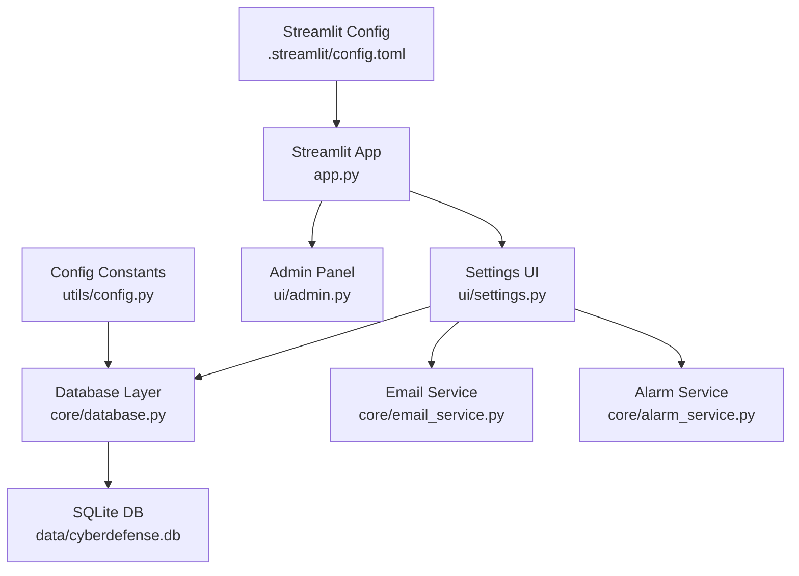
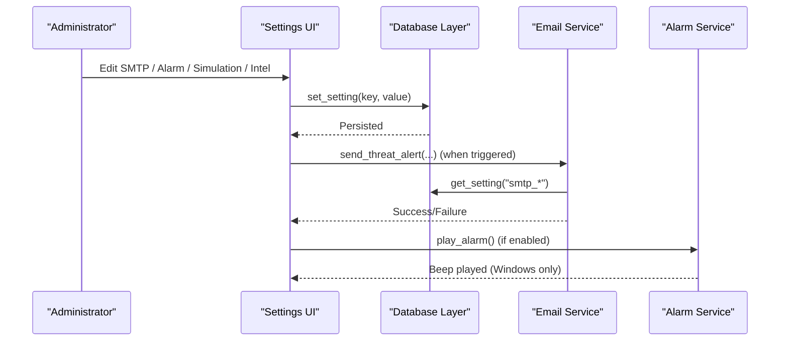
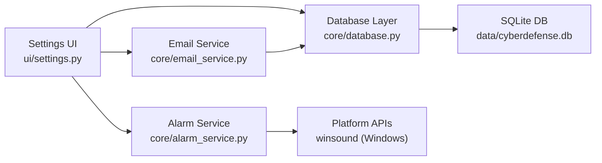

# Settings and Configuration Interface

<cite>
**Referenced Files in This Document**
- [app.py](file://app.py)
- [ui/settings.py](file://ui/settings.py)
- [core/database.py](file://core/database.py)
- [core/email_service.py](file://core/email_service.py)
- [core/alarm_service.py](file://core/alarm_service.py)
- [utils/config.py](file://utils/config.py)
- [auth/authentication.py](file://auth/authentication.py)
- [.streamlit/config.toml](file://.streamlit/config.toml)
</cite>

## Table of Contents
1. Introduction
2. Project Structure
3. Core Components
4. Architecture Overview
5. Detailed Component Analysis
6. Dependency Analysis
7. Performance Considerations
8. Troubleshooting Guide
9. Conclusion
10. Appendices

## Introduction
This document explains the application’s settings and configuration interface, focusing on how administrators configure:
- Application parameters via a centralized settings panel
- SMTP server for email notifications (verification codes, password resets, threat alerts)
- Alarm system customization (on/off behavior)
- Database connection and schema used to persist settings and operational data
- Security parameter management (user roles, verification, audit logging)
It also covers how to modify detection thresholds indirectly through simulation controls and threat intelligence, configure notification recipients, customize alert sounds, manage user permissions, and tune performance-related parameters. Examples include validation behaviors, environment-specific settings, and guidance for backup/restore of configuration data.

## Project Structure
The settings functionality is implemented as part of a Streamlit application with clear separation between UI, services, and persistence:
- UI layer: Streamlit pages including Settings and Admin Panel
- Services: Email service, alarm service, threat detection logic
- Persistence: SQLite database with tables for users, incidents, blocked IPs, threat intel, audit log, app settings, and email recipients
- Configuration: Defaults and constants in a dedicated config module; Streamlit runtime configuration via TOML

**Diagram sources**
- [app.py:101-200](file://app.py#L101-L200)
- [ui/settings.py:10-110](file://ui/settings.py#L10-L110)
- [core/database.py:16-150](file://core/database.py#L16-L150)
- [core/email_service.py:10-185](file://core/email_service.py#L10-L185)
- [core/alarm_service.py:8-23](file://core/alarm_service.py#L8-L23)
- [utils/config.py:7-36](file://utils/config.py#L7-L36)
- [.streamlit/config.toml:1-14](file://.streamlit/config.toml#L1-L14)

**Section sources**
- [app.py:101-200](file://app.py#L101-L200)
- [ui/settings.py:10-110](file://ui/settings.py#L10-L110)
- [core/database.py:16-150](file://core/database.py#L16-L150)
- [utils/config.py:7-36](file://utils/config.py#L7-L36)
- [.streamlit/config.toml:1-14](file://.streamlit/config.toml#L1-L14)

## Core Components
- Settings UI: Centralized tabs for Email, Alarm, Simulation, and Threat Intelligence. Persists values into the settings table and manages recipients.
- Email Service: Reads SMTP settings from the database, sends verification, password reset, and threat alert emails to configured recipients.
- Alarm Service: Plays an audible beep on Windows when alarms are enabled for high/critical threats.
- Database Layer: Initializes schema, seeds default settings, provides get/set helpers for settings, and stores recipients and other operational data.
- Authentication: Manages user registration, verification, login, and role-based access; integrates with email for verification and password reset flows.
- Configuration Constants: Defines defaults like severity levels, attack types, and base paths.

Key capabilities exposed by the Settings UI:
- Configure SMTP server, port, sender email, and app password
- Toggle auto-email on High/Critical threats
- Enable/disable alarm sounds for High/Critical threats
- Control simulation speed and auto-blocking behavior
- Manage threat intelligence indicators

**Section sources**
- [ui/settings.py:10-110](file://ui/settings.py#L10-L110)
- [core/email_service.py:10-185](file://core/email_service.py#L10-L185)
- [core/alarm_service.py:8-23](file://core/alarm_service.py#L8-L23)
- [core/database.py:16-150](file://core/database.py#L16-L150)
- [auth/authentication.py:27-112](file://auth/authentication.py#L27-L112)
- [utils/config.py:23-36](file://utils/config.py#L23-L36)

## Architecture Overview
The settings flow reads/writes persistent configuration via the database and uses services to apply changes at runtime.

**Diagram sources**
- [ui/settings.py:32-88](file://ui/settings.py#L32-L88)
- [core/database.py:165-178](file://core/database.py#L165-L178)
- [core/email_service.py:130-185](file://core/email_service.py#L130-L185)
- [core/alarm_service.py:8-23](file://core/alarm_service.py#L8-L23)

## Detailed Component Analysis

### Settings UI: Application Parameter Configuration Panel
- Tabs:
  - Email: SMTP server, port, sender email, app password, auto-email toggle
  - Alarm: Enable/disable alarm for High/Critical threats
  - Simulation: Auto-block malicious IPs, default simulation speed
  - Threat Intel: View and add indicators (IP/domain/country), type, threat level, source
- Persistence: All settings are stored in the settings table using key/value pairs. Recipients are managed separately in the email_recipients table.

Operational notes:
- SMTP status indicator shows whether a sender email is configured
- Adding/removing recipients updates the active list immediately
- Simulation speed affects event throughput in simulations
- Auto-block toggles automatic IP blocking based on detected threats

Validation and UX:
- Forms submit via Streamlit forms; success messages confirm saves
- Missing SMTP credentials disable email features until configured

**Section sources**
- [ui/settings.py:10-110](file://ui/settings.py#L10-L110)
- [core/database.py:99-131](file://core/database.py#L99-L131)

### SMTP Server Setup for Email Notifications
- Purpose: Supports user registration verification, password reset, and threat alerts
- Configuration fields:
  - SMTP Server (default: smtp.gmail.com)
  - SMTP Port (default: 587)
  - Sender Email
  - App Password
  - Auto-send email on High/Critical (toggle)
- Behavior:
  - If sender email or password missing, email functions return failure without sending
  - Recipients are read from the email_recipients table; no recipients means alerts are not sent
  - Verification and password reset emails use the same SMTP settings

Example validation scenarios:
- Unconfigured SMTP: UI warns that email features are disabled
- Invalid credentials: Email service catches exceptions and returns failure
- No recipients: Alert function exits early without sending

**Section sources**
- [ui/settings.py:18-66](file://ui/settings.py#L18-L66)
- [core/email_service.py:37-127](file://core/email_service.py#L37-L127)
- [core/email_service.py:130-185](file://core/email_service.py#L130-L185)
- [core/database.py:165-178](file://core/database.py#L165-L178)

### Alarm System Customization
- Controls:
  - Enable alarm for High/Critical threats
- Behavior:
  - On supported platforms (Windows), plays a beep sound in a background thread
  - Non-Windows platforms ignore alarm requests silently

Customization options:
- Duration and frequency can be adjusted in code if needed; current implementation uses fixed duration and frequency

**Section sources**
- [ui/settings.py:67-76](file://ui/settings.py#L67-L76)
- [core/alarm_service.py:8-23](file://core/alarm_service.py#L8-L23)

### Database Connection Settings and Schema
- Storage: SQLite database file located under the data directory
- Key tables:
  - users: authentication and roles
  - incidents: detected threats and responses
  - blocked_ips: manually or automatically blocked IPs
  - threat_intel: indicators and threat levels
  - audit_log: administrative actions
  - settings: key-value pairs for application configuration
  - email_recipients: active recipients for alerts
- Initialization:
  - Creates tables if missing
  - Seeds default settings and sample threat intelligence
- Accessors:
  - get_setting(key, default)
  - set_setting(key, value)

Backup/Restore guidance:
- Backup: Copy the SQLite database file to a safe location
- Restore: Replace the database file with the backed-up copy; ensure the application is stopped during replacement to avoid corruption

**Section sources**
- [core/database.py:16-150](file://core/database.py#L16-L150)
- [core/database.py:165-178](file://core/database.py#L165-L178)
- [utils/config.py:7-16](file://utils/config.py#L7-L16)

### Security Parameter Management
- User roles: analyst, admin
- Registration and verification:
  - New users receive a verification code via email
  - Admin-created users are auto-verified
- Login gating:
  - Only verified, active users can log in
- Audit logging:
  - Actions such as login attempts, user creation, IP blocking/unblocking are recorded

Permissions:
- Admin Panel restricts sensitive operations to users with role=admin
- Settings UI is accessible to authenticated users; admin-only features are gated in the Admin Panel

**Section sources**
- [auth/authentication.py:27-112](file://auth/authentication.py#L27-L112)
- [ui/admin.py:12-16](file://ui/admin.py#L12-L16)
- [core/database.py:155-162](file://core/database.py#L155-L162)

### Detection Thresholds, Notification Recipients, Alert Sounds, and Performance Tuning
- Detection thresholds:
  - The threat detector uses internal heuristics and model parameters; these are not directly exposed in the Settings UI
  - Indirect tuning can be achieved by adding threat intelligence indicators and adjusting simulation speed to influence detection context
- Notification recipients:
  - Add/remove recipients via the Email tab; only active recipients receive alerts
- Alert sounds:
  - Enable/disable alarms for High/Critical threats; platform-dependent (Windows)
- Performance parameters:
  - Simulation speed slider adjusts events per cycle in simulations
  - Auto-block setting influences network-level mitigation behavior

Examples:
- To reduce false positives, add known-good indicators to threat intel
- To increase responsiveness, raise simulation speed within resource limits
- To minimize noise, disable auto-email and rely on manual review

**Section sources**
- [ui/settings.py:67-110](file://ui/settings.py#L67-L110)
- [core/threat_detection.py:15-147](file://core/threat_detection.py#L15-L147)

### Environment-Specific Settings
- Streamlit runtime configuration:
  - Theme colors, headless mode, port, usage stats collection
- Application defaults:
  - Severity levels and attack types defined in config module
  - Default SMTP server/port constants available for fallback

Environment overrides:
- Use environment variables where applicable (e.g., ADMIN_EMAIL)
- Adjust Streamlit config for deployment modes (headless vs interactive)

**Section sources**
- [.streamlit/config.toml:1-14](file://.streamlit/config.toml#L1-L14)
- [utils/config.py:18-36](file://utils/config.py#L18-L36)

## Dependency Analysis
The following diagram shows how the Settings UI depends on core services and persistence:

**Diagram sources**
- [ui/settings.py:10-110](file://ui/settings.py#L10-L110)
- [core/database.py:165-178](file://core/database.py#L165-L178)
- [core/email_service.py:10-185](file://core/email_service.py#L10-L185)
- [core/alarm_service.py:8-23](file://core/alarm_service.py#L8-L23)

**Section sources**
- [ui/settings.py:10-110](file://ui/settings.py#L10-L110)
- [core/database.py:165-178](file://core/database.py#L165-L178)
- [core/email_service.py:10-185](file://core/email_service.py#L10-L185)
- [core/alarm_service.py:8-23](file://core/alarm_service.py#L8-L23)

## Performance Considerations
- Simulation speed:
  - Higher speeds increase throughput but may consume more CPU/memory; adjust based on host capacity
- Email sending:
  - Network latency and SMTP provider rate limits can affect delivery; consider batching or throttling in future enhancements
- Alarm sounds:
  - Background threads used to avoid blocking UI; ensure platform support
- Database:
  - SQLite is lightweight; for high write volumes, consider WAL mode and periodic backups

[No sources needed since this section provides general guidance]

## Troubleshooting Guide
Common issues and resolutions:
- Email not sending:
  - Verify SMTP server, port, sender email, and app password are configured
  - Ensure at least one active recipient exists
  - Check for exceptions in email service logs
- Alarm not playing:
  - Confirm alarm is enabled
  - Verify running on Windows; non-Windows platforms do not play beeps
- Settings not persisting:
  - Ensure database initialization runs and settings table exists
  - Validate write operations succeed and commit completes
- User cannot log in:
  - Check account verification status and active flag
  - Review audit log for failed attempts

Operational tips:
- Use the Admin Panel to view audit logs and export them for analysis
- Back up the database regularly to preserve configuration and historical data

**Section sources**
- [core/email_service.py:37-185](file://core/email_service.py#L37-L185)
- [core/alarm_service.py:8-23](file://core/alarm_service.py#L8-L23)
- [core/database.py:16-150](file://core/database.py#L16-L150)
- [ui/admin.py:101-111](file://ui/admin.py#L101-L111)

## Conclusion
The Settings and Configuration Interface provides a comprehensive, user-friendly way to manage critical operational parameters:
- SMTP configuration enables robust email notifications for security workflows
- Alarm customization improves operator awareness on supported platforms
- Simulation controls allow tuning detection context and response behavior
- Database-backed settings ensure persistence and consistency across sessions
- Security controls and audit logging support governance and compliance

Administrators should regularly back up the database, validate SMTP connectivity, and adjust simulation and alerting parameters to match their environment’s risk profile and performance constraints.

[No sources needed since this section summarizes without analyzing specific files]

## Appendices

### Configuration Validation Examples
- SMTP validation:
  - If sender email or password is missing, email functions short-circuit and return failure
  - Recipient list must contain at least one active address for alerts to be sent
- Alarm validation:
  - Enabled state checked before attempting to play alarm
  - Platform check prevents errors on non-Windows systems
- Simulation validation:
  - Speed slider constrained to a reasonable range to prevent overloading resources

**Section sources**
- [core/email_service.py:37-185](file://core/email_service.py#L37-L185)
- [core/alarm_service.py:8-23](file://core/alarm_service.py#L8-L23)
- [ui/settings.py:77-88](file://ui/settings.py#L77-L88)

### Backup and Restore Procedures
- Backup:
  - Stop the application
  - Copy the SQLite database file to a secure location
- Restore:
  - Stop the application
  - Replace the database file with the backed-up copy
  - Restart the application

**Section sources**
- [core/database.py:16-150](file://core/database.py#L16-L150)
- [utils/config.py:7-16](file://utils/config.py#L7-L16)