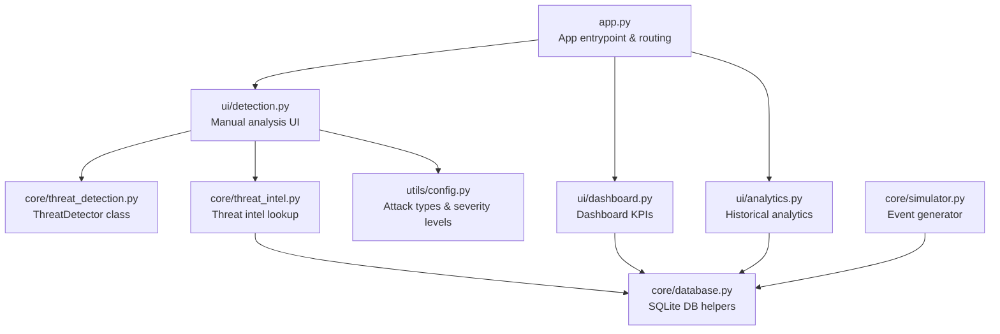
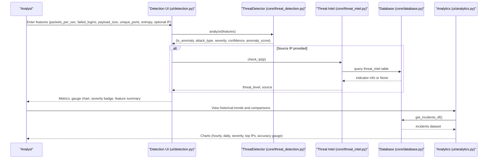
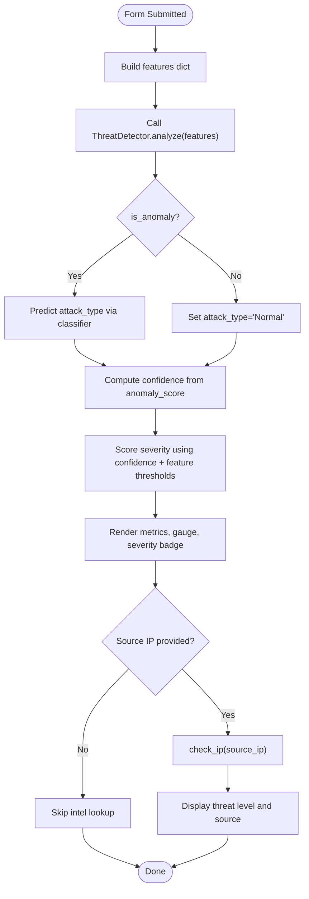
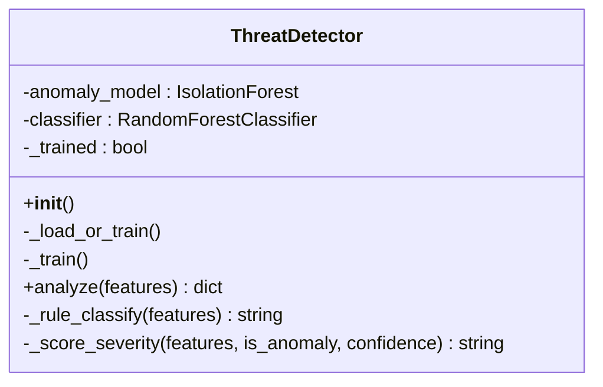
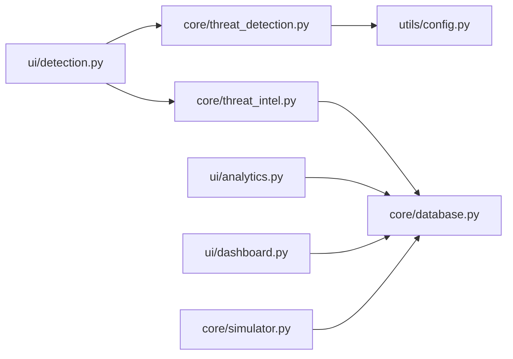

# Threat Detection Interface

<cite>
**Referenced Files in This Document**
- [app.py](file://app.py)
- [ui/detection.py](file://ui/detection.py)
- [core/threat_detection.py](file://core/threat_detection.py)
- [utils/config.py](file://utils/config.py)
- [core/threat_intel.py](file://core/threat_intel.py)
- [core/database.py](file://core/database.py)
- [ui/analytics.py](file://ui/analytics.py)
- [ui/dashboard.py](file://ui/dashboard.py)
- [core/simulator.py](file://core/simulator.py)
</cite>

## Table of Contents
1. [Introduction](#introduction)
2. [Project Structure](#project-structure)
3. [Core Components](#core-components)
4. [Architecture Overview](#architecture-overview)
5. [Detailed Component Analysis](#detailed-component-analysis)
6. [Dependency Analysis](#dependency-analysis)
7. [Performance Considerations](#performance-considerations)
8. [Troubleshooting Guide](#troubleshooting-guide)
9. [Conclusion](#conclusion)
10. [Appendices](#appendices)

## Introduction
This document explains the manual threat detection interface used to analyze network traffic patterns, interpret machine learning model inference results, visualize confidence and severity scores, and compare current detections against historical patterns. It covers how users input custom network parameters, view AI predictions, interpret severity levels, and leverage analytics for historical context. It also describes integration with core threat detection algorithms and provides guidance on feature engineering inputs and result interpretation.

## Project Structure
The platform is a Streamlit application with a clear separation between UI modules, core ML logic, configuration, and data access:
- App entrypoint and routing
- Manual threat detection UI
- Core threat detection engine (Isolation Forest + Random Forest classifier)
- Configuration constants (attack types, severity levels)
- Threat intelligence lookup
- Database schema and helpers
- Analytics and dashboard views
- Attack simulator for generating realistic events

**Diagram sources**
- [app.py:172-200](file://app.py#L172-L200)
- [ui/detection.py:15-96](file://ui/detection.py#L15-L96)
- [core/threat_detection.py:15-147](file://core/threat_detection.py#L15-L147)
- [core/threat_intel.py:1-31](file://core/threat_intel.py#L1-L31)
- [core/database.py:16-150](file://core/database.py#L16-L150)
- [utils/config.py:23-30](file://utils/config.py#L23-L30)
- [ui/dashboard.py:32-119](file://ui/dashboard.py#L32-L119)
- [ui/analytics.py:12-126](file://ui/analytics.py#L12-L126)
- [core/simulator.py:45-76](file://core/simulator.py#L45-L76)

**Section sources**
- [app.py:1-200](file://app.py#L1-L200)
- [ui/detection.py:1-96](file://ui/detection.py#L1-L96)
- [core/threat_detection.py:1-147](file://core/threat_detection.py#L1-L147)
- [utils/config.py:1-36](file://utils/config.py#L1-L36)
- [core/threat_intel.py:1-31](file://core/threat_intel.py#L1-L31)
- [core/database.py:1-262](file://core/database.py#L1-L262)
- [ui/analytics.py:1-126](file://ui/analytics.py#L1-L126)
- [ui/dashboard.py:1-119](file://ui/dashboard.py#L1-L119)
- [core/simulator.py:1-76](file://core/simulator.py#L1-L76)

## Core Components
- Manual Threat Detection UI: Provides an interactive form to enter traffic features and run AI analysis. Displays anomaly detection, attack type prediction, severity, confidence, and optional threat intelligence lookup.
- Threat Detector Engine: Implements Isolation Forest for anomaly scoring and a Random Forest classifier for attack type prediction. Computes severity based on confidence and feature thresholds.
- Threat Intelligence Lookup: Checks if source IPs or domains are known indicators of compromise.
- Analytics and Dashboard: Historical trend charts, severity distribution, top attacking IPs, and system resource monitoring.
- Database Layer: SQLite schema for incidents, blocked IPs, threat intel, audit logs, settings, and email recipients.

Key responsibilities:
- Input validation and feature vector construction
- Model inference and result formatting
- Severity calculation and confidence visualization
- Integration with threat intel and historical data

**Section sources**
- [ui/detection.py:15-96](file://ui/detection.py#L15-L96)
- [core/threat_detection.py:15-147](file://core/threat_detection.py#L15-L147)
- [core/threat_intel.py:1-31](file://core/threat_intel.py#L1-L31)
- [ui/analytics.py:12-126](file://ui/analytics.py#L12-L126)
- [ui/dashboard.py:32-119](file://ui/dashboard.py#L32-L119)
- [core/database.py:16-150](file://core/database.py#L16-L150)

## Architecture Overview
The manual threat detection flow integrates UI inputs with ML models and optional threat intel lookups, then renders results with visualizations. Historical analytics provide context for comparing current threats against past patterns.

**Diagram sources**
- [ui/detection.py:24-96](file://ui/detection.py#L24-L96)
- [core/threat_detection.py:92-147](file://core/threat_detection.py#L92-L147)
- [core/threat_intel.py:7-13](file://core/threat_intel.py#L7-L13)
- [core/database.py:214-221](file://core/database.py#L214-L221)
- [ui/analytics.py:16-126](file://ui/analytics.py#L16-L126)

## Detailed Component Analysis

### Manual Threat Detection Interface
The detection page presents a form where analysts can input custom network parameters:
- Packets per second
- Failed login attempts
- Payload size (bytes)
- Unique destination ports
- Payload entropy (0–8)
- Optional source IP for threat intel lookup

On submission:
- The UI constructs a feature dictionary and calls the detector’s analyze method.
- Results include anomaly flag, predicted attack type, severity level, confidence percentage, and anomaly score.
- A Plotly gauge visualizes confidence; severity is color-coded.
- If a source IP is provided, a threat intel lookup is performed and displayed.
- Feature summary is shown for transparency.

**Diagram sources**
- [ui/detection.py:24-96](file://ui/detection.py#L24-L96)
- [core/threat_detection.py:92-147](file://core/threat_detection.py#L92-L147)
- [core/threat_intel.py:7-13](file://core/threat_intel.py#L7-L13)

**Section sources**
- [ui/detection.py:15-96](file://ui/detection.py#L15-L96)

### Threat Detection Engine (ML Models and Scoring)
The ThreatDetector class encapsulates:
- Anomaly detection via Isolation Forest
- Classification via Random Forest trained on synthetic attack features
- Rule-based fallback classification when needed
- Severity scoring combining confidence and feature thresholds

Key behaviors:
- On first run, synthetic data is generated to train both models and persist them.
- analyze(features) returns structured results including anomaly flag, attack type, severity, confidence, and anomaly score.
- _score_severity adjusts severity based on confidence and specific feature thresholds (e.g., high failed logins, high packet rate, high entropy).

**Diagram sources**
- [core/threat_detection.py:15-147](file://core/threat_detection.py#L15-L147)

**Section sources**
- [core/threat_detection.py:15-147](file://core/threat_detection.py#L15-L147)

### Threat Intelligence Integration
Threat intel lookup checks whether a given IP or domain exists in the threat_intel database table. If found, it returns threat level and source metadata.

Usage in the detection UI:
- Optional field for source IP triggers a lookup after analysis.
- Results are displayed as warnings or informational messages depending on presence in the database.

**Section sources**
- [core/threat_intel.py:1-31](file://core/threat_intel.py#L1-L31)
- [ui/detection.py:85-92](file://ui/detection.py#L85-L92)

### Historical Analysis Tools
The analytics page provides multiple charts for understanding historical threat patterns:
- Hourly threat counts
- Daily threat trends
- Top attack types
- Severity distribution
- Heatmap by hour and day-of-week
- Top attacking IPs
- AI detection accuracy gauge
- Monthly report bar chart

These charts rely on incident data stored in the database and help analysts compare current detections against historical baselines.

**Section sources**
- [ui/analytics.py:12-126](file://ui/analytics.py#L12-L126)
- [core/database.py:214-221](file://core/database.py#L214-L221)

### Dashboard and KPIs
The dashboard displays key performance indicators such as total threats, critical count, today’s attacks, blocked IPs, active sessions, detection percentage, and AI confidence. It includes:
- Severity distribution pie chart
- System resource monitors (CPU, RAM, Disk)
- Recent threats table

This complements the manual detection interface by providing real-time operational visibility.

**Section sources**
- [ui/dashboard.py:32-119](file://ui/dashboard.py#L32-L119)

## Dependency Analysis
The manual threat detection interface depends on several components:
- UI module imports the ThreatDetector and threat intel functions.
- ThreatDetector uses scikit-learn models and configuration constants.
- Threat intel queries the SQLite database.
- Analytics and dashboard read incident data from the database.
- Simulator generates synthetic events that populate the database for demonstration.

**Diagram sources**
- [ui/detection.py:1-96](file://ui/detection.py#L1-L96)
- [core/threat_detection.py:1-147](file://core/threat_detection.py#L1-L147)
- [core/threat_intel.py:1-31](file://core/threat_intel.py#L1-L31)
- [core/database.py:1-262](file://core/database.py#L1-L262)
- [ui/analytics.py:1-126](file://ui/analytics.py#L1-L126)
- [ui/dashboard.py:1-119](file://ui/dashboard.py#L1-L119)
- [core/simulator.py:1-76](file://core/simulator.py#L1-L76)
- [utils/config.py:1-36](file://utils/config.py#L1-L36)

**Section sources**
- [app.py:172-200](file://app.py#L172-L200)
- [ui/detection.py:1-96](file://ui/detection.py#L1-L96)
- [core/threat_detection.py:1-147](file://core/threat_detection.py#L1-L147)
- [core/threat_intel.py:1-31](file://core/threat_intel.py#L1-L31)
- [core/database.py:1-262](file://core/database.py#L1-L262)
- [ui/analytics.py:1-126](file://ui/analytics.py#L1-L126)
- [ui/dashboard.py:1-119](file://ui/dashboard.py#L1-L119)
- [core/simulator.py:1-76](file://core/simulator.py#L1-L76)
- [utils/config.py:1-36](file://utils/config.py#L1-L36)

## Performance Considerations
- Model loading: ThreatDetector caches models via pickle files; ensure models exist to avoid retraining overhead on each run.
- UI rendering: Plotly gauges and charts are rendered client-side; keep datasets reasonable to avoid slow updates.
- Database queries: Use limits in incident queries to prevent large payloads.
- Resource usage: Monitor CPU/RAM/Disk via dashboard; adjust simulation speed and batch sizes accordingly.

[No sources needed since this section provides general guidance]

## Troubleshooting Guide
Common issues and resolutions:
- No results or errors during analysis:
  - Ensure models are present in data/models directory; otherwise, training will occur on first run.
  - Validate input ranges for features (e.g., entropy within 0–8).
- Threat intel not returning results:
  - Verify entries in the threat_intel table; use add_intel to seed new indicators.
- Historical charts empty:
  - Run the simulator to generate incidents; check database connectivity and permissions.
- Slow UI updates:
  - Reduce limit in incident queries; avoid excessive rows in dataframes.

**Section sources**
- [core/threat_detection.py:27-37](file://core/threat_detection.py#L27-L37)
- [core/threat_intel.py:25-31](file://core/threat_intel.py#L25-L31)
- [core/database.py:214-221](file://core/database.py#L214-L221)
- [core/simulator.py:45-76](file://core/simulator.py#L45-L76)

## Conclusion
The manual threat detection interface offers a comprehensive workflow for analyzing network traffic, interpreting ML predictions, visualizing confidence and severity, and contextualizing findings through historical analytics. By integrating threat intelligence and robust data access layers, analysts can quickly assess current threats and compare them against established patterns. Proper feature engineering and adherence to input guidelines ensure accurate and actionable results.

[No sources needed since this section summarizes without analyzing specific files]

## Appendices

### Feature Engineering Inputs
Recommended feature ranges and meanings:
- packets_per_sec: Typical normal range around low hundreds; spikes may indicate DDoS.
- failed_logins: Elevated values suggest brute force attempts.
- payload_size: Large payloads with high entropy may indicate ransomware or malware.
- unique_ports: High port diversity suggests scanning activity.
- entropy: Higher values indicate encrypted or obfuscated payloads.

Example inputs:
- Brute Force pattern: high failed_logins, low unique_ports, moderate payload_size.
- Port Scan pattern: high unique_ports, moderate packets_per_sec.
- Ransomware pattern: high payload_size and high entropy.
- DDoS pattern: very high packets_per_sec.

**Section sources**
- [core/threat_detection.py:74-89](file://core/threat_detection.py#L74-L89)
- [core/simulator.py:53-59](file://core/simulator.py#L53-L59)

### Result Interpretation Guidelines
- is_anomaly: Indicates whether traffic deviates from normal patterns.
- attack_type: Predicted category; “Normal” if no anomaly detected.
- severity: Derived from confidence and feature thresholds; categories include Low, Medium, High, Critical.
- confidence: Probability-like score reflecting model certainty; visualized via gauge.
- anomaly_score: Raw decision function output from Isolation Forest; lower values imply higher anomaly likelihood.

Interpretation tips:
- High confidence with high severity warrants immediate investigation.
- Low confidence but high severity may require additional verification.
- Normal classification with high anomaly_score should be reviewed for potential false negatives.

**Section sources**
- [core/threat_detection.py:92-147](file://core/threat_detection.py#L92-L147)
- [ui/detection.py:48-83](file://ui/detection.py#L48-L83)

### Integration with Core Algorithms
- ThreatDetector.analyze orchestrates anomaly detection and classification.
- Severity scoring combines confidence and feature thresholds.
- Threat intel lookup augments results with external indicators.
- Analytics and dashboard retrieve historical incidents for comparison and reporting.

**Section sources**
- [core/threat_detection.py:92-147](file://core/threat_detection.py#L92-L147)
- [core/threat_intel.py:7-13](file://core/threat_intel.py#L7-L13)
- [ui/analytics.py:16-126](file://ui/analytics.py#L16-L126)
- [ui/dashboard.py:32-119](file://ui/dashboard.py#L32-L119)