# User Interface Components

<cite>
**Referenced Files in This Document**
- [app.py](file://app.py)
- [dashboard.py](file://ui/dashboard.py)
- [monitoring.py](file://ui/monitoring.py)
- [detection.py](file://ui/detection.py)
- [analytics.py](file://ui/analytics.py)
- [incidents.py](file://ui/incidents.py)
- [reports.py](file://ui/reports.py)
- [chatbot.py](file://ui/chatbot.py)
- [settings.py](file://ui/settings.py)
- [admin.py](file://ui/admin.py)
- [login.py](file://ui/login.py)
- [authentication.py](file://auth/authentication.py)
- [database.py](file://core/database.py)
- [threat_detection.py](file://core/threat_detection.py)
- [config.py](file://utils/config.py)
</cite>

## Table of Contents
1. [Introduction](#introduction)
2. [Project Structure](#project-structure)
3. [Core Components](#core-components)
4. [Architecture Overview](#architecture-overview)
5. [Detailed Component Analysis](#detailed-component-analysis)
6. [Dependency Analysis](#dependency-analysis)
7. [Performance Considerations](#performance-considerations)
8. [Troubleshooting Guide](#troubleshooting-guide)
9. [Conclusion](#conclusion)

## Introduction
This document provides comprehensive documentation for all Streamlit-based user interface components of the Autonomous AI Cyber Defense Platform. It covers the dashboard with KPI cards and system metrics, live monitoring with real-time event streaming, threat detection for manual analysis, analytics with statistical visualizations, incident center for case management, PDF report generation, an AI assistant chatbot, settings management, administrative controls, and the authentication system. For each component, we describe behavior, user interactions, customization options, responsive design considerations, and examples of component composition and styling approaches used throughout the application.

## Project Structure
The application is a Streamlit app with a single entry point that configures global theme and navigation, then routes to feature-specific modules under ui/. Core business logic (database, threat detection, email/alarm services, simulator) resides under core/, while utilities and configuration are under utils/. The login flow is gated at startup, ensuring only authenticated users access the main UI.

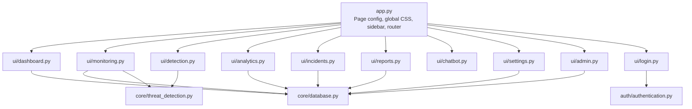

**Diagram sources**
- [app.py:8-13](file://app.py#L8-L13)
- [app.py:148-199](file://app.py#L148-L199)
- [dashboard.py:32-119](file://ui/dashboard.py#L32-L119)
- [monitoring.py:20-133](file://ui/monitoring.py#L20-L133)
- [detection.py:15-96](file://ui/detection.py#L15-L96)
- [analytics.py:12-126](file://ui/analytics.py#L12-L126)
- [incidents.py:15-118](file://ui/incidents.py#L15-L118)
- [reports.py:17-133](file://ui/reports.py#L17-L133)
- [chatbot.py:118-179](file://ui/chatbot.py#L118-L179)
- [settings.py:10-99](file://ui/settings.py#L10-L99)
- [admin.py:12-109](file://ui/admin.py#L12-L109)
- [login.py:11-102](file://ui/login.py#L11-L102)
- [authentication.py:33-44](file://auth/authentication.py#L33-L44)
- [database.py:16-136](file://core/database.py#L16-L136)
- [threat_detection.py:15-147](file://core/threat_detection.py#L15-L147)

**Section sources**
- [app.py:8-13](file://app.py#L8-L13)
- [app.py:148-199](file://app.py#L148-L199)
- [config.py:1-36](file://utils/config.py#L1-L36)

## Core Components
- Global Theme and Layout: The app sets a wide layout, dark cyber theme via custom CSS, and consistent typography/colors across pages. Sidebar navigation uses radio buttons to route to pages.
- Authentication Gate: If not authenticated, the login page is shown; otherwise, the main sidebar and page router are rendered.
- Session State: Centralized session state tracks authentication, current user, active sessions, and per-page data like live events and chat history.

Key behaviors:
- Page routing based on selected sidebar item.
- Consistent styling using inline CSS and Streamlit components.
- Lazy imports for each page module to reduce startup overhead.

**Section sources**
- [app.py:8-13](file://app.py#L8-L13)
- [app.py:16-99](file://app.py#L16-L99)
- [app.py:109-120](file://app.py#L109-L120)
- [app.py:126-199](file://app.py#L126-L199)

## Architecture Overview
The UI layer composes Streamlit components and delegates to core modules for data and processing. Data flows from the database and simulation into UI tables and charts. Real-time monitoring uses session state to accumulate recent events and triggers alarms or emails based on settings.

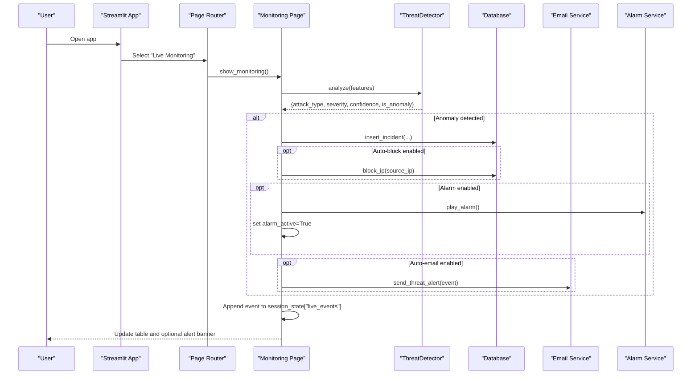

**Diagram sources**
- [monitoring.py:20-133](file://ui/monitoring.py#L20-L133)
- [threat_detection.py:92-147](file://core/threat_detection.py#L92-L147)
- [database.py:167-197](file://core/database.py#L167-L197)

## Detailed Component Analysis

### Dashboard
Behavior:
- Displays KPI cards (total threats, critical count, today’s attacks, blocked IPs, active sessions, detection %, AI confidence).
- Shows severity distribution pie chart and system resource gauges (CPU, RAM, Disk).
- Presents recent threats as a DataFrame.

User interaction:
- No direct inputs; refreshes on rerun to reflect latest data.

Customization:
- KPI card styling via HTML/CSS; color accents per metric.
- Chart colors and layout configured via Plotly.

Responsive design:
- Uses st.columns(7) for KPIs and two-column layout for charts/resources.

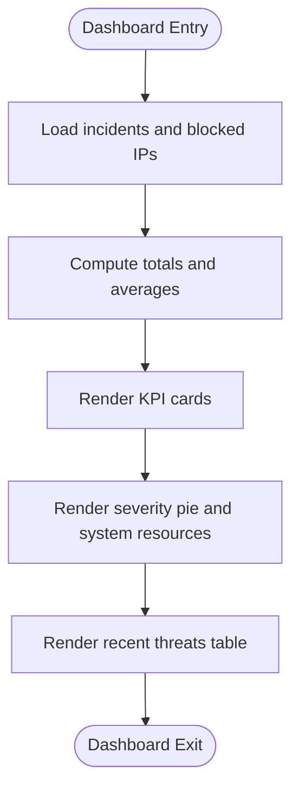

**Diagram sources**
- [dashboard.py:32-119](file://ui/dashboard.py#L32-L119)

**Section sources**
- [dashboard.py:32-119](file://ui/dashboard.py#L32-L119)

### Live Monitoring
Behavior:
- Toggles auto-simulation and adjusts events per cycle.
- Generates events, analyzes them with ThreatDetector, persists anomalies, optionally blocks IPs, plays alarms, sends emails, and logs audits.
- Maintains a rolling list of last 500 events in session state and displays them in a table.

User interaction:
- Toggle auto-run, slider for speed, button to generate a single event, acknowledge/mute alarm banner.

Customization:
- Settings-driven behavior (auto_block, alarm_enabled, auto_email).
- Alert banner styled with CSS animation.

Responsive design:
- Three-column control bar; full-width table; conditional alert banner.

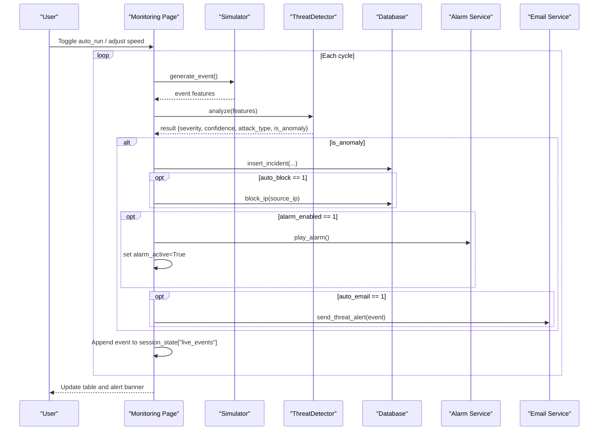

**Diagram sources**
- [monitoring.py:20-133](file://ui/monitoring.py#L20-L133)
- [threat_detection.py:92-147](file://core/threat_detection.py#L92-L147)
- [database.py:167-197](file://core/database.py#L167-L197)

**Section sources**
- [monitoring.py:20-133](file://ui/monitoring.py#L20-L133)

### Threat Detection (Manual Analysis)
Behavior:
- Accepts network traffic features via form fields.
- Runs AI analysis using ThreatDetector and shows anomaly status, attack type, severity, confidence, and a gauge visualization.
- Optionally checks source IP against threat intelligence and displays warnings/info accordingly.

User interaction:
- Fill numeric inputs and entropy slider, submit to analyze, optionally enter source IP for intel lookup.

Customization:
- Severity badge colors mapped dynamically.
- Gauge chart uses severity-based coloring.

Responsive design:
- Two-column input layout; four-column results summary; full-width gauge.

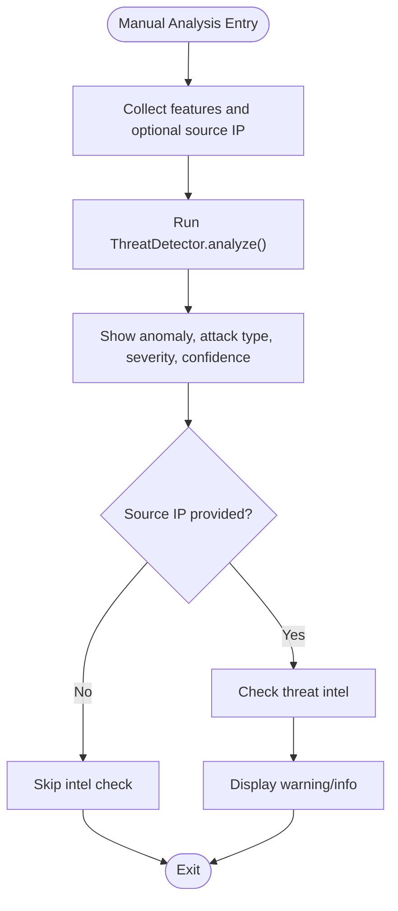

**Diagram sources**
- [detection.py:15-96](file://ui/detection.py#L15-L96)
- [threat_detection.py:92-147](file://core/threat_detection.py#L92-L147)

**Section sources**
- [detection.py:15-96](file://ui/detection.py#L15-L96)

### Analytics
Behavior:
- Loads incidents and computes time-based aggregations (hourly, daily, monthly).
- Visualizes top attack types, severity distribution, heatmap by hour and day-of-week, top attacking IPs, AI detection accuracy gauge, and monthly trends.

User interaction:
- Read-only view; no inputs.

Customization:
- Dark theme applied consistently to all charts.
- Color scales and markers configured per chart.

Responsive design:
- Two-column grid for charts; full-width usage within columns.

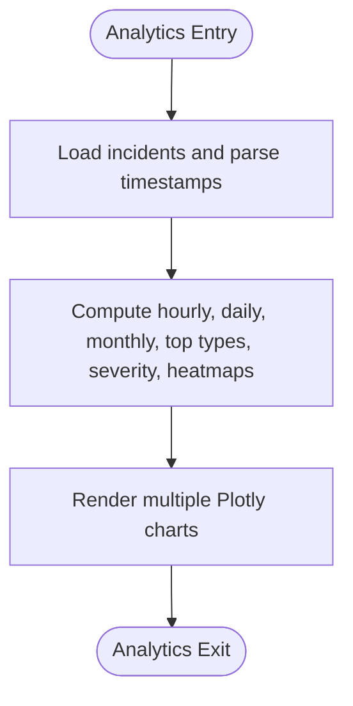

**Diagram sources**
- [analytics.py:12-126](file://ui/analytics.py#L12-L126)

**Section sources**
- [analytics.py:12-126](file://ui/analytics.py#L12-L126)

### Incident Center
Behavior:
- Displays stats (total, critical, high, open, resolved).
- Search and filter by query, severity, and status; shows matching incidents in a table.
- Actions include exporting CSV, generating PDF, marking incidents as resolved or investigating.

User interaction:
- Text search, dropdown filters, action buttons, and text inputs for incident IDs.

Customization:
- PDF generated with ReportLab including styled tables and header info.

Responsive design:
- Five-column stats row; three-column filter row; four-column actions row.

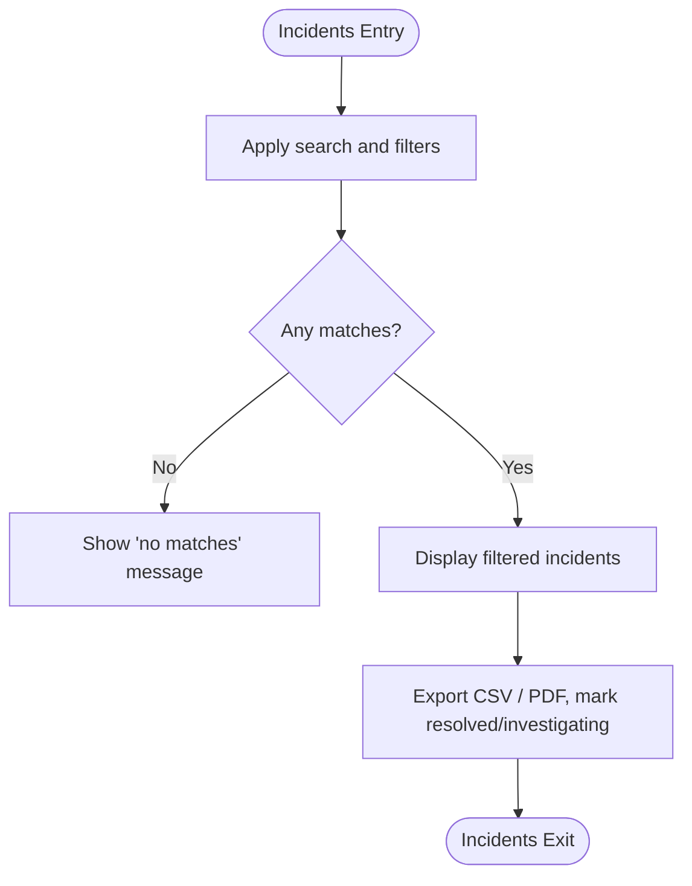

**Diagram sources**
- [incidents.py:15-118](file://ui/incidents.py#L15-L118)

**Section sources**
- [incidents.py:15-118](file://ui/incidents.py#L15-L118)

### Reports
Behavior:
- Summarizes total incidents, critical/high counts, average confidence, and top attack types.
- Provides recommendations and builds a downloadable PDF report with sections for summary, attack breakdown, recent incidents, and recommendations.

User interaction:
- Read-only preview; download PDF button.

Customization:
- PDF styling with dark-themed tables and structured sections.

Responsive design:
- Four-column metrics row; full-width charts and lists.

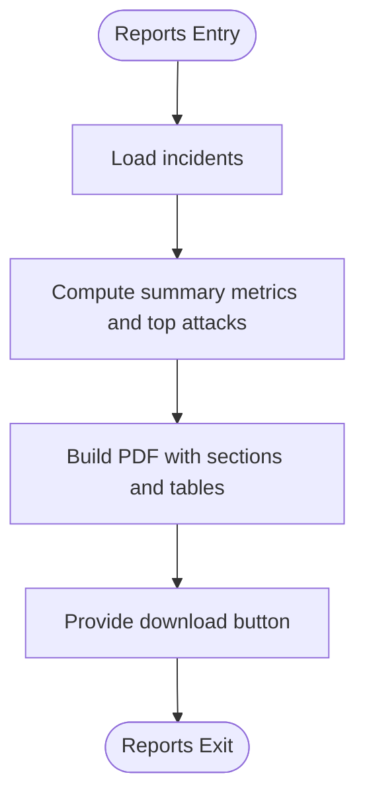

**Diagram sources**
- [reports.py:17-133](file://ui/reports.py#L17-L133)

**Section sources**
- [reports.py:17-133](file://ui/reports.py#L17-L133)

### AI Assistant Chatbot
Behavior:
- Maintains chat history in session state.
- Processes user questions by keyword matching against a knowledge base; returns tailored cybersecurity guidance.
- Offers suggestion buttons to prompt common queries.

User interaction:
- Type a question or click suggestion buttons; conversation updates in place.

Customization:
- Knowledge base is a dictionary mapping topics to detailed answers.

Responsive design:
- Suggestions displayed in a three-column grid; chat messages use Streamlit chat bubbles.

```mermaid
sequenceDiagram
participant U as "User"
participant CB as "Chatbot Page"
KB as "Knowledge Base"
U->>CB : Enter question or click suggestion
CB->>KB : Match keywords in question
KB-->>CB : Return answer text
CB->>CB : Append user and assistant messages to history
CB-->>U : Render updated chat history
```

**Diagram sources**
- [chatbot.py:118-179](file://ui/chatbot.py#L118-L179)

**Section sources**
- [chatbot.py:118-179](file://ui/chatbot.py#L118-L179)

### Settings Management
Behavior:
- Configurable tabs for Email, Alarm, Simulation, and Threat Intelligence.
- Saves SMTP settings, toggles for auto-email and alarms, simulation speed, and manages recipients and threat indicators.

User interaction:
- Forms to save settings; buttons to add/remove recipients; table to view indicators; form to add new indicators.

Customization:
- All settings persisted via database key-value pairs.

Responsive design:
- Tabbed interface; forms organized in columns; tables with fixed heights.

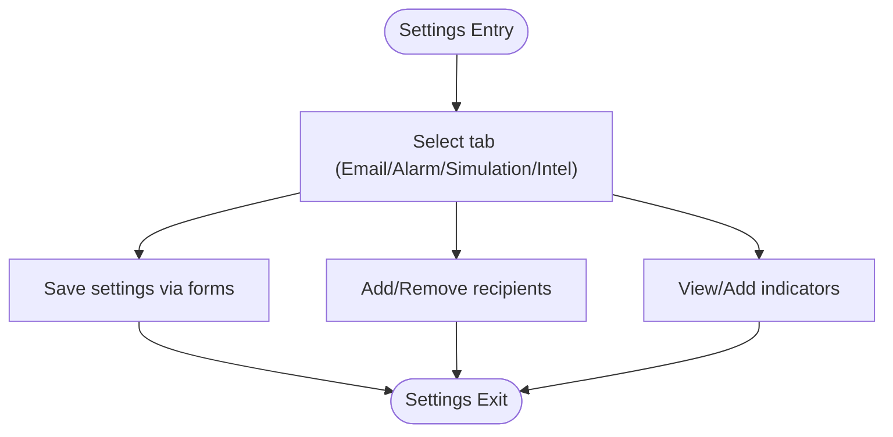

**Diagram sources**
- [settings.py:10-99](file://ui/settings.py#L10-L99)
- [database.py:151-164](file://core/database.py#L151-L164)

**Section sources**
- [settings.py:10-99](file://ui/settings.py#L10-L99)

### Administrative Controls
Behavior:
- Restricted to admin role; manages users (add, deactivate, reset password), blocked IPs (block/unblock), and audit logs (view/download).

User interaction:
- Forms for adding users and blocking IPs; dropdowns for selecting users/IPs; buttons for actions; download audit log CSV.

Customization:
- Audit logging captures admin actions.

Responsive design:
- Tabbed interface; columnar layouts for forms; full-width tables.

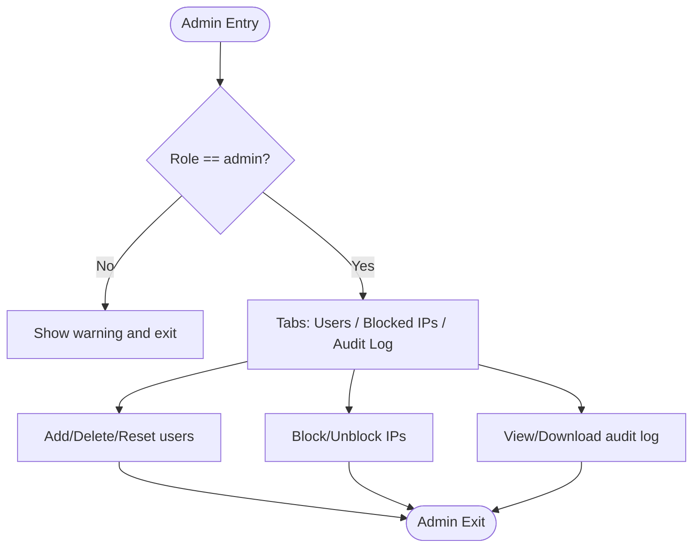

**Diagram sources**
- [admin.py:12-109](file://ui/admin.py#L12-L109)

**Section sources**
- [admin.py:12-109](file://ui/admin.py#L12-L109)

### Authentication System
Behavior:
- Login, Register, and Forgot Password tabs.
- Authenticates users against hashed passwords stored in the database; sets session state upon success.
- Seeds default admin if none exists.

User interaction:
- Enter credentials, register new accounts, reset passwords; remember me option stores username in session.

Customization:
- Custom CSS container for login page; error/success messages.

Responsive design:
- Single centered container; tabbed interface for login/register/forgot.

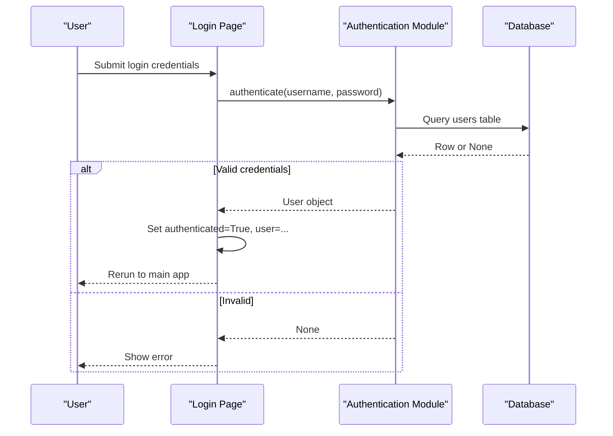

**Diagram sources**
- [login.py:11-102](file://ui/login.py#L11-L102)
- [authentication.py:33-44](file://auth/authentication.py#L33-L44)
- [database.py:16-31](file://core/database.py#L16-L31)

**Section sources**
- [login.py:11-102](file://ui/login.py#L11-L102)
- [authentication.py:33-44](file://auth/authentication.py#L33-L44)

## Dependency Analysis
UI components depend on core modules for data and processing:
- Database module provides schema initialization, CRUD operations, and settings retrieval.
- Threat detector encapsulates ML models and classification logic.
- Email and alarm services integrate external notifications and audio alerts.
- Configuration defines constants and paths.

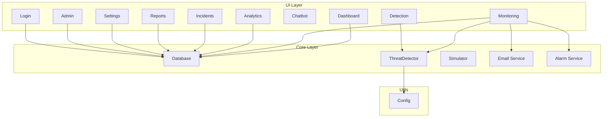

**Diagram sources**
- [app.py:148-199](file://app.py#L148-L199)
- [database.py:16-136](file://core/database.py#L16-L136)
- [threat_detection.py:15-147](file://core/threat_detection.py#L15-L147)
- [config.py:1-36](file://utils/config.py#L1-L36)

**Section sources**
- [database.py:16-136](file://core/database.py#L16-L136)
- [threat_detection.py:15-147](file://core/threat_detection.py#L15-L147)
- [config.py:1-36](file://utils/config.py#L1-L36)

## Performance Considerations
- Caching: Use @st.cache_resource for expensive objects like ThreatDetector to avoid reinitialization across reruns.
- Event buffering: Limit live events to last 500 entries to prevent memory growth.
- Efficient queries: Fetch limited rows where possible (e.g., get_incidents_df(limit)).
- Avoid heavy computations on every render; rely on session state and cached resources.
- Streaming updates: Use st.rerun sparingly; batch updates where feasible.

[No sources needed since this section provides general guidance]

## Troubleshooting Guide
Common issues and resolutions:
- No data in dashboards/analytics: Ensure simulator generates events and incidents are inserted into the database.
- Alarms not playing: Verify alarm_enabled setting and OS audio permissions.
- Emails not sent: Check SMTP settings and recipient list; ensure auto_email is enabled.
- Admin panel inaccessible: Confirm user role is admin; check session state.
- Login failures: Validate credentials and ensure user is active; check bcrypt hashing and database integrity.

**Section sources**
- [monitoring.py:117-125](file://ui/monitoring.py#L117-L125)
- [settings.py:57-77](file://ui/settings.py#L57-L77)
- [admin.py:12-16](file://ui/admin.py#L12-L16)
- [authentication.py:33-44](file://auth/authentication.py#L33-L44)

## Conclusion
The Streamlit-based UI delivers a cohesive, dark-themed cybersecurity dashboard with robust features: real-time monitoring, AI-powered threat analysis, comprehensive analytics, incident management, PDF reporting, an AI assistant, configurable settings, and secure administration. The modular architecture separates UI concerns from core logic, enabling maintainability and scalability. Styling and responsiveness are achieved through consistent CSS and Streamlit layout primitives, ensuring usability across devices.

[No sources needed since this section summarizes without analyzing specific files]